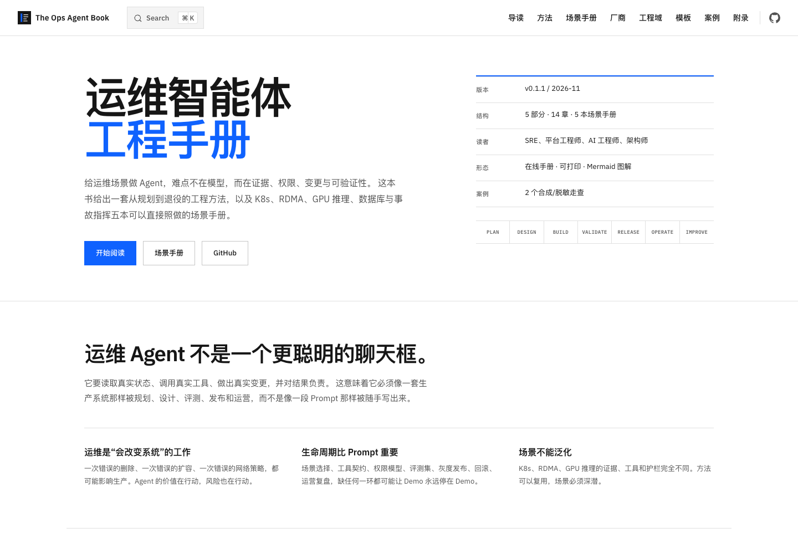

# The Ops Agent Book

> 面向运维场景的智能体工程手册。规划、设计、建设、维护、优化、迭代。

运维 Agent 的难点不在模型，而在证据、权限、变更与可验证性。这本书给出一套从想法到退役的工程方法，K8s、RDMA、GPU 推理、数据库与事故指挥五本可落地的场景手册，覆盖全球与中国主要厂商的运维 Agent 产品地图，以及 2026 工程域：AgentOps、身份与安全、成本/ROI、2027+ 路线图。站点采用 IBM 白底蓝企业风格，全书 23 张概念图使用统一的 Mermaid 图表系统。

当前版本：**v0.1.1**（2026-11）。适合 SRE、平台工程师、AI 工程师、运维产品经理与架构师。



在线阅读：**https://ai-guru-global.github.io/the-ops-agent-book/**

## 这本书回答什么

- 什么样的运维场景值得做 Agent，什么样的场景应该继续用脚本和告警？
- 一个运维 Agent 从规划、设计、建设、评测、发布到运营，需要哪些门禁与交付物？
- 工具怎么设计，权限怎么收，审批怎么做得不让人疲惫？
- K8s、RDMA、GPU 推理这些高价值场景，各自的证据源、工具、护栏、评测集是什么？
- Agent 上线之后怎么观测、怎么回滚、怎么持续迭代，怎么避免“Demo 很聪明，生产不敢用”？

## 目录

### 第一部分 · 方法与生命周期

1. [为什么运维 Agent 不一样](docs/guide/01-why-ops-agents.md)
2. [全生命周期：从想法到退役](docs/guide/02-lifecycle.md)
3. [场景选择与可行性](docs/guide/03-scenario-selection.md)
4. [架构与运行模式](docs/guide/04-architecture.md)
5. [工具、权限与安全护栏](docs/guide/05-tools-permissions.md)
6. [上下文与知识工程](docs/guide/06-context-knowledge.md)
7. [评测、验收与发布](docs/guide/07-evaluation-release.md)
8. [运营、观测与持续改进](docs/guide/08-operate-improve.md)
9. [组织、流程与治理](docs/guide/09-organization-governance.md)
10. [Build vs Buy 与平台选型](docs/guide/10-build-vs-buy.md)

### 第二部分 · 场景手册

- [场景手册导读](docs/playbooks/index.md)
- [K8s 集群运维 Agent](docs/playbooks/k8s.md)
- [RDMA 高网运维 Agent](docs/playbooks/rdma.md)
- [GPU 推理运维 Agent](docs/playbooks/gpu-inference.md)
- [数据库运维 Agent](docs/playbooks/database.md)
- [事故指挥 Agent](docs/playbooks/incident-commander.md)

### 第三部分 · 厂商与产品全景

- [厂商地图导读](docs/vendors/index.md)
- [全球云厂商](docs/vendors/global-cloud.md) — AWS、Microsoft、Google、IBM、Oracle、SAP、ServiceNow、Salesforce
- [中国云厂商](docs/vendors/china-cloud.md) — 阿里云、华为云、腾讯云、百度智能云、火山引擎、京东云、移动云、浪潮云与国产 AIOps
- [可观测与 AIOps](docs/vendors/observability-aiops.md) — Datadog、Dynatrace、New Relic、Splunk、PagerDuty、Grafana、BMC、ManageEngine
- [安全、网络与 FinOps](docs/vendors/security-network-finops.md) — Security Copilot、Palo Alto、CrowdStrike、Cisco、Juniper、Arista、Cloudability
- [内嵌 Agent 助手](docs/vendors/embedded-assistants.md) — M365 Copilot、Azure Copilot、Gemini Cloud Assist、Now Assist、Agentforce、Joule
- [垂直行业运维 Agent](docs/vendors/vertical-ops.md) — 电信 NOC、金融、制造/OT、能源、零售、物流、医疗、政务
- [厂商评估方法](docs/vendors/methodology.md) — 分层、证据分级、POC、TCO 与选型模板

### 第四部分 · 2026 工程域

11. [AgentOps 与可观测性](docs/guide/11-agentops-observability.md)
12. [身份、权限与安全](docs/guide/12-identity-security.md)
13. [成本、ROI 与组合管理](docs/guide/13-cost-roi-portfolio.md)
14. [2027+：自进化、A2A 与自治运维](docs/guide/14-future-roadmap.md)

### 第五部分 · 模板与工具箱

- [Agent 设计文档](docs/templates/agent-design-doc.md)
- [工具契约](docs/templates/tool-contract.md)
- [评测集](docs/templates/eval-set.md)
- [权限矩阵](docs/templates/permission-matrix.md)
- [Runbook → Tool 映射](docs/templates/runbook-tool-map.md)
- [发布与回滚清单](docs/templates/release-checklist.md)
- [事故复盘](docs/templates/incident-review.md)

### 附录

- [端到端案例：K8s 节点 NotReady](docs/appendix/case-notready.md)
- [失败复盘：一个没有上线的 Agent](docs/appendix/case-failed-agent.md)
- [阿里 Agent 产品全景](docs/appendix/alibaba-agent-landscape.md)
- [指标与 SLO 库](docs/appendix/metrics.md)
- [术语表](docs/appendix/glossary.md)
- [参考资料](docs/appendix/references.md)

## 本地运行

需要 Node.js 20+。

```bash
npm install
npm run docs:dev      # 本地写作预览
npm run docs:build    # 生产构建
npm run docs:preview  # 预览构建产物
```

站点使用 VitePress。内容在 `docs/`，主题在 `docs/.vitepress/theme/`。视觉系统为 IBM 白底蓝企业风格，强制浅色主题；Mermaid 图使用 `docs/.vitepress/config.mts` 中的 IBM 主题变量，并在正文中用 `::: diagram 图 XX · 标题 | 图注` 包裹。完整视觉规范见 [DESIGN.md](DESIGN.md)，产品背景见 [PRODUCT.md](PRODUCT.md)。

## 写作约定

- 中文为主，术语首次出现时给出英文与缩写。
- 每个场景手册使用同一结构：范围与非目标、证据源、工具清单、典型任务流、权限与护栏、评测集、SLO 与失败模式、检查清单。
- 能写成表格的不要写成大段散文；能写成检查清单的不要只给原则。
- 不写“某模型一定更强”“某产品一定更好”这类不可核验的判断；涉及产品能力时给出官方来源。
- 书名、章节标题、术语保持一致：Agent、工具契约、护栏、评测集、证据包、Runbook、HITL。

## 与 agent-landing 的关系

[`agent-landing`](https://github.com/ai-guru-global/agent-landing) 是官方 Agent 服务目录的检索与选型工具，当前快照为 36 个官方 Agent 与 328 个 Skills。

阿里实际的 Agent 版图远不止这 36 个产品：还包括 AgentRun（Agent Runtime）、AgentScope、Agent Sandbox/AgentBay、Qoder Cloud Agents、百炼 Agent 平台、AgentLoop、Agentic OS 等运行、开发与治理产品。书的“厂商与产品全景”部分把这层全景扩展到全球与中国主要厂商，并区分独立运维 Agent、内嵌助手、运行时、平台与 AIOps 能力，避免把不同层级的产品放在同一张表里比较。

## 部署

仓库包含 `.github/workflows/deploy.yml`，默认手动触发，不会在 push 时自动发布：

1. 在 GitHub 仓库 **Settings → Pages → Build and deployment** 中选择 **GitHub Actions**。
2. 在 **Actions → Deploy book to GitHub Pages → Run workflow** 手动运行。
3. 发布地址：`https://ai-guru-global.github.io/the-ops-agent-book/`。

构建时 workflow 会设置 `GITHUB_PAGES=true`，VitePress 的 `base` 自动切换为 `/the-ops-agent-book/`。如果希望 push 自动发布，取消 workflow 中 `push` 触发的注释。

## 贡献

欢迎提交 Issue / PR：

- 发现事实错误、过时产品信息或失效链接。
- 补充真实场景的任务流、评测案例与失败模式。
- 提供脱敏后的 Runbook、工具契约或复盘案例。

请勿提交真实密钥、客户信息、未脱敏的生产日志或内部拓扑。

## 版本记录

| 版本 | 日期 | 主要变化 |
| --- | --- | --- |
| v0.1.1 | 2026-11-12 | 统一五本场景手册口径；补齐 K8s NotReady 贯穿案例；新增端到端案例与失败复盘；补齐厂商来源与核实日期；IBM 白底蓝主题重构；23 张 Mermaid 图解；新增内链检查 |
| v0.1 | 2026-11-11 | 初版：方法、5 本场景手册、厂商地图、2026 工程域、模板与附录 |

## License

- 书籍正文、图表与图片：**CC BY 4.0**。
- 代码片段、配置示例与构建脚本：**MIT**。

详见 [LICENSE](LICENSE)。
