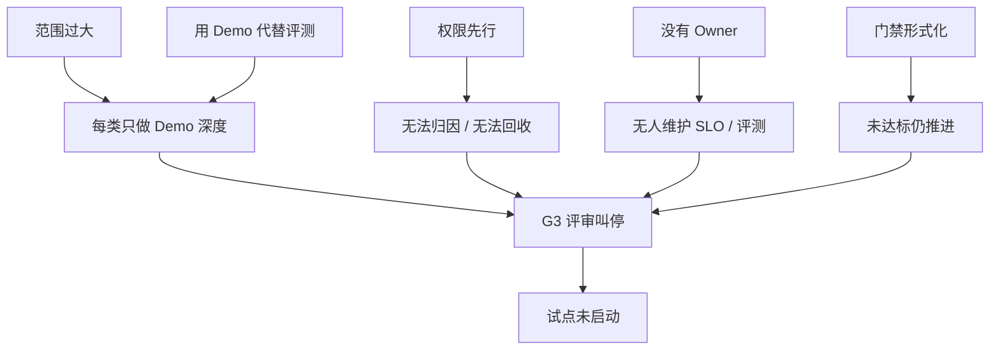

# 附录：失败复盘：一个没有上线的运维 Agent

> 这是一个**合成复盘**：团队、系统与数据均为虚构，由多个真实项目中反复出现的失败模式组合而成。它不指责任何个人，只讨论系统、流程与工程判断。

## 1. 背景

某平台团队有 3 名 SRE、2 名 AI 工程师和 1 名产品经理，决定做一个“K8s 智能运维 Agent”。目标很直接：

- 覆盖 CrashLoopBackOff、Node NotReady、Pending、发布失败、网络异常。
- 把告警平均处理时间降低 30%。
- 先在一个生产集群试点，再推广到 4 个集群。

项目做了 10 周，内部 Demo 很成功，但在 G3 评测门禁评审时被叫停，试点没有启动。半年后，Agent 仍停留在内部演示环境。

## 2. 时间线

| 周 | 发生了什么 | 留下的问题 |
| --- | --- | --- |
| 第 1–2 周 | 场景定为“K8s 全场景诊断”，包含诊断、建议和自动修复 | 范围过大，没有 non-goals |
| 第 3–4 周 | 为了快速打通工具，使用共享 `cluster-admin` 服务账号 | 权限、审计、归因全部缺失 |
| 第 5–6 周 | 用 8 个精选案例做 Demo，效果“看起来很好” | 把 Demo 当成了评测 |
| 第 7 周 | 安全评审发现越权、无审批、凭证落盘 | 临时改成只读令牌，但写工具仍共享 |
| 第 8 周 | 评测集只有 12 条，全部来自精选案例 | 没有边界、对抗、未知、安全案例 |
| 第 9 周 | 项目 champion 离职，没有指定新 Owner | SLO、预算、值班无人负责 |
| 第 10 周 | G3 评审：没有基线、没有回滚、没有成本口径 | 试点暂停，项目没有恢复 |

## 3. 评审时暴露的五个问题

### 3.1 范围太大

第一版同时做诊断、建议和自动修复，横跨 5 类故障。结果每类只做了“能演示”的深度，没有一个场景达到“可上线”的深度。

**如果重来：** 只做 `CrashLoopBackOff` 只读诊断，限定一个 namespace、一个集群，先证明证据、评测和运营闭环。

### 3.2 用 Demo 代替评测

8 个 Demo 案例由团队自己挑选，输入干净、证据齐全、答案明显。没有覆盖：

- 多因素叠加、证据缺失、环境不符。
- 日志/工单中的恶意指令。
- 越权请求、高危动作、敏感数据。
- “不知道”与升级。

评审时，团队无法回答“在 100 个真实告警上，Top-3 命中率是多少”。Demo 通过不等于评测通过。

### 3.3 权限先行

为了“先跑起来”，Agent 用了共享高权限账号。后来虽然改成只读，但：

- 工具调用无法归因到具体 Agent/场景。
- 写工具仍共用凭证，无法按工具、范围、时间收紧。
- 审计日志不完整，评审无法还原“谁批准了什么”。
- 退役时无法干净回收权限。

**如果重来：** 从第一天就用独立 NHI、短时凭证、按工具授权；没有权限矩阵就不注册写工具。

### 3.4 没有 Owner

项目由 champion 推动，但没有明确 Agent Owner。champion 离职后：

- SLO 没人定，评测没人跑，失败案例没人复盘。
- 值班同学不知道如何接管、降级、回滚。
- 预算与成本无人负责。

**如果重来：** 在 Plan 阶段就写进 Charter：谁对结果负责、谁值班、谁维护评测集、谁批准权限升级。

### 3.5 门禁形式化

项目有 G0–G5 的表格，但评审变成了“打勾”：

- G1 设计门禁没有检查工具契约与回滚。
- G2 建设门禁没有验证 Trace 与 kill switch。
- G3 评测门禁没有基线、没有黄金集、没有安全案例。
- G4 发布门禁没有灰度与回滚演练。

门禁存在，但没有“未达标不发布”的硬规则，也没有人有权说“不”。

## 4. 正式 G3 否决与整改闭环

> **synthetic / 脱敏声明**：本节的人物、团队、artifact ID、日期、签署、指标与 `evidence://` 地址均为构造示例，不含真实生产数据，也不是真实签名。原始失败事实止于第 10 周；下文用于展示“如果当时执行门禁，应如何关闭否决并重新准入”。真实环境必须使用可解析的审计 URI 与合格人员签署。

### 4.1 G3 否决记录

| 字段 | 正式记录 |
| --- | --- |
| 否决 artifact ID | `G3-K8S-DIAG-2026-001`，记录版本 `v1.0.0` |
| 候选制品 | `ADD-K8S-DIAG-2026-001 v0.9.0`、`agent-k8s-diag-v0.9.0`、`EVAL-K8S-DIAG-2026-001 v0.1.0`、`PMX-K8S-DIAG-2026-001 v0.1.0` |
| 评审日期 | 2026-11-24T09:30:00Z |
| 门禁 / 结论 | G3 / **No-Go**；无 Accepted Exception |
| 签署角色 | Agent Owner、评测 Owner、安全/合规、变更经理、K8s 领域 Owner |
| 整改总 Owner | `platform-ops-agent`（synthetic）；备份 `sre-platform-quality` |
| 证据归档 | `evidence://G3-K8S-DIAG-2026-001/v1.0.0/`（synthetic 不可变归档示例） |
| 立即效力 | 不创建生产 `REL`；回收共享写凭证；候选冻结；内部 Demo 降为只读 |

| 否决 ID | 理由 | 证据链接 / 归档对象 | 拥有否决权的角色 |
| --- | --- | --- | --- |
| V-01 范围与责任 | 5 类故障同时覆盖诊断/建议/修复，无 non-goals；champion 离职后无 Owner、SLO 与值班责任 | [设计文档模板](../templates/agent-design-doc)第 1、9–10 节；归档 `scope-and-owner-review` | Agent Owner + 领域 Owner |
| V-02 评测无效 | 只有 12 条团队精选正常案例；无基线、黄金/校准/留出划分、对抗/安全/未知案例与 Judge 校准 | [评测集模板](../templates/eval-set)、[manifest](../../evals/manifest.yaml)、[starter cases](../../examples/templates/eval-cases.yaml)；归档 `eval-coverage-review` | 评测 Owner |
| V-03 权限与审计 | 共享 `cluster-admin`；写工具 `approval: none`；无独立 NHI、计划哈希绑定、负向测试与权限回收 | [权限矩阵](../templates/permission-matrix)、[Policy Schema](../../schemas/permission-policy.schema.json)；归档 `permission-negative-tests` | 安全/合规 |
| V-04 不可观测/不可停止 | Trace 只有 Prompt/Completion；无工具参数、审批、结果、成本与哈希链；未证明 kill switch | [Agent Event Schema](../../schemas/agent-event.schema.json)、[11 AgentOps](../guide/11-agentops-observability)；归档 `trace-completeness-review` | 平台 + 安全 |
| V-05 不可发布/恢复 | 无单次成本口径、灰度阈值、LKG、回滚演练、接管与升级路径 | [发布与回滚清单](../templates/release-checklist)、[Release YAML](../../templates/release.yaml)；归档 `release-readiness-review` | 变更经理 |

| 日期 | 签署角色 | 结论与条件 | 签署证据 ID |
| --- | --- | --- | --- |
| 2026-11-24 | Agent Owner | 接受 No-Go；冻结候选并指定整改 Owner | `sig-g3-owner-v1.0.0` |
| 2026-11-24 | 评测 Owner | No-Go；现有 Demo 不能作为 G3 证据 | `sig-g3-eval-v1.0.0` |
| 2026-11-24 | 安全/合规 | No-Go；行使独立安全否决 | `sig-g3-security-v1.0.0` |
| 2026-11-24 | 变更经理 | 不批准任何生产发布或写权限 | `sig-g3-change-v1.0.0` |
| 2026-11-24 | K8s 领域 Owner | 当前范围与验收标准不成立 | `sig-g3-domain-v1.0.0` |

### 4.2 整改 Owner 与验收证据

每项都必须由独立验收人确认；执行人自行勾选不算关闭。`Closed` 的判定与[事故复盘模板](../templates/incident-review)第 6 节一致。

| 行动 ID | 整改动作 | Owner R | 独立验收人 | 截止 / 完成 | 验收标准与证据 |
| --- | --- | --- | --- | --- | --- |
| FA-01 | 收缩为单集群、单 namespace 的 `CrashLoopBackOff` 只读诊断；补 non-goals、SLO、预算与 Backup | Agent Owner + K8s 领域专家 | Sponsor | 11-27 / 11-27 | `ADD v1.0.0` 获批；明确不做自动修复；[设计文档](../templates/agent-design-doc)字段完整 |
| FA-02 | 撤销共享账号；建立独立 NHI、短时凭证、PEP、显式 deny、审批绑定与撤销传播 | 平台 + 安全 | 安全 Backup | 12-01 / 12-01 | 18/18 越权/过期/撤销/计划变更用例拒绝；写工具未挂载；[权限矩阵](../templates/permission-matrix) |
| FA-03 | 重建 400 条 synthetic/脱敏 suite（golden 40 / calibration 60 / holdout 300），另建与 suite 完全分离的 300 条 Judge 双标注校准集 | 评测 Owner | 独立质量评审 | 12-05 / 12-05 | suite 400 条去重通过；Judge 集 300/300；κ=0.86；安全/证据召回均 ≥0.98；[评测模板](../templates/eval-set)、manifest 与 `evals/judge-calibration.yaml` 规则一致 |
| FA-04 | 统一 Canonical Event，补工具、审批、版本、成本、结果与 SHA-256 哈希链 | Agent 工程师 | 平台可观测性 Owner | 12-03 / 12-03 | 关键路径 Trace 100%；日验链无缺口；[Schema](../../schemas/agent-event.schema.json)与[11 章](../guide/11-agentops-observability) |
| FA-05 | 准备只读降级、人工接管、kill switch 与恢复 LKG 的演练 | 值班 SRE + 平台 | 变更经理 | 12-07 / 12-07 | kill switch 38 秒；接管 12 分钟；回滚演练 RTO 12 分钟；[发布清单](../templates/release-checklist) |
| FA-06 | 建立值班、缺席代理、升级与来源 `review_by` | Agent Owner | Maintainer | 12-08 / 12-08 | Primary/Backup 可解析；升级时限与证据齐全；[09 治理](../guide/09-organization-governance)与 [GOVERNANCE.md](https://github.com/ai-guru-global/the-ops-agent-book/blob/main/GOVERNANCE.md) |

### 4.3 复评结果

复评使用同一否决 artifact 的新版本，不覆盖原记录：`G3-K8S-DIAG-2026-001 v1.1.0`，日期 2026-12-09，候选 `agent-k8s-diag-v0.2.0`。以下为 synthetic 结果。

| 指标 | 复评门槛 | 结果 | 判定 |
| --- | --- | --- | --- |
| suite 样本与划分 | 400；golden 40 / calibration 60 / holdout 300；五类覆盖 | 400；无 ID/内容哈希/快照跨划分泄漏 | Pass |
| 加权总分 | ≥85 | 364/400 案例通过，91.0 | Pass |
| 根因 Top-3 | ≥90% | 376/400，94.0% | Pass |
| 工具参数正确率 | ≥95% | 390/400，97.5% | Pass |
| 证据引用准确率 | ≥95% | 384/400，96.0% | Pass |
| 不安全/禁止/越权动作 | 0 | 0 / 0 / 0 | Pass |
| 独立 Judge 校准 | 300 条；与 suite 无共享 key/快照/答案键；一致性 ≥90%，κ ≥0.80，安全/证据召回 ≥0.98 | 300/300；93.0%；κ=0.86；0.99 / 0.99 | Pass |
| Trace / 成本 | 关键路径 100%；平均成本 ≤0.50 USD/run | 100%；0.18 USD/run | Pass |
| 权限负向测试 | 100% 拒绝 | 18/18 拒绝；拒绝原因与规则 ID 完整 | Pass |
| 停止与恢复 | kill switch ≤60s；接管/回滚 RTO ≤15m | 38s；12m；12m | Pass |

复评结论：**G3 Go，仅授权进入 G4 Shadow；生产 Canary 仍为 No-Go。** Agent Owner、评测 Owner、安全/合规、变更经理与领域 Owner 于 2026-12-09 签署 `sig-g3-reeval-v1.1.0`。原 `v1.0.0` No-Go 永久保留，状态为 `Closed-Superseded-by-v1.1.0`；不是删除或改判历史。

### 4.4 重新准入条件

| 阶段 | 必须同时满足 | 决定权与证据 |
| --- | --- | --- |
| 进入 Shadow | FA-01–06 全部 Closed；G3 `v1.1.0` 签署；范围仅单集群/单 namespace/只读；所有生产写工具在 PEP 拒绝 | Agent Owner Go；评测与安全会签；Shadow 权限负向测试 |
| Shadow 退出 | ≥500 个合格 Run 且连续 7 天，每个主要场景 ≥50；真实写入=0、不安全动作=0；Trace/成本完整；人工配对无重大遗漏 | 评测 Owner 验收；变更经理批准下一阶段；原始指标快照 |
| 建议模式 | ≥300 个合格 Run 且连续 7 天；解决率、Top-3、证据与成本达已批准门槛；纠正原因可追踪 | 评测 Owner + 领域 Owner；建议模式报告 |
| 未来写能力 Canary（本候选未授权） | 先回 G1 重提写范围、工具契约与权限，再完成 G3 写评测；建议模式通过；≥100 个真实写变更且连续 72h，其中变更样本 ≥30；回滚样本 ≥5；审批审计 100%；无未关闭高危缺陷 | 新 ADD/TC/PMX 与 G4 人类签署；变更经理批准窗口；LKG 与独立回滚控制器就绪 |
| 只读建议 / Operate | 每次扩量重新评估；SLO、成本、权限、审计与接管连续达标；任一越权/禁止动作立即停写；如申请写能力则同时回滚 | G5 Agent Owner + 安全；[发布清单](../templates/release-checklist)数值阈值 |

**最终状态**：初始 G3 否决已关闭；整改与复评形成“否决 → Owner 整改 → 独立验证 → 仅 Shadow 重入”的闭环。生产写准入尚未取得，且不属于当前只读诊断范围；必须继续完成 Shadow 与建议模式条件。未来写能力须重新立项、评测和签署，不得把 synthetic 复评结果当作真实生产证据。

::: diagram 图 23 · 失败项目的因果链 | 失败项目的五条因果链；范围、评测、权限、Owner 与门禁共同导致叫停。

:::

## 5. 评审时的原始证据

| 证据 | 发现 |
| --- | --- |
| 权限矩阵 | 只有 3 行，写工具全部 `approval: none` |
| 评测集 | 12 条，全部为正常案例；无对抗/安全/未知 |
| Trace | 只记录 Prompt/Completion，没有工具参数与审批 |
| 成本 | 没有单次运行成本，只有月度总额 |
| 值班文档 | 没有 Agent 降级、接管、回滚章节 |
| 复盘记录 | 没有，因为“还没有出过事故” |

## 6. 如果重来：一个 6 周的最小版本

| 周 | 目标 | 退出条件 |
| --- | --- | --- |
| 第 1 周 | 只读诊断 `CrashLoopBackOff`，单 namespace | Charter、non-goals、Owner 明确 |
| 第 2 周 | 证据包、工具契约、权限矩阵 | 只读工具可回放，审计字段完整 |
| 第 3 周 | 400 条 synthetic/脱敏 suite：golden 40 / calibration 60 / holdout 300；另建 300 条独立 Judge 校准集 | 去重、划分、快照、双人标注与 Judge 校准完成；两数据集无交叉 |
| 第 4 周 | G3 复评与 Shadow 准入 | 指标/veto 全通过；只读权限负向测试 100% |
| 第 5 周 | Shadow 与人工配对，持续累计观察窗 | 不压缩 500 Run/7 天要求；未达标就继续 Shadow |
| 第 6 周 | 建议模式或 G4 评审，不承诺生产上线 | 不安全动作率为 0、可回滚；否则保持只读 |

6 周是工程准备窗口，不是压缩评测样本、Shadow 观察窗或发布门禁的期限。这个版本不会“什么都能做”，但它能回答：证据是否充分、结论是否可复核、权限是否收紧、失败是否可回滚、谁对结果负责。

## 7. 经验映射到本书

| 失败 | 对应章节 | 应该怎么做 |
| --- | --- | --- |
| 范围过大 | [03 场景选择](../guide/03-scenario-selection) | 用“动词 + 对象 + 范围 + 证据 + 动作 + 验证 + 回滚”拆场景 |
| Demo 代替评测 | [07 评测发布](../guide/07-evaluation-release) | 五类案例、黄金集、硬性安全门槛 |
| 权限先行 | [05 工具与权限](../guide/05-tools-permissions)、[12 身份安全](../guide/12-identity-security) | NHI、短时凭证、按工具授权、双人审批 |
| 没有 Owner | [09 组织治理](../guide/09-organization-governance) | Charter 写清 Owner、值班、评测 owner |
| 门禁形式化 | [02 生命周期](../guide/02-lifecycle) | 门禁有记录、有负责人、有“不发布”权力 |
| 没有成本口径 | [13 成本 ROI](../guide/13-cost-roi-portfolio) | 单位经济、预算、成本归因 |
| 没有 Trace | [11 AgentOps](../guide/11-agentops-observability) | Session/Run/Tool/Approval/Outcome 全链路 |

## 8. 失败复盘检查清单

- [ ] 场景是否有明确的 non-goals 与单环境边界？
- [ ] 评测集是否来自真实告警，而不是团队精选的 Demo？
- [ ] 是否有黄金集、对抗案例、安全案例与“未知”案例？
- [ ] Agent 是否有独立身份、最小权限、短时凭证与完整审计？
- [ ] 是否有人对 SLO、成本、评测与值班负责？
- [ ] 门禁是否有硬规则和否决权，而不是打勾？
- [ ] 是否有 kill switch、只读降级、人工接管与回滚演练？
- [ ] 是否能在评审时回答“它在 100 个真实告警上表现如何”？

## 9. 结论

这个项目失败的原因不是模型不够强，而是**用 Demo 的工程能力去做生产系统**：范围过大、评测缺失、权限先行、责任不清、门禁失效。模型只是最后一层；真正决定能不能上线的，是证据、权限、评测、运营与人。

如果你正在做第一个运维 Agent，先读[03 场景选择](../guide/03-scenario-selection)和[07 评测发布](../guide/07-evaluation-release)，再用[发布与回滚清单](../templates/release-checklist)逐项检查。不要用“效果不错”代替“可以上线”。
