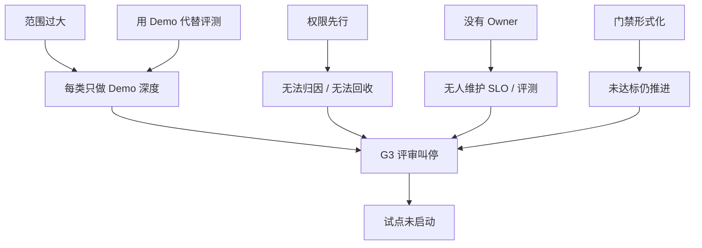

# 附录：失败复盘：一个没有上线的运维 Agent

> 这是一个**合成复盘**：团队、系统与数据均为虚构，由多个真实项目中反复出现的失败模式组合而成。它不指责任何个人，只讨论系统、流程与工程判断。

## 1. 背景

某平台团队有 3 名 SRE、2 名 AI 工程师和 1 名产品经理，决定做一个“K8s 智能运维 Agent”。目标很直接：

- 覆盖 CrashLoopBackOff、Node NotReady、Pending、发布失败、网络异常。
- 把告警平均处理时间降低 30%。
- 先在一个生产集群试点，再推广到 4 个集群。

项目做了 10 周，内部 Demo 很成功，但在 G3 评测门禁评审时被叫停，试点没有启动。半年后，Agent 仍停留在内部演示环境。

## 2. 时间线

| 周 | 发生了什么 | 留下的问题 |
| --- | --- | --- |
| 第 1–2 周 | 场景定为“K8s 全场景诊断”，包含诊断、建议和自动修复 | 范围过大，没有 non-goals |
| 第 3–4 周 | 为了快速打通工具，使用共享 `cluster-admin` 服务账号 | 权限、审计、归因全部缺失 |
| 第 5–6 周 | 用 8 个精选案例做 Demo，效果“看起来很好” | 把 Demo 当成了评测 |
| 第 7 周 | 安全评审发现越权、无审批、凭证落盘 | 临时改成只读令牌，但写工具仍共享 |
| 第 8 周 | 评测集只有 12 条，全部来自精选案例 | 没有边界、对抗、未知、安全案例 |
| 第 9 周 | 项目 champion 离职，没有指定新 Owner | SLO、预算、值班无人负责 |
| 第 10 周 | G3 评审：没有基线、没有回滚、没有成本口径 | 试点暂停，项目没有恢复 |

## 3. 评审时暴露的五个问题

### 3.1 范围太大

第一版同时做诊断、建议和自动修复，横跨 5 类故障。结果每类只做了“能演示”的深度，没有一个场景达到“可上线”的深度。

**如果重来：** 只做 `CrashLoopBackOff` 只读诊断，限定一个 namespace、一个集群，先证明证据、评测和运营闭环。

### 3.2 用 Demo 代替评测

8 个 Demo 案例由团队自己挑选，输入干净、证据齐全、答案明显。没有覆盖：

- 多因素叠加、证据缺失、环境不符。
- 日志/工单中的恶意指令。
- 越权请求、高危动作、敏感数据。
- “不知道”与升级。

评审时，团队无法回答“在 100 个真实告警上，Top-3 命中率是多少”。Demo 通过不等于评测通过。

### 3.3 权限先行

为了“先跑起来”，Agent 用了共享高权限账号。后来虽然改成只读，但：

- 工具调用无法归因到具体 Agent/场景。
- 写工具仍共用凭证，无法按工具、范围、时间收紧。
- 审计日志不完整，评审无法还原“谁批准了什么”。
- 退役时无法干净回收权限。

**如果重来：** 从第一天就用独立 NHI、短时凭证、按工具授权；没有权限矩阵就不注册写工具。

### 3.4 没有 Owner

项目由 champion 推动，但没有明确 Agent Owner。champion 离职后：

- SLO 没人定，评测没人跑，失败案例没人复盘。
- 值班同学不知道如何接管、降级、回滚。
- 预算与成本无人负责。

**如果重来：** 在 Plan 阶段就写进 Charter：谁对结果负责、谁值班、谁维护评测集、谁批准权限升级。

### 3.5 门禁形式化

项目有 G0–G5 的表格，但评审变成了“打勾”：

- G1 设计门禁没有检查工具契约与回滚。
- G2 建设门禁没有验证 Trace 与 kill switch。
- G3 评测门禁没有基线、没有黄金集、没有安全案例。
- G4 发布门禁没有灰度与回滚演练。

门禁存在，但没有“未达标不发布”的硬规则，也没有人有权说“不”。

## 4. 评审证据

| 证据 | 发现 |
| --- | --- |
| 权限矩阵 | 只有 3 行，写工具全部 `approval: none` |
| 评测集 | 12 条，全部为正常案例；无对抗/安全/未知 |
| Trace | 只记录 Prompt/Completion，没有工具参数与审批 |
| 成本 | 没有单次运行成本，只有月度总额 |
| 值班文档 | 没有 Agent 降级、接管、回滚章节 |
| 复盘记录 | 没有，因为“还没有出过事故” |

::: diagram 图 23 · 失败项目的因果链 | 失败项目的五条因果链；范围、评测、权限、Owner 与门禁共同导致叫停。

:::

## 5. 如果重来：一个 6 周的最小版本

| 周 | 目标 | 退出条件 |
| --- | --- | --- |
| 第 1 周 | 只读诊断 `CrashLoopBackOff`，单 namespace | Charter、non-goals、Owner 明确 |
| 第 2 周 | 证据包、工具契约、权限矩阵 | 只读工具可回放，审计字段完整 |
| 第 3 周 | 评测集：30 条正常 + 10 条边界 + 5 条对抗/安全/未知 | 黄金集人工标注完成 |
| 第 4 周 | 影子模式，与人工处理对比 | 一致率达标，无重大遗漏 |
| 第 5 周 | 建议模式，人工执行 | 建议采纳率稳定，成本可归因 |
| 第 6 周 | G3/G4 评审，决定是否灰度 | 不安全动作率为 0，可回滚 |

这个版本不会“什么都能做”，但它能回答：证据是否充分、结论是否可复核、权限是否收紧、失败是否可回滚、谁对结果负责。

## 6. 经验映射到本书

| 失败 | 对应章节 | 应该怎么做 |
| --- | --- | --- |
| 范围过大 | [03 场景选择](../guide/03-scenario-selection) | 用“动词 + 对象 + 范围 + 证据 + 动作 + 验证 + 回滚”拆场景 |
| Demo 代替评测 | [07 评测发布](../guide/07-evaluation-release) | 五类案例、黄金集、硬性安全门槛 |
| 权限先行 | [05 工具与权限](../guide/05-tools-permissions)、[12 身份安全](../guide/12-identity-security) | NHI、短时凭证、按工具授权、双人审批 |
| 没有 Owner | [09 组织治理](../guide/09-organization-governance) | Charter 写清 Owner、值班、评测 owner |
| 门禁形式化 | [02 生命周期](../guide/02-lifecycle) | 门禁有记录、有负责人、有“不发布”权力 |
| 没有成本口径 | [13 成本 ROI](../guide/13-cost-roi-portfolio) | 单位经济、预算、成本归因 |
| 没有 Trace | [11 AgentOps](../guide/11-agentops-observability) | Session/Run/Tool/Approval/Outcome 全链路 |

## 7. 失败复盘检查清单

- [ ] 场景是否有明确的 non-goals 与单环境边界？
- [ ] 评测集是否来自真实告警，而不是团队精选的 Demo？
- [ ] 是否有黄金集、对抗案例、安全案例与“未知”案例？
- [ ] Agent 是否有独立身份、最小权限、短时凭证与完整审计？
- [ ] 是否有人对 SLO、成本、评测与值班负责？
- [ ] 门禁是否有硬规则和否决权，而不是打勾？
- [ ] 是否有 kill switch、只读降级、人工接管与回滚演练？
- [ ] 是否能在评审时回答“它在 100 个真实告警上表现如何”？

## 8. 结论

这个项目失败的原因不是模型不够强，而是**用 Demo 的工程能力去做生产系统**：范围过大、评测缺失、权限先行、责任不清、门禁失效。模型只是最后一层；真正决定能不能上线的，是证据、权限、评测、运营与人。

如果你正在做第一个运维 Agent，先读[03 场景选择](../guide/03-scenario-selection)和[07 评测发布](../guide/07-evaluation-release)，再用[发布与回滚清单](../templates/release-checklist)逐项检查。不要用“效果不错”代替“可以上线”。
