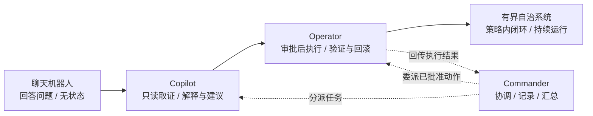
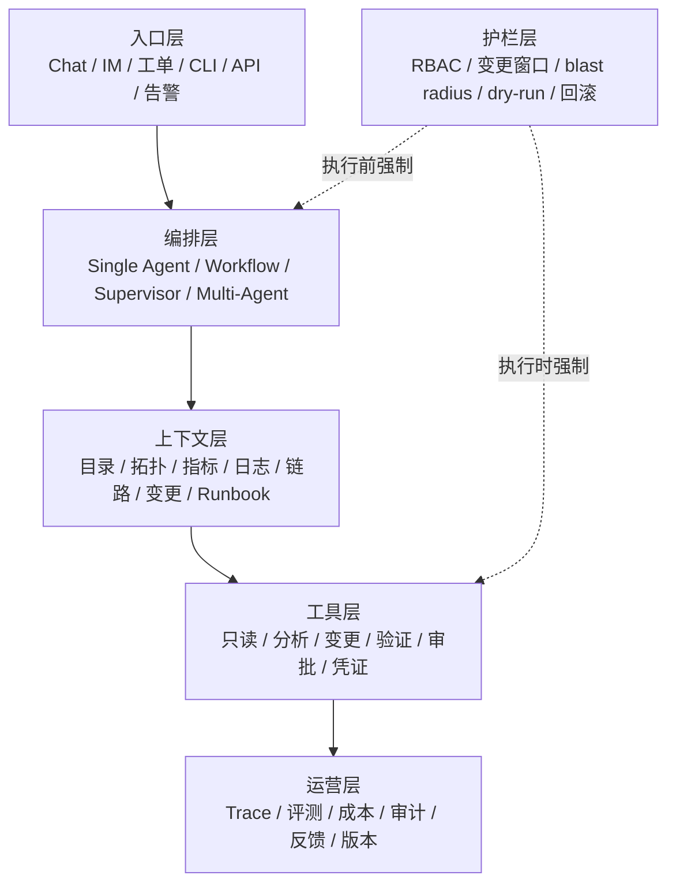

# 01 为什么运维 Agent 不一样

> 聊天机器人错了，用户会再问一遍；运维 Agent 错了，可能是一次生产事故。

## 运维工作的五个特征

| 特征 | 含义 | 对 Agent 的要求 |
| --- | --- | --- |
| **状态性** | 系统状态随时变化，昨天的答案今天可能不成立 | 每次回答都要重新取证，带时间戳与环境标识 |
| **长尾性** | 一部分告警可由既有 SOP 覆盖，仍有未知、组合与新型故障 | 既要有确定性工作流，也要有受控推理；先测本组织覆盖率，不套用外部比例 |
| **高风险** | 一次错误变更可能影响大量用户 | 权限、审批、dry-run、回滚、blast radius 评估 |
| **部分可观测** | 指标、日志、链路、事件各自不完整 | 多源取证、交叉验证、明确“不知道” |
| **强时效** | 事故期间每一分钟都在损失 | 快速收敛、并行取证、清晰的升级路径 |

这些特征决定了：**运维 Agent 的核心不是生成，而是决策与执行的质量。**

## 聊天机器人、Copilot、Operator 与自治系统

::: diagram 图 24 · 角色与能力阶梯 | 能力从左向右增强；Commander 是独立协调角色，不拥有生产写权。

每往右一步，能力增强，但需要的证据、权限、评测与运营能力也同步增加。很多项目失败，不是因为模型不够强，而是因为**跳级**：用聊天机器人的工程能力，去做 Operator 的事。

### 角色权限与责任矩阵

角色决定身份与工具边界，**不是**一个万能 Agent 的动态头衔。每次运行都固定 principal，并由策略引擎在执行前再次判定权限。

| 角色 | 允许的工具 | 明确禁止 | 前置条件 | 运行责任 | 最终责任 |
| --- | --- | --- | --- | --- | --- |
| **Copilot** | 批准范围内的只读查询、检索、聚合、草稿生成 | 变更工具、审批、生产记录写入、提升权限 | 数据授权、作用域与时效约束 | 提供证据包、候选根因与不确定性 | 人类使用者复核；领域 Owner 对采纳结果负责 |
| **Operator** | Copilot 工具 + 白名单变更、dry-run、验证、该变更的 Trace 写入 | 自审批、超范围/超时调用、修改审计、跨域写 | 已批准变更单、短时凭证、回滚点、工具契约 | 执行计划、检查结果、失败时回滚或升级 | 授权的人类操作者/值班对生产结果负责 |
| **Commander** | 只读证据查询 + 事故任务板、时间线、证据板、沟通草稿 | **任何生产写工具**、Operator 凭证、最终事故决策 | 事故记录域授权、任务委派规则 | 协调分派、保留冲突证据、记录决策来源 | 人类 Incident Commander 对事故决策负责 |

三重隔离缺一不可：**身份隔离**（不同服务账号）、**工具隔离**（Commander 的工具目录不含生产写工具）、**数据隔离**（记录域凭证不能调用生产 API）。策略拒绝必须可观测；不能只在 Prompt 中写“不要执行”。

::: warning 一个常见误判
“模型已经能调用工具了，所以它可以自己修故障。”  
调用工具只是能力，不是授权；能执行不等于该执行。运维 Agent 的难点在**该不该做、做到什么程度、做完怎么验证**。
:::

## 三个 Gap

### 1. 证据 Gap

模型的知识来自训练数据，而运维需要的是**此刻的系统状态**。没有实时证据，Agent 只能给出“看起来合理”的通用建议。

- 反例：根据报错文本直接建议“重启 Pod”，没有看事件、日志、资源限制和依赖状态。
- 正确做法：先构造证据包（查询、时间窗口、来源、结果），再形成假设；每个假设都能被证据支持或推翻。

### 2. 行动 Gap

从“建议”到“执行”隔着工具契约、权限、审批、幂等、超时、回滚和审计。

- 读工具：查询、检索、聚合。
- 分析工具：拓扑、依赖、基线、异常检测。
- 变更工具：重启、扩容、切换、回滚。
- 验证工具：健康检查、SLO、日志、指标、用户路径。

没有工具契约，Agent 就只能“说得对但做不了”；没有权限与回滚，Agent 就“做得动但不敢用”。

### 3. 信任 Gap

运维团队不会因为一次 Demo 就信任一个会自动改生产的系统。信任来自：

- 可解释：每个结论有证据、每个动作有理由。
- 可预演：dry-run、diff、影响面分析。
- 可回滚：失败时能在可控时间内恢复。
- 可评测：历史事故回放、影子模式、灰度发布。
- 可追责：谁批准、谁执行、执行了什么、结果如何。

## 运维 Agent 的任务分类

| 任务类型 | 典型动作 | 默认权限 | 关键指标 |
| --- | --- | --- | --- |
| **解释** | 解释告警、指标、日志、配置 | 只读 | 准确率、引用准确率 |
| **诊断** | 定位根因、关联多源证据 | 只读 | Top-1/Top-3 命中率、证据完整度 |
| **规划** | 生成变更方案、影响面与回滚计划 | 只读 | 方案可执行率、风险识别率 |
| **执行** | 重启、扩容、回滚、切换、配置变更 | 受控写 | 变更成功率、回滚率、事故率 |
| **验证** | 健康检查、SLO 验证、回归 | 只读 | 验证覆盖率、漏报率 |
| **优化** | 容量、成本、性能、稳定性改进 | 只读/受控写 | 成本节省、性能提升、风险 |

先明确你的 Agent 主要做哪一类任务，再决定它的架构、工具与评测方式。不要用一个“全能 Agent”同时承担解释、诊断、执行和优化。

## 一个运维 Agent 的最小技术栈

::: diagram 图 25 · 最小技术栈 | 六层能力从入口到运营展开；权限与护栏横切编排和工具执行，不是串行处理步骤。

“最小”指能力不能缺项，不指必须采购六个产品。记录与护栏应随能力一起建设，而不是上线后补丁；这本书后续的每一章，都会展开其中一层。

## 五个反模式

1. **用 Demo 代替评测**：几个漂亮案例不等于能上生产；需要覆盖正常、边界、对抗和安全场景。
2. **用 Prompt 代替流程**：把 Runbook、审批、回滚都塞进系统提示词，结果不可控、不可审计。
3. **用权限换速度**：给 Agent 一个高权限账号“先跑起来”，之后很难收回。
4. **用自治代替责任**：没有人对 Agent 的行为负责，事故复盘无法闭环。
5. **用通用 Agent 做所有场景**：K8s、RDMA、GPU 的证据与工具差异巨大，通用 Agent 往往样样都懂、样样不精。

## 本章检查清单

- [ ] 我们做的是 Copilot、Operator 还是 Commander？身份、工具与责任边界写清楚了吗？
- [ ] Commander 是否在身份、工具和凭证三层都与生产写权隔离？
- [ ] 每个诊断结论是否能追溯到一个证据包？
- [ ] 每个变更动作是否有工具契约、权限、审批、dry-run 和回滚？
- [ ] 我们是否有一个覆盖历史事故的评测集，而不是只有 Demo？
- [ ] 是否明确了 Agent 不做什么（non-goals）？
- [ ] 是否有人对 Agent 的生产行为负责？

下一章：[全生命周期：从想法到退役](./02-lifecycle)
