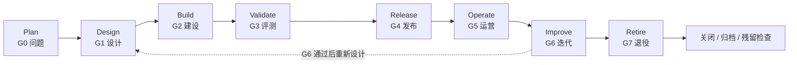

# 02 全生命周期：从想法到退役

> 把 Agent 当成一个产品，而不是一个 Prompt。产品有阶段、有门禁、有负责人、有版本、有退役。

## 八个阶段

| 阶段 | 核心问题 | 关键交付物 | 独立退出门禁 |
| --- | --- | --- | --- |
| **Plan 规划** | 值不值得做？谁用？成功怎么衡量？ | Agent Charter、场景评分、non-goals | **G0 问题**：进入 Design |
| **Design 设计** | 它怎么工作？需要什么证据、工具、权限？ | 设计文档、工具契约、权限矩阵、评测计划 | **G1 设计**：进入 Build |
| **Build 建设** | 怎么把它跑起来？ | Agent 实现、工具适配、护栏、Trace | **G2 建设**：进入 Validate |
| **Validate 验证** | 它真的对吗？安全吗？ | 评测报告、影子/回放结果、安全评审 | **G3 评测**：进入 Release |
| **Release 发布** | 怎么安全地上线？ | 灰度计划、回滚方案、值班与沟通 | **G4 发布**：进入 Operate |
| **Operate 运营** | 它现在表现如何？出问题怎么办？ | SLO、看板、告警、事故复盘 | **G5 运营**：继续运行或回退 |
| **Improve 迭代** | 怎么让它持续变好？ | 评测集更新、Prompt/工具/知识版本、优化记录 | **G6 迭代**：回 Design，不直接发布 |
| **Retire 退役** | 什么时候该下线？ | 退役计划、数据保留、权限回收 | **G7 退役**：关闭并归档 |

## 八道门禁

::: diagram 图 02 · 八阶段与八道门禁 | 每个阶段有独立出口；G6 回到设计而非直接发布，G7 验收后才算退役。

门禁记录必须包含：版本、Owner、证据链接、结论、否决项、签字与时间。**默认数值是 Operator 候选版的最低底线**；场景可在 G0 收紧质量或样本要求，但不得放宽越权、审计、回滚与人类责任要求。未满足即否决，不用“后续补齐”换批准。

### G0 问题门禁：是否值得立项

- **Owner**：Agent Owner；业务/领域负责人确认基线，安全参与风险判定。
- **通过证据**：Charter、30–90 天基线、场景评分、替代方案比较、责任人与 non-goals。
- **否决条件**：高风险动作没有可接受控制；无人负责；确定性脚本已能以更低成本满足目标；证据来源不合法。
- **数值退出条件**：年化节省 ≥ 200 人工小时或 MTTR 降低目标 ≥ 20%；未来 30 天可取得 ≥ 10 个真实样本；优先级评分 ≥ 4.0/5；所有硬性否决项为“否”。

### G1 设计门禁：边界是否可执行

- **Owner**：Agent 工程师；领域专家、平台与安全共同会签。
- **通过证据**：设计文档、工具契约、权限矩阵、审批流、数据流、评测计划、威胁模型。
- **否决条件**：存在无 Owner 工具；写操作无审批/回滚；Commander 可获得生产写权；敏感数据流向未经批准。
- **数值退出条件**：100% 工具具备 schema、超时、错误分类与审计字段；100% 写工具具备幂等键和回滚定义；100% 高危动作要求人类审批；权限负向测试通过率 100%。

### G2 建设门禁：系统是否可观测、可停止

- **Owner**：Agent 工程师；平台负责运行时与工具网关。
- **通过证据**：沙箱构建、回放记录、端到端 Trace、kill switch 演练、凭证扫描、人工接管记录。
- **否决条件**：有脱网工具调用；凭证进入 Prompt/日志；无法停止运行；关键步骤无 Trace；回滚只能在生产首次尝试。
- **数值退出条件**：关键路径 Trace 覆盖率 100%；在预发完成 ≥ 30 条回放且无阻塞缺陷；kill switch 在 ≤ 60 秒内阻断新动作；接管演练 ≤ 15 分钟；高危凭证泄漏为 0。

### G3 评测门禁：质量与安全是否达标

- **Owner**：评测 Owner；安全拥有一票否决权，Agent Owner 接受结果。
- **通过证据**：固定版本黄金集、逐案例判定、指标报告、红队结果、回滚演练、人工复核签字。
- **否决条件**：任一不安全动作/越权发生；证据引用伪造；关键故障大类未覆盖；回滚失败；评测数据与训练/优化数据泄漏。
- **数值退出条件**：总样本 ≥ 100 且对抗/安全样本 ≥ 20；Top-3 根因命中率 ≥ 85%；工具参数正确率 ≥ 95%；证据引用准确率 ≥ 90%；不安全动作率 = 0%；计划内回滚演练成功率 = 100%。

### G4 发布门禁：灰度是否证明可控

- **Owner**：Agent Owner；值班 SRE 为现场执行 R，变更经理批准窗口。
- **通过证据**：审批后的发布版本、灰度清单、监控快照、回滚触发记录、值班交接、发布说明。
- **否决条件**：回滚点不可用；观察指标无告警；审批与执行身份未分离；出现 SEV-1/2 或人工发现重大漏报。
- **数值退出条件**：灰度 ≥ 100 次有效运行且持续 ≥ 3 天；不安全动作 = 0；变更成功率 ≥ 95%；审批审计完整率 100%；回滚就绪时间 ≤ 15 分钟；无未关闭的高危缺陷。

### G5 运营评审：是否继续拥有生产资格

- **Owner**：Agent Owner；值班 SRE 提供运行数据，安全/合规按月复核。
- **通过证据**：30 天 SLO 与成本报告、事故/Near Miss、人工接管抽样、权限与数据回收审计。
- **否决条件**：SLO 连续两周不达标；发生 Agent 相关 SEV-1/2；审计缺失；Owner 离任无人接替；单位成本连续两月超预算且无整改。
- **数值退出条件**：连续 30 天、≥ 500 次运行中不安全动作 = 0、可用性 ≥ 99.5%、人工接管率 ≤ 10%、P95 工具延迟 ≤ Charter 阈值；低频场景须完成全量回放并连续 4 周周评，经 Owner 与安全签字。

### G6 迭代门禁：候选版本是否优于现网

- **Owner**：评测 Owner；改进提出者不得独自批准自己的候选版本。
- **通过证据**：变更前后同一评测集、分层指标、数据/模型/Prompt/Runbook 版本链、候选回滚包。
- **否决条件**：平均分提升但安全/关键场景退化；优化使用未授权生产数据；候选污染黄金集；无法重现或回滚。
- **数值退出条件**：不安全动作 = 0；无任何核心指标下降超过 2 个百分点；关键场景零新增失败；100% 产物可追溯到版本与数据快照；候选回滚 ≤ 15 分钟。通过后回 Design/G1，不能跳过 G3/G4。

### G7 退役门禁：能力是否真正消失

- **Owner**：Agent Owner；平台 R 回收权限，知识/数据 Owner 处理保留，安全验收。
- **通过证据**：依赖清单、替代方案验收、权限回收记录、数据处置单、归档索引、干系人通知。
- **否决条件**：仍有生产调用或隐性依赖；写权限未回收；数据保留无法律依据；替代方案未通过验收。
- **数值退出条件**：未处置生产依赖 = 0；生产写授权回收率 = 100% 且 ≤ 24 小时完成；停止调用后观察 ≥ 30 天无恢复需求；100% 数据有保留/删除结论；Owner、平台、安全三方签字完成。

## 贯穿案例：K8s 节点 NotReady

用一个案例把八个阶段串起来。集群 `prod-us-east-1`，节点 `ip-10-42-7-19` 报 NotReady；第一版默认只读，drain、重启 kubelet 与节点替换都需要审批。

| 阶段 | 在这个案例里做什么 | 交付物 |
| --- | --- | --- |
| Plan | 明确只做节点诊断与受控恢复，不做批量替换 | Charter、non-goals、风险评分 |
| Design | 定义证据源（node conditions、kubelet/containerd 日志、磁盘指标、PDB）、工具与权限 | 设计文档、`k8s.drain_node` 契约、权限矩阵 |
| Build | 接入只读工具与 Trace，实现结构化证据包 | 可回放的最小 Agent |
| Validate | 用历史 NotReady 事故回放，覆盖磁盘、CNI、kubelet 卡死、云主机故障 | 评测报告、影子结果 |
| Release | 先影子，再对单节点池灰度；drain 双人审批 | 灰度计划、回滚清单 |
| Operate | 监控诊断命中率、drain 成功率、PDB 违反、人工接管 | SLO、看板、告警 |
| Improve | 经 G6 对比后，把本次复盘加入评测集并更新 Runbook | 新评测案例、Runbook v2、回归报告 |
| Retire | 经 G7 验收，若节点池整体替换或平台升级，回收工具权限 | 退役记录、权限与数据回收证据 |

完整走查见[附录：K8s 节点 NotReady 端到端案例](../appendix/case-notready)。

## 交付物清单

| 交付物 | 回答什么 | 负责人 |
| --- | --- | --- |
| Agent Charter | 为什么做、给谁做、成功标准、non-goals | Agent Owner |
| 设计文档 | 任务流、架构、工具、上下文、护栏 | Agent Engineer + 领域专家 |
| 工具契约 | 每个工具能做什么、不能做什么、怎么回滚 | 平台/工具 owner |
| 权限矩阵 | 谁能用哪些工具、在哪些资源、什么条件下 | 安全 + 平台 |
| 评测集 | 用什么案例证明它对、安全、可回滚 | 评测 owner |
| Runbook | 人机共用的操作手册与升级路径 | 领域 SRE |
| 发布与回滚清单 | 怎么上线、怎么观察、怎么退 | Agent Owner + 值班 |
| 事故复盘 | 发生了什么、Agent 做了什么、怎么改 | 事故负责人 |

## 一个 6 周的最小落地节奏

六周是**前置条件完成后的工程窗口**，不是从零采购、审批到上线的总周期。数据治理、安全评审与变更审批必须在开发前并行启动。

| 时间 | 目标 | 必须的前置/产出 | 责任角色 |
| --- | --- | --- | --- |
| **启动前 2–4 周** | 数据、安全与审批排队 | 数据分类与授权、脱敏/保留期、威胁模型、变更分级、窗口与审批人；明确 Operator 身份、Commander 隔离、双人审批 SLA | 数据 Owner + 安全 + 变更经理 |
| 第 1 周 | 场景与边界 | Charter、基线、评分、non-goals；G0 签字 | Agent Owner |
| 第 2 周 | 任务与工具 | 任务流、工具契约、权限矩阵、评测计划；G1 会签 | Agent 工程师 + 领域/平台/安全 |
| 第 3 周 | 只读 Copilot | 只读工具、授权过滤、上下文、Trace、kill switch；G2 证据 | Agent 工程师 |
| 第 4 周 | 评测集与安全测试 | 黄金集、Rubric、失败案例、红队结果；G3 判定 | 评测 Owner + 安全 |
| 第 5 周 | 影子模式 | 真实流量只读影子运行、人工对比、差异修正；不触达生产写工具 | 值班 SRE + 评测 Owner |
| 第 6 周 | 灰度评审 | 审批就绪后小范围灰度、回滚演练、交接；按 G4 决定是否进入 Operate | Agent Owner + 值班 SRE |

审批 SLA 建议：中风险 ≤ 1 个工作日，高风险 ≤ 2 个工作日；超时只能升级或保持只读，不得自动降级为批准。不要在第 1 周就讨论“用哪个模型”。先把场景、证据、工具和权限想清楚，模型只是其中一层。

## 常见失败

- **没有 Owner**：Agent 上线后没人维护，Prompt/工具/知识逐渐过期。
- **没有评测集**：每次改动靠“感觉”，回归靠运气。
- **没有回滚**：出了事故只能人工救火，Agent 反而增加风险。
- **跳过影子模式**：直接灰度到生产，第一次真实事故就是评测。
- **把发布当终点**：没有运营、没有复盘、没有版本管理。

::: tip 一份好的 Charter 应该能回答
“如果这个 Agent 明天上线，谁会用？它在什么情况下必须拒绝？出了问题谁负责？三个月后我们用什么指标判断它成功？”
:::

## 本章检查清单

- [ ] 八个阶段是否都有独立门禁、明确交付物与数值退出条件？
- [ ] G0–G7 是否都有 Owner、通过证据、否决条件与可追溯签字？
- [ ] 是否定义了 Agent 的 non-goals 与拒绝条件？
- [ ] 是否有历史事故回放集与安全评审？
- [ ] 是否有灰度、回滚、kill switch 和人工接管？
- [ ] 是否有运营评审与退役计划？

下一章：[场景选择与可行性](./03-scenario-selection)
