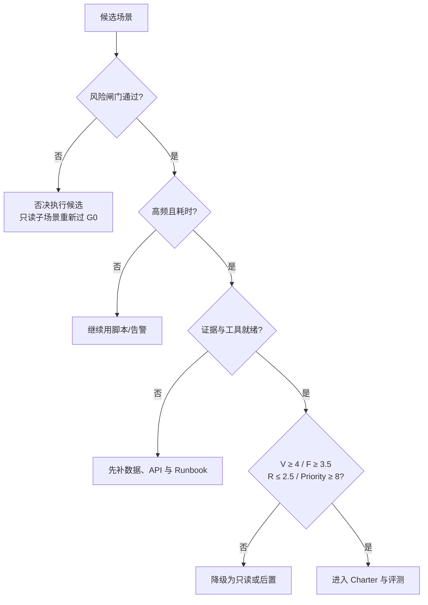
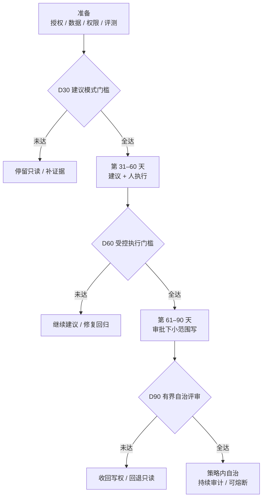

# 03 场景选择与可行性

> 第一个场景选错，后面所有工程努力都会被“没有价值”或“风险太高”吞掉。

## 三维评分：价值 × 可行性 ÷ 风险

不要用“这个场景很酷”来做决策，也不要用“出错损失大”制造做高危自动化的激励。**错误后果属于风险，不属于价值；高价值不能抵消不可接受的风险。** 价值只计算可验证的收益，例如减少耗时、减少可避免的人工差错、扩大覆盖。

| 维度 | 权重后的子项 | 权重 | 1 分 | 3 分 | 5 分 |
| --- | --- | --- | --- | --- | --- |
| **价值 V** | 频率 | 30% | 一年几次 | 每月几次 | 每天多次 |
| | 单次耗时 | 30% | 几分钟 | 约 1 小时 | 数小时 |
| | 可减少的人工差错 | 20% | 几乎无可避免错误 | 偶尔出错且可复核 | 高频误判且已有控制基线 |
| | 覆盖人群 | 20% | 1 个团队 | 多个团队 | 多个团队/客户 |
| **可行性 F** | 工具就绪度 | 35% | 全靠人工 | 部分 API/CLI | 契约完整、可审计 |
| | 数据就绪度 | 30% | 关键数据缺失 | 指标/日志可用 | 指标/日志/链路/拓扑齐全 |
| | 环境可复现 | 15% | 无法复现 | 可预发验证 | 可沙箱/回放 |
| | 评测可得 | 20% | 无历史案例 | 部分标注案例 | 足量事故与人工标注 |
| **风险 R** | blast radius | 25% | 单实例 | 单集群 | 跨地域/多租户 |
| | 可逆性 | 25% | 不可逆 | 人工恢复 | 一键回滚并演练 |
| | 权限复杂度 | 20% | 只读 | 受控写 | 高危/跨账号写 |
| | 合规约束 | 15% | 无特殊约束 | 需审批/审计 | 强监管/数据不出域 |
| | 错误后果 | 15% | 无用户影响 | 局部降级 | 重大资金/安全/声誉影响 |

各维度按权重求平均，仍为 1–5 分：

```text
V = 0.30×频率 + 0.30×耗时 + 0.20×人工差错 + 0.20×覆盖
F = 0.35×工具 + 0.30×数据 + 0.15×环境 + 0.20×评测
R = 0.25×影响面 + 0.25×可逆性 + 0.20×权限 + 0.15×合规 + 0.15×后果
RiskVeto = 任一硬否决成立
Priority = RiskVeto ? 否决 : (V × F) / R
```

**风险先否决，再排序。** 硬否决项包括：无责任 Owner；无合法数据授权；不可逆且无经批准的补偿控制；写操作无审批/回滚；需要超范围权限；无法审计。被否决场景可拆出只读子场景重新过 G0，但不能凭高 Priority 放行。

默认晋级线为 `V ≥ 4.0、F ≥ 3.5、R ≤ 2.5、Priority ≥ 8.0`，且 `RiskVeto = false`。分数不是精确科学，它的价值在于让团队把“为什么先做这个”说清楚；子分与证据必须保留，不能只报一个总分。

::: diagram 图 03 · 第一个场景的筛选路径 | 风险否决先于频率、证据与收益排序；被否决的执行候选只能拆出只读子场景重新过 G0。

:::

## 场景拆解模板

把模糊需求拆成可设计、可评测的任务：

```text
动词 + 对象 + 范围 + 证据 + 动作 + 验证 + 回滚
```

例如“帮我运维 K8s”不是一个场景；“在 prod-us 集群中诊断 CrashLoopBackOff，读取 Pod events、日志、资源限制和依赖状态，给出根因与修复建议，不自动删除资源”才是一个场景。

| 字段 | 示例 |
| --- | --- |
| 动词 | 诊断 / 规划 / 执行 / 验证 |
| 对象 | Deployment、Node、Pod、GPU、RDMA 端口 |
| 范围 | 单 namespace / 单集群 / 单可用区 |
| 证据 | metrics、logs、events、topology、change history |
| 动作 | 只读建议 / 重启 / 扩容 / 回滚 |
| 验证 | rollout status、SLO、错误率、日志 |
| 回滚 | 保留旧 ReplicaSet、回滚配置、恢复节点 |

## 适合先做的场景

- **只读诊断**：告警解释、根因候选、证据汇总、Top-N 排查建议。
- **日志/指标/链路关联**：把一个现象在不同数据源之间对齐。
- **Runbook 导航**：根据现场状态找到该走的 SOP，并指出缺失的前置条件。
- **容量与成本报告**：汇总利用率、浪费、趋势与建议。
- **配置漂移检测**：对比期望状态与实际状态，给出差异与风险。
- **工单分诊**：分类、补全信息、路由到正确团队。

这些场景的共同点：**高频、耗时、低风险、证据清晰、容易评测。**

## 不适合作为第一个版本的场景

- 核心生产变更：删库、删集群、改网络 ACL、改安全策略。
- 低频高风险：一年一次的容灾切换、监管变更。
- 权限边界不清：跨账号、跨租户、共享平台。
- 无法回滚：不可逆的数据删除或加密操作。
- 没有历史数据：既没有指标日志，也没有事故记录。
- 责任不清：没人愿意为 Agent 的动作负责。

这些场景不是永远不能做，而是要先完成只读诊断、评测集、审批与回滚，再逐步升级。

## 数据与工具就绪度检查

| 检查项 | 问题 |
| --- | --- |
| 指标 | 是否有稳定的指标、标签、保留期与查询 API？ |
| 日志 | 是否可按服务/实例/时间检索？是否有结构化字段？ |
| 链路 | 是否有 Trace ID、服务依赖与延迟分布？ |
| 拓扑 | 是否有服务目录、主机/网络/存储/GPU 拓扑？ |
| CMDB | 资产、负责人、环境、变更历史是否准确？ |
| Runbook | 是否有可执行的 SOP、前置条件、验证与回滚？ |
| 事故库 | 是否有脱敏的历史事故、时间线、根因与修复？ |
| 权限 | 是否有最小权限的 API/CLI，是否支持审计与短时凭证？ |

如果半数以上是“没有”，先补数据与工具，不要急着做 Agent。

## 候选场景算例与排序

以下数字是**方法示例，不是行业基准**；每个子分都要能指向工单量、耗时记录、工具审计或事故样本。

**K8s CrashLoopBackOff 只读诊断**：价值子分为 `[5, 4, 4, 4]`，可行性为 `[4, 4, 3, 4]`，风险为 `[2, 1, 2, 2, 2]`。

```text
V = 0.30×5 + 0.30×4 + 0.20×4 + 0.20×4 = 4.30
F = 0.35×4 + 0.30×4 + 0.15×3 + 0.20×4 = 3.85
R = 0.25×2 + 0.25×1 + 0.20×2 + 0.15×2 + 0.15×2 = 1.75
RiskVeto = false（有 Owner、合法数据、只读、可审计）
Priority = 4.30 × 3.85 / 1.75 = 9.46
判定：4.30 ≥ 4.0，3.85 ≥ 3.5，1.75 ≤ 2.5，9.46 ≥ 8.0 → 第一批候选
```

| 场景（示例评分） | V | F | R | Priority | 硬否决 | 结论 |
| --- | ---: | ---: | ---: | ---: | --- | --- |
| K8s CrashLoopBackOff 只读诊断 | 4.30 | 3.85 | 1.75 | 9.46 | 否 | 第一批候选 |
| GPU 推理延迟只读 triage | 4.30 | 3.65 | 2.15 | 7.30 | 否 | 第二批；先补评测 |
| RDMA 端口只读诊断 | 4.00 | 3.20 | 1.65 | 7.76 | 否 | 先补工具契约与回放 |
| RDMA PFC/ECN 配置变更 | 4.30 | 2.15 | 4.35 | 2.13 | **是：回滚/跨域审批未验证** | 后置；不得因收益高放行 |
| K8s 集群大版本升级 | 3.40 | 2.50 | 4.25 | 2.00 | **是：高风险写未受控** | 先做升级前检查 |
| 数据库 DDL 变更 | 3.90 | 2.95 | 4.45 | 2.59 | **是：不可逆/审批不足** | 只做建议与预检 |

## 从只读到自治的 90 天路径

::: diagram 图 26 · 90 天量化晋级路径 | 90 天是证据积累窗口而非自动升级承诺；每道门禁失败即停留、修复或回退。


| 晋级点 | 必须同时满足的量化门槛 | 证据 Owner |
| --- | --- | --- |
| **D30 建议模式** | 离线黄金集 ≥ 100；影子运行 ≥ 100 次且 ≥ 14 天；质量门槛读取 `gate_profiles.G3`，不得低于 Top-3/工具参数/证据引用当前冻结值；重大遗漏 = 0；不安全动作 = 0 | 评测 Owner + 安全 |
| **D60 受控执行** | ≥ 50 个变更回放/dry-run；回滚演练成功率 = 100%；kill switch ≤ 60 秒；权限负向测试 = 100%；审批审计完整率 = 100%；回滚点验证率 = 100% | Agent Owner + 平台 + 变更经理 |
| **D90 有界自治** | 审批下生产写灰度 ≥ 100 次且 ≥ 30 天；变更成功率 ≥ 95%；不安全动作 = 0；SEV-1/2 = 0；人工接管率 ≤ 10%；回滚就绪 ≤ 15 分钟；连续两次熔断演练通过 | Agent Owner + 值班 SRE + 安全 |

Gate 判定使用固定版本与同一评测集，逐项留证。任一安全门槛失败即否决；低频场景不能用次数不足为由跳过，只能延长窗口。不要因为“效果不错”就跳级，也不把 90 天当作上线承诺。

## 本章检查清单

- [ ] 场景能用“动词 + 对象 + 范围 + 证据 + 动作 + 验证 + 回滚”描述吗？
- [ ] 价值、可行性、风险是否按权重评分，且每项有证据？
- [ ] 风险硬否决是否独立判定，没有被高收益抵消？
- [ ] 是否有足够的历史事故与数据做评测？
- [ ] 第一版是否只读？是否明确 non-goals？
- [ ] 是否定义了升级到受控执行的门槛？
- [ ] 是否有人对场景的成功与失败负责？

下一章：[架构与运行模式](./04-architecture)
