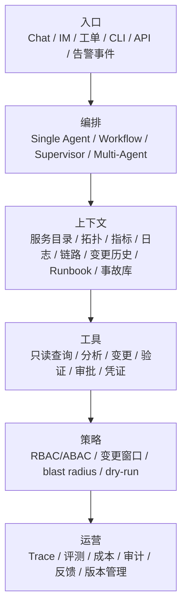
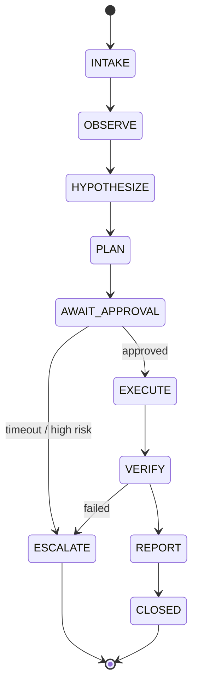

# 04 架构与运行模式

> 架构的目标不是“看起来像智能体”，而是让每一次观察、决策、行动和验证都可解释、可控制、可回放。

## 参考架构

::: diagram 图 04 · 运维 Agent 参考架构 | 六层参考架构；证据格式、工具契约、权限模型与 Trace 不应随模型替换。

:::

每一层都要能独立替换：模型可以换、工具可以换、运行时可以换，但**证据格式、工具契约、权限模型和 Trace 数据模型**应保持稳定。

## 五种运行模式

| 模式 | 适合 | 不适合 | 关键设计 |
| --- | --- | --- | --- |
| **Copilot** | 告警解释、诊断建议、Runbook 导航 | 需要变更 | 只读工具、证据引用、明确“不知道” |
| **Workflow** | 步骤明确的 SOP、巡检、预检 | 高度不确定的故障 | 确定性步骤 + LLM 处理分支与文本 |
| **Supervisor** | 多领域诊断（K8s + 网络 + 存储） | 简单单步任务 | 明确分工、共享证据、汇总与冲突处理 |
| **Multi-Agent** | 事故指挥、跨团队协作 | 可用单 Agent 解决的场景 | 角色、通信协议、共享状态、终止条件 |
| **Event-driven** | 自动巡检、告警触发、定时任务 | 需要复杂判断的高风险变更 | 事件去重、幂等、速率限制、熔断 |

::: warning 多 Agent 不是默认答案
多 Agent 会增加协调成本、状态不一致和不可观测性。能用一个 Agent + 工具编排解决的，不要拆成多个 Agent。
:::

## 一次运行的 State Machine

::: diagram 图 05 · 一次运行的 State Machine | 一次运行的状态机；审批、升级与验证是三个不可省略的状态。

:::

| 状态 | 系统要做什么 | 必须留下什么 |
| --- | --- | --- |
| INTAKE | 识别意图、范围、环境、风险 | 原始请求、会话 ID、操作者 |
| OBSERVE | 收集证据，标注时间与来源 | 证据包 |
| HYPOTHESIZE | 形成候选根因与置信度 | 假设列表、支持/反驳证据 |
| PLAN | 生成动作、影响面、回滚 | 变更计划、diff、风险评估 |
| AWAIT_APPROVAL | 等待人确认或策略放行 | 审批人、审批时间、审批内容 |
| EXECUTE | 幂等执行，记录每一步 | 工具调用 Trace |
| VERIFY | 指标、日志、SLO、用户路径 | 验证结果与证据 |
| REPORT | 生成结论、后续项、复盘素材 | 运行报告 |
| ESCALATE | 超时/不确定/高风险时交给人 | 升级原因与接收人 |

## 工具分层

| 层 | 作用 | 示例 | 默认权限 |
| --- | --- | --- | --- |
| **只读查询** | 获取事实 | 查 Pod、查指标、查日志、查拓扑 | 只读 |
| **分析** | 把事实变成判断 | 依赖图、基线对比、异常检测、容量模型 | 只读 |
| **变更** | 改变系统 | 重启、扩容、回滚、切换、改配置 | 受控写 |
| **验证** | 证明变更有效 | 健康检查、SLO、日志、用户路径 | 只读 |
| **治理** | 控制变更 | 审批、凭证、策略、审计 | 平台 |

每个工具都应该有契约：输入、输出、副作用、幂等性、dry-run、超时、错误分类、审计字段、回滚方式。模板见[工具契约](../templates/tool-contract)。

## 上下文构建

上下文不是“把日志都塞进去”，而是按任务检索最小充分证据：

1. **身份与范围**：环境、集群、服务、实例、时间窗口。
2. **状态**：指标、日志、链路、事件、配置、变更历史。
3. **结构**：拓扑、依赖、服务目录、负责人。
4. **知识**：Runbook、事故库、策略、厂商文档。
5. **约束**：变更窗口、维护模式、合规要求、blast radius。

每条证据都要带 `source`、`timestamp`、`query`、`environment` 和 `confidence`。没有来源的上下文，不应该进入结论。

## 策略层

策略层决定“能不能做”，而不是“模型想不想做”：

- **RBAC/ABAC**：谁能用哪个工具、对哪些资源。
- **变更窗口**：什么时间允许变更。
- **Blast radius**：一次动作最多影响多少实例/租户。
- **Dry-run**：是否必须先预演。
- **审批**：哪些动作必须人工批准，谁有权批准。
- **速率/并发**：防止 Agent 循环调用或批量误操作。
- **熔断/终止**：异常时立即停止。

策略应该是独立于 Prompt 的代码/配置，可审计、可测试、可回滚。

## 记忆设计

| 记忆类型 | 内容 | 生命周期 |
| --- | --- | --- |
| 会话记忆 | 当前事故的对话、证据、动作 | 小时级 |
| 事故记忆 | 时间线、根因、修复、复盘 | 月/年级 |
| 拓扑记忆 | 服务、主机、网络、GPU 关系 | 天级，需刷新 |
| Runbook 记忆 | 可执行 SOP 与版本 | 版本化 |
| 反馈记忆 | 人工纠正、评价、失败案例 | 持续积累 |

记忆最大的风险是“过期”。每条记忆都要有 TTL、来源和版本；过期拓扑比没有拓扑更危险。

## 可观测性

一个 Agent 的运行记录至少包含：

- 输入：请求、操作者、环境、范围。
- 证据：查询、来源、时间、结果摘要。
- 决策：候选假设、选择理由、置信度。
- 动作：工具、参数、审批、执行结果。
- 验证：指标、日志、SLO、结论。
- 成本：Token、工具调用、耗时。
- 结果：成功/失败/升级/回滚。

没有这些，事故复盘只能靠猜。

## 多 Agent 的边界

多 Agent 适合“角色分工明确、证据可共享、终止条件清晰”的场景，例如事故指挥：Commander、Diagnostician、SRE、Communicator。

失败模式包括：

- 多个 Agent 同时执行冲突动作。
- 共享状态不一致，重复诊断。
- 责任不清，没人对最终动作负责。
- 通信成本高于收益。
- 观测链断裂，无法还原决策。

设计多 Agent 时，先定义**共享证据板、动作仲裁者和终止条件**，再定义角色。

## 平台选择

运行时与框架只是架构的一层。选型时优先看：

- 是否支持长任务、会话恢复、沙箱、工具治理、Trace、评测。
- 是否兼容开放协议（MCP、OpenAPI、A2A）与现有系统。
- 是否能导出数据，避免锁定。
- 是否有你需要的合规与数据驻留能力。

阿里生态的 AgentRun、AgentScope、Agent Sandbox/AgentBay、Qoder Cloud Agents、百炼、AgentLoop 等如何映射到这些层，见[附录：阿里 Agent 产品全景](../appendix/alibaba-agent-landscape)。

## 本章检查清单

- [ ] 运行模式是否与场景复杂度匹配？是否过度使用多 Agent？
- [ ] 是否有明确的状态机、终止条件与升级路径？
- [ ] 工具是否按只读/分析/变更/验证/治理分层？
- [ ] 上下文是否带来源、时间、环境与置信度？
- [ ] 策略是否独立于 Prompt，可审计、可测试？
- [ ] 是否有完整的运行 Trace 与成本记录？

下一章：[工具、权限与安全护栏](./05-tools-permissions)
