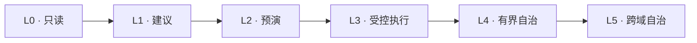
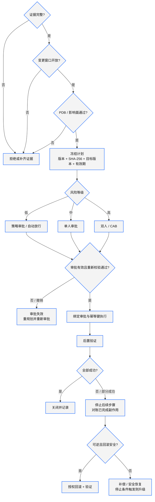

# 05 工具、权限与安全护栏

> 运维 Agent 的能力边界，最终由工具和权限决定。模型只是决定“想做什么”，工具契约与策略决定“能做什么”。

## 动作阶梯

| 等级 | 名称 | Agent 能做什么 | 人类角色 | 适用条件 |
| --- | --- | --- | --- | --- |
| **L0** | 只读 | 查询、检索、解释 | 提问者 | 默认起点 |
| **L1** | 建议 | 给诊断、方案、影响面 | 决策者 | 有证据与评测 |
| **L2** | 预演 | dry-run、diff、回滚计划 | 审批者 | 工具有 dry-run |
| **L3** | 受控执行 | 小范围变更，需审批 | 审批 + 观察 | 有回滚与灰度 |
| **L4** | 有界自治 | 策略内自动修复 | 监控 + 熔断 | 评测、审计、回滚成熟 |
| **L5** | 跨域自治 | 多系统协同自动闭环 | 治理 | 极少数场景 |

不要跳级。绝大多数团队在第一年只需要 L1–L3。

::: diagram 图 06 · 从只读到有界自治的动作阶梯 | 从只读到有界自治的六级动作阶梯；大多数团队第一年停在 L1–L3。

:::

## 权限模型

一个可用的权限判断至少包含七个维度：

```text
principal × tool × resource scope × environment × time × blast radius × approval
```

| 维度 | 示例 |
| --- | --- |
| Principal | Agent 服务身份、调用者、审批者 |
| Tool | `k8s.get_pod`、`k8s.restart_deployment`、`rdma.set_pfc` |
| Resource scope | 单 namespace / 单集群 / 单租户 / 单机架 |
| Environment | dev / staging / prod / dr |
| Time | 变更窗口、维护模式、冻结期 |
| Blast radius | 最多影响 1 个实例 / 1 个节点 / 1 个集群 |
| Approval | 自动 / 单人 / 双人 / 变更委员会 |

::: warning 最小权限不是“只读”
最小权限是“完成当前任务所需的最小写权限 + 最短时间 + 最小范围”。只读是 L0 的最小权限，不是所有场景的终点。
:::

## 前后置护栏

### 前置检查

- 证据是否完整：目标存在、环境正确、时间窗口正确。
- 变更窗口是否允许，是否处于冻结期/事故模式。
- 依赖是否健康，是否有正在进行的变更。
- 备份/快照/回滚点是否就绪。
- blast radius 是否在阈值内。
- 是否有 PDB、维护模式、流量摘除等保护。

### 运行时护栏

- 速率限制、并发限制、重试上限、超时。
- 幂等键与去重，防止重复执行。
- 循环检测：同一工具/同一参数反复调用时熔断。
- kill switch：人工或策略一键停止。
- 凭证最小化：短时令牌、按工具授权、不进入 Prompt。

### 后置验证

- 健康检查、就绪检查、SLO、错误率、延迟。
- 日志与事件是否出现新的异常。
- 变更 diff 是否与计划一致。
- 回滚条件是否触发；回滚是否成功。
- 用户路径/业务指标是否恢复。

## 审批包

人类审批者不应该只看一句“是否允许”。审批包至少包含：

| 内容 | 说明 |
| --- | --- |
| 变更内容 | 要做什么，工具与参数 |
| 证据 | 为什么做，支持证据与反证 |
| 影响面 | 资源、租户、地域、预估 blast radius |
| Diff | 变更前后的配置/资源差异 |
| 风险 | 最坏情况、失败概率、依赖风险 |
| 回滚 | 回滚步骤、预估时间、验证方法 |
| 有效期 | 审批在多长时间内有效 |
| 审批人 | 谁有权批准，是否需要双人 |

审批疲劳是真实风险。按风险分级：低风险自动放行、中风险单人、较高风险双人、高风险变更委员会。不要把一切都变成“点一下同意”。

### 审批绑定与重新校验

审批不是对一句自然语言说“同意”，而是对一个**不可变计划版本**的授权。审批服务在生成审批包时计算规范化计划的 SHA-256 摘要；摘要覆盖工具及参数、目标资源、目标资源版本、执行顺序、影响面、停止条件、补偿/回滚和有效期。运行时保存 `plan_version`、`plan_hash`、`target_resource_versions`、`approval_id` 和 `expires_at`。

1. **冻结计划**：进入 `AWAIT_APPROVAL` 前生成不可变快照；后续编辑创建新版本，不覆盖旧快照。
2. **绑定授权**：审批人、角色/策略、签名或审批记录绑定计划哈希、版本、目标版本和有效期。
3. **等待后重新校验**：获批后、每次写调用前重查资源 `resourceVersion`/generation、RBAC/ABAC、变更窗口、PDB、依赖、限流、撤销状态和短时凭证；条件不满足则不执行。
4. **变化即失效**：计划任何字段变化、目标版本漂移、审批被撤销或超过有效期，旧审批立即失效，回到重规划并申请新审批。不得把旧审批“移植”到新计划。
5. **撤销传播**：撤销通过策略/审批服务同步到执行网关；执行网关在调用前验证撤销版本，正在等待的任务立即失败关闭，已发出的请求记录结果并进入人工对账。

### 错误分类、重试与部分成功

| 类别 | 典型情况 | 默认动作 | 能否自动重试 |
| --- | --- | --- | --- |
| `validation` | 参数缺失、范围非法、PDB 不满足 | 修正输入或重规划 | 否 |
| `auth` | 身份过期、权限不足、委托撤销 | 停止、刷新授权或升级 | 否 |
| `conflict` | 资源版本变化、已有变更锁 | 重新读取并对账，审批失效则重规划 | 否 |
| `pdb_blocked` | 驱逐会破坏可用性 | 停止 drain，不得强制忽略 PDB | 否 |
| `not_found` | 目标不存在 | 对账实际状态，不自动创建资源 | 否 |
| `throttled` | 触发速率/并发限制 | 尊重 `Retry-After`，退避并限次 | 有限、仅幂等调用 |
| `transient` | 网关超时、可恢复的网络错误 | 指数退避 + 抖动；先判断结果是否已知 | 仅明确可重试且幂等 |
| `unknown_outcome` | 请求已发出但响应丢失 | 停止后续步骤，按幂等键对账 | 未确认前不得重试 |
| `policy_denied` | deny 命中、窗口关闭、审批失效 | 拒绝并记录原因 | 否 |

- **幂等键**：每个写动作使用 `agent_run_id + plan_version + step_id + target_resource_version` 生成稳定键；服务端在同一 key 和相同请求哈希下返回首次结果，不同参数返回冲突。重试不得换 key。
- **重试预算**：按工具、错误类别和整个计划分别设置尝试上限、超时与退避；`validation/auth/conflict/unknown_outcome` 不进入自动重试。
- **部分成功**：逐步记录 `succeeded/failed/skipped/unknown`，不得把“请求已接受”当作业务成功。一个步骤失败即停止未执行步骤，汇总已完成副作用，再按可逆性选择回滚、补偿或人工安全恢复。
- **结果对账**：超时后先查操作 ID、资源版本和审计记录；只有确认未产生副作用，才允许同键重试。

::: diagram 图 07 · 审批与护栏的判断顺序 | 证据、窗口、PDB 与影响面先检查；审批绑定计划，执行前重新校验，失败后按可逆性恢复。

:::

## 不可逆动作、drain 与安全恢复

`reversible: true` 只表示存在一个定义明确、经过授权且能验证的逆向工具，不能概括整个动作的历史影响。以下语义必须写入契约：

- **uncordon 不是完整回滚**：它只解除节点的 `Unschedulable` 约束，不会撤销 Pod 驱逐、重新调度、节点亲和性/污点容忍变化，也不会恢复已删除的日志或本地缓存。
- **Pod 迁移不可自动撤销**：drain 后 Pod 可能已由控制器在其他节点创建新副本；不能删除新 Pod 来“还原”。恢复依赖控制器重新调度、PDB、容量与业务验证。
- **drain 不是完全可逆动作**：契约应标为 `reversible: false`，恢复方式为“补偿 + 人工安全恢复”；`uncordon` 是恢复流程中的一个步骤，不是回滚凭证。
- **清理/复位可能不可逆**：清日志会丢失排障证据；复位配置可能覆盖后续人工修改。执行前保留脱敏证据、配置快照和操作者；无法恢复的数据必须明确告知审批人。
- **补偿有边界**：重新创建已驱逐 Pod、恢复已删除文件或撤销节点替换不保证等价。仅在控制器能重建、依赖健康、容量足够且 PDB 满足时自动补偿；否则停止并升级。
- **安全恢复条件**：目标版本仍匹配、无并发冲突、依赖健康、容量/PDB 有裕量、恢复凭证有效、有验证工具。任一不满足即执行停止条件，不强行“恢复原状”。

## 沙箱、预演与灰度

| 手段 | 回答的问题 | 局限 |
| --- | --- | --- |
| Dry-run | 计划是否可执行、diff 是什么 | 不能证明真实效果 |
| 沙箱 | 在隔离环境能否跑通 | 与生产状态可能不一致 |
| 历史回放 | 在过去的事故上是否正确 | 无法覆盖新故障 |
| 影子模式 | 在真实流量下建议是否靠谱 | 不执行，验证有限 |
| 灰度 | 小范围真实执行是否安全 | 需要可观测与回滚 |
| 混沌演练 | 失败路径是否可控 | 成本高，需安全边界 |

## 安全风险

### Prompt Injection

外部内容（日志、工单、网页、告警文本）可能包含恶意指令。原则：

- 外部内容一律视为不可信数据，不当作指令。
- 工具调用使用 allowlist，不接受模型自由生成的高危命令。
- 变更参数必须来自结构化工具 schema，不从自然语言直接拼接 shell。
- 对敏感操作做二次确认与策略校验。

### 凭证与数据

- 凭证不进入 Prompt、不进入日志、不进入沙箱明文环境。
- 使用短时凭证、按工具授权、最小权限角色。
- 日志与 Trace 脱敏；跨租户数据隔离。
- 数据出境/驻留遵守合规要求。

### 审计

每次运行至少记录：谁发起、Agent 做了什么、证据是什么、谁批准、执行结果、是否回滚。审计日志应 append-only、可检索、可导出。

## 失败模式

| 失败模式 | 表现 | 对策 |
| --- | --- | --- |
| 过度授权 | Agent 能删生产资源 | 按工具/范围/时间收紧 |
| 幻觉资源 ID | 操作了不存在的资源或错误实例 | 先查询确认，参数来自工具结果 |
| 不可逆动作 | 删除 PVC、强制删除、改安全策略 | 默认禁止，白名单 + 双人审批 |
| 上下文过期 | 基于旧拓扑/旧配置决策 | 证据带 TTL，动作前重新确认 |
| 工具错误循环 | 反复重试同一个失败调用 | 重试上限、熔断、升级 |
| 审批疲劳 | 所有动作都让人点同意 | 风险分级、批量低风险审批 |
| 静默失败 | 执行成功但业务未恢复 | 强制后置验证与 SLO 检查 |

## 一个工具契约的骨架

```yaml
name: k8s.restart_deployment
version: 1.2.0
owner:
  team: platform-runtime
  contact: platform-oncall@example.invalid  # synthetic
description: 在指定 namespace 内触发 Deployment 滚动重启
side_effects: true
idempotent: true
dry_run: true
reversible: true
scope:
  resource_types: [deployment]
  environments: [staging, prod]
  max_blast_radius: 1
permissions:
  role: ops-agent-operator
  approval: single
  change_window: required
  break_glass: false
input_schema:
  type: object
  required: [cluster, namespace, name, reason, idempotency_key]
  properties:
    cluster: { type: string }
    namespace: { type: string }
    name: { type: string }
    reason: { type: string }
    idempotency_key: { type: string }
output_schema:
  type: object
  required: [status, partial_success, steps, error]
  properties:
    status: { type: string, enum: [succeeded, failed, unknown] }
    partial_success: { type: boolean }
    steps: { type: array, items: { type: object } }
    error: { type: [object, "null"] }
execution:
  timeout_seconds: 300
  rate_limit: "10/min"
  retry:
    max_attempts: 2
    backoff: exponential
    retry_on: [transient, throttled]
  idempotency:
    required: true
    scope: run_plan_step_target
    retention_minutes: 1440
  error_taxonomy:
    classes:
      - { code: transient, category: transient, retryable: true, agent_action: backoff_then_retry }
      - { code: conflict, category: conflict, retryable: false, agent_action: reconcile_and_replan }
approval_binding:
  required: true
  fields: [plan_version, plan_hash, target_resource_versions, expires_at]
  plan_hash_algorithm: sha256
  revalidate_before_execute: true
  invalidate_on_plan_change: true
recovery:
  mode: rollback
  steps: [k8s.rollout_undo]
  safe_conditions: [target_generation_unchanged, approval_valid]
  stop_conditions: [rollback_failed, slo_regression]
audit:
  fields: [caller, agent_run_id, approval_id, plan_hash, idempotency_key, outcome]
```

正式结构约束见 [JSON Schema](../../schemas/tool-contract.schema.json)，完整模板见[工具契约](../templates/tool-contract)，可校验示例见 [drain 契约示例](../../examples/cases/notready/tool-contract.drain.json)。

## 贯穿案例：节点 drain 的契约与权限

以第 02 章的 NotReady 节点为例。drain 是高风险动作，契约必须写清楚 PDB、范围、审批、回滚和验证：

```yaml
name: k8s.drain_node
version: 1.1.0
owner: { team: platform-runtime, contact: platform-oncall@example.invalid } # synthetic
description: 在 PDB 允许的前提下 cordon 并 drain 单个节点；不自动删除 Pod
side_effects: true
idempotent: true
dry_run: true
reversible: false  # Pod 迁移与调度后果不能由 uncordon 撤销
scope:
  resource_types: [node]
  environments: [prod]
  max_blast_radius: 1
permissions:
  role: ops-agent-senior-operator
  approval: dual
  change_window: required
  break_glass: false
input_schema:
  type: object
  required: [cluster, node, reason, idempotency_key, expected_resource_version]
  properties:
    cluster: { type: string }
    node: { type: string }
    reason: { type: string }
    idempotency_key: { type: string }
    expected_resource_version: { type: string }
    ignore_daemonsets: { type: boolean, default: true }
output_schema:
  type: object
  required: [status, partial_success, steps, error]
  properties:
    status: { type: string, enum: [succeeded, failed, unknown] }
    partial_success: { type: boolean }
    steps: { type: array, items: { type: object } }
    evicted_pods: { type: integer }
    pdb_violations: { type: integer }
    cordoned: { type: boolean }
    error: { type: [object, "null"] }
execution:
  timeout_seconds: 900
  rate_limit: "2/hour"
  concurrency_limit: 1
  retry:
    max_attempts: 1
    backoff: none
    retry_on: []
  idempotency:
    required: true
    scope: run_plan_step_target
    retention_minutes: 1440
  error_taxonomy:
    classes:
      - { code: pdb_blocked, category: pdb_blocked, retryable: false, agent_action: stop }
      - { code: unknown_outcome, category: unknown_outcome, retryable: false, agent_action: reconcile_then_escalate }
approval_binding:
  required: true
  fields: [plan_version, plan_hash, target_resource_versions, expires_at]
  plan_hash_algorithm: sha256
  plan_version_required: true
  target_resource_version_required: true
  expires_at_required: true
  revalidate_before_execute: true
  invalidate_on_plan_change: true
preconditions:
  - node_exists
  - node_not_ready
  - pdb_check_passed
  - no_active_incident_in_scope
recovery:
  mode: compensate
  steps: [k8s.uncordon_node, k8s.verify_node_ready, k8s.verify_pdb, slo.query]
  safe_conditions: [node_ready, capacity_available, pdb_satisfied, approval_valid]
  stop_conditions: [pdb_violation, capacity_below_threshold, approval_revoked, slo_regression]
  notes: uncordon 仅恢复可调度性，不撤销 Pod 迁移；必要时由控制器重建副本
```

审批人至少看到：节点与节点池、当前 NotReady 证据、待驱逐 Pod 与 PDB、预计影响面、清理/恢复步骤、补偿与验证。没有 PDB 检查、审批绑定或安全恢复条件时，不允许注册这个工具。案例的完整走查见[附录：K8s 节点 NotReady 端到端案例](../appendix/case-notready)。

## 本章检查清单

- [ ] Agent 当前处于动作阶梯的哪一级？是否有人批准升级？
- [ ] 权限是否按工具、资源、环境、时间、blast radius 收紧？
- [ ] 每个变更工具是否有 dry-run、幂等、回滚与审计？
- [ ] 是否有前置检查、运行时护栏与后置验证？
- [ ] 审批包是否包含证据、影响面、diff、风险与补偿/回滚？
- [ ] 审批是否绑定计划版本、SHA-256、目标版本和有效期，并在执行前重新校验？
- [ ] 计划变化、撤销和过期是否使审批失效？
- [ ] 错误分类、重试预算、幂等键、部分成功与结果对账是否可测试？
- [ ] 不可逆动作是否明确 uncordon/清理/复位的边界及安全恢复条件？
- [ ] 是否有 kill switch、只读降级与人工接管？
- [ ] 外部内容是否被当作不可信数据？凭证是否隔离？

下一章：[上下文与知识工程](./06-context-knowledge)
