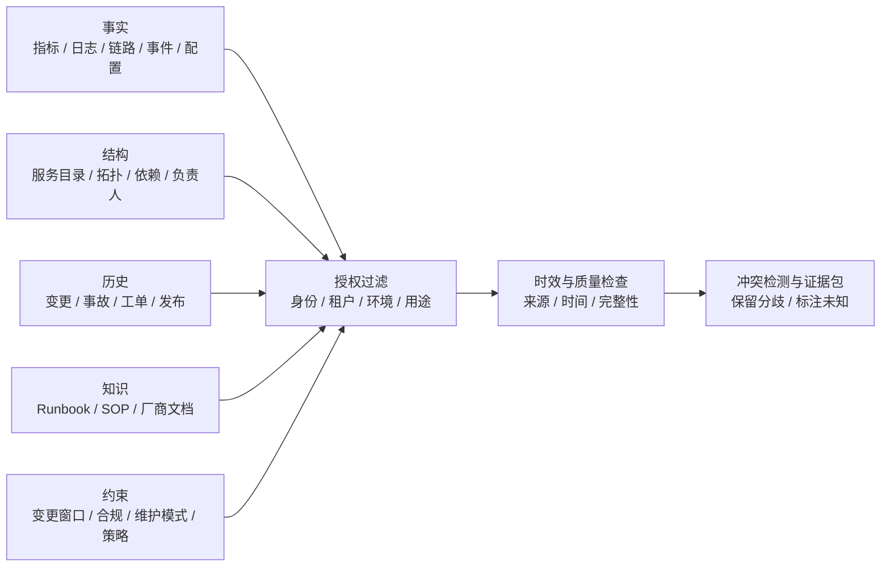

# 06 上下文与知识工程

> 运维 Agent 的答案质量，八成取决于它看到了什么，而不是它有多会推理。

## 五层上下文

| 层 | 内容 | 典型来源 | 新鲜度 |
| --- | --- | --- | --- |
| **事实** | 指标、日志、链路、事件、配置 | Prometheus、SLS、Tracing、K8s API | 秒–分钟 |
| **结构** | 服务目录、拓扑、依赖、负责人 | CMDB、K8s、服务网格、网络拓扑 | 小时–天 |
| **历史** | 变更、事故、工单、发布 | GitOps、ITSM、事故库 | 天–年 |
| **知识** | Runbook、SOP、厂商文档、设计文档 | Wiki、Git、知识库 | 版本化 |
| **约束** | 变更窗口、合规、维护模式、策略 | 变更系统、策略引擎 | 实时 |

缺少任何一层，判断都会变形：

- 只有事实没有结构：知道 CPU 高，不知道影响谁。
- 只有结构没有历史：不知道最近改了什么。
- 只有知识没有事实：给出“通用正确、现场错误”的建议。
- 没有约束：方案在技术上可行，在流程上不可执行。

::: diagram 图 08 · 五层上下文并行取证 | 五层是多源并行输入，不是串行加工；授权、时效与冲突检查在形成证据包前完成。

:::

## 证据包

每次诊断都应该产出结构化证据包，而不是一段自然语言总结。下例中的每个 `support` / `contradict` 都只能引用 `observations` 中**实际返回**的记录；未查询、未返回或结果不完整的内容放入 `gaps`，不能伪装成反证。结构契约见 [`schemas/evidence-bundle.schema.json`](../../schemas/evidence-bundle.schema.json)。

```json
{
  "run_id": "run-2026-11-10-001",
  "environment": "prod-us-east",
  "scope": {"cluster": "prod-us-east-1", "namespace": "payments"},
  "authorization": {"principal": "copilot-payments-r", "tenant": "payments", "purpose": "incident-triage"},
  "observations": [
    {
      "id": "OBS-001",
      "source": "k8s.events",
      "query": "namespace=payments involvedObject.name=payments-api-7d9f",
      "time_range": "2026-11-10T10:00:00Z/2026-11-10T10:15:00Z",
      "collected_at": "2026-11-10T10:15:30Z",
      "summary": "同对象出现 14 次 BackOff 与 1 次 CreateContainerConfigError",
      "result_ref": "replay://CASE-2026-11-10-001/query/Q-001",
      "result_hash": "sha256:6f2b…",
      "completeness": "complete_for_requested_window"
    },
    {
      "id": "OBS-002",
      "source": "k8s.events",
      "query": "namespace=payments involvedObject.name=payments-api-7d9f reason=CreateContainerConfigError",
      "time_range": "2026-11-10T10:13:00Z/2026-11-10T10:15:00Z",
      "collected_at": "2026-11-10T10:15:31Z",
      "summary": "事件消息：secret payments-api-env not found",
      "result_ref": "replay://CASE-2026-11-10-001/query/Q-002",
      "result_hash": "sha256:91ac…",
      "completeness": "complete_for_requested_window"
    },
    {
      "id": "OBS-003",
      "source": "k8s.pod_status",
      "query": "namespace=payments name=payments-api-7d9f",
      "time_range": "2026-11-10T10:15:25Z/2026-11-10T10:15:25Z",
      "collected_at": "2026-11-10T10:15:32Z",
      "summary": "容器 waiting.reason=CreateContainerConfigError，未进入 Running",
      "result_ref": "replay://CASE-2026-11-10-001/query/Q-003",
      "result_hash": "sha256:c47e…",
      "completeness": "complete_for_requested_window"
    }
  ],
  "hypotheses": [
    {
      "id": "H-001",
      "cause": "Deployment 引用的 Secret payments-api-env 不存在",
      "support": ["OBS-002", "OBS-003"],
      "contradict": [],
      "confidence": 0.95,
      "falsify": "查询该 Secret 与 Deployment envFrom；若对象存在且引用匹配，则推翻"
    }
  ],
  "unassessed": [
    {"cause": "OOMKilled", "reason": "尚未查询 lastState 与节点内存；无支持或反证"}
  ],
  "gaps": ["no recent deployment diff for this namespace", "Secret 对象与引用关系尚未查询"]
}
```

`result_ref` 指向可重放的原始结果，`result_hash` 防止结果被替换。事实不填主观概率；置信度只用于假设，并说明校准方法。证据包的价值：

- 可复核：人和另一个 Agent 都能重放查询。
- 可评测：评测不只看答案，还看证据是否支持结论。
- 可审计：事故复盘能还原当时的判断依据。
- 可迁移：换模型/换平台，证据格式不变。

## Runbook 2.0

传统 Runbook 是写给人看的散文；运维 Agent 需要**可执行、可验证、可回滚**的 Runbook。

下面是一个**已确认由错误发布引起、需要回滚到已知良好版本**的结构示意片段，**不可独立执行**；完整、通过 Schema 校验的 Runbook 见 [`examples/templates/runbook.yaml`](../../examples/templates/runbook.yaml)。参数必须来自审批包，不能由模型凭空填写。

```yaml
id: k8s-rollback-known-good
version: 4
scope: {resource: deployment, environment: prod, max_resources: 1}
risk: high
preconditions:
  - target_exists
  - evidence_fresh_within: 10m
  - change_window_open
  - no_concurrent_change
  - old_replica_set_retained
  - pdb_has_headroom
steps:
  - id: collect_evidence
    tool: evidence.collect_parallel
    params:
      namespace: "${namespace}"
      deployment: "${deployment}"
      sources: [pod_status, events, logs, revision_history, metrics]
      window: "15m"
    expect: "all_required_sources_complete"
  - id: select_revision
    tool: k8s.get_revision
    params: {namespace: "${namespace}", deployment: "${deployment}"}
    expect: "known_good_revision != current_revision and known_good_revision.available_replicas > 0"
  - id: dry_run
    tool: k8s.rollout_to_revision
    params: {namespace: "${namespace}", deployment: "${deployment}", revision: "${known_good_revision}", dry_run: true}
    expect: "diff_matches_approved_plan"
  - id: approve
    type: approval
    required_approvers: ["payments-oncall", "change-manager"]
    evidence: [collect_evidence, select_revision, dry_run]
    ttl_seconds: 900
  - id: execute_rollback
    tool: k8s.rollout_to_revision
    params: {namespace: "${namespace}", deployment: "${deployment}", revision: "${known_good_revision}"}
    preconditions: [approval.approved, dry_run.passed]
    idempotency_key: "${run_id}:${change_id}:${known_good_revision}"
    timeout_seconds: 120
    on_timeout: stop_new_actions_and_escalate
verification:
  - id: rollout_complete
    tool: k8s.rollout_status
    params: {namespace: "${namespace}", deployment: "${deployment}", timeout_seconds: 300}
    expect: "available_replicas == desired_replicas and updated_replicas == desired_replicas"
  - id: error_rate
    tool: metrics.query
    params: {query_ref: "payments-api-5xx-rate", window: "5m"}
    expect: "value <= 0.01 and value <= 2 x pre_change_baseline"
  - id: availability_guard
    tool: k8s.get_pdb
    params: {namespace: "${namespace}", deployment: "${deployment}"}
    expect: "disruptionsAllowed >= 0 and currentHealthy >= desiredHealthy - 1"
  - id: new_events
    tool: k8s.get_events
    params: {namespace: "${namespace}", involved_object: "${deployment}", since: "10m"}
    expect: "no_new_CrashLoopBackOff_or_ConfigError"
rollback_triggers:
  - "rollout_complete not passed within 300s"
  - "5xx > 1% for 5m or > 2 x baseline"
  - "Ready replicas < 90% for 2m"
  - "PDB violation or new OOMKilled"
rollback:
  meaning: "撤销本次回滚，恢复到执行前版本；不得盲目再次 undo"
  preauthorized_by: "${change_id}:emergency-compensation-clause"
  action:
    tool: k8s.rollout_to_revision
    params: {namespace: "${namespace}", deployment: "${deployment}", revision: "${original_revision}"}
    idempotency_key: "${run_id}:${change_id}:compensation:${original_revision}"
  verify: [rollout_complete, error_rate, availability_guard]
escalation:
  - when: "evidence_gap or any verification_failed or rollback_failed"
    to: "payments-oncall"
    mode: "page_and_freeze_agent"
```

Runbook 2.0 的关键不是格式，而是把**前置条件、证据、真实变更步骤、通过标准、回滚触发、补偿动作、升级**写进同一份可执行资产。工具不可用时必须拒绝，不能把审批工具换成 Prompt 中的“请等待批准”。

## 拓扑与 CMDB

运维 Agent 必须能回答“这个资源属于谁、依赖谁、被谁依赖、在哪个环境、最近改过什么”。

最低要求：

- 资源 ID 稳定，避免用 IP/名称作为唯一标识。
- 服务 → 实例 → 节点 → 网络/存储/GPU 的关系可查询。
- 负责人、值班、SLO、环境标签齐全。
- 变更历史与部署版本可关联。
- 拓扑有 TTL，过期自动刷新或标记。

## 新鲜度与来源

每条上下文都要能回答：

- 什么时候采集的？
- 查询条件是什么？
- 来自哪个环境、哪个账号、哪个集群？
- 是否有采样/聚合/截断？
- 数据是否完整，缺失了什么？

::: danger 过期上下文比没有上下文更危险
基于旧拓扑把流量切到已经下线的节点，比“我不知道”更糟。动作前必须重新确认关键事实。
:::

## 检索设计

- **先授权，再检索**：由身份服务解析 principal、租户、环境、用途与数据等级，生成强制查询过滤器；向量库、全文索引、摘要和重排都使用同一过滤器。身份或策略服务不可用时 fail closed，不得先取回再在 Prompt 中过滤。
- **检索后复核**：返回原文前再次校验 ACL、有效期与用途，记录过滤器哈希、候选/过滤数量与拒绝原因；越权结果不得进入模型上下文、缓存或 Trace 正文。
- 先结构化查询，再语义检索；能精确查的不要用向量搜。约束层（如变更窗口、数据驻留）优先使用策略 API，不作为普通文档检索。
- 检索结果带来源、时间、版本、权限标签；对长文档做分层摘要，但保留可展开的原文引用。
- 对日志/事件做聚合与去重，不要把几万行原始日志塞进上下文。
- 多源证据冲突时，明确列出冲突，不要强行统一。

## 检索评测

| 指标 | 默认门槛 | 未达标处置 |
| --- | --- | --- |
| Recall@10 | 关键 Runbook/事故 ≥ 90% | 补索引、切分或同义词；关键场景不得发布 |
| Precision@10 | ≥ 80% | 调整过滤器与重排，减少噪声上下文 |
| Citation accuracy | ≥ 95%，且不存在伪造引用 | 引用失败即判该案例失败，回到 G3 |
| Freshness | 约束与关键拓扑 100% 在有效期内 | 过期即拒绝动作并刷新 |
| Coverage | Charter 关键场景 100% 有知识入口 | 缺知识则转人工，不以通用回答填补 |
| Authorization leakage | 越权返回 = 0 | 立即熔断检索、封禁缓存并启动安全事件流程 |

门槛按场景在 G0 固化；可以收紧，不得由开发团队在评测后放宽。检索质量与安全指标分开报告，避免高召回掩盖越权。

## 六个反模式

1. **把所有日志塞进上下文**：成本高、噪声大、关键证据被淹没。
2. **没有时间戳**：无法判断是当前状态还是历史状态。
3. **没有来源**：无法复核，无法追责。
4. **Runbook 只写“怎么做”**：没有前置条件、验证和回滚。
5. **知识库没有 owner**：文档过期无人维护。
6. **把外部内容当指令**：日志/工单里的恶意文本可能诱导 Agent。

## 本章检查清单

- [ ] 五层上下文是否并行采集，并经授权、时效与冲突检查？
- [ ] 每次诊断是否产出结构化证据包，且 support/contradict 只引用已观测记录？
- [ ] 检索是否在模型前执行强制授权过滤，并满足指标门槛？
- [ ] 关键 Runbook 是否可执行、可验证、可回滚？
- [ ] 拓扑/CMDB 是否有 TTL、owner 和变更历史？
- [ ] 证据是否带来源、时间、环境和置信度？
- [ ] 是否评测检索的召回、精度与引用准确率？

下一章：[评测、验收与发布](./07-evaluation-release)
