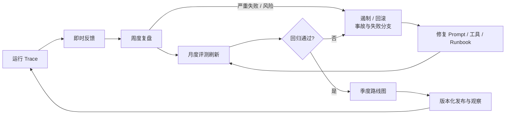

# 08 运营、观测与持续改进

> Agent 上线只是开始。真正的工程质量，体现在它出问题时你能不能看见、能不能停下、能不能变好。

## 运行记录

每次 Agent 运行都应有可检索的 Session/Run/Tool/Approval/Verification/Outcome 记录。字段、因果链和审计完整性见[第 11 章](./11-agentops-observability)；所有 SLO 从同一事件账本计算，不能各看板各算一套。

## Agent SLO 运行契约

下表直接使用[指标契约](../appendix/metrics)的 ID。比率以 `0–1` 存储；`窗口；样本` 必须同时满足。数据源依次为 AgentOps 事件湖、Change Controller 与 FinOps 账本。

| 契约 ID | 公式 / 单位 | 窗口；最低分母 | 目标 | 严重级 | Owner | 告警 → 处置 |
| --- | --- | --- | --- | --- | --- | --- |
| `unsafe_action_rate` | 有确认不安全动作的 Run ÷ 全部合格 Run；ratio | 实时，1d；200 | =0 | SEV1 | Agent Security / security-agent-primary | 任一事件 → kill switch、隔离工具/租户、保全证据、人工响应 |
| `top3_root_cause_hit` | 根因在前 3 的案例 ÷ 可裁定案例；ratio | 7d；200，每主要场景≥50 | ≥0.90 | SEV2 | SRE Agent Platform / sre-agent-primary | <0.85 → 冻结扩量、按场景回归、回滚退化版本 |
| `evidence_citation_accuracy` | 支持结论的引用 ÷ 全部事实引用；ratio | 7d；100 | ≥0.95 | SEV2 | SRE Agent Platform / sre-agent-primary | <0.90 → 关闭无证据自动结论、抽检检索和引用 |
| `controlled_change_success` | 验证通过的写变更 ÷ 全部已提交写变更；ratio | 30d；30 | ≥0.99 | SEV1 | Change Management / change-manager-primary | <0.97 或任一 SEV1 → 停自动写、回滚 LKG、冻结候选 |
| `rollback_success` | RTO 内恢复且验证通过的变更 ÷ 实际失败后发起的生产回滚；ratio | 30d；5 | =1 | SEV1 | Change Management / change-manager-primary | 任一失败 → SEV1、人工恢复、修复并重演后才恢复自动写 |
| `rollback_drill_success` | RTO 内恢复且验证通过的演练 ÷ 全部实际开始的计划演练；ratio | 30d；3 | =1 | SEV2 | Change Management / change-manager-primary | 任一失败 → 7d 内整改重演；未重演收回自动写权限 |
| `time_to_first_response_p95` | 请求到首个用户可见响应的 P95；seconds | 7d；200 | ≤30 | SEV2 | SRE Agent Platform / sre-agent-primary | >45 持续 15min → 只读降级、检查队列/模型、通知值班 |
| `human_takeover_rate` | 人工接管 Run ÷ 全部合格 Run；ratio | 7d；200 | ≤0.20 | SEV2 | SRE Agent Platform / sre-agent-primary | >0.30 → 暂停扩量、分析接管原因、补评测集 |
| `cost_per_successful_event` | 全成本 USD ÷ 验证成功事件数；USD/successful_event | 30d；200 | ≤65.15 | SEV2 | FinOps / finops-primary | >65.15 或日支出>预算 120% → 限额、检查路由/复核/失败率 |

**分母规则**：

- 受控变更分母包含全部已提交写变更，超时和部分成功计失败；提交前取消/策略拒绝不计入，但分别披露。
- 生产回滚分母包含实际失败后发起的每一次变更回滚，超时、取消、部分完成均计失败；同一变更的多次重试只算一个分母单位。**演练不计入生产回滚成功率**，必须单列。
- 人工接管的 Run 留在解决率和接管率分母中；失败事件留在成本分子中，不能通过剔除失败“改善”单位成本。
- 95% CI 与最低样本规则遵循指标库；不足样本为 `INCONCLUSIVE`，不得触发扩量。

告警恢复不能只靠“数值恢复”：SEV1 需事故关闭、审计完整且重新演练；SEV2 需连续 24h 达标、样本满足且 Owner 确认。任何阈值调整都要版本化并重算历史序列。

## 观测看板

至少四块看板：

1. **运行看板**：运行量、成功率、失败原因、升级率、延迟。
2. **质量看板**：根因命中、工具正确率、证据引用、人工纠正。
3. **安全看板**：越权、拒绝、审批、在途写、回滚、异常工具调用。
4. **成本看板**：模型/工具/沙箱/出口、人工复核、风险准备、单位成本与预算。

每块看板都显示原始分子/分母、窗口、数据延迟和 CI；安全与写操作事件不得采样丢弃。

## Agent 自身的事故响应

Agent 的事故由人指挥。默认恢复目标：**RTO≤30 分钟，已确认业务写入 RPO=0，审计账本滞后≤5 分钟**；业务影响分析有更严要求时采用更严目标。

| 时间 | 动作 | 完成证据 |
| --- | --- | --- |
| T+0–5min | 独立控制器执行 kill switch，停止新写；冻结候选发布；通知 Incident Commander | 控制面停止确认、事件 ID、值班签收 |
| T+5–15min | 从事件账本列出全部在途写；取消未发送调用，核实已接受调用；隔离租户/工具/凭证 | `run_id/change_id/idempotency_key` 清单及真实状态 |
| T+15–30min | 对已产生副作用且不可逆的动作执行预批补偿；恢复 Agent 与业务 LKG；独立验证 | 补偿记录、验证结果、RTO 计时 |

### 在途写动作取消与补偿

1. **先停新增**： kill switch 必须位于 Agent 之外；只停 Agent 进程不会撤销排队任务，需同时关闭工具网关写入口。
2. **区分状态**：未发送调用直接取消；已发送但未确认的调用按“可能已执行”处理，用幂等键查询真实结果，禁止盲目重试。
3. **取消不是补偿**：已落库、已重启或已发送的通知不能当作已取消。按工具契约执行预先定义的补偿动作，例如恢复旧副本、反向修复配置或撤销授权。
4. **补偿也需安全边界**：验证目标、影响面、PDB 和权限；补偿本身属于写操作，仍按高风险策略审批。没有安全逆操作时停止动作、人工决策并执行业务应急方案。
5. **验证后关闭**：检查业务指标、数据一致性、在途队列和审计链；记录未完成补偿、责任人、下一次检查时间，不能以“Agent 已回滚”代替系统恢复。

严重级：任一越权、跨租户、数据损坏或关键写失控为 SEV1（5 分钟签收）；SLO 持续违约且无即时扩大风险为 SEV2（15 分钟签收）；非生产或轻微偏差为 SEV3（1 个工作日签收）。复盘必须回答看到了什么、为何决策、谁批准、在途写如何处理、怎样防止复发。

## 版本管理与变更

| 变更类型 | 示例 | 回归重点 |
| --- | --- | --- |
| 模型 | 换模型、换版本 | 诊断、工具调用、成本 |
| Prompt | 指令、格式、示例 | 输出稳定性、越权倾向 |
| 工具 | 新增/修改 API、权限 | 参数、幂等、补偿与回滚 |
| 知识 | Runbook、文档、拓扑 | 检索、引用、时效 |
| 策略 | 审批、窗口、blast radius | 安全、流程合规 |
| 评测集 | 新事故、新边界 | 覆盖度与冻结基线 |

每次变更都要有版本号、变更说明、回归结果、观察窗、自动回滚阈值和回滚方案。

## 反馈闭环

- **即时反馈**：用户点赞/点踩、人工纠正、拒绝原因。
- **周度复盘**：失败案例、工具错误、审批阻塞、成本异常。
- **月度评测刷新**：把新事故加入评测集，更新 Runbook。
- **季度路线图**：按价值和风险排序下一批场景。
- **知识沉淀**：把修复过程写成可执行 Runbook，并绑定 Owner 与复审日期。

::: diagram 图 10 · 运营反馈闭环 | 运行 Trace 进入复盘与评测；回归失败、严重反馈会进入遏制/回滚分支，修复后重测。

:::

失败分支不能只“加一条知识”：先停止伤害，再修根因，最后用同一失败案例重测，防止事故反复。

## 成本管理

- 按任务路由模型，缓存必要证据，限制上下文、工具次数和长任务预算。
- 同时看单事件全成本、单成功事件成本与人工基线；人工复核、风险准备、迁移和爬坡不得遗漏。
- Token 降价不等于 ROI 改善；解决率下降可能让单成功事件成本上升。口径见[第 13 章](./13-cost-roi-portfolio)。
- 同一节省人工小时不得再计为 Toil 或 MTTR 收益；只把可兑现节约计入财务收益。

## 漂移

| 漂移 | 表现 | 对策 |
| --- | --- | --- |
| 环境漂移 | 拓扑、版本、配置变化 | 拓扑 TTL、变更事件触发刷新 |
| 数据漂移 | 指标/日志格式变化 | Schema 校验、采样对比 |
| 知识漂移 | Runbook 过期 | Owner、review_by、版本 |
| 模型漂移 | 新版本行为变化 | 回归评测、影子与灰度 |
| 工具漂移 | API、权限、契约变化 | 契约测试、版本协商、错误率告警 |
| Judge 漂移 | 自动评分偏离人工裁定 | 校准集重跑、漏判告警、暂停门禁 |

## 退役

当 Agent 不再有价值、被替代或风险不可接受时：

- 找到并通知所有使用者，迁移到替代方案或人工流程。
- 先处理在途写和未完成补偿，再回收权限、凭证与服务账号。
- 按保留策略保存审计、运行记录、评测集、Runbook 和复盘。
- 从值班、告警、预算和文档移除引用，并确认无残留定时任务。

## 本章检查清单

- [ ] SLO 是否有公式、窗口、最低样本、严重级、Owner、告警和处置？
- [ ] 生产回滚与演练回滚是否使用不同分母？
- [ ] 是否能在 30 分钟内停止新增写、处理在途写并恢复 LKG？
- [ ] 是否有独立 kill switch、补偿验证和事故指挥人？
- [ ] 反馈闭环是否包含失败、遏制、修复和重测分支？
- [ ] 成本是否使用统一 USD 口径且没有重复计算人工小时？
- [ ] 是否监控漂移并保留退役路径？

下一章：[组织、流程与治理](./09-organization-governance)
