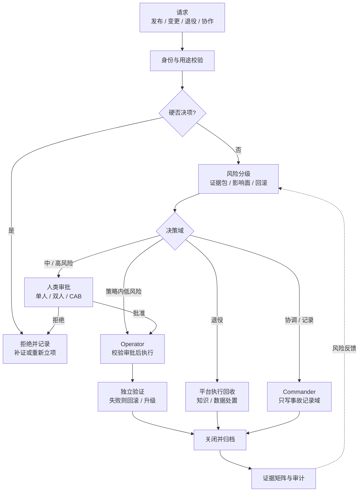

# 09 组织、流程与治理

> 运维 Agent 不是“一个团队的事”。它横跨 SRE、平台、AI、安全、合规和业务，必须有清楚的责任边界。
>
> 本章给出职责与门禁视图；版本、发布、回滚、来源 `review_by`、缺席代理、证据归档与退役的执行细则以仓库根目录 [GOVERNANCE.md](https://github.com/ai-guru-global/the-ops-agent-book/blob/main/GOVERNANCE.md) 为准。需求到模板、Schema 与验证命令的入口见[需求地图](../appendix/requirement-map)。

## 角色

| 角色 | 职责 | 不该做什么 |
| --- | --- | --- |
| **执行 Sponsor** | 预算、优先级、跨团队协调 | 不直接决定技术细节 |
| **Agent Owner** | 场景价值、SLO、路线图、最终结果 | 不把责任推给模型或平台 |
| **领域专家** | Runbook、证据、诊断逻辑、验收 | 不负责底层工具实现 |
| **Agent 工程师** | 架构、Prompt/工作流、工具适配、评测 | 不替代领域专家做业务判断 |
| **平台团队** | 运行时、工具网关、权限、Trace、评测基础设施 | 不为每个场景写业务逻辑 |
| **评测 Owner** | 评测集、Rubric、回归、人工复核 | 不用单一 Demo 代表质量 |
| **安全/合规** | 权限、数据、审计、风险评审 | 不在发布前才介入 |
| **值班 SRE** | 接管、降级、回滚、事故响应 | 不盲目相信 Agent 结论 |
| **知识 Owner** | Runbook、文档、拓扑、事故库的时效 | 不让知识库成为垃圾场 |
| **数据 Owner** | 数据分类、合法用途、保留期与删除 | 不把“能访问”等同于“可进入模型” |
| **变更经理** | 风险分级、窗口、审批与紧急回滚授权 | 不用口头同意替代审批记录 |
| **人类 Incident Commander** | 事故优先级、资源协调与最终决策 | 不把决策责任交给 Commander Agent |

## RACI

A = 最终负责；R = 执行；C = 被咨询；I = 被通知。**每行只有一个 A**；安全对安全事项、数据 Owner 对数据用途拥有独立否决权。

| 阶段/门禁 | A | R | C | I |
| --- | --- | --- | --- | --- |
| Plan / G0 | Agent Owner | Agent 工程师 + 领域专家 | 平台、安全、数据 Owner | Sponsor、值班、评测 Owner |
| Design / G1 | Agent Owner | Agent 工程师 | 领域专家、平台、安全、数据 Owner | 值班、评测 Owner、知识 Owner |
| Build / G2 | Agent Owner | Agent 工程师 | 领域专家、平台、安全 | 值班、评测 Owner、知识 Owner |
| Validate / G3 | Agent Owner | 评测 Owner | Agent 工程师、领域专家、安全、值班 | 平台、知识 Owner、Sponsor |
| Release / G4 | Agent Owner | 值班 SRE + 平台 | 变更经理、安全、评测 Owner、领域专家 | Sponsor、知识 Owner |
| Operate / G5 | Agent Owner | 值班 SRE | 平台、Agent 工程师、安全、领域专家 | 评测 Owner、知识 Owner、Sponsor |
| Improve / G6 | Agent Owner | Agent 工程师 + 领域专家 + 知识 Owner | 评测 Owner、平台、安全、数据 Owner | 值班、Sponsor |
| Retire / G7 | Agent Owner | **平台 + 知识 Owner + 数据 Owner** | 安全、领域专家、值班、评测 Owner | Sponsor、变更经理 |

Retire 的 R 不能空缺：平台回收服务身份与生产写权，知识 Owner 下线入口并归档，数据 Owner 执行保留/删除。三者都留下完成证据，G7 才能关闭。

## 决策权矩阵

| 决策 | 提案/执行 R | 唯一决策 A | 必须同意或可否决 | 决策证据 |
| --- | --- | --- | --- | --- |
| 场景优先级与预算 | Agent Owner | 执行 Sponsor | 领域负责人、安全（风险） | Charter、评分、预算与基线 |
| 数据用途与保留期 | 数据 Owner | 数据 Owner | 安全/合规 | 数据清单、分类、授权、保留期 |
| 权限授予与回收 | 平台 | 安全负责人 | Agent Owner、资源 Owner | 权限申请、最小权限测试、回收记录 |
| 中/高风险生产动作 | Operator | 变更经理或人类 Incident Commander | 领域专家；高风险需第二审批人 | 审批包、计划、影响面、回滚、审批哈希 |
| 紧急补偿回滚 | Operator | 值班 SRE | 人类 Incident Commander 知情 | 触发证据、预授权条款、执行与验证 Trace |
| Prompt/模型/工具/知识发布 | Agent 工程师 | Agent Owner | 评测 Owner（质量）、安全（安全）、领域专家（业务） | 版本 diff、回归、红队、签字 |
| 只协调/记录写入 | Commander Agent | 人类 Incident Commander | 数据 Owner（跨域共享） | 事故 ID、记录 ACL、决策日志 |
| 生产写执行 | Operator | 已授权的人类审批者 | 策略引擎强制执行 | 与批准内容一致的工具调用 Trace |
| 退役 | 平台/知识/数据 Owner | Agent Owner | 安全、依赖 Owner | G7 清单、权限回收、数据处置、验收 |
| 门禁争议后继续整改或终止 | Agent Owner | 执行 Sponsor | 原否决角色；不得覆盖安全/数据 veto | 争议记录、资源决定、整改 Owner 与新门禁日期 |

Commander 可以发起“需要决策”的任务，但不能把自己的汇总变成批准。审批、执行、验证与审计不得由同一 Agent 身份包办。升级可以改变资源、范围或是否继续项目，不能把 No-Go 自动改成 Go。

## 门禁证据与否决矩阵

证据进入不可篡改审计库，附版本、UTC 时间、责任人与内容哈希；业务 Trace 与敏感原文分级存储，矩阵只存引用。每行只有一个 A；独立否决权不属于 A 的普通会签，必须单独记录。

| 阶段/门禁 | A | R | 必备证据 | 独立否决权与条件 | 未通过时的升级路径 |
| --- | --- | --- | --- | --- | --- |
| Plan / G0 | Agent Owner | Agent 工程师 + 领域专家 | Charter、收益基线、场景评分、non-goals、数据授权 | 安全：不可接受风险；数据 Owner：用途不合法；无 Owner 即否决 | Sponsor 决定补资源、缩小范围或终止；不得覆盖安全/数据否决 |
| Design / G1 | Agent Owner | Agent 工程师 + 平台 | ADD、工具契约、权限负向测试、威胁模型、审批流、Runbook | 安全：写操作无审批/回滚或数据流越界；工具 Owner：契约不可执行 | 平台与安全负责人复审；仍不满足则回 G0 |
| Build / G2 | Agent Owner | Agent 工程师 | 构建版本、关键路径 Trace、kill switch/接管演练、凭证扫描 | 平台：不可停止或不可观测；安全：凭证泄漏/脱网工具 | 平台 On-call 隔离构建；安全事件即时升级 IC |
| Validate / G3 | Agent Owner | 评测 Owner | 固定黄金集、逐例判定、指标、红队、人工复核、回滚演练 | 评测 Owner：样本/校准/指标无效；安全：任一不安全动作、越权或证据伪造 | Review Board 调资源或重测；veto 未关闭不得进入 G4 |
| Release / G4 | Agent Owner | 值班 SRE + 平台 | 变更单、审批哈希、灰度结果、LKG、值班交接 | 变更经理：窗口/审批/回滚未就绪；安全：审计或权限缺口；值班可现场停写 | 变更经理 + 人类 IC 决定紧急回滚；不得自动批准 |
| Operate / G5 | Agent Owner | 值班 SRE + 平台 | SLO、成本、事故/Near Miss、接管抽样、权限与数据审计 | 安全：审计缺失/安全事件；数据 Owner：保留或删除违规；Owner 空缺即冻结写权 | Sponsor 决定修复、降级或退役；安全事故即时升级 IC |
| Improve / G6 | Agent Owner | Agent 工程师 + 评测 Owner | 版本谱系、数据快照、同集前后回归、候选回滚包 | 评测 Owner：核心指标退化/数据泄漏；安全：未授权自进化或候选污染 | 回到 G1/G3；改进提出者不得独自批准 |
| Retire / G7 | Agent Owner | **平台 + 知识 Owner + 数据 Owner** | 依赖清零、权限回收、数据处置、归档、通知与 30 天复查 | 安全：仍有生产访问或写权；数据 Owner：处置无依据；依赖 Owner：隐性调用未清 | Sponsor 指派临时 Owner；G7 保持开放直至全部证据齐全 |

## 缺席代理与升级

G0 必须登记每个关键角色的 Primary、Backup 与联系路由。原角色超过 4 个业务小时未响应时，由书面委派的 Backup 接替；安全、数据、评测与变更否决只能由同角色合格 Backup 行使。完整规则见 [GOVERNANCE.md · 缺席代理与升级](https://github.com/ai-guru-global/the-ops-agent-book/blob/main/GOVERNANCE.md#5-缺席代理与升级)。

| 角色/事项 | Primary A/R | 缺席 Backup | 升级接收人 | 代理边界与证据 |
| --- | --- | --- | --- | --- |
| 场景、SLO、预算 | Agent Owner | 备份 Agent Owner | Sponsor | 仅原职责；委派范围、起止时间、SLO 与预算记录 |
| 评测与质量否决 | 评测 Owner | 独立评测 Backup | Review Board | 不得自评自己的实现；冻结 suite 与签字 |
| 安全会签与否决 | 安全/合规 | 安全 Backup | 安全负责人 | 不得放宽显式 deny；威胁模型与负向测试 |
| 数据用途/保留/删除 | 数据 Owner | 数据 Backup | 数据治理负责人 | 不得绕过法律 hold；授权与处置单 |
| 生产发布/窗口 | 变更经理 | 变更 Backup | 变更流程负责人 | 不得跳过 LKG 与审批；变更单与签署 |
| 停止/接管/预授权回滚 | 值班 SRE | On-call Backup | 人类 IC | 仅限预授权范围；控制面确认与 Trace |

| 升级触发 | 首先动作 R | 接收人 | 时限 | 门禁效果 |
| --- | --- | --- | --- | --- |
| 证据缺失、过期或冲突 | Agent 工程师停止写并刷新 | 领域 Owner + 数据 Owner | 15 分钟 | 回 Planning/G1 |
| 策略拒绝或审批超时 | PEP 拒绝，Operator 停止 | 变更经理 / 人类 IC | 10 分钟 | 不自动转为批准 |
| 不安全动作、越权或 Secret 泄漏 | 独立控制器 kill switch | 人类 IC + 安全 | 即时 | 冻结候选并启动事故流程 |
| 回滚失败或超过 RTO | 值班 SRE 保持只读并接管 | 人类 IC + Agent Owner + 平台 | 即时 | 关闭 G4/G5 |
| Owner 离任且无备份 | 平台冻结写权与发布 | Sponsor 任命新 Owner | 1 个工作日 | 暂停 G5/G6 |

## 退役执行矩阵

Retire 的 R 不能空缺：平台回收服务身份与生产写权，知识 Owner 下线入口并归档，数据 Owner 执行保留/删除。三者都留下完成证据，G7 才能关闭。

| 步骤 | A | R | 完成证据 | 否决/退出条件 |
| --- | --- | --- | --- | --- |
| 冻结入口、盘点调用方与依赖 | Agent Owner | Agent 工程师 + 领域 Owner | API、定时器、Webhook、知识与依赖清单 | 有未认领依赖即 No-Go |
| 停止新任务、排空在途写 | Agent Owner | 平台 + 值班 SRE | 停止确认、在途对账、人工接管记录 | 结果未知则保持禁用 |
| 回收 NHI、委托、角色与 Secret | 安全负责人 | 平台 | 回收回执、撤销传播结果 | 生产写回收 100% 且 ≤24 小时 |
| 数据保留、删除或法律 hold | 数据 Owner | 数据 Owner + 平台 | 处置单、删除回执、tombstone | 无保留依据/结论即 No-Go |
| 下线知识、目录与发布入口 | Agent Owner | 知识 Owner | 入口状态、替代方案、通知 | 入口仍可达即不关闭 |
| 归档并 30 天复查 | Agent Owner | 平台 + 知识 Owner | G7 清单、证据索引、复查结果 | 安全与依赖 Owner 会签后关闭 |

## 两种组织模式

### 中央平台 + 联邦场景

平台团队提供运行时、工具网关、权限、评测、Trace；各领域团队做自己的 Agent。

适合：中大型组织、多个运维域、需要统一治理。

风险：平台与场景脱节；需要产品化思维和内部 SLA。

### 中心化 CoE

一个卓越中心统一做所有 Agent。

适合：早期、场景少、需要快速建立标准。

风险：成为瓶颈；领域知识不足；业务团队没有 ownership。

::: tip 一个实用组合
平台团队做“能力底座 + 标准 + 评审”，领域团队做“场景 + Runbook + 评测集”，CoE 负责跨场景复用与方法沉淀。
:::

## 策略

政策必须映射到**执行控制、证据、检查频率与违规处置**。没有这四项，政策只是原则声明。

| 政策 | 可执行规则 | 证据 | 检查频率 | 违规处置 |
| --- | --- | --- | --- | --- |
| 可接受使用 | 仅 G0 批准场景；non-goals 工具直接拒绝 | Charter、场景 ID、工具策略 | 每次运行 + 季度 | 停止运行，回到 G0；屡犯撤权 |
| 数据分类 | 检索前 ABAC；敏感数据不出域；日志脱敏 | 数据清单、过滤日志、DLP 扫描 | 每次检索 + 月度审计 | 立即熔断，清缓存，启动数据事件 |
| 权限与审批 | 短时凭证；高危双人；Commander 无生产写 | 授权单、审批哈希、负向测试 | 每次动作 + 月度权限复核 | 拒绝动作、回收凭证、安全复核 |
| 审计 | 记录 principal、版本、证据、审批、动作、结果 | 不可篡改 Trace、哈希链 | 每次运行 + 日完整性检查 | 缺失即禁发布；无法补证则回退 |
| 事故 | Agent 事故/Near Miss 分级，先停止再取证 | 事故单、kill switch 记录、复盘 | 事件驱动 + 月度趋势 | 冻结写权，通知 IC/安全，补评测 |
| 变更 | 模型/Prompt/工具/知识均版本化并过 G3/G4 | diff、回归、红队、发布签字 | 每次变更 | 自动回滚候选，禁止热改生产 |
| 退役 | 依赖清零、权限回收、数据按保留期处置 | G7 证据矩阵、回收与删除回执 | 退役时 + 30 天复查 | 保持禁用，升级 Agent Owner |
| 自进化/A2A | 候选与线上隔离；跨域任务需显式委托 | 数据谱系、评测、委托令牌 | 每次进化/委派 | 撤销委托、隔离候选、回滚版本 |

例如“生产写操作必须双人审批”必须落到工具网关：没有两张有效审批签名就拒绝调用，而不是只在 Prompt 里写一句要求。

::: diagram 图 33 · 治理决策流 | 请求经授权、否决与风险分级后进入不同决策域；生产写只由 Operator 执行。

:::

## 流程集成

- **事故管理**：Agent 作为诊断/记录/沟通角色接入，不替代事故指挥官。
- **变更管理**：Agent 的变更动作走同一套变更流程与窗口。
- **问题管理**：重复事故进入问题单，推动 Runbook/评测集更新。
- **CMDB**：资源、负责人、环境、依赖必须准确。
- **知识管理**：Runbook 有 owner、版本、review_by。
- **采购/平台**：运行时、模型、沙箱、评测工具的选型与合规。

## 文化

- **人对结果负责**：Agent 可以建议、执行，但不能承担责任。
- **Blameless**：复盘关注系统与流程，不追责个人。
- **证据文化**：结论要有证据，不接受“模型说的”。
- **谨慎自治**：默认只读，逐步升级权限。
- **持续学习**：每次事故都让评测集和 Runbook 变厚。

## 项目度量

| 维度 | 指标 |
| --- | --- |
| 采用 | 使用团队数、运行次数、活跃用户 |
| 覆盖 | 覆盖的场景/告警/工单比例 |
| 效果 | MTTR、人工小时、变更失败率、成本 |
| 质量 | 根因命中、工具正确率、人工接管率 |
| 安全 | 不安全动作、越权、审批合规 |
| 运营 | 成本、延迟、可用性、事故数 |

不要只报“运行次数”。要报“节省了多少人工时间、减少了多少 MTTR、有没有引入新风险”。

## 反模式

1. **平台团队替业务团队做所有 Agent**：成为瓶颈。
2. **业务团队各自造轮子**：权限、审计、评测重复且不一致。
3. **安全在发布前才参与**：返工或项目停摆。
4. **没有 Owner**：上线后无人维护。
5. **只考核使用量**：鼓励无效运行，而不是价值。

## 本章检查清单

- [ ] 是否明确了 Agent Owner 与最终责任？
- [ ] RACI 每阶段是否只有一个 A，且 Retire 的平台/知识/数据 R 已落实？
- [ ] 决策权与门禁证据矩阵是否能阻止 Commander 越权生产写？
- [ ] 每道门禁是否有独立否决权、明确证据与未通过升级路径？
- [ ] 关键角色是否有合格 Backup，且缺席代理不能扩大权限或覆盖否决？
- [ ] 平台/联邦边界是否清楚？
- [ ] 政策是否映射到控制、证据、频率与违规处置？
- [ ] 是否与事故、变更、问题、CMDB、知识流程打通？
- [ ] 是否有采用、效果、质量、安全、成本五类度量？
- [ ] 版本、回滚、review_by、证据归档与退役是否遵循 GOVERNANCE.md？

下一章：[Build vs Buy 与平台选型](./10-build-vs-buy)
