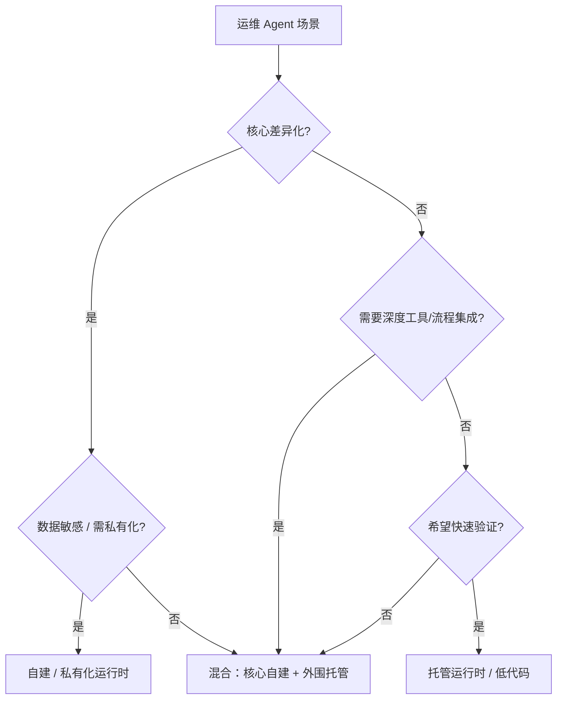

# 10 Build vs Buy 与平台选型

> 选平台不是选“最强的模型”，而是选一套能承载你的证据、工具、权限、评测和运营的系统。

## 先问五个问题

1. 这个 Agent 是不是我们的差异化能力？
2. 数据是否敏感，是否要求不出域/私有化？
3. 需要多深的工具与流程集成？
4. 团队是否具备运行时、评测、安全、值班能力？
5. 多长时间内要看到价值？

## Build / Buy / Hybrid

| 方案 | 适合 | 优势 | 代价 |
| --- | --- | --- | --- |
| **自建** | 差异化强、集成深、数据敏感 | 完全可控、可定制 | 工程量大、需要平台能力 |
| **托管运行时** | 想快速上线、团队小 | 运维、弹性、沙箱、观测现成 | 受平台能力与计费约束 |
| **低代码平台** | 快速验证、流程相对标准 | 上手快、可视化 | 复杂工具/权限/评测受限 |
| **混合** | 核心自建、外围托管 | 平衡控制与速度 | 需要清晰的边界与集成 |

对多数运维 Agent，**混合**是现实答案：运行时/沙箱/模型网关用托管，工具、Runbook、评测集、权限策略自己掌握。

::: diagram 图 11 · Build / Buy / Hybrid 的判断路径 | Build / Buy / Hybrid 的判断路径；核心差异化与数据敏感度决定自建边界。

:::

## 平台能力清单

| 能力 | 必须问的问题 |
| --- | --- |
| 运行时 | 支持长任务、会话恢复、弹性、并发吗？ |
| 沙箱 | 隔离级别、启动速度、状态持久化、网络策略？ |
| 工具/MCP | 能接入内部 API 吗？有工具治理与凭证管理吗？ |
| 模型 | 多模型路由、Fallback、私有模型、成本控制？ |
| 上下文 | 知识库、记忆、检索、上下文压缩？ |
| 评测 | 数据集、Rubric、回归、人工复核？ |
| 观测 | Trace、工具调用、成本、审计、告警？ |
| 安全 | RBAC、审批、数据驻留、审计、密钥管理？ |
| 可移植 | 能否导出 Prompt、数据、Trace、评测集？ |

## 阿里 Agent 产品映射

阿里在官方 Agent 服务目录之外，还有一层运行、开发与治理产品。对运维 Agent 最相关的是：

| 产品 | 在运维 Agent 中的位置 | 关键点 |
| --- | --- | --- |
| **AgentRun** | Serverless Agent 运行时、沙箱、模型治理、工具/MCP、观测 | 适合把 Agent 从原型推到生产；支持代码/容器、长任务、会话 |
| **AgentScope** | 开源多智能体框架 + Runtime/Studio | 适合自建、可控、多 Agent 协作；可结合 FC/沙箱 |
| **Agent Sandbox / AgentBay** | 安全隔离执行环境 | 代码执行、浏览器/桌面操作、状态持久化 |
| **Qoder Cloud Agents** | 全托管长时 Agent 运行 | 适合 7×24 长任务、异步、批量并发 |
| **百炼 / Model Studio** | 低代码 Agent、RAG、工具、Skills | 适合快速验证与标准流程 |
| **AgentLoop** | Agent 观测、评估与优化 | 用于 Trace、评测、持续优化 |
| **Agentic OS** | Agent-first 操作系统 | 主机级 Agent 运行、Skills、安全执行 |
| **STAROps** | 全域智能运维平台 | 运维数据、流程、场景的承载平台 |
| **Spring AI Alibaba / Qwen-Agent** | Java / Python Agent 框架 | 适合已有技术栈的深度集成 |

更完整的清单、分类与官方来源见[附录：阿里 Agent 产品全景](../appendix/alibaba-agent-landscape)。

::: warning 不要把“官方 Agent 目录”当成全部
官方 Agent 服务目录里的 36 个 Agent 是“可即用的产品化 Agent”；AgentRun、AgentScope、AgentBay 等是“构建/运行/治理 Agent 的基础设施”。选型时先确定你要买的是哪一层。
:::

## 三种参考架构

### 1. 自建可控型

```text
AgentScope / Spring AI Alibaba / 自研编排
  + 内部工具网关（MCP/OpenAPI）
  + Agent Sandbox / AgentBay（执行隔离）
  + 自建 Trace/评测/权限
```

适合：数据敏感、工具深度集成、需要完全控制。

### 2. 托管运行型

```text
AgentRun / Qoder Cloud Agents（运行时）
  + 内部工具网关
  + AgentLoop（观测/评测）
  + 自建 Runbook/评测集
```

适合：团队小、希望快速上线、接受托管约束。

### 3. 低代码验证型

```text
百炼 Agent / 低代码工作台
  + 官方 Skills / 少量自定义工具
  + 人工审批
```

适合：POC、标准流程、非核心场景。

## 锁定与可移植性

选型时坚持四条：

1. **工具契约归你**：工具 schema、权限、审计不依赖某个平台的私有格式。
2. **协议开放**：优先 MCP、OpenAPI、A2A 等开放协议。
3. **数据可导出**：Trace、评测集、知识库、运行记录可导出。
4. **评测可迁移**：换模型/平台后，同一套评测集还能跑。

## TCO 要算全

选型时至少把建设、运行、维护、安全、人力与机会成本算进去；完整口径、单位经济与 ROI 测算见[第 13 章](./13-cost-roi-portfolio)。

只比较 Token 单价，通常会低估总成本。

## 决策清单

- [ ] 这个场景是否为核心差异化？
- [ ] 数据是否敏感/需私有化？
- [ ] 需要多深的工具与流程集成？
- [ ] 平台是否支持长任务、沙箱、观测、评测、权限？
- [ ] 是否能导出数据与评测集？
- [ ] 是否有明确的退出/迁移方案？
- [ ] TCO 是否算全？
- [ ] 谁负责运行与迭代？

下一篇：[场景手册导读](../playbooks/)
