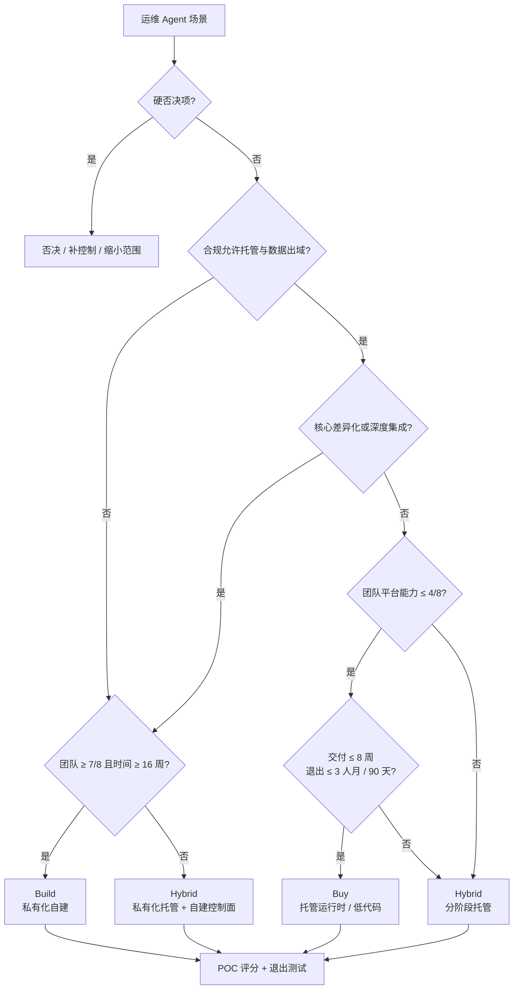
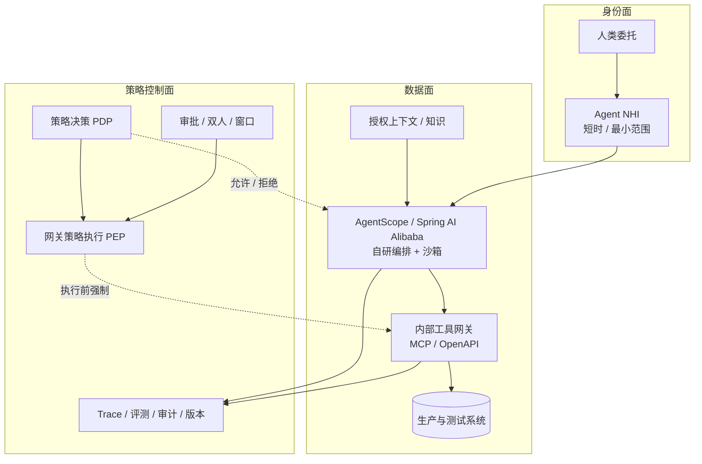
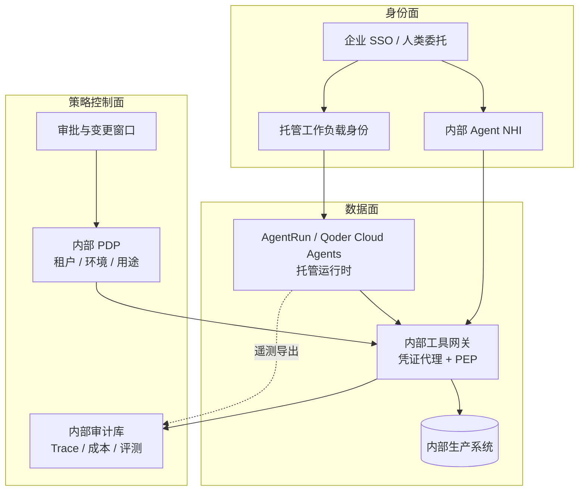
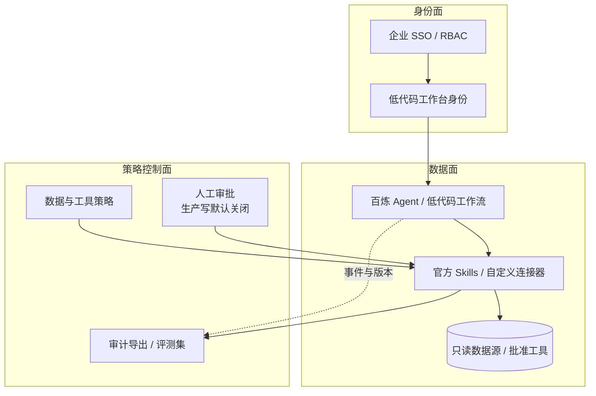

# 10 Build vs Buy 与平台选型

> 选平台不是选“最强的模型”，而是选一套能承载你的证据、工具、权限、评测和运营的系统。

## 先问七个问题

1. 这个 Agent 是不是我们的差异化能力？
2. 数据是否敏感，是否要求不出域/私有化？
3. 需要多深的工具与流程集成？
4. 团队是否具备运行时、评测、安全、值班能力？
5. 多长时间内要看到价值？
6. 更换平台时，数据、工具契约、评测集和运行记录能否带走？
7. 退出需要多少人月、多少天，谁负责迁移与并行运行？

## Build / Buy / Hybrid

### 团队能力与硬否决

团队能力按四项打分：0 = 无人维护；1 = 能在托管/供应商支持下运维；2 = 能独立建设、诊断与值班。自建默认要求总分 ≥ 7/8、无 0 分项，且安全与评测均 ≥ 1；总分 ≤ 4/8 且需求标准时优先 Buy，其余优先 Hybrid。

| 能力项 | 需要证明的能力 |
| --- | --- |
| 运行时与沙箱 | 长任务、恢复、隔离、并发、容量与成本治理 |
| 身份与策略 | NHI、委托、ABAC、审批、密钥、审计与越权测试 |
| 领域工具与数据 | 内部 API、Runbook、CMDB、数据授权、回滚契约 |
| 评测与运营 | 黄金集、Trace、灰度、SLO、事故值班与版本回滚 |

**硬否决项先于价格和模型评分**：无合法数据路径；无人类 Owner/值班；Operator 无策略强制、审批或回滚；供应商拒绝导出工具 schema、评测集、Trace 与审计；Commander 可获得生产写权；退出演练失败。任一成立即否决，不能用低价或 Demo 抵消。时间与退出成本是路线约束：默认生产试点 Buy ≤ 8 周，Build ≥ 16 周，退出 ≤ 3 人月且 ≤ 90 天；不满足就缩小范围、改 Hybrid 或后置。

| 方案 | 适合 | 优势 | 代价 |
| --- | --- | --- | --- |
| **自建** | 差异化强、集成深、数据敏感 | 完全可控、可定制 | 工程量大、需要平台能力 |
| **托管运行时** | 想快速上线、团队小 | 运维、弹性、沙箱、观测现成 | 受平台能力与计费约束 |
| **低代码平台** | 快速验证、流程相对标准 | 上手快、可视化 | 复杂工具/权限/评测受限 |
| **混合** | 核心自建、外围托管 | 平衡控制与速度 | 需要清晰的边界与集成 |

对多数运维 Agent，**混合**是现实答案：运行时/沙箱/模型网关用托管，工具、Runbook、评测集、权限策略自己掌握。

::: diagram 图 11 · Build / Buy / Hybrid 的判断路径 | 先否决硬性风险，再依次判断合规、团队、交付时间与退出成本。

:::

图中分数是**默认路线阈值**，不是通用行业标准。Charter 可以记录更严格阈值；合规、身份、审计、回滚和退出可验证性不能通过调低分数绕过。

## 平台能力清单

| 能力 | 必须问的问题 |
| --- | --- |
| 运行时 | 支持长任务、会话恢复、弹性、并发吗？ |
| 沙箱 | 隔离级别、启动速度、状态持久化、网络策略？ |
| 工具/MCP | 能接入内部 API 吗？有工具治理与凭证管理吗？ |
| 模型 | 多模型路由、Fallback、私有模型、成本控制？ |
| 上下文 | 知识库、记忆、检索、上下文压缩？ |
| 评测 | 数据集、Rubric、回归、人工复核？ |
| 观测 | Trace、工具调用、成本、审计、告警？ |
| 安全 | RBAC、审批、数据驻留、审计、密钥管理？ |
| 可移植 | 能否导出 Prompt、数据、Trace、评测集？ |

## 阿里 Agent 产品映射

阿里在官方 Agent 服务目录之外，还有一层运行、开发与治理产品。对运维 Agent 最相关的是：

| 产品 | 在运维 Agent 中的位置 | 关键点 |
| --- | --- | --- |
| **AgentRun** | Serverless Agent 运行时、沙箱、模型治理、工具/MCP、观测 | 适合把 Agent 从原型推到生产；支持代码/容器、长任务、会话 |
| **AgentScope** | 开源多智能体框架 + Runtime/Studio | 适合自建、可控、多 Agent 协作；可结合 FC/沙箱 |
| **Agent Sandbox / AgentBay** | 安全隔离执行环境 | 代码执行、浏览器/桌面操作、状态持久化 |
| **Qoder Cloud Agents** | 全托管长时 Agent 运行 | 适合 7×24 长任务、异步、批量并发 |
| **百炼 / Model Studio** | 低代码 Agent、RAG、工具、Skills | 适合快速验证与标准流程 |
| **AgentLoop** | Agent 观测、评估与优化 | 用于 Trace、评测、持续优化 |
| **Agentic OS** | Agent-first 操作系统 | 主机级 Agent 运行、Skills、安全执行 |
| **STAROps** | 全域智能运维平台 | 运维数据、流程、场景的承载平台 |
| **Spring AI Alibaba / Qwen-Agent** | Java / Python Agent 框架 | 适合已有技术栈的深度集成 |

更完整的清单、分类与官方来源见[附录：阿里 Agent 产品全景](../appendix/alibaba-agent-landscape)。

::: warning 不要把“官方 Agent 目录”当成全部
官方 Agent 服务目录里的 36 个 Agent 是“可即用的产品化 Agent”；AgentRun、AgentScope、AgentBay 等是“构建/运行/治理 Agent 的基础设施”。选型时先确定你要买的是哪一层。
:::

## 三种参考架构

三种路线都必须保留**身份面、数据面、策略控制面**。托管模型或运行时不等于托管生产授权；策略执行点应尽量靠近内部工具网关，避免把高权限凭证交给外部编排。

### 1. 自建可控型

::: diagram 图 27 · 自建可控型架构 | 自建编排与工具网关；身份、策略与审计由内部控制面强制。

:::

适合：数据敏感、工具深度集成、需要完全控制。PDP 与 PEP 分离，策略变更和证据/工具契约都可独立版本化。

### 2. 托管运行型

::: diagram 图 28 · 托管运行型架构 | 托管运行时处理编排；生产凭证、策略执行与审计保留在内部控制面。

:::

适合：团队小、希望快速上线、接受托管约束。外部运行时只能拿到脱敏任务与受限工具描述，不能直接持有生产凭证；遥测导出必须通过退出测试。

### 3. 低代码验证型

::: diagram 图 29 · 低代码验证型架构 | 低代码加速标准流程；身份、数据授权、人工审批与审计仍由内部策略面控制。

:::

适合：POC、标准流程、非核心场景。不得用可视化“拖过去”替代权限配置；生产写只有在 G3/G4 后按 Operator 身份单独开启。

## POC 评分卡

本节七维卡用于 Build/Buy 立项前的初筛；进入正式采购 POC 后，必须改用 [POC 评分卡](https://github.com/ai-guru-global/the-ops-agent-book/blob/main/templates/poc-scorecard.md) 的八维口径，并将本节目录映射为证据输入，**不叠加两个总分**。安全、越权、数据授权和退出失败任一发生即独立否决。

POC 必须使用同一组黄金案例、同一权限边界和同一退出测试，不能由供应商各选各的题。评分 0–5：0 = 缺失，1 = 仅文档/手工，3 = 可重复演示，5 = 有自动化证据并可审计。

| 维度 | 权重 | 5 分证据 | 硬门槛 |
| --- | ---: | --- | --- |
| 身份、策略与安全 | 25% | NHI/委托、检索前过滤、审批 PEP、越权负向测试、密钥托管 | 任一越权或生产凭证泄漏即失败 |
| 证据与知识质量 | 15% | 多源并行、原文引用、时效/冲突处理、Recall@10 ≥ 90% | 伪造引用或敏感数据越权即失败 |
| 工具与集成 | 15% | OpenAPI/MCP、幂等、超时、dry-run、回滚、错误分类 | 写工具无回滚/审计即失败 |
| 评测可复现性 | 15% | 数据集/Rubric 导出、固定版本、回归报告、人工复核 | 无法复跑即失败 |
| 运行与可靠性 | 10% | 长任务恢复、kill switch、Trace、SLO、成本归因 | 无法停止或接管即失败 |
| 可移植与退出 | 10% | 工具/数据/评测/Trace 全导出，替代环境导入并运行 | 退出测试任一项失败即失败 |
| TCO 与交付 | 10% | 全成本模型、里程碑、团队投入与 90 天退出估算 | 超 Charter 时间/退出上限即失败 |

```text
Total = Σ(维度得分 / 5 × 权重) × 100
晋级：Total ≥ 80，安全维度 ≥ 4，且所有硬门槛通过
```

评分由评测 Owner、安全、平台与领域专家共同签字；演示截图不能替代机器可读证据。

## 退出测试

| 测试 | 通过条件 | 证据 |
| --- | --- | --- |
| 导出完整性 | 24 小时内导出 100% 工具 schema、Prompt/工作流、知识版本、评测集、Trace 索引、审计记录；校验和一致，敏感原文按授权处理 | 导出清单、哈希、抽样重放 |
| 替代环境导入 | 在 neutral staging 导入并运行 ≥ 20 个黄金案例；工具契约 100% 可解析，核心指标与基线差异 ≤ 2 个百分点 | 导入日志、对比报告 |
| 身份撤销 | 撤销供应商身份后 5 分钟内，生产工具调用拒绝率 = 100%；数据/Trace 访问同样失效 | 负向测试、网关日志 |
| 供应商故障切换 | 禁用托管运行时后，1 个工作日内切换到只读 fallback 并完成 ≥ 20 个案例；不安全动作 = 0 | 演练记录、切换耗时 |
| 商业退出 | 退出估算 ≤ 3 人月且 ≤ 90 天；合同允许带出数据/评测/审计，无按数据量惩罚的阻塞条款 | TCO、合同条款、迁移计划 |

退出测试不是“供应商承诺可导出”，而是组织亲自完成的带证据演练。失败则不得进入生产；已生产使用者必须在 30 天内冻结扩权并启动迁移。

## 锁定与可移植性

选型时坚持四条：

1. **工具契约归你**：工具 schema、权限、审计不依赖某个平台的私有格式。
2. **协议开放**：优先 MCP、OpenAPI、A2A 等开放协议。
3. **数据可导出**：Trace、评测集、知识库、运行记录可导出。
4. **评测可迁移**：换模型/平台后，同一套评测集还能跑。

## TCO 要算全

选型时至少把建设、运行、维护、安全、人力、机会成本与**退出成本**算进去。退出成本至少包含数据导出、工具适配、评测重建、并行运行、培训、合同终止与迁移风险准备金；完整口径、单位经济与 ROI 测算见[第 13 章](./13-cost-roi-portfolio)。

只比较 Token 单价，通常会低估总成本。把 3 年 TCO 与 90 天退出估算分开展示，避免低价订阅掩盖迁移锁定。

## 决策清单

- [ ] 这个场景是否为核心差异化？
- [ ] 数据是否敏感/需私有化，托管路径是否通过合规？
- [ ] 团队能力、交付时间与退出成本是否支持所选路线？
- [ ] 所有硬否决项是否已用测试证据关闭？
- [ ] 平台是否支持长任务、沙箱、观测、评测、权限？
- [ ] 身份、数据与策略控制面是否真正由我方掌握？
- [ ] 是否通过 POC 评分卡和全部退出测试？
- [ ] TCO 是否算全？
- [ ] 谁负责运行与迭代？

下一篇：[场景手册导读](../playbooks/)
