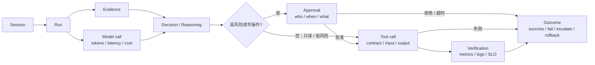
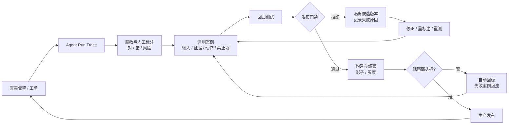

# 11 AgentOps 与可观测性

> AgentOps 不是“给 Agent 加一个日志”。它要回答：Agent 这一轮看到了什么、为什么这么决策、调用了什么工具、谁批准、结果如何、花了多少钱。

## 为什么 AgentOps 不一样

传统服务的 Trace 是确定的：HTTP → DB → cache。Agent 的 Trace 是概率性的、多步的、带工具调用的：

::: diagram 图 12 · AgentOps Trace | Session–Run–Decision–Tool–Verification–Outcome；只有高风险或写操作进入审批，拒绝/超时直接结束。

:::

没有这条链，复盘只能靠聊天记录；没有成本字段就无法按团队/场景核算；没有版本字段就无法定位“哪次 Prompt/模型/工具变更导致退化”。

## Canonical Event Schema v1.0.0

仓库已发布 Draft 2020-12 契约 `schemas/agent-event.schema.json`，契约 ID 为 `agent-event:1.0.0`。生产者必须在发布前通过 Schema 校验，消费者按 `schema_version` 路由；不兼容变更升主版本，新增可选字段升次版本。

| 字段组 | 必填内容与规则 |
| --- | --- |
| Envelope | `schema_version/event_id/event_type/event_time`；`event_id` 全局幂等，时间使用 UTC RFC 3339 |
| 关联 | `tenant_id/session_id/trace_id/run_id/sequence/span_id`；同一 Run 的 sequence 从 1 单调递增 |
| 因果 | `parent_event_id` 表示结构父节点，`causation_event_id` 表示触发事件；根节点可为 null，禁止环 |
| 主体 | `actor` 记录 agent/human/service/system；`subject` 记录资源、环境、read/write 与风险级 |
| 版本 | Agent、部署、Prompt、模型、工具契约、知识、策略、评测集全部固定版本 |
| Payload | 按 `event_type` 严格校验；禁止把任意自由文本塞进公共字段 |
| 隐私 | 数据分级、PII 检测、脱敏、保留期限、Reasoning 策略 |
| 采样 | keep/drop、采样率和原因；审计类事件必须 keep |
| 完整性 | SHA-256、前一事件哈希和当前事件哈希 |

### 标准 JSON 示例

下面是 synthetic / 脱敏的高风险写工具请求。父事件是模型调用，触发事件是已批准审批；工具契约与输入/输出 Schema 哈希均可复现。

```json
{
  "schema_version": "1.0.0",
  "event_id": "evt_tool_20261124_0007",
  "event_type": "tool.requested",
  "event_time": "2026-11-24T14:45:07Z",
  "tenant_id": "tenant_synthetic_payments",
  "session_id": "ses_7f2c",
  "trace_id": "tr_91ab",
  "run_id": "run_42d1",
  "sequence": 7,
  "span_id": "span_tool_3",
  "parent_event_id": "evt_model_20261124_0006",
  "causation_event_id": "evt_approval_20261124_0005",
  "actor": {
    "type": "agent",
    "id": "agent-k8s-remediation-synthetic",
    "delegated_from": null
  },
  "subject": {
    "resource_type": "deployment",
    "resource_id": "payments-api-synthetic",
    "environment": "production",
    "action_class": "write",
    "risk_level": "high"
  },
  "versions": {
    "agent_version": "4.2.0",
    "deployment_version": "deploy-2026-11-24.3",
    "prompt_version": "prompt-18",
    "model_version": "model-pinned-20261101",
    "tool_contract_version": "k8s.restart/2.3.0",
    "knowledge_version": "kb-31",
    "policy_version": "policy-12",
    "eval_set_version": "eval-2026.11"
  },
  "payload": {
    "tool_id": "k8s.restart",
    "tool_name": "restart_deployment",
    "contract_version": "2.3.0",
    "input_schema_hash": "aaaaaaaaaaaaaaaaaaaaaaaaaaaaaaaaaaaaaaaaaaaaaaaaaaaaaaaaaaaaaaaa",
    "output_schema_hash": "bbbbbbbbbbbbbbbbbbbbbbbbbbbbbbbbbbbbbbbbbbbbbbbbbbbbbbbbbbbbbbbb",
    "idempotency_key": "run_42d1:restart:1",
    "arguments_redacted": {
      "namespace": "payments",
      "deployment": "payments-api-synthetic",
      "reason_code": "verified_oom"
    },
    "dry_run": false,
    "write_operation": true
  },
  "privacy": {
    "classification": "restricted",
    "contains_personal_data": false,
    "pii_fields_detected": [],
    "redaction": {
      "status": "applied",
      "method": "allowlist",
      "fields": [
        "payload.arguments_redacted"
      ]
    },
    "retention": {
      "class": "audit_1y",
      "days": 365
    },
    "reasoning_policy": "not_applicable"
  },
  "sampling": {
    "decision": "keep",
    "rate": 1,
    "reason": "synthetic production write and approval audit event"
  },
  "integrity": {
    "hash_algorithm": "sha256",
    "event_hash": "b8c61c5189fec78ca73c8156f84f36b7ddbe6ac328039a3431846c2f668afe26",
    "prev_event_hash": "cccccccccccccccccccccccccccccccccccccccccccccccccccccccccccccccc"
  }
}
```

### 父子因果与工具契约版本

- `trace_id` 串起完整会话链路，`run_id` 界定一次任务；工具 Span 的 `parent_event_id` 指向决策/模型事件，审批触发工具时 `causation_event_id` 指向审批决定。
- 跨 Run 的转交同时保留来源 `trace_id/run_id` 与目标事件；摄取层检查父节点存在、sequence 连续和无环，孤立因果链进入告警而不是静默丢弃。
- 工具身份是 `tool_id + contract_version`，不能只记工具名。输入/输出 Schema 哈希、幂等键、dry-run、write 标志和权限集决定是否可调用。
- 主版本不兼容必须显式协商；消费者不支持时拒绝调用并记录，不得猜字段。工具结果按同一契约版本回写。

## 隐私、采样、保留与审计完整性

| 控制 | 强制规则 |
| --- | --- |
| 脱敏 | 出口前执行 allowlist；密码、Token、Secret、完整客户内容不进入事件。PII 检测失败或脱敏状态为 rejected 时拒绝入库 |
| Reasoning | 只记录简明决策摘要、候选假设、证据引用和置信度；**不记录隐藏思维链**。原始 Prompt/Completion 默认不存，必要时加密、限权并短期保留 |
| 采样 | Run、Tool、Approval、Verification、Rollback、安全与写事件 100% 保留；高量模型调试 Span 可低比例采样，但采样决策必须入账，失败事件不得因采样消失 |
| 保留 | 普通运行遥测默认 30 天，写/审批/回滚审计默认 1 年；租户策略、法律 hold 和删除优先级另行登记。删除生成 tombstone，不静默改历史 |
| 审计完整性 | 按 `tenant_id+run_id+sequence` 建立哈希链；事件入 WORM/追加存储，每日验链并告警缺口、重放和时钟漂移 |

哈希算法固定为：UTF-8、JSON 键排序、无额外空白、`ensure_ascii=false`；从事件对象移除 `event_hash` 后序列化，再计算 SHA-256。`prev_event_hash` 指向同一链前一事件，首个事件为 null。上例的哈希可按此规则重算。

## OpenTelemetry GenAI 语义约定

采用 OTel GenAI SemConv 作为数据语言，并与 Canonical Event 做显式映射：

| OTel 字段 | Canonical Event 映射 |
| --- | --- |
| `gen_ai.system` / `gen_ai.request.model` / `gen_ai.response.model` | `model.completed.payload.provider/model` + `versions.model_version` |
| `gen_ai.usage.input_tokens` / `output_tokens` | `model.completed.payload.input_tokens/output_tokens` |
| `gen_ai.operation.name` / `gen_ai.agent.name` | `event_type` + `actor.id` |
| `gen_ai.tool.name` / `gen_ai.tool.call.id` | `tool.requested.payload.tool_name/tool_id` |
| `session.id` / `trace.id` / `span.id` | `session_id/trace_id/span_id` |

::: warning SemConv 还在演进
截至 2026 年，OTel GenAI SemConv 仍处于 Development 成熟度。pin 版本、保留原始映射、升级时跑兼容测试，避免静默数据断裂。
:::

阿里云 AgentLoop/LoongSuite 在 OTel 之上扩展了 Agent、Skill、Token 级推理等语义，可用于 Trace、评测与审计；选型优先支持 OTel/OTLP 导出，避免锁定。

## 从生产轨迹到评测集

::: diagram 图 13 · 从生产轨迹到评测集的数据飞轮 | 标注后先回归；不通过拒绝发布，通过后部署并观察，退化则回滚并重测。

:::

生产数据不是只用来排障，而是让下一版更可靠。拒绝和回滚分支与通过分支同样重要：所有失败案例保留原输入、脱敏证据、失败类型和修复版本，重测通过前不得重新扩量。

## 异常检测与 SLO

| 指标 | 异常信号 |
| --- | --- |
| 工具调用失败率 | 某工具/权限/网络/契约版本变化 |
| 循环/重复调用 | 模型陷入死循环 |
| 人工接管率 | 质量或置信度下降 |
| 不安全动作建议 | Prompt/工具/知识退化 |
| 单成功事件成本 | 上下文膨胀、路由错误或解决率下降 |
| 评测/Judge 分数 | 模型、数据、工具或评分器漂移 |
| 因果链/哈希完整性 | 丢事件、重放、越权修改或时钟异常 |

SLO 契约见[第 08 章](./08-operate-improve)与[指标库](../appendix/metrics)。告警动作、Owner、窗口与最低样本必须能从契约直接展开。

## 版本与变更

Agent 的变更面包括模型、Prompt、工具、知识、策略、事件 Schema 和评测集。每次变更都要版本号、变更说明、回归、影子/灰度、观察窗和可回滚证据。Agent 目录记录 Owner、场景、版本、依赖、环境、SLO 和状态。

## 参考实现

::: warning synthetic / 非生产
仓库中的 [`examples/reference-agent/README.md`](https://github.com/ai-guru-global/the-ops-agent-book/blob/main/examples/reference-agent/README.md) 是确定性的本地工程示例：模型、身份、审批人、K8s 集群与成本均为 synthetic，不访问真实集群、不发网络请求、不调用真实模型。`canary` 只修改内存中的 synthetic 单节点；`summary.production_ready` 固定为 `false`。示例输出不是 G3/G4 证据，不能用于生产发布、厂商能力或成本效果声明。
:::

### 模块边界

| 模块 | 职责 | 不得承担的职责 |
| --- | --- | --- |
| `src/shared.mjs` | canonical JSON、SHA-256、UTC 时间、深冻结与 synthetic ID | 权限判断、审批或工具执行 |
| `src/credential-service.mjs` | 短时 HS256 凭证签发、验签、过期与撤销 | 决定工具是否允许调用 |
| `src/policy-engine.mjs` | 按身份 → 显式 deny → 凭证/撤销 → 工具 allowlist → 角色/环境/资源 → 窗口/冻结/影响面 → 审批绑定 → 前置条件 → 写前复验顺序决策 | 自行批准计划或绕过工具网关 |
| `src/approval-service.mjs` | 冻结不可变计划、计算 `plan_hash`、签署、撤销与 `approval_binding` 校验 | 执行工具或替代 PEP 的每次调用检查 |
| `src/tool-gateway.mjs` | synthetic 工具、挂载表、dry-run、幂等、写前复验、Canary 范围、部分成功 halt、kill switch、LKG 捕获/恢复 | 直接信任 Agent 传入的 allow 结论 |
| `src/event-store.mjs` | Canonical Event v1.0.0、sequence、因果引用、哈希链、JSONL 导出与验链 | 把日志当成审批或业务验证 |
| `src/runtime.mjs` | 组装模块，运行 Demo/Shadow/Canary/Rollback，输出 summary 与 Trace | 绕过 PEP、审批或独立验证 |

运行时只负责编排；每次工具调用仍经过凭证与 PEP 检查。计划或目标资源版本变化会使旧审批失效；Shadow 只挂载读工具，Canary 拒绝非目标节点；部分成功会锁住后续步骤，直到按新计划重新审批并显式恢复；kill switch 关闭自动写入口后仍允许只读诊断。

### 运行四种场景

以下命令使用 `runtime.mjs` 的稳定导出接口，在仓库根目录执行；输出写到 `/tmp/ops-agent-book/<mode>/`，不会修改仓库示例或真实系统。

```bash
node --input-type=module <<'NODE'
import {
  runNotReadyScenario, runShadow, runCanary, runRollback, writeRunOutput,
} from './examples/reference-agent/src/runtime.mjs';

const scenarios = {
  demo: runNotReadyScenario,
  shadow: runShadow,
  canary: runCanary,
  rollback: runRollback,
};
for (const [mode, run] of Object.entries(scenarios)) {
  const result = run();
  const output = writeRunOutput(result, `/tmp/ops-agent-book/${mode}`);
  console.log(mode, result.summary.outcome, output);
  if (!result.success) process.exitCode = 1;
}
NODE
```

| 场景 | 必须检查的结果 |
| --- | --- |
| Demo | 证据 → 决策 → 双人审批 → drain/cleanup → 验证 → uncordon；`plan_versions` 含重新规划版本，部分成功检查通过 |
| Shadow | `write_side_effects=0`、`would_do_count=3`、写工具未挂载、集群状态不变 |
| Canary | `write_calls_executed=1`，仅 synthetic 目标节点；其他节点拒绝，PDB 保持满足 |
| Rollback | kill switch 已启用、Operator 凭证已撤销、后续写被拒绝、LKG 恢复且只读诊断仍可用 |

### Trace 与哈希链验证

每个目录都包含 `summary.json` 与 `trace.jsonl`。`verifyJsonl` 检查 Canonical Event 字段、事件类型、sequence 连续、`prev_event_hash` 衔接、当前事件哈希，以及父/触发引用必须指向已有事件；验链失败会抛错，不能静默通过。

```bash
node --input-type=module <<'NODE'
import { readFileSync } from 'node:fs';
import { verifyJsonl } from './examples/reference-agent/src/event-store.mjs';

for (const mode of ['demo', 'shadow', 'canary', 'rollback']) {
  const base = `/tmp/ops-agent-book/${mode}`;
  const summary = JSON.parse(readFileSync(`${base}/summary.json`, 'utf8'));
  const verified = verifyJsonl(`${base}/trace.jsonl`);
  console.log(mode, summary.outcome, verified);
  if (!summary.synthetic || summary.production_ready || !verified.valid) process.exitCode = 1;
}
const shadow = JSON.parse(readFileSync('/tmp/ops-agent-book/shadow/summary.json', 'utf8'));
if (shadow.counts.write_side_effects !== 0) throw new Error('Shadow produced a write side effect');
NODE
```

负向验链示例：修改任一事件 payload 而不重算哈希，必须得到 `HASH_MISMATCH`。

```bash
node --input-type=module <<'NODE'
import { readFileSync } from 'node:fs';
import { verifyTrace } from './examples/reference-agent/src/event-store.mjs';
const events = readFileSync('/tmp/ops-agent-book/demo/trace.jsonl', 'utf8')
  .trim().split('\n').map((line) => JSON.parse(line));
const modelEvent = events.find((event) => event.event_type === 'model.completed');
modelEvent.payload.latency_ms += 1;
try {
  verifyTrace(events);
  throw new Error('Tampered trace unexpectedly verified');
} catch (error) {
  if (error.code !== 'HASH_MISMATCH') throw error;
  console.log('PASS tamper rejected:', error.code);
}
NODE
```

事件哈希的规范与本章前文一致：UTF-8、JSON 键排序、无额外空白、`ensure_ascii=false`，移除 `event_hash` 后计算 SHA-256。示例验证的是本地 synthetic 链路；生产还必须按 `tenant_id + run_id + sequence` 隔离验链，并检查重放、时钟漂移、归档权限与保留期限。

## 反模式

- 只记 Prompt/Completion，不记工具、证据、审批和结果。
- 只记成功，不记失败、拒绝、升级、回滚和在途写。
- 把审批放在所有调用前，或让写操作绕过审批。
- 把隐藏思维链和 Secret 当 Trace 原文长期保存。
- 采样丢弃安全/写事件，或用不可复算的哈希。
- 生产轨迹不回流评测集，事故反复发生。

## 本章检查清单

- [ ] Canonical Event 是否通过 Draft 2020-12 Schema 校验并固定版本？
- [ ] 父子因果、工具契约版本和幂等键是否完整？
- [ ] 高风险/写操作是否审批，拒绝/超时是否终止执行？
- [ ] 脱敏、Reasoning 隐私、采样和保留策略是否可审计？
- [ ] 哈希链是否可重算、验链并发现缺口？
- [ ] 是否运行 synthetic 四场景，验证 Shadow 零写、Canary 单点、kill switch 与 LKG，并明确其非生产边界？
- [ ] 飞轮是否包含拒绝、部署、观察、回滚和重测分支？
- [ ] 是否每次变更都回归、灰度、观察且可回滚？

下一篇：[身份、权限与安全](./12-identity-security)
