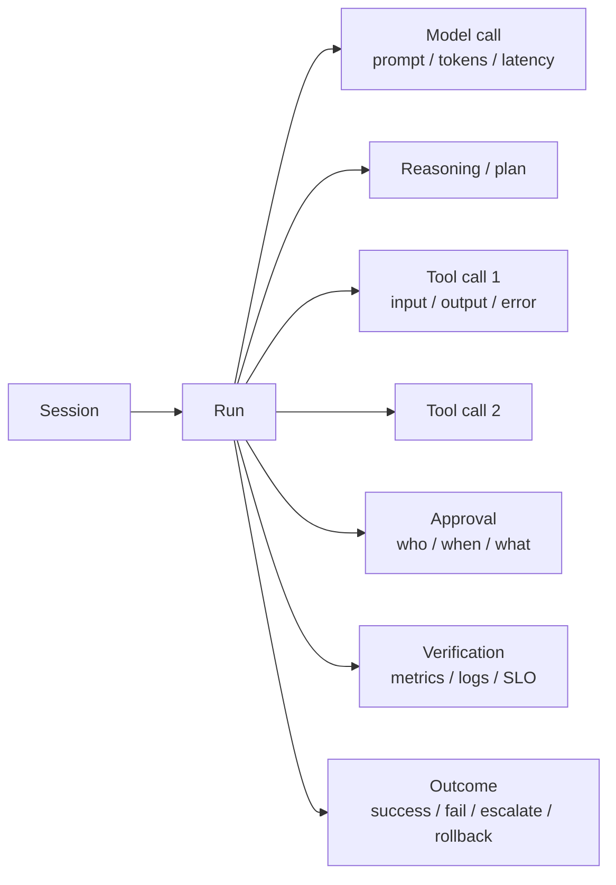
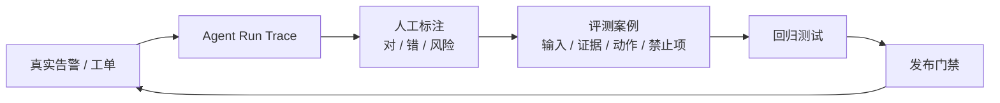

# 11 AgentOps 与可观测性

> AgentOps 不是“给 Agent 加一个日志”。它要回答：Agent 这一轮看到了什么、为什么这么决策、调用了什么工具、谁批准、结果如何、花了多少钱。

## 为什么 AgentOps 不一样

传统服务的 Trace 是确定的：HTTP → DB → cache。Agent 的 Trace 是概率性的、多步的、带工具调用的：

::: diagram 图 12 · AgentOps Trace | Session–Run–Tool–Approval–Outcome 的 Trace 结构；成本和版本必须可归因。

:::

没有这条链，事故复盘只能靠聊天记录；没有成本字段，就无法按团队/场景核算；没有版本字段，就无法定位“是哪次 Prompt/模型/工具变更导致退化”。

## 九个运营层

| 层 | 作用 | 关键问题 |
| --- | --- | --- |
| **可观测性** | 看 Agent 在做什么 | Trace/Session/工具调用/证据是否完整？ |
| **评测** | 上线前证明质量 | 评测集、Rubric、回归是否可信？ |
| **Prompt/版本管理** | 可回滚地变更 | Prompt/模型/工具/知识是否版本化？ |
| **链路追踪** | 定位故障点 | 能否从告警下钻到模型/工具/数据？ |
| **成本控制** | 防止账单失控 | Token/调查/沙箱/数据出口是否可归因？ |
| **安全** | 防越狱/越权/投毒 | 工具、身份、数据、供应链是否受控？ |
| **人工审批** | 控制高风险动作 | 审批包、双人、超时、回滚是否就绪？ |
| **评测数据飞轮** | 持续变好 | 生产轨迹能否变成评测集？ |
| **目录/依赖/退役** | 可运维 | Agent 目录、依赖、版本、下线是否清楚？ |

## OpenTelemetry GenAI 语义约定

采用 OTel GenAI SemConv 作为数据语言，至少标准化：

| 字段 | 用途 |
| --- | --- |
| `gen_ai.system` | 模型/提供商标识 |
| `gen_ai.request.model` / `gen_ai.response.model` | 请求/响应模型 |
| `gen_ai.usage.input_tokens` / `output_tokens` | Token 与成本 |
| `gen_ai.operation.name` | 操作类型（chat/tool/agent） |
| `gen_ai.agent.name` | Agent 标识 |
| `gen_ai.tool.name` / `gen_ai.tool.call.id` | 工具调用 |
| `session.id` / `trace.id` / `span.id` | 会话与链路关联 |

::: warning SemConv 还在演进
截至 2026 年，OTel GenAI SemConv 仍处于 Development 成熟度，字段会演进。把它当版本化契约：pin 版本、做字段映射、升级时跑兼容测试，避免“静默数据断裂”。
:::

阿里云 AgentLoop/LoongSuite 在 OTel 之上扩展了 Agent、Skill、Token 级推理等语义，可用于 Trace、评测、经营分析与审计；选型时优先支持 OTel/OTLP 导出，避免锁定。

## 运行记录数据模型

一次 Run 至少记录：

- **输入**：请求、操作者、来源、环境、范围。
- **证据**：查询、来源、时间、结果摘要。
- **决策**：候选假设、选择理由、置信度。
- **动作**：工具、参数、审批、执行结果。
- **验证**：指标、日志、SLO、结论。
- **成本**：Token、工具调用、沙箱、耗时。
- **版本**：模型、Prompt、工具、知识、策略、评测集。
- **结果**：成功/失败/升级/回滚。

字段要能按 `tenant`、`team`、`scenario`、`agent_version` 聚合，才能做成本归因与质量分析。

## 从生产轨迹到评测集

::: diagram 图 13 · 从生产轨迹到评测集的数据飞轮 | 生产轨迹经过标注、评测、回归与发布门禁，回到下一轮生产。

:::

这条飞轮是 AgentOps 最大的价值：**生产数据不是只用来排障，而是用来让下一版更可靠。**

## 异常检测与 SLO

除了传统延迟/错误率，还要监控 Agent 特有指标：

| 指标 | 异常信号 |
| --- | --- |
| 工具调用失败率 | 某工具/权限/网络变化 |
| 循环/重复调用 | 模型陷入死循环 |
| 人工接管率 | 质量或置信度下降 |
| 不安全动作建议 | Prompt/工具/知识退化 |
| 单次运行成本 | 上下文膨胀/模型路由错误 |
| 评测分数 | 模型/数据/工具漂移 |

SLO 指标与门槛见[第 08 章](./08-operate-improve)与[指标与 SLO 库](../appendix/metrics)；AgentOps 侧重点监控工具失败、循环调用、接管率、成本异常等 Agent 特有信号。

## 版本与变更

Agent 的变更面比普通服务更广：模型、Prompt、工具、知识、策略、评测集。每次变更都要：

1. 版本号 + 变更说明。
2. 回归评测（至少黄金集）。
3. 影子/灰度。
4. 可回滚。
5. 变更后观察窗口与复盘。

Agent 目录要记录：Owner、场景、版本、依赖工具/模型/知识、环境、SLO、状态（实验/灰度/生产/退役）。

## 实施路线

| 阶段 | 目标 |
| --- | --- |
| 第 1 步 | 统一 Trace：Session/Run/Tool/Approval/Outcome |
| 第 2 步 | 成本归因：Token/工具/沙箱/数据出口 |
| 第 3 步 | 评测数据飞轮：生产轨迹 → 评测集 |
| 第 4 步 | 异常检测 + SLO + 告警 |
| 第 5 步 | 版本/目录/依赖/退役治理 |

## 反模式

- 只记 Prompt/Completion，不记工具调用与证据。
- 只记成功，不记失败/升级/回滚。
- 不做成本归因，月底才发现账单异常。
- 没有 Agent 版本，无法定位退化来源。
- 生产轨迹不回流评测集，事故反复发生。

## 本章检查清单

- [ ] 是否有 Session/Run/Tool/Approval/Outcome 的完整 Trace？
- [ ] 是否采用 OTel GenAI SemConv 或等价标准，并 pin 版本？
- [ ] 是否能按租户/团队/场景/版本归因成本？
- [ ] 是否有评测数据飞轮？
- [ ] 是否监控循环、接管率、不安全动作、成本异常？
- [ ] 是否有 Agent 目录、依赖、版本、退役管理？
- [ ] 是否每次变更都回归 + 灰度 + 可回滚？

下一篇：[身份、权限与安全](./12-identity-security)
