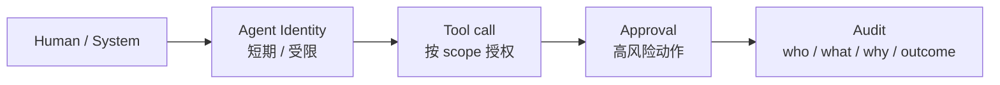

# 12 身份、权限与安全

> 运维 Agent 的安全，不是“加一个内容审核”。它要回答：Agent 是谁、代表谁、能做什么、做完谁负责。

## Agent 身份（NHI）

Agent 是一个非人类身份（Non-Human Identity, NHI），必须有：

- **唯一身份**：不是共用人的账号，不是共享 API Key。
- **归属**：属于哪个团队/场景/Owner。
- **委托关系**：代表谁、在什么条件下、多长时间。
- **最小权限**：按工具、资源、环境、时间、blast radius。
- **短时凭证**：按任务签发，任务结束即失效。
- **可审计**：每次调用记录身份、委托、审批、动作。

::: diagram 图 14 · 身份、委托与审计链 | 人类/系统委托给 Agent 身份，再按 scope 调用工具、审批与审计。

:::

::: warning 不要给 Agent 一个“超级账号”
共享高权限账号会让事故无法归因、权限无法回收、审计无法通过。Agent 身份要像服务账号一样被治理，而不是像人的账号一样被借用。
:::

## 委托与权限模型

基础权限模型（工具、资源、环境、时间、blast radius、审批）见[第 05 章](./05-tools-permissions)。身份章额外回答三个问题：

| 维度 | 问题 |
| --- | --- |
| Principal / 委托链 | Agent 代表谁？委托是否可传递？上级权限被回收后是否立即失效？ |
| Credential | 凭证是否短时、按工具授权、不落盘、不进入 Prompt/日志？ |
| 审计与回收 | 每次调用能否回答“谁、代表谁、做了什么、谁批准”？退役时能否立即回收？ |

## OWASP Agentic Top 10（2026）

| 风险 | 在运维场景中的表现 | 控制 |
| --- | --- | --- |
| **ASI01 目标劫持** | 恶意日志/工单诱导 Agent 改变目标 | 外部内容不可信、目标与范围校验、工具 allowlist |
| **ASI02 工具滥用** | 调用了不该调用的高危工具 | 工具契约、最小权限、审批、blast radius |
| **ASI03 身份/权限滥用** | 借用高权限账号、越权访问 | NHI、短时凭证、委托、RBAC/ABAC |
| **ASI04 供应链漏洞** | 第三方 Skill/MCP Server 被投毒 | 签名/校验、来源白名单、隔离、审计 |
| **ASI05 恶意代码执行** | Agent 生成/执行恶意脚本 | 沙箱、只读挂载、egress 控制、代码审查 |
| **ASI06 记忆投毒** | 污染长期记忆/知识库，持续影响决策 | 记忆来源、TTL、隔离、写入审批 |
| **ASI07 不安全通信** | Agent 间/工具间通信被窃听/篡改 | mTLS、身份认证、最小暴露面 |
| **ASI08 级联故障** | 一个 Agent 的错误动作扩散到多系统 | 熔断、速率限制、blast radius、人工接管 |
| **ASI09 人机信任利用** | 利用审批疲劳/过度信任绕过人 | 审批包、风险分级、双人、审计 |
| **ASI10 失控 Agent** | Agent 持续运行/自我复制/逃避监管 | kill switch、预算/时长上限、行为基线、隔离 |

同时参考：OWASP LLM Top 10（2026）、Agentic Skills Top 10（AST10）、MCP Top 10（2025）；它们分别覆盖模型、技能、协议层风险。

## 威胁建模

运维 Agent 的威胁面比聊天机器人多四个：

1. **工具面**：工具参数、权限、幂等、回滚、注入。
2. **数据面**：日志/工单/网页中的恶意指令；敏感数据进入上下文。
3. **身份面**：委托链、凭证、跨租户、权限漂移。
4. **供应链面**：Skill、MCP Server、模型、依赖包、插件。

每个工具都要问：最坏情况是什么？谁批准？如何回滚？如何审计？

## 安全控制清单

### 输入/上下文

- 外部内容一律视为不可信数据，不当作指令。
- 结构化工具参数，不从自然语言拼接 shell。
- 敏感字段脱敏；跨租户隔离；上下文带来源/时间。
- 记忆写入有来源、TTL、审批；防止记忆投毒。

### 工具/执行

- 工具 allowlist + 契约 + 最小权限。
- 高危动作：双人审批、dry-run、变更窗口、回滚。
- 沙箱执行；egress 控制；只读挂载；无明文凭证。
- 速率/并发/时长/预算上限；循环检测；kill switch。

### 身份/审计

- NHI + 委托 + 短时凭证。
- 每次调用记录：谁、代表谁、工具、参数、审批、结果。
- 审计日志 append-only、可检索、可导出。
- 定期权限复核与回收；退役即回收。

### 供应链

- Skill/MCP/插件来源白名单 + 签名/哈希校验。
- 第三方代码在沙箱运行；最小网络/文件权限。
- 依赖版本锁定；升级前回归；供应链事件响应。

## 事故场景

| 场景 | 应对 |
| --- | --- |
| 日志中的恶意指令诱导 Agent 删除资源 | 拒绝、隔离、审计、更新评测集 |
| 第三方 Skill 窃取凭证 | 撤销凭证、隔离 Skill、供应链排查 |
| Agent 循环调用导致账单暴涨 | 预算/速率熔断、kill switch、根因分析 |
| Agent 越权访问其他租户 | 身份/权限审计、隔离、通知合规 |
| 审批疲劳导致人放过高危动作 | 风险分级、双人、审批包改进 |

## 本章检查清单

- [ ] Agent 有唯一 NHI、归属、委托、短时凭证吗？
- [ ] 权限按工具/资源/环境/时间/blast radius 收紧了吗？
- [ ] 高危动作有双人审批、dry-run、回滚、审计吗？
- [ ] 外部内容被视为不可信数据吗？
- [ ] Skill/MCP/插件有来源白名单、签名、沙箱吗？
- [ ] 记忆/知识有来源、TTL、写入审批吗？
- [ ] 有 kill switch、预算/时长上限、人工接管吗？
- [ ] 是否按 OWASP Agentic Top 10 做过威胁建模与测试？

下一篇：[成本、ROI 与组合管理](./13-cost-roi-portfolio)
