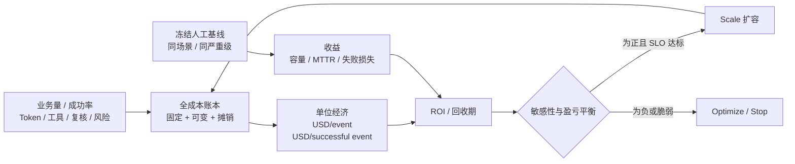

# 13 成本、ROI 与组合管理

> Agent 项目的失败，往往不是“做不出来”，而是“算不过账”。没有冻结基线、全量成本和敏感性的 ROI，只是演示算术。

## 统一口径

所有金额统一为 USD，记录价格日期、汇率日期和税率处理；月度与年化分别标注。Token 单价统一换算为 `USD/1M tokens`，工时统一为小时，再乘 loaded 人力成本。不得把 Token、次数、小时和金额直接相加。

收益只计一次：

- **节省人工小时是容量收益的输入**，不是额外一条“Toil 收益”。Toil 可标记工时来源，但不能再次计入 ROI。
- 如果 MTTR 收益已经包含恢复工时，则该部分不得再进入容量收益。
- 未真正裁撤或重新部署的工时，单列为“释放容量”；只有可兑现的加班、外包或编制避免才能列为现金收益。

## TCO 要算全

| 成本 | 计算内容 | 防重复规则 |
| --- | --- | --- |
| 平台/许可 | 订阅、席位、事件量、调查次数、Credits | 与按量模型费核对账单，避免同一推理被双重计费 |
| 模型 | 输入/输出 Token、微调、路由、缓存与重试 | 用实际账单用量，不只看目录价 |
| 工具/沙箱/出口 | API、Sandbox、GPU、存储、数据出口、观测 | 固定 quota 与超量单价分开 |
| **人工复核** | 事件数 × 复核率 × 分钟/60 × loaded USD/小时 | 放成本侧，不再作为“节省工时”收益 |
| 实施 | 数据接入、工具适配、权限、流程、培训 | 一次性成本按摊销期分摊 |
| **迁移** | 旧流程切换、数据清洗、双跑、退出与回迁 | 不得藏在“实施”标题下重复列支 |
| **爬坡** 生产力损失 | 学习、监督、低采用期和额外返工 | 与正式人工复核分开，按实际月份摊销 |
| 运营 | 值班、评测、Prompt/知识/工具维护 | 只计增量人力，已有岗位成本需说明分摊 |
| 安全/合规 | 审计、渗透、认证、驻留、脱敏 | 与平台内置安全功能去重 |
| **风险准备** | 事件数 × 事故概率 × 期望损失，另可加尾部缓冲 | 不在收益侧再次扣同一预期事故；基线失败损失另计 |

只比较 Token 单价会严重低估 TCO。固定成本按场景/团队使用量分摊，不能全压给第一个试点。

## 常见定价模型

| 模型 | 适合 | 风险 |
| --- | --- | --- |
| **席位订阅** | 固定岗位、日常 Copilot | 用不满/用超 |
| **按任务/事件** | 工单、告警、调查 | 事件量波动 |
| **按 Token** | 通用 API 调用 | 长上下文/多轮成本失控 |
| **按调查/Credits** | AI SRE 调查类产品 | 调查深度与次数耦合 |
| **按沙箱/算力** | 代码/浏览器/GPU 任务 | 长任务、闲置 |
| **混合** | 企业级平台 | 计费复杂，需核对重复项 |

## 单位经济

“单位”优先选一个可核验业务事件，而不是一次模型调用。一个事件可能包含多次 Run，先聚合到 `event_id`：

```text
事件全成本 C = 模型 + 工具 + 沙箱/算力 + 数据出口 + 观测
             + 人工复核 + 分摊固定运营 + 风险准备

每事件成本   = Σ C(全部合格事件) / 合格事件数
每成功事件成本 = Σ C(全部合格事件) / 验证成功事件数
```

失败事件不进入“成功事件”分母，但其成本必须留在分子。因此解决率下降时，单成功事件成本通常上升。

::: diagram 图 34 · 单位经济与 ROI 结构 | 同一全成本账本派生单位经济，与冻结人工基线收益比较，再做敏感性与盈亏平衡决策。

:::

## ROI 公式

```text
年化收益 B = 可兑现容量收益 + MTTR  downtime 损失避免 + 变更/事故失败损失避免
年化成本 C = 平台 + 模型 + 工具/沙箱/出口 + 人工复核 + 运营 + 安全
             + 风险准备 + 摊销实施/迁移/爬坡

ROI = (B - C) / C
净收益 = B - C
回收月数 = 一次性投入 / 健康月份的增量净收益
```

容量收益 = 事件数 × 验证解决率 × 每解决事件避免工时 × loaded USD/小时。MTTR 收益 = 减少的恢复分钟 × 每分钟业务损失 × 受影响事件数。两类收益使用不同基线字段，明确是否有重叠。

### 可复算示例

以下为合成数据，完整机器可读输入在 `examples/cost/roi-example.json`：

| 输入 | 数值 |
| --- | --- |
| 年事件量 / 验证解决率 | 600 / 80% |
| 每事件模型用量 | 20,000 input tokens × $0.50/1M + 4,000 output tokens × $2.00/1M |
| 工具、观测、沙箱、出口 | $0.10/event |
| 人工复核 | 25% × 10 分钟 × $80/小时 |
| 风险准备 | 5% 事故概率 × $40 期望损失 |
| 年固定成本 | 平台 $12,000 + 运营/评测/安全 $6,000 + 首年实施/迁移/爬坡摊销 $10,000 |
| 人工基线 | 1 小时/event × $80/小时 |
| 每个解决事件避免工时 | 1 小时；MTTR 与额外事故收益均取 0 |

逐步计算：

```text
模型成本/event = 20,000/1,000,000×0.50 + 4,000/1,000,000×2.00 = $0.018
复核成本/event = 0.25×10/60×80 = $3.3333
风险准备/event = 0.05×40 = $2.0000
可变成本/event = $5.4513
年成本 C = 600×5.4513 + 28,000 = $31,270.80
容量收益 B = 600×0.80×1×80 = $38,400.00
净收益 = $7,129.20
ROI = 7,129.20/31,270.80 = 22.80%
每事件全成本 = 31,270.80/600 = $52.12
每成功事件全成本 = 31,270.80/(600×0.80) = $65.15
```

交叉校验：人工基线成本为 $48,000；120 个未解决事件仍产生 $9,600 人工成本，Agent 加残余人工成本为 $40,870.80，与基线之差仍为 $7,129.20。释放容量若不能兑现，应把 ROI 标注为“容量口径”，不能冒充现金回报。

### 敏感性与盈亏平衡

每次只改变一个假设，其余保持基准值：

| 场景 | 年成本 C | 年收益 B | ROI |
| --- | ---: | ---: | ---: |
| 解决率 60% | $31,270.80 | $28,800.00 | −7.90% |
| 解决率 80%（基准） | $31,270.80 | $38,400.00 | 22.80% |
| 解决率 90% | $31,270.80 | $43,200.00 | 38.15% |
| 复核 5 分钟 | $30,270.80 | $38,400.00 | 26.85% |
| 复核 20 分钟 | $33,270.80 | $38,400.00 | 15.42% |
| loaded 成本 $60/小时 | $30,770.80 | $28,800.00 | −6.40% |
| loaded 成本 $100/小时 | $31,770.80 | $48,000.00 | 51.08% |

基准假设下的盈亏平衡点：

- 解决率约 **65.15%**；低于此值 ROI 为负。
- loaded 人力成本约 **$64.33/小时**。
- 单事件复核约 **45.65 分钟**。
- 年事件量约 **479**（600 以下仍可能盈利，但样本和固定成本分摊会变化）。

决策不能只看基准 ROI：若解决率或 loaded 成本的小幅不利变化就转负，应缩小范围、优化复核或停止，而不是用更激进自治“补收益”。

## 试点组合

| 阶段 | 目标 | 退出条件 |
| --- | --- | --- |
| **Explore** | 验证价值/可行性 | 4–6 周 POC 达标，或停止 |
| **Scale** | 扩到多团队/多场景 | 单位经济为正、SLO 达标、敏感性可接受 |
| **Optimize** | 降本/提质 | ROI 提升、接管率下降且安全门槛不退化 |
| **Stop** | 停止/退役 | 价值不足、风险过高、被替代 |

每季度按继续、加码、暂停、退役评审组合，避免“僵尸 Agent”占用预算与权限。

## FinOps 控制

- 按团队/场景/Agent 设置预算、配额、告警和熔断。
- 简单任务路由小模型，复杂任务保留强模型；上下文只取必要证据。
- 缓存查询、证据和知识；限制工具次数、时长、并发。
- 同时监控每事件与每成功事件成本，防止只压 Token 却推高失败和复核。
- Showback/Chargeback 按团队/场景归因；财务口径与运行事件账本每月对账。

## 供应商谈判

- 试点价格、用量上限、超量单价与涨价规则。
- 数据出口、存储、沙箱、重试和人工服务是否另计费。
- SLA、支持、安全、合规和数据驻留条款。
- 数据、评测集、Trace 可导出；退出、迁移与删除条款。
- 避免“按调查次数”与“按 Token”双重计费不透明。

## 本章检查清单

- [ ] TCO 是否包含人工复核、风险准备、迁移和爬坡且没有重复列支？
- [ ] 所有金额是否统一为 USD，Token/工时是否先换算？
- [ ] 节省人工小时是否只计一次，Toil 是否仅作分类标签？
- [ ] 单位成本是否保留失败事件成本并使用成功事件分母？
- [ ] ROI 是否有冻结人工基线、可复算输入和交叉校验？
- [ ] 是否报告敏感性、盈亏平衡与回收期，而非单一乐观值？
- [ ] 是否有 Explore/Scale/Optimize/Stop 组合和预算熔断？

下一篇：[2027+：自进化、A2A 与自治运维](./14-future-roadmap)
