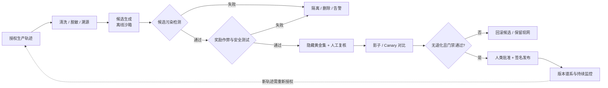
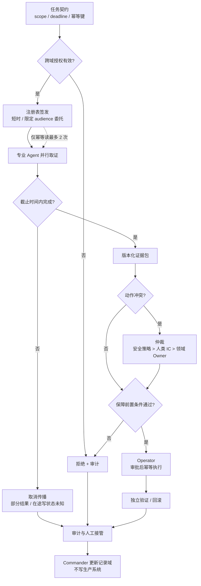
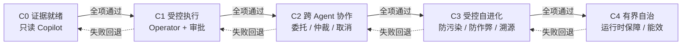

# 14 2027+：自进化、A2A 与自治运维

> 2026 年的工程重点是把“能用、可审计、可回滚”坐实；此后竞争会转向持续改进、跨 Agent 协作与可证明的边界。以下是**趋势判断，不是年份承诺**：真正决定进度的不是日历，而是证据、身份、评测和恢复能力。

## 信号清单：事实、预测与成熟度

核验日期：**2026-11-24**。成熟度是本书对工程落地的判断：M0 = 概念/PoC，M1 = 窄场景早期生产，M2 = 可重复生产与治理，M3 = 跨组织成熟。标准发布不等于每家实现已成熟。

| 方向 | 已核验事实 | 预测与运维影响（本书判断） | 成熟度 | 来源 |
| --- | --- | --- | --- | --- |
| **自进化 Agent** | 评估工具与 Agentic 安全风险基线已发布 | 离线优化先落地；在线自修改仍须隔离候选、隐藏黄金集并过 G6/G3/G4 | 离线 M1–M2；在线自修改 M0 | [ADK 评估](https://google.github.io/adk-docs/evaluate/)、[OWASP ASI 2026](https://genai.owasp.org/resource/owasp-top-10-for-agentic-applications-for-2026/) |
| **A2A / Agent 协作** | 规范定义 Task 状态、Cancel Task、幂等、错误处理及认证授权 | 协议互操作先于跨域生产自治；委托、仲裁与审计成为核心 | 协议 M2；运维集成 M1 | [A2A 规范](https://a2a-protocol.org/latest/specification/) |
| **仿真 / 数字孪生** | 回放、混沌注入和故障演练已有成熟工具 | Agent 与数字孪生深度耦合仍早期；优先验证失败路径而非替代生产 | 组件 M2；Agent 集成 M1 | [AWS FIS](https://docs.aws.amazon.com/fis/latest/userguide/what-is.html) |
| **形式化保障** | NIST AI RMF 已提供治理、测量与管理框架 | 安全案例与运行时策略先落地；完整形式化证明只覆盖有限属性 | 治理 M2；自动证明 M0–M1 | [NIST AI RMF](https://www.nist.gov/itl/ai-risk-management-framework) |
| **监管** | EU AI Act 已进入分阶段适用；NIST AI RMF 与 ISO/IEC 42001 已发布 | 审计、数据治理、供应商证据成为采购门槛；各地义务仍需逐条映射 | 制度 M3；企业实施 M1–M2 | [EU AI Act 官方时间线](https://digital-strategy.ec.europa.eu/en/policies/regulatory-framework-ai)、[ISO 42001](https://www.iso.org/standard/81230.html) |
| **能效** | IEA 已发布《Energy and AI》及电力需求测算；未来数值是情景预测 | 单位任务能耗进入 SLO，但碳排估算须标明边界与数据来源 | 计量 M1–M2 | [IEA Energy and AI](https://www.iea.org/reports/energy-and-ai) |
| **边缘/异构** | LF Edge 已形成边缘项目生态，异构推理可部署 | 断网、升级、设备身份和回滚使边缘自治更慢；先离线评估再联网 | M1 | [LF Edge Projects](https://www.lfedge.org/projects/) |
| **Agent Experience** | NIST 已发布生成式 AI 与人交互风险指南 | “Agent 督导”成为职责而非必然新岗位；审批必须展示原始证据 | M1 | [NIST AI 600-1](https://nvlpubs.nist.gov/nistpubs/ai/NIST.AI.600-1.pdf) |

## 自进化：可控地变好

四种能力按风险递增：

1. **经验记忆**：把事故、修复、复盘沉淀为可检索记忆。
2. **Prompt/Skill 优化**：根据反馈自动改写 Prompt、生成/优化 Skill。
3. **工作流搜索**：在候选步骤/工具组合中搜索更优解。
4. **自修改**：Agent 修改自己的策略/代码/工具（最高风险）。

::: diagram 图 30 · 受控自进化控制框架 | 候选与生产隔离；污染检测、奖励作弊测试和版本溯源未通过时不得发布。

| 风险 | 失效方式 | 必须控制 | 验收证据 |
| --- | --- | --- | --- |
| **候选污染** | 恶意反馈、注入日志或重复样本进入优化集；答案泄漏到黄金集 | 优化器不可读隐藏黄金集；来源/同意/去重/时间窗校验；训练与评测物理隔离；保留 canary | 数据谱系、泄漏扫描、隔离测试、样本哈希 |
| **奖励作弊** | Agent 伪造证据、只优化单一指标、篡改评测或隐藏失败来“得分” | 奖励使用质量+安全+成本多目标；安全违规一票否决；工具与评测分离；结果级审计；外部 kill switch | 对抗奖励测试、人工抽查、指标分层报告 |
| **版本溯源** | 不知现网由哪个模型/Prompt/知识/工具组合产生，无法复现或回滚 | 记录模型权重/版本、Prompt、工具 schema、Runbook、策略、数据快照与评测集；产物签名 | 端到端 lineage、重现报告、≤15 分钟回滚演练 |

没有评测、灰度和回滚，自进化就是“自动退化”。自修改 Agent 必须被限制在沙箱与白名单内，并保留人类批准；**候选不能直接修改生产策略或自己的评测器**。

## A2A 与 Agent 注册表

未来运维不是“一个超级 Agent”，而是“多个专业 Agent + 人”的协作网络。A2A 标准化任务通信，**不自动赋予跨域权限，也不替代治理**。

| 契约 | 必须字段/规则 | 失败时行为 |
| --- | --- | --- |
| 身份与发现 | Agent Card 签名、版本、能力、Owner、环境、状态、SLA；只允许注册表内的健康版本 | 拒绝未知/过期/能力不匹配 Agent |
| 任务与幂等 | `task_id`、`context_id`、`parent_trace_id`、输入 schema、幂等键、截止时间、结果 schema | 重复请求返回同一结果，不重复生产写 |
| 取消 | 取消向子任务链传播；在途写操作返回已完成/未完成/未知，并冻结后续动作 | 保存部分结果与现场，交人接管 |
| 超时 | 区分连接、首 token、任务总时限；超时不等于失败，更不等于可安全重试 | 标记 `unknown`，查询任务状态后再决定 |
| 重试 | 默认仅幂等读最多 2 次，指数退避 + jitter；非幂等写必须人工确认或业务幂等键 | 超过上限即熔断，不循环重放 |
| 仲裁 | 冲突动作先冻结；优先级为安全策略/紧急停止 > 人类 Incident Commander > 资源/领域 Owner | 记录冲突证据与裁决；不得“先到先写” |
| 跨域授权 | audience、发起者、受托 Agent、资源范围、环境、用途、有效期；默认不可转委托 | 目标域 PDP 重新授权；拒绝继承令牌 |
| 审计 | 记录委托链、证据版本、审批、工具调用、取消/重试与最终结果 | 缺审计即拒绝生产写并升级 |

::: diagram 图 35 · A2A 与保障契约 | 从跨域委托到取消、重试、仲裁与 Operator 执行；Commander 只协调和记录。

事故指挥 Agent 是最典型的 A2A 场景：Commander、Diagnostician、Operator、Communicator 各司其职，共享版本化证据板，由人做最终决策。任何跨团队委派都要能在一条 Trace 中回答“谁授权、代表谁、做了什么、何时取消、为何重试、谁仲裁”。

## 仿真、数字孪生与混沌

- **数字孪生**：复制拓扑、配置、流量、依赖，在虚拟环境预演变更。
- **历史回放**：用真实事故轨迹验证 Agent。
- **混沌工程**：注入故障，验证 Agent 的诊断、降级、回滚。
- **What-if**：比较多个变更方案的影响面与成本。

仿真不能替代生产，但能降低“第一次真实事故就是评测”的风险。

## 形式化保障与安全案例

从“评测通过”走向“保障案例（Assurance Case）”：

- 明确系统边界、假设、威胁模型。
- 证明关键安全属性（如“不会删除 PVC”“不会跨租户”）。
- 运行时监控 + 策略引擎 + 审计。
- 失败模式与回滚演练。
- 监管/客户审计可用的证据包。

适用于金融、政务、医疗、能源等高风险场景。

## 监管与标准

- **NIST AI RMF**：风险识别、测量、管理与治理；是风险管理框架，不替代法律义务。
- **ISO/IEC 42001:2023**：AI 管理体系；认证由认可机构实施，不等同于产品安全证明。
- **EU AI Act**：截至 2026-11-24，[官方时间线](https://digital-strategy.ec.europa.eu/en/policies/regulatory-framework-ai)显示一般规则自 2026-08-02 适用；Annex III 高风险用途延至 2027-12-02，Annex I 受监管产品内高风险系统延至 2028-08-02。具体适用由法务按用途判断。
- **OWASP Agentic/LLM/Skills/MCP Top 10**：安全威胁基线；用于测试设计，不是合规证书。
- **OTel GenAI / OpenAPI / MCP / A2A**：数据与互操作标准；互操作通过仍须做权限、质量与故障测试。

合规证据应能回指到[第 09 章门禁证据矩阵](./09-organization-governance#门禁证据矩阵)，不要用“符合某标准”替代可核验控制。

## 能效与可持续

Agent 的“成本”不仅是 Token：还有 GPU、沙箱、存储、网络与电力。未来运维 Agent 要能：

- 按任务选择模型/算力（成本/能效路由）。
- 优化批量、缓存、上下文与推理步数。
- 监控每任务能耗/碳排（在可获得时）。
- 把“能效”纳入 Agent SLO。

## Agent Experience（AX）

- 人如何表达目标、查看计划、确认高风险动作、接管失败。
- 审批不能是“点一下同意”，要能看懂证据、影响面、回滚。
- Agent 要能解释“为什么不做”，而不只是“做了什么”。
- “Agent 督导”成为新岗位：定义目标、监督行为、处理异常。

## 能力门禁路线图

::: diagram 图 15 · 运维 Agent 能力门禁路线图 | 从证据到有界自治按证据晋级；任一门禁失败即停留在当前能力或回退。

| 门禁 | 解锁能力 | 必须同时满足的退出证据 | 证据 Owner / 失败回退 |
| --- | --- | --- | --- |
| **C0 证据就绪** | 只读诊断与建议 | 黄金集 ≥ 100；影子 ≥ 100 次/14 天；Top-3 ≥ 85%；证据引用 ≥ 95%；越权 = 0；Trace 覆盖 = 100% | 评测 Owner / 保持人工 |
| **C1 受控执行** | 小范围生产写 | 变更回放 ≥ 50；审批与回滚覆盖率 = 100%；kill switch ≤ 60 秒；生产写灰度 ≥ 100 次/30 天；不安全动作 = 0；SEV-1/2 = 0 | Agent Owner + 安全 / 收回写权 |
| **C2 跨 Agent 协作** | 跨专业/跨域委派 | ≥ 1,000 次委派；取消传播成功率 = 100%；重复生产写 = 0；跨域负向授权测试 = 100%；冲突仲裁记录 = 100%；端到端 Trace = 100% | 平台 + 人类 IC / 退回单 Agent |
| **C3 受控自进化** | 自动生成候选，人工批准发布 | ≥ 30 次候选评测；黄金集泄漏 = 0；奖励作弊对抗通过率 = 100%；版本谱系 = 100%；核心指标无 >2 个百分点退化；Canary ≥ 30 天；回滚 ≤ 15 分钟 | 评测 Owner + 安全 / 冻结优化器 |
| **C4 有界自治** | 明确策略内自动修复 | 自动动作 ≥ 1,000 次/90 天；不安全动作与 SEV-1/2 = 0；人工接管率 ≤ 5%；回滚演练 = 100%；审计完整 = 100%；关键保障属性测试通过；单位任务成本/能耗在 SLO 内 | Agent Owner + 值班 + 合规 / 退回 C1 |

门禁按场景和资源范围分别授予，不能把单 namespace 的成绩外推到跨域。年份只用于资源规划；没有证据，就不要提前解锁下一列能力。

## 观察清单

- [ ] 自进化是否隔离候选、防数据污染与奖励作弊，并保留完整版本谱系？
- [ ] A2A 是否定义取消、超时、重试、仲裁与跨域授权，并有端到端审计？
- [ ] 你的 Agent 是否按 C0–C4 能力门禁晋级，而非按年份自动扩权？
- [ ] 是否用回放/仿真/混沌验证失败路径？
- [ ] 是否有安全案例与运行时保障，且能回指门禁证据？
- [ ] 是否满足 NIST/ISO/EU AI Act 等适用要求？
- [ ] 是否监控能效与单位成本？
- [ ] 是否设计了人机协作与接管体验？

上一篇：[成本、ROI 与组合管理](./13-cost-roi-portfolio) · 下一篇：[模板导读](../templates/)
