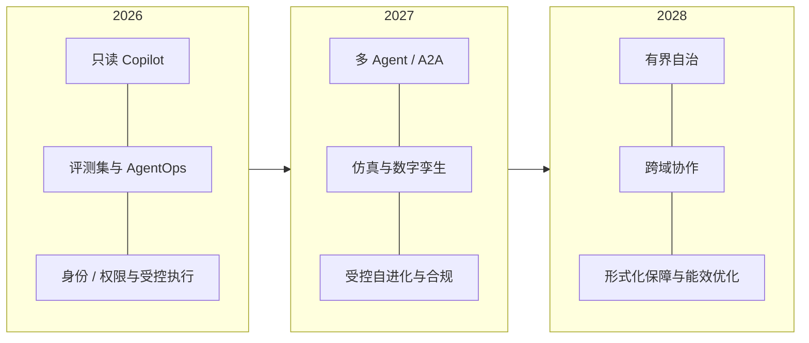

# 14 2027+：自进化、A2A 与自治运维

> 2026 年把“能用”坐实，2027 年会把“有用”和“可控”推到台前。未来不是更会聊天的模型，而是能持续学习、跨 Agent 协作、被仿真与保障约束的运维系统。

## 信号清单

| 方向 | 2026 信号 | 对运维 Agent 的影响 |
| --- | --- | --- |
| **自进化 Agent** | 经验记忆、Prompt/Skill 优化、工作流搜索、自修改 Agent | Agent 能变好，但也可能退化/漂移；需要评测、灰度和回滚 |
| **A2A / Agent 协作** | A2A 协议、Agent 注册表、多 Agent 编排 | 跨团队/跨厂商 Agent 协作；身份、仲裁、共享证据变关键 |
| **仿真 / 数字孪生** | 数字孪生、混沌工程、回放 | 在虚拟环境预演变更，降低真实风险 |
| **形式化保障** | 安全案例、运行时监控、策略验证 | 从“评测通过”走向“可证明的边界” |
| **监管** | EU AI Act 高风险合规期限、NIST AI RMF、ISO 42001 | 审计、风险管理、数据治理成为采购门槛 |
| **能效** | 数据中心用电增长、AI 服务器占比上升 | Token/GPU 成本之外，能效成为运营指标 |
| **边缘/异构** | 边缘 Agent、异构算力、端侧推理 | 运维 Agent 走向边缘与混合环境 |
| **Agent Experience** | 人机协作、审批体验、可解释 | “Agent 督导”成为新岗位；人因决定成败 |

## 自进化：可控地变好

自进化的四种能力：

1. **经验记忆**：把事故、修复、复盘沉淀为可检索记忆。
2. **Prompt/Skill 优化**：根据反馈自动改写 Prompt、生成/优化 Skill。
3. **工作流搜索**：在候选步骤/工具组合中搜索更优解。
4. **自修改**：Agent 修改自己的策略/代码/工具（最高风险）。

控制框架：

```text
生产轨迹 → 离线评测 → 候选改进 → 影子/灰度 → 对比 → 发布/回滚
```

没有评测、灰度和回滚，自进化就是“自动退化”。自修改 Agent 必须被限制在沙箱与白名单内，并保留人类批准。

## A2A 与 Agent 注册表

未来运维不是“一个超级 Agent”，而是“多个专业 Agent + 人”的协作网络：

- **Agent 注册表**：身份、能力、Owner、版本、SLA、状态。
- **A2A 协议**：任务委派、状态同步、结果回传。
- **仲裁者**：冲突动作、共享证据、终止条件。
- **身份与委托**：Agent 代表谁、能做什么、多久。
- **审计**：跨 Agent 链路可追溯。

事故指挥 Agent 是最典型的 A2A 场景：Commander、Diagnostician、Operator、Communicator 各司其职，共享证据板，由人做最终决策。

## 仿真、数字孪生与混沌

- **数字孪生**：复制拓扑、配置、流量、依赖，在虚拟环境预演变更。
- **历史回放**：用真实事故轨迹验证 Agent。
- **混沌工程**：注入故障，验证 Agent 的诊断、降级、回滚。
- **What-if**：比较多个变更方案的影响面与成本。

仿真不能替代生产，但能降低“第一次真实事故就是评测”的风险。

## 形式化保障与安全案例

从“评测通过”走向“保障案例（Assurance Case）”：

- 明确系统边界、假设、威胁模型。
- 证明关键安全属性（如“不会删除 PVC”“不会跨租户”）。
- 运行时监控 + 策略引擎 + 审计。
- 失败模式与回滚演练。
- 监管/客户审计可用的证据包。

适用于金融、政务、医疗、能源等高风险场景。

## 监管与标准

- **NIST AI RMF**：风险识别、评估、管理、治理。
- **ISO/IEC 42001**：AI 管理体系。
- **EU AI Act**：高风险系统的合规义务；行业综述提到最严节点延期至 2027-12，但不应据此放松准备。
- **OWASP Agentic/LLM/Skills/MCP Top 10**：安全威胁基线。
- **OTel GenAI / OpenAPI / MCP / A2A**：数据与互操作标准。

## 能效与可持续

Agent 的“成本”不仅是 Token：还有 GPU、沙箱、存储、网络与电力。未来运维 Agent 要能：

- 按任务选择模型/算力（成本/能效路由）。
- 优化批量、缓存、上下文与推理步数。
- 监控每任务能耗/碳排（在可获得时）。
- 把“能效”纳入 Agent SLO。

## Agent Experience（AX）

- 人如何表达目标、查看计划、确认高风险动作、接管失败。
- 审批不能是“点一下同意”，要能看懂证据、影响面、回滚。
- Agent 要能解释“为什么不做”，而不只是“做了什么”。
- “Agent 督导”成为新岗位：定义目标、监督行为、处理异常。

## 2026–2028 路线图

::: diagram 图 15 · 2026–2028 运维 Agent 路线图 | 2026–2028 的三个阶段；从只读 Copilot 到有界自治。

:::

| 阶段 | 重点 |
| --- | --- |
| **2026** | 只读 Copilot、评测集、AgentOps、身份/权限、受控执行 |
| **2027** | 多 Agent/A2A、仿真/数字孪生、自进化（受控）、合规/保障 |
| **2028** | 有界自治、跨域协作、形式化保障、能效优化、Agent 经济 |

## 观察清单

- [ ] 你的 Agent 有评测、灰度、回滚，能安全地“变”吗？
- [ ] 是否有 Agent 注册表/身份/委托，能跨 Agent 协作吗？
- [ ] 是否用回放/仿真/混沌验证失败路径？
- [ ] 是否有安全案例与运行时保障？
- [ ] 是否满足 NIST/ISO/EU AI Act 等适用要求？
- [ ] 是否监控能效与单位成本？
- [ ] 是否设计了人机协作与接管体验？

上一篇：[成本、ROI 与组合管理](./13-cost-roi-portfolio) · 下一篇：[模板导读](../templates/)
