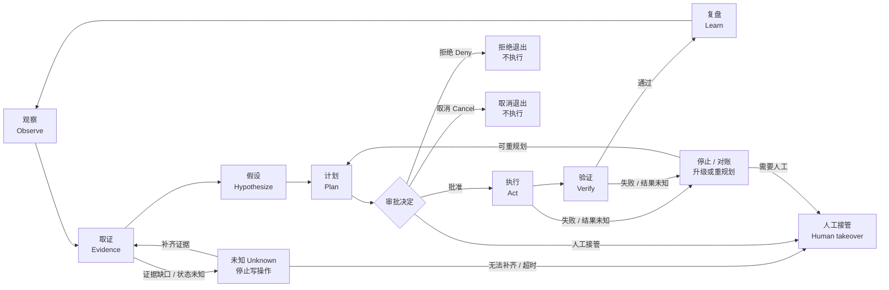

# 导读：为什么写这本书

> 运维 Agent 的价值不在“会聊天”，而在“能把系统状态读清楚、把变更做对、把结果验证掉”。这本书围绕这一条主线展开。

## 一个最小闭环

先看一个最小的运维 Agent 闭环。它不是“用户问、模型答”，而是：

::: diagram 图 01 · 运维 Agent 的最小闭环 | 正常路径从观察到复盘；拒绝、未知、取消与人工接管都是显式退出，不得伪装成成功。

:::

闭环有正常路径，也有必须被记录和验证的退出路径：

| 退出 | 触发与动作 | Canonical Event 记录 |
| --- | --- | --- |
| **拒绝 Deny** | 策略或审批者拒绝；不得调用写工具 | 策略拒绝保留 PEP 审计；审批者拒绝时记录 `approval.decided.decision = rejected`。未接管的 Run 使用 `run.completed.outcome = failure`、`verified = false`、`human_takeover = false` |
| **未知 Unknown** | 证据缺失、状态未知或结果未知；停止写操作，能补证则重取证，否则升级 | 需要人工时使用 `run.completed.outcome = escalated`、`human_takeover = true`；不得把未知记为成功 |
| **取消 Cancel** | 执行前由用户或审批流取消；不得继续动作 | `run.completed.outcome = failure`、`error_code = user_cancelled`、`verified = false`；取消不是 `approval.decided` 的枚举值 |
| **人工接管 Human takeover** | 超时、冲突、权限失败或安全停止条件触发；冻结 Agent 动作并交接证据、审批与未决项 | `run.completed.outcome = escalated`、`human_takeover = true`；接管后的动作由获授权的人类执行并留痕 |

`run.completed.outcome` 的正式枚举只有 `success / failure / escalated / rolled_back`；Deny、Unknown、Cancel 是退出原因，不是额外的 outcome 值。任何退出都不能跳过验证后声称成功。

任何一步缺失，Agent 都会退化：

| 缺失的环节 | 退化后的形态 | 典型后果 |
| --- | --- | --- |
| 取证 | 凭模型记忆猜 | 诊断看似合理，实际与现场不符 |
| 计划 | 直接调工具 | 动作不可解释，无法预演 |
| 审批 | 全自动执行 | 一次误操作扩大 blast radius |
| 验证 | 执行完就结束 | 变更失败无人发现 |
| 复盘 | 每次都从头来 | 同类事故反复发生，评测集不增长 |

这本书的每一章，最终都落在这个闭环的某一环上。

## 运维 Agent 的三种角色

同一个团队里，“运维 Agent”可能指三种完全不同的东西。先把它们分开，后面的设计与评测才不会混在一起。

| 角色 | 能做什么 | 生产系统权限 | 记录域权限 | 责任边界 |
| --- | --- | --- | --- | --- |
| **Copilot** | 在批准范围内查状态、解释告警、关联证据、生成诊断与 Runbook 草稿 | **只读**；不得执行变更，不得代人工确认结论 | 无写入；草稿必须经人审 | 对证据完整性与引用负责，不替人作最终决策 |
| **Operator** | 在批准范围内执行重启、扩容、回滚、切换，并完成变更验证 | **受控写**；短时凭证、最小资源范围、审批后生效、可熔断 | 可写本变更的执行 Trace 与结果，不得改审批记录 | 对动作执行与验证负责；生产责任由授权的人类 Owner/值班承担 |
| **Commander** | 分派诊断与执行任务、维护共享证据板/时间线、汇总状态、提醒升级 | **无生产写权**；不能持有或借用 Operator 写身份 | **协调/记录权**：可写事故元数据、任务状态与决策日志 | 对协调秩序与记录一致性负责，不替代人类 Incident Commander 决策 |

**硬边界：Commander 只有协调与记录权。任何生产写动作必须由 Operator 身份执行，并先取得相应审批；Commander 不得通过继承权限、工具透传或“代执行”获得生产写权。** 只读 Copilot 不需要写操作审批，但仍受数据授权、工具白名单、时效与审计约束。人类批准者、Operator 与验证人应职责分离；Agent 是执行主体，不是责任主体。

大多数团队应该从 Copilot 开始。直接做 Operator，通常不是技术问题，而是权限、评测、审批和回滚还没准备好。Commander 不是比 Operator 更高级的权限角色，而是事故协作角色。

## 这本书的结构

| 部分 | 回答的问题 | 你会拿到什么 |
| --- | --- | --- |
| **第一部分 方法与生命周期** | 该不该做、怎么做、怎么上线、怎么运营 | 一套从 Plan 到 Retire 的工程方法与门禁 |
| **第二部分 场景手册** | K8s、RDMA、GPU 推理等具体场景怎么做 | 证据源、工具清单、任务流、护栏、评测与检查清单 |
| **第三部分 厂商与产品全景** | 全球/中国主要厂商都有哪些运维 Agent？怎么分层与选型？ | 独立 Agent、内嵌助手、运行时、平台、AIOps 的厂商地图与评估方法 |
| **第四部分 2026 工程域** | 2026 上生产还需要补什么？ | AgentOps/可观测性、身份与安全、成本/ROI、2027+ 路线图 |
| **第五部分 模板与工具箱** | 怎么把方法落到文档和评审 | 设计文档、工具契约、评测集、权限矩阵、发布与复盘模板 |
| **附录** | 端到端案例、失败复盘、阿里 Agent 产品全景、指标、术语与来源 | 可复用的走查模板、选型背景与可核验的参考资料 |

## 一条贯穿全书的例子

为了让方法不悬空，我们会反复使用一个例子：

> **K8s 节点 NotReady 诊断与恢复 Agent**：它需要读取节点状态、kubelet 日志、系统事件、网络与磁盘指标，判断是 kubelet 卡死、磁盘压力、CNI 异常还是云主机问题；在获得审批后，它可以 cordon/drain、重启 kubelet 或触发节点替换；最后验证 Pod 是否恢复、SLO 是否回到基线。

这个例子会出现在第 02 章的生命周期、第 05 章的工具契约、第 07 章的评测案例、权限矩阵模板、K8s 场景手册，以及附录的端到端案例里。读完之后，你应该能把它替换成自己的 RDMA 或 GPU 推理场景。

## 三个约定

1. **证据先于结论**：任何诊断结论都要能追溯到具体的查询、时间窗口、数据源和结果。
2. **权限先于能力**：先决定 Agent 能碰什么、不能碰什么，再决定它能多聪明。
3. **验证先于关闭**：变更执行完不算完成，指标、日志、SLO 和用户路径都验证过才算完成。

::: tip 怎么读
第一次做运维 Agent：按 01 → 02 → 03 → 选一本场景手册 → 用模板写设计文档。
已有 Agent 要上生产：从 05 → 07 → 08 开始，配合权限矩阵、发布清单和复盘模板。
平台团队：从 04 → 05 → 09 → 10 开始，最后读附录的阿里 Agent 产品全景。
:::

## 版本与反馈

这是 **v0.2.0-rc1**，优先把方法与五个高价值场景写扎实。欢迎在 [GitHub](https://github.com/ai-guru-global/the-ops-agent-book) 提交 Issue / PR，补充真实场景、评测案例与失败模式。

下一章：[为什么运维 Agent 不一样](./01-why-ops-agents)
