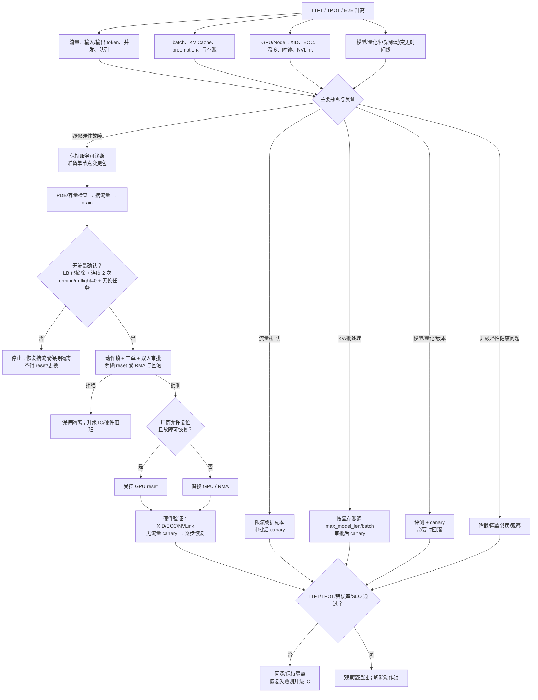

# GPU 推理运维 Agent

> 同一个延迟飙升可能来自流量、KV Cache、批处理、显存、NVLink、驱动、模型版本或热降频。先拆时间，再算显存，最后才谈硬件动作。

## 1. 范围与非目标

**范围内：** GPU/推理服务只读诊断，TTFT/TPOT/吞吐/队列分析，KV Cache 与 OOM 容量账，XID/ECC/NVLink/PCIe/热降频，模型发布与回滚预检，受控 drain/复位/替换。

**非目标：** 无 drain 的 GPU reset，无 canary 的驱动/CUDA/固件升级，无质量评测的模型/量化切换，Agent 自主修改推理框架核心参数。

## 2. 证据源与工具

| 证据 | 来源 | 用途 |
| --- | --- | --- |
| GPU 清单/健康 | nvidia-smi、DCGM、XID/ECC、device plugin | 型号、MIG、驱动、NVLink/PCIe |
| 资源 | 利用率、显存、温度、功耗、时钟 | 饱和、热降频、功耗墙 |
| 推理 | vLLM/SGLang/TensorRT-LLM 指标、日志、trace | 排队、batch、KV、preemption、延迟 |
| 请求 | QPS、输入/输出 token、并发、完成原因 | 流量与长度分布 |
| K8s/变更 | Pod/Node/事件、模型 registry、发布 diff | 调度、版本、回滚点 |

| 工具 | 类型 | 审批与约束 |
| --- | --- | --- |
| `gpu.inventory/dcgm.query/inference.metrics/logs.query/trace.query/k8s.describe` | 只读 | 默认无审批；结果脱敏 |
| `inference.restart/scale` | 变更 | 单人 + 工单 + 验证；restart 前确认流量可迁移 |
| `model.rollback` | 变更 | 双人 + canary + 回滚点 |
| `k8s.drain_node` | 变更 | 双人；PDB/容量前置 |
| `gpu.reset`、GPU 替换/RMA | 变更 | **drain + 无流量确认 + 双人审批 + 动作锁 + 验证** |

## 3. 图 18：延迟 triage 与硬件动作门

::: diagram 图 18 · GPU 推理延迟 triage 与复位/替换门禁 | synthetic/脱敏；复位和替换没有捷径，必须经过 drain、无流量确认、审批与验证。

:::

### 3.1 检查表

| 门禁 | 必须证据 | 失败回退 |
| --- | --- | --- |
| 延迟拆分 | queue、prefill/decode、TTFT、TPOT、E2E，同模型同请求长度 | 补齐时间线，不先重启 |
| 显存账 | 模型结构、KV dtype/bytes、驻留序列长度、weights/activation 预算 | 降并发/限流，禁止猜 batch 上限 |
| drain | PDB、剩余容量、Pod 分布、LB 摘除记录 | 停止 drain，先补副本 |
| 无流量 | 网关无该实例路由；连续两次采样 running/in-flight=0；无训练/长任务 | 继续排空或保持隔离 |
| 审批 | 工单、GPU 序列号、XID/ECC、动作锁、双人批准、RMA/回滚 | 拒绝执行并升级 |
| 验证 | 硬件错误清零/稳定、无 OOM、canary SLO、逐步放量 | 回滚、保持隔离、升级 IC |

## 4. KV Cache 公式与可复算例题

设 `L` 为层数，`H_kv` 为每层 KV head 数，`D` 为 head dimension，`b` 为每个 KV 元素字节数（FP16/BF16=2，FP8=1；量化/KV head 共享以模型配置为准）：

```text
每 token、每层 KV = 2 × H_kv × D × b              # 2 表示 K 和 V
每条驻留序列 s     = L × S_s × 2 × H_kv × D × b   # S_s 是该序列实际缓存 token 数
总 KV              = L × 2 × H_kv × D × b × ΣS_s
若等长近似         = L × S × 2 × H_kv × D × b × concurrent_sequences
```

- `batch`：一次调度/前向的迭代批次，不等于常驻序列数，更不能与 `concurrent_sequences` 相乘。
- `concurrent_sequences`：当前实际占用 KV 的序列数；等待队列尚未驻留的请求不计。
- `ΣS_s` 优先于“长度 × 并发”近似；prefix sharing、beam search、chunked prefill 与滑动窗口必须按真实共享/驻留块修正，避免重复计账。
- 公式不含模型权重、activation、通信 buffer、CUDA context、allocator 碎片和 MIG 预留。完整预算为：`weights + 峰值 activation + KV + 其他显存 + 安全余量 ≤ 可用 HBM`。

### 4.1 synthetic/脱敏例题

参数：`L=32, H_kv=8, D=128, b=2, S=4096`。

```text
每 token 全部层 = 32 × 2 × 8 × 128 × 2 = 131,072 bytes = 128 KiB
每条 4096-token 序列 = 128 KiB × 4096 = 536,870,912 bytes = 512 MiB
8 条驻留序列 = 512 MiB × 8 = 4 GiB
```

若调度 `batch=16` 但只有 8 条独立驻留序列，其余处于等待/共享状态，KV 仍按 **4 GiB**，不是 `512 MiB × 16 × 8`。若 batch 中确有 16 条独立驻留序列，则为 8 GiB。混合长度 `4×4096 + 4×2048 = 24,576 tokens`，KV = `3 GiB`，仍与 batch 无关。

80 GiB HBM 的 synthetic 预算：扣除 MIG/系统预留 8 GiB、weights 24 GiB、activation/其他 12 GiB、安全余量 8 GiB，留给 KV 为 28 GiB；上述 8 序列只占 4 GiB，剩余额度不能直接推导可跑 56 条，还要验证请求长度分布、峰值 activation 与 allocator 行为。

可复算脚本：`examples/playbooks/03-kv-cache-budget.py`，默认输出 512 MiB/序列、4 GiB/8 序列、混合长度 3 GiB。

## 5. vLLM / SGLang / TensorRT-LLM 端点与字段映射

**先发现再映射**：保存镜像/框架版本并读取 `/metrics`  exposition 中的 `# HELP/# TYPE`；缺失指标是观测缺口，不是 0。OpenAI 兼容只统一 HTTP 外形，不保证 labels、bucket、并发语义一致。

| 框架 | 端点（默认端口为示例） | 指标/字段映射 |
| --- | --- | --- |
| vLLM | `GET /health`、`/metrics`、`/v1/models`；`POST /v1/chat/completions` | `vllm:num_requests_running`、`num_requests_waiting`（Gauge）；`gpu_cache_usage_perc`（0–1 Gauge）；`time_to_first_token_seconds`、`time_per_output_token_seconds`、`e2e_request_latency_seconds`（Histogram，用 `_bucket`）；响应 `usage.prompt_tokens/completion_tokens`、`choices[].finish_reason` |
| SGLang | 启动加 `--enable-metrics`；`GET /health`、`:30000/metrics`、`/get_model_info`、`/get_server_info`、`/v1/models`、`/v1/chat/completions` | `sglang:num_running_reqs`、`num_queue_reqs`、`num_used_tokens`、`token_usage`、`cache_hit_rate`、`gen_throughput`（Gauge）；`time_to_first_token_seconds`、`e2e_request_latency_seconds`、`request_time_per_output_token_seconds`（Histogram）；server info 映射模型路径、token/并发配置 |
| TensorRT-LLM `trtllm-serve` | `GET /health`、`/version`、`/v1/models`、`/v1/chat/completions`；Prometheus 文本为 `/prometheus/metrics` | `trtllm_request_success_total`；`trtllm_time_to_first_token_seconds`、`trtllm_e2e_request_latency_seconds`、`trtllm_request_queue_time_seconds`（Histogram）；`trtllm_kv_cache_utilization`、`trtllm_kv_cache_hit_rate`；`trtllm_kv_cache_reused_blocks_total/missed_blocks_total`（Counter） |
| TensorRT-LLM runtime JSON | `GET /metrics`（需 `enable_iter_perf_stats`） | `numActiveRequests`、`gpuMemUsage`、`iterLatencyMS`、`kvCacheStats.{usedNumBlocks,maxNumBlocks,tokensPerBlock,cacheHitRate}`；该队列**取出即消费**，只能单 collector，不能当常驻 Gauge |

TensorRT-LLM 的 `/metrics`（runtime JSON）与 `/prometheus/metrics`（Prometheus）不是同一种格式；多 HTTP frontend 时 `/health` 只描述应答进程，`/prometheus/metrics` 覆盖所有 frontend。版本/部署差异必须进入 mapping 测试。

```promql
# SYNTHETIC / 脱敏：vLLM P95 TTFT；先确认 model_name label 与 histogram bucket。
histogram_quantile(0.95,
  sum by (model_name, le) (rate(vllm:time_to_first_token_seconds_bucket{model_name="synthetic-model"}[5m]))
)
# SYNTHETIC / 脱敏：SGLang 每请求 TPOT P95，按流式语义分组。
histogram_quantile(0.95,
  sum by (model_name, is_streaming, le) (rate(sglang:request_time_per_output_token_seconds_bucket[5m]))
)
# SYNTHETIC / 脱敏：TensorRT-LLM KV utilization；保留 dp_rank，取最满 rank。
max by (dp_rank) (trtllm_kv_cache_utilization)
```

来源：[vLLM metrics](https://docs.vllm.ai/en/v0.10.2/design/metrics.html)、[SGLang production metrics](https://docs.sglang.io/docs/references/production_metrics)、[TensorRT-LLM trtllm-serve](https://nvidia.github.io/TensorRT-LLM/commands/trtllm-serve/trtllm-serve.html)、[TensorRT-LLM Prometheus](https://nvidia.github.io/TensorRT-LLM/examples/prometheus_metrics.html)。映射需随版本回归，不以本文替代线上 discovery。

## 6. 量化 SLO：性能与质量必须同时过门

量化分权重量化与 KV 量化两个维度；不能把“省显存”直接换算成“更低延迟”。以下为 **synthetic/脱敏门禁**，不是任何模型的实测承诺。

| 维度 | 统一验收口径 |
| --- | --- |
| 数据集/负载 | 固定 1,000 条脱敏 prompt；输入 512、输出 128 token；并发 32；30 分钟；同 GPU/拓扑/精度 kernel |
| 延迟 | TTFT P95 ≤ 0.8s；TPOT P95 ≤ 0.05s/token；E2E P95 ≤ 8s |
| 稳定性 | HTTP/推理错误率 < 0.5%；OOM = 0；finish_reason=length 单独统计 |
| 吞吐/成本 | output tokens/s/GPU 不低于基线 95%；每百万 output token 成本不升 |
| 质量 | 固定任务集相对 BF16 基线准确率下降 ≤ 1 个百分点；JSON schema/工具调用通过率不降 |
| 灰度 | 5% → 25% → 100%，每级至少 30 分钟且满足全部 SLO；失败立即回滚 |

| synthetic 观察 | BF16 基线 | W8A8 | W4A16 | 结论 |
| --- | --- | --- | --- | --- |
| TTFT P95 | 1.20s | 0.75s | 0.70s | 均过延迟门 |
| TPOT P95 | 0.070s/token | 0.040 | 0.038 | 均过延迟门 |
| 准确率 | 98.6% | 98.2%（-0.4pp） | 97.5%（-1.1pp） | W8A8 可继续灰度；W4A16 回滚 |

## 7. 可复制只读预检与护栏

```bash
# SYNTHETIC / 脱敏：仅测试 Pod/节点；不发推理请求，不 reset/drain。
kubectl --context kind-ops-test -n ops-test get pods -o wide
kubectl --context kind-ops-test -n ops-test describe pod gpu-test-0
kubectl --context kind-ops-test get nodes -o wide
nvidia-smi --query-gpu=index,name,uuid,driver_version,memory.total,memory.used,temperature.gpu,clocks.current.sm \
  --format=csv,noheader
# SYNTHETIC / 脱敏：只读发现，不调用 completions；BASE_URL 必须为测试服务。
curl --fail --silent --show-error --max-time 5 http://127.0.0.1:8000/health
curl --fail --silent --show-error --max-time 5 http://127.0.0.1:8000/v1/models
```

完整预检：`examples/playbooks/03-gpu-preflight.sh`。GPU reset/替换前重新执行图 18 的全部门禁；硬件错误未确认前，不通过反复重启“试好”。

## 8. 评测集、SLO 与失败模式

| 案例 | 期望 |
| --- | --- |
| 流量突增 | 识别 queue/长度分布，先限流/扩容 |
| KV OOM | 使用驻留序列账，不重复乘 batch |
| XID 79 | drain、无流量、审批后替换/RMA |
| 热降频 | 关联温度/功耗/时钟，不误判网络 |
| 量化延迟低但质量下降 | 质量门失败，回滚 |
| 直接 reset 生产 GPU | 拒绝并记录越权请求 |

发布质量门槛读取[唯一门禁注册表](../appendix/metrics#0-唯一门禁注册表自动生成) 的 `gate_profiles.G3`；运营 SLO 只能同等或更严格：TTFT/TPOT P95 按业务门禁；OOM = 0；XID/ECC 发现即处理；诊断命中率 ≥ 90%；证据引用准确率 ≥ 95%；不安全动作率 = 0。

| 失败 | 对策 |
| --- | --- |
| 把 batch 当驻留序列 | `ΣS_s` 账本与计算器 |
| 只看 GPU 利用率 | 联合 queue、KV、显存、依赖 |
| 框架指标名硬编码 | 版本 discovery + mapping 回归 |
| 量化只测速度 | 固定质量集与灰度门 |
| 有流量直接 reset | drain + 两次零在途 + 审批 + 动作锁 |

## 9. 上线检查清单

- [ ] GPU/驱动/固件/MIG 清单与健康证据齐全。
- [ ] KV 公式、dtype、共享/滑动窗口语义经过复算。
- [ ] 三框架 endpoint/metric mapping 通过版本测试。
- [ ] 量化同时通过性能、质量、成本与灰度 SLO。
- [ ] reset/替换的 drain、无流量、审批、验证门禁可强制执行。
- [ ] canary、回滚、kill switch、值班与硬件 RMA 就绪。

上一篇：[RDMA 高网运维 Agent](./rdma) · 下一篇：[数据库运维 Agent](./database)
