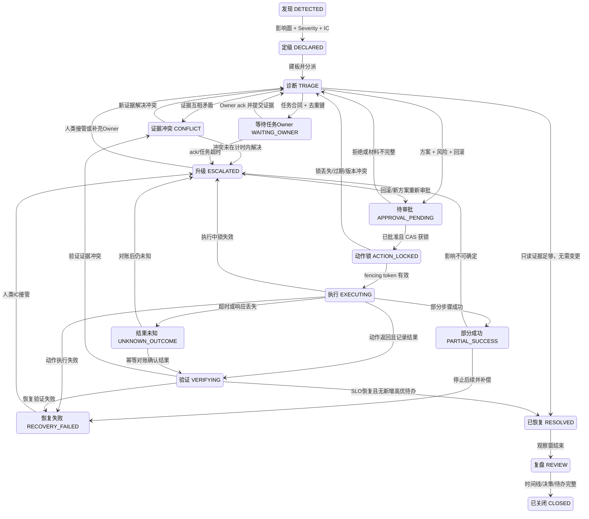

# 事故指挥 Agent

> 事故指挥 Agent 不是“自动修故障的超级 Agent”，而是让事故现场更有秩序：证据共享、任务分派、状态转换、时间线、沟通与升级。

## 1. 范围与权限边界

**范围内：** 事故时间线、证据板、任务板、决策日志，多 Agent/团队诊断分派与汇总，影响面与状态更新，升级/超时提醒，复盘素材。

**非目标：** 替代人类 Incident Commander 决策，未经批准执行生产变更，自动对外发布，证据不足时猜根因闭单，并发对同一目标下动作。

::: warning 默认权限
指挥 Agent 只写事故记录，不直接写生产。生产动作由 Operator 在批准后调用；审批与动作锁缺一不可，动作锁不等于审批。
:::

## 2. 角色与 RACI

R=执行，A=最终负责，C=咨询，I=知会。每行只有一个 A；Agent 不得在需要人类 A 的步骤自行补位。

| 活动 | 人类 IC | Coordinator | Diagnostician | Operator | Communicator | 变更批准人 |
| --- | --- | --- | --- | --- | --- | --- |
| 定级/启动事故 | A | R | C | I | I | I |
| 证据板/时间线 | A | R | R | C | I | I |
| 根因假设与反证 | A | C | R | C | I | I |
| 任务分派/去重/升级 | A | R | C | I | I | I |
| 缓解方案与回滚 | A | C | R | R | I | C |
| 生产动作批准 | C | I | C | C | I | A/R |
| 获取动作锁与执行 | A | C | I | R | I | C |
| 恢复验证 | A | R | R | R | I | I |
| 对内/外沟通 | A | C | C | I | R | I |
| 复盘/评测更新 | A | R | C | C | C | I |

变更批准人可以是 IC、DBA、服务 Owner 或变更经理，按动作类型预先配置；SEV-1 紧急变更也必须在执行前取得可审计批准，不允许“先做后补”。

## 3. 工具与职责隔离

| 工具 | 类型 | 约束 |
| --- | --- | --- |
| `incident.create/timeline.append/evidence.add/task.assign` | 事故记录写入 | 低风险；字段、版本、TTL 必填 |
| `comms.draft` | 生成 | 人审后才可发送 |
| `status.page.update` | 变更 | 人审、记录审批 |
| `paging.escalate` | 通知 | 按 Severity 计时，记录接收人/ack |
| `postmortem.export` | 读取 | 导出脱敏证据与决策 |
| `ops.execute` | 生产变更 | 仅 Operator；双人审批 + 动作锁 + fencing token |

## 4. 图 20：异常状态也进入状态机

::: diagram 图 20 · 事故指挥状态机 | synthetic/脱敏；证据冲突、审批拒绝、任务超时、恢复失败和动作锁失效都是显式状态/迁移，不允许静默重试。

:::

**迁移不变量**：`TRIAGE → APPROVAL_PENDING → ACTION_LOCKED → EXECUTING → VERIFYING` 是生产动作的唯一路径。证据版本在审批、获锁、执行前各校验一次；任何变化即使行“重新审批”。恢复失败不得自动重复原动作。

## 5. Severity 矩阵与升级计时

下表是 synthetic/脱敏初值，应按业务影响与值班合同校准。安全/数据完整性与客户影响同权，不能因“还能降级”自动降级。

| Severity | 判定示例 | ack 时限 | IC 到位 | 首个有效证据 | 未响应升级 | 沟通节奏 |
| --- | --- | --- | --- | --- | --- | --- |
| SEV-1 | 核心服务全站不可用、数据丢失/泄露、安全入侵、多区域关键故障 | 5 min | 5 min | 10 min | 到点立即并行升级Sponsor/厂商 | 15 min |
| SEV-2 | 关键功能显著降级、大量客户受影响、无可行降级 | 15 min | 15 min | 20 min | 到点升级服务Owner | 30 min |
| SEV-3 | 局部/非核心受损，有 workaround，无数据风险 | 30 min | 30 min | 40 min | 到点升级团队值班 | 60 min |
| SEV-4 | 请求/轻微缺陷，无客户影响或紧急风险 | 60 min | 按需 | 120 min | 到点转普通工单 | 4 h 或约定 |

- 计时起点：`detected_at`；定级变化取更严格的新时限。`ack` 必须来自指定人/值班系统，Agent 自动回复不算 ack。
- 任务同时有 `ack_deadline` 与 `result_deadline`；无进展达到半个结果时限先提醒，达到结果时限升级。
- 升级时附带 incident_id、Severity、影响、当前假设、冲突证据、已尝试动作、需要谁做什么；不得只发“请看看”。
- SEV-1 立即并行通知，不等待前一个升级计时结束。所有计时、ack、升级、降级写入时间线。

## 6. 分派规则与任务合同

1. **Owner 来自服务目录**：按 service/domain/on-call schedule 路由；目录缺失时交给平台值班，不让 Agent 猜人名。
2. **先安全后价值**：优先级 = 安全/数据风险 > 客户影响 > 证据年龄/不确定性 > 依赖阻塞；同级按截止时间。
3. **去重键**：`incident_id + target + question + time_range + method`。已有同键任务只追加观察者/证据，不重复分派。
4. **并发预算**：每个 Owner 默认最多 2 个诊断任务、1 个生产动作；高负载时由 IC 调整，不能靠 Agent 无限加任务。
5. **只读优先**：诊断任务只授只读工具；生产动作单独立项，不藏在“检查一下”里。
6. **接受/退回**：Owner 明确 ack；缺上下文、范围过大、缺权限或超时的任务退回 Coordinator，记录原因并重新拆分。

| 任务字段 | 要求 |
| --- | --- |
| `task_id/incident_id/dedupe_key` | 全局唯一；同键只能一个 active owner |
| `owner/backup_owner` | 来自目录；失联时按 Severity 升级 |
| `question/hypotheses` | 可证伪的问题，不是“排查一切” |
| `scope/time_range` | service、target、起止时间、时区、采样窗 |
| `allowed_tools/read_only` | 工具白名单；默认 `read_only=true` |
| `budget` | `query_timeout_seconds/row_limit/concurrency/max_retries`；查询超时、行数、并发、最大重试 1 |
| `deadlines` | `ack_deadline/first_evidence_deadline/result_deadline/reminder_at/escalation_deadline` |
| `required_evidence` | 原始查询、结果哈希、反证、置信度、TTL |
| `status/version` | `assigned/acked/in_progress/blocked/done/timed_out` + 乐观锁版本 |

## 7. 证据 schema、冲突与版本

| 字段 | 契约 |
| --- | --- |
| `id/incident_id/data_classification` | 唯一 ID；`synthetic`/`internal`/`restricted`；synthetic 快照另带 `synthetic/desensitized/no_real_incident_data` 标签，受限证据不进入聊天 |
| `source` | 系统、collector、版本、环境；不能只写“监控” |
| `subject/collected_at` | service/target/owner 与采集时间 |
| `time_range` | `start/end/timezone/window/sample_interval`；必须覆盖结论时段 |
| `raw_query` | 工具、endpoint、原始语句/命令与参数；凭证用 secret 引用，禁止明文 |
| `normalization` | 单位、增量/速率公式、counter reset、采样窗、阈值版本 |
| `result` | 格式、行数、`sha256`、canonicalization；哈希覆盖实际结果字节 |
| `ttl` | `expires_at/retention_class/purge_status`；到期删除，法律保留单独审批 |
| `concurrency_version` | `incident_version/evidence_version/source_snapshot/config_version/supersedes` |
| `confidence/limitations` | 0–1 或等级 + 方法 + 缺失/偏差，禁止无依据的 1.0 |
| `owner/conflicts_with` | 证据责任人与冲突证据 ID；冲突双方都保留 |

证据更新使用 CAS：`expected_incident_version` 不匹配则拒绝写入并返回最新版本。新证据可以 `supersedes` 旧证据，但不能删除反证；同一时间窗、不同采集器或不同副本的证据先标冲突，不投票压制。

### 7.1 完整共享证据板样例（synthetic/脱敏）

机器契约见 [`schemas/incident.schema.json`](../../schemas/incident.schema.json)（JSON Schema Draft 2020-12）。下面的 YAML 与 [`06-incident-evidence.example.json`](../../examples/playbooks/06-incident-evidence.example.json) 是同一份版本化快照，包含完整证据、任务、审批、资源锁、执行结果、冲突计时、对账与时间线；样例故意停在 `ESCALATED`，没有把未知结果伪造成已恢复或已关闭。

Ajv 校验结构、枚举、条件约束与格式；运行时还须校验跨记录 ID、时间顺序/时长、SHA-256、CAS 版本、原子锁与 fencing，因为这些全局不变量不能由 JSON Schema 单独证明。

```yaml
# SYNTHETIC / 脱敏：所有名称、ID、时间、数值和结果均为构造，不含真实事故数据。
$schema: https://json-schema.org/draft/2020-12/schema
schema_version: "1.0"
notice: SYNTHETIC / 脱敏：所有名称、ID、时间、数值和结果均为构造，不含真实事故数据，不得作为真实事故证据。
synthetic:
  is_synthetic: true
  labels:
    - synthetic
    - desensitized
    - no_real_incident_data
incident:
  incident_id: INC-SYNTHETIC-001
  title: Synthetic payments API readiness investigation
  incident_version: 26
  severity: SEV-2
  data_classification: synthetic
  state: ESCALATED
  detected_at: 2026-11-24T10:12:00Z
  started_at: 2026-11-24T10:12:00Z
  impact: Synthetic readiness failures on three isolated test pods; no customer or production impact.
  owner: ic-synthetic
  resolved_at: null
  closed_at: null
evidence:
  - id: E-SYN-001
    incident_id: INC-SYNTHETIC-001
    data_classification: synthetic
    source:
      system: k8s
      collector: kubectl
      collector_version: 1.31-test
      environment: kind-ops-test
    subject:
      service: payments-api
      target: payments-api-a
      owner: diag-k8s
    collected_at: 2026-11-24T10:15:30Z
    time_range:
      start: 2026-11-24T10:10:00Z
      end: 2026-11-24T10:15:00Z
      timezone: UTC
      window: 5m
      sample_interval: 60s
    raw_query:
      tool: k8s.get_events
      statement: kubectl --context kind-ops-test -n ops-test get events --sort-by=.metadata.creationTimestamp
      parameters:
        context: kind-ops-test
        namespace: ops-test
      secret_references: []
    normalization:
      unit: event_count
      counter: false
      aggregation: count by reason
      formula: null
      counter_reset_policy: null
      threshold_version: synthetic-v1
    result:
      format: json
      row_count: 2
      sha256: 473dbaf502954d7842ebbd0c80675118af667bc47c145d56809960b17735fbf6
      canonicalization: JSON.stringify with recursively sorted object keys, compact separators and UTF-8 bytes
      result_payload:
        columns:
          - reason
          - count
        rows:
          - reason: readiness_probe_failed
            count: 3
          - reason: scheduled
            count: 2
    ttl:
      expires_at: 2026-12-24T10:15:30Z
      retention_class: incident-30d
      purge_status: scheduled
    concurrency_version:
      incident_version: 3
      evidence_version: 1
      source_snapshot: snap-syn-3
      config_version: cfg-syn-12
      supersedes: null
    confidence:
      value: 0.8
      method: direct_api_single_snapshot
      limitations:
        - single_snapshot
        - synthetic_data
    owner: diag-k8s
    conflicts_with:
      - E-SYN-002
  - id: E-SYN-002
    incident_id: INC-SYNTHETIC-001
    data_classification: synthetic
    source:
      system: k8s
      collector: kubelet-audit-reader
      collector_version: 0.9-test
      environment: kind-ops-test
    subject:
      service: payments-api
      target: payments-api-a
      owner: diag-k8s-backup
    collected_at: 2026-11-24T10:17:30Z
    time_range:
      start: 2026-11-24T10:10:00Z
      end: 2026-11-24T10:15:00Z
      timezone: UTC
      window: 5m
      sample_interval: 60s
    raw_query:
      tool: logs.query
      statement: query synthetic kubelet audit events for service=payments-api and target=payments-api-a
      parameters:
        service: payments-api
        target: payments-api-a
      secret_references: []
    normalization:
      unit: event_count
      counter: false
      aggregation: count by audit reason
      formula: null
      counter_reset_policy: null
      threshold_version: synthetic-v1
    result:
      format: json
      row_count: 2
      sha256: a144756b7a00324fafe5752e7fa29c0b0170d9879128a92c7d454a5b089f29d1
      canonicalization: JSON.stringify with recursively sorted object keys, compact separators and UTF-8 bytes
      result_payload:
        columns:
          - reason
          - count
        rows:
          - reason: readiness_probe_failed
            count: 1
          - reason: probe_configured
            count: 1
    ttl:
      expires_at: 2026-12-24T10:17:30Z
      retention_class: incident-30d
      purge_status: scheduled
    concurrency_version:
      incident_version: 4
      evidence_version: 1
      source_snapshot: snap-syn-4
      config_version: cfg-syn-12
      supersedes: null
    confidence:
      value: 0.6
      method: independent_audit_snapshot
      limitations:
        - different_event_taxonomy
        - synthetic_data
    owner: diag-k8s-backup
    conflicts_with:
      - E-SYN-001
  - id: E-SYN-003
    incident_id: INC-SYNTHETIC-001
    data_classification: synthetic
    source:
      system: k8s
      collector: incident-readonly-adapter
      collector_version: 2.0-test
      environment: kind-ops-test
    subject:
      service: payments-api
      target: payments-api-a
      owner: diag-k8s
    collected_at: 2026-11-24T10:20:30Z
    time_range:
      start: 2026-11-24T10:10:00Z
      end: 2026-11-24T10:15:00Z
      timezone: UTC
      window: 5m
      sample_interval: 60s
    raw_query:
      tool: k8s.list_pods
      statement: read pod conditions and restart counts for the same synthetic target and time window
      parameters:
        cluster: kind-ops-test
        namespace: ops-test
        target: payments-api-a
      secret_references: []
    normalization:
      unit: condition_transition_count
      counter: false
      aggregation: deduplicate by pod UID and condition transition timestamp
      formula: null
      counter_reset_policy: null
      threshold_version: synthetic-v1
    result:
      format: json
      row_count: 2
      sha256: e32c9077d00a94e49e2783b3794edfdecd47dbd169a8e79e2db253e6586674d2
      canonicalization: JSON.stringify with recursively sorted object keys, compact separators and UTF-8 bytes
      result_payload:
        columns:
          - condition
          - transitions
        rows:
          - condition: Ready=False
            transitions: 1
          - condition: Ready=True
            transitions: 1
    ttl:
      expires_at: 2026-12-24T10:20:30Z
      retention_class: incident-30d
      purge_status: scheduled
    concurrency_version:
      incident_version: 5
      evidence_version: 1
      source_snapshot: snap-syn-5
      config_version: cfg-syn-12
      supersedes: null
    confidence:
      value: 0.85
      method: deduplicated_condition_timeline
      limitations:
        - single_test_cluster
        - synthetic_data
    owner: diag-k8s
    conflicts_with: []
  - id: E-SYN-004
    incident_id: INC-SYNTHETIC-001
    data_classification: synthetic
    source:
      system: synthetic-change-api
      collector: audit-log-reader
      collector_version: 1.4-test
      environment: kind-ops-test
    subject:
      service: payments-api
      target: payments-api-b
      owner: operator-synthetic
    collected_at: 2026-11-24T10:51:30Z
    time_range:
      start: 2026-11-24T10:49:00Z
      end: 2026-11-24T10:51:00Z
      timezone: UTC
      window: 2m
      sample_interval: 30s
    raw_query:
      tool: logs.query
      statement: read synthetic audit events for idempotency key inc-syn-001-baseline-b-v1
      parameters:
        idempotency_key: inc-syn-001-baseline-b-v1
      secret_references: []
    normalization:
      unit: audit_event_count
      counter: false
      aggregation: order by event timestamp
      formula: null
      counter_reset_policy: null
      threshold_version: synthetic-v1
    result:
      format: json
      row_count: 1
      sha256: 55a212526cc2db2b9e5f0f92839ee914ff13e3b370811af89345a17bc943018e
      canonicalization: JSON.stringify with recursively sorted object keys, compact separators and UTF-8 bytes
      result_payload:
        columns:
          - idempotency_key
          - phase
        rows:
          - idempotency_key: inc-syn-001-baseline-b-v1
            phase: request_accepted
    ttl:
      expires_at: 2026-12-24T10:51:30Z
      retention_class: incident-30d
      purge_status: scheduled
    concurrency_version:
      incident_version: 24
      evidence_version: 1
      source_snapshot: snap-syn-24
      config_version: cfg-syn-12
      supersedes: null
    confidence:
      value: 0.7
      method: idempotency_key_audit_lookup
      limitations:
        - no_completion_event
        - synthetic_data
    owner: operator-synthetic
    conflicts_with: []
  - id: E-SYN-005
    incident_id: INC-SYNTHETIC-001
    data_classification: synthetic
    source:
      system: k8s
      collector: incident-readonly-adapter
      collector_version: 2.0-test
      environment: kind-ops-test
    subject:
      service: payments-api
      target: payments-api-b
      owner: diag-k8s-backup
    collected_at: 2026-11-24T10:53:30Z
    time_range:
      start: 2026-11-24T10:49:00Z
      end: 2026-11-24T10:53:00Z
      timezone: UTC
      window: 4m
      sample_interval: 30s
    raw_query:
      tool: k8s.get
      statement: read synthetic pod B observed generation, ready condition and audit completion marker
      parameters:
        cluster: kind-ops-test
        namespace: ops-test
        target: payments-api-b
      secret_references: []
    normalization:
      unit: observed_state
      counter: false
      aggregation: latest observation only
      formula: null
      counter_reset_policy: null
      threshold_version: synthetic-v1
    result:
      format: json
      row_count: 1
      sha256: 3e1900c6cd6cc53a4554ce2c7d2f90979d7d9bf25c1513b75894a4669dd9a50a
      canonicalization: JSON.stringify with recursively sorted object keys, compact separators and UTF-8 bytes
      result_payload:
        columns:
          - target
          - observed_generation
          - ready
          - completion_marker
        rows:
          - target: payments-api-b
            observed_generation: 12
            ready: false
            completion_marker: null
    ttl:
      expires_at: 2026-12-24T10:53:30Z
      retention_class: incident-30d
      purge_status: scheduled
    concurrency_version:
      incident_version: 25
      evidence_version: 1
      source_snapshot: snap-syn-25
      config_version: cfg-syn-12
      supersedes: null
    confidence:
      value: 0.55
      method: read_only_state_check
      limitations:
        - same_target_and_observed_version
        - missing_completion_marker
        - synthetic_data
    owner: diag-k8s-backup
    conflicts_with: []
  - id: E-SYN-006
    incident_id: INC-SYNTHETIC-001
    data_classification: synthetic
    source:
      system: synthetic-change-api
      collector: operator-action-adapter
      collector_version: 3.1-test
      environment: kind-ops-test
    subject:
      service: payments-api
      target: payments-api-a
      owner: operator-synthetic
    collected_at: 2026-11-24T10:35:30Z
    time_range:
      start: 2026-11-24T10:33:00Z
      end: 2026-11-24T10:35:00Z
      timezone: UTC
      window: 2m
      sample_interval: 30s
    raw_query:
      tool: ops.get_receipt
      statement: read synthetic compensation receipt for lock LOCK-SYN-001 and step compensate-pod-a
      parameters:
        lock_id: LOCK-SYN-001
        step_id: compensate-pod-a
      secret_references: []
    normalization:
      unit: action_receipt
      counter: false
      aggregation: single idempotent action receipt
      formula: null
      counter_reset_policy: null
      threshold_version: synthetic-v1
    result:
      format: json
      row_count: 1
      sha256: d5d43812dd2ad1d94ea46b23ded65453d1610e1df68acf6571f04410c3568bb0
      canonicalization: JSON.stringify with recursively sorted object keys, compact separators and UTF-8 bytes
      result_payload:
        columns:
          - step_id
          - target_version
          - outcome
        rows:
          - step_id: compensate-pod-a
            target_version: 12
            outcome: succeeded
    ttl:
      expires_at: 2026-12-24T10:35:30Z
      retention_class: incident-30d
      purge_status: scheduled
    concurrency_version:
      incident_version: 13
      evidence_version: 1
      source_snapshot: snap-syn-13
      config_version: cfg-syn-12
      supersedes: null
    confidence:
      value: 0.9
      method: signed_action_receipt
      limitations:
        - single_test_cluster
        - synthetic_data
    owner: operator-synthetic
    conflicts_with: []
  - id: E-SYN-007
    incident_id: INC-SYNTHETIC-001
    data_classification: synthetic
    source:
      system: synthetic-slo
      collector: prometheus-test
      collector_version: 2.53-test
      environment: kind-ops-test
    subject:
      service: payments-api
      target: payments-api-b
      owner: coordinator-synthetic
    collected_at: 2026-11-24T10:38:30Z
    time_range:
      start: 2026-11-24T10:36:00Z
      end: 2026-11-24T10:38:00Z
      timezone: UTC
      window: 2m
      sample_interval: 30s
    raw_query:
      tool: metrics.query_range
      statement: sum(rate(synthetic_readiness_failures_total{service="payments-api"}[2m])) by (target)
      parameters:
        service: payments-api
        window: 2m
      secret_references: []
    normalization:
      unit: failures_per_second
      counter: true
      aggregation: sum by target
      formula: rate(counter[2m])
      counter_reset_policy: rate handles counter reset
      threshold_version: synthetic-slo-v1
    result:
      format: json
      row_count: 2
      sha256: 2485b3e83368844f2e87f45c86810d7a2664195e2e7a1fd5a572fc15147341c1
      canonicalization: JSON.stringify with recursively sorted object keys, compact separators and UTF-8 bytes
      result_payload:
        columns:
          - target
          - readiness_failures_per_second
        rows:
          - target: payments-api-a
            readiness_failures_per_second: 0
          - target: payments-api-b
            readiness_failures_per_second: 0.2
    ttl:
      expires_at: 2026-12-24T10:38:30Z
      retention_class: incident-30d
      purge_status: scheduled
    concurrency_version:
      incident_version: 15
      evidence_version: 1
      source_snapshot: snap-syn-15
      config_version: cfg-syn-12
      supersedes: null
    confidence:
      value: 0.88
      method: slo_rate_over_observation_window
      limitations:
        - short_observation_window
        - synthetic_data
    owner: coordinator-synthetic
    conflicts_with: []
tasks:
  - task_id: T-SYN-001
    incident_id: INC-SYNTHETIC-001
    dedupe_key: INC-SYNTHETIC-001|payments-api-a|Do readiness failures coincide with the synthetic rollout?|2026-11-24T10:10:00Z/2026-11-24T10:15:00Z|k8s.list_pods
    owner: diag-k8s
    backup_owner: diag-k8s-backup
    question: Do readiness failures coincide with the synthetic rollout?
    hypotheses:
      - A rollout changed the readiness probe.
      - Event taxonomy differences exaggerate the failure count.
    scope:
      service: payments-api
      target: payments-api-a
      cluster: kind-ops-test
      namespace: ops-test
      resource_keys:
        - tenant-synthetic/kind-ops-test/ops-test/pod/payments-api-a
      time_range:
        start: 2026-11-24T10:10:00Z
        end: 2026-11-24T10:15:00Z
        timezone: UTC
        window: 5m
        sample_interval: 60s
    allowed_tools:
      - k8s.get_events
      - k8s.list_pods
      - logs.query
    read_only: true
    budget:
      query_timeout_seconds: 30
      row_limit: 500
      concurrency: 2
      max_retries: 1
    deadlines:
      ack_deadline: 2026-11-24T10:20:00Z
      first_evidence_deadline: 2026-11-24T10:20:00Z
      result_deadline: 2026-11-24T10:25:00Z
      reminder_at: 2026-11-24T10:22:30Z
      escalation_deadline: 2026-11-24T10:25:00Z
    required_evidence:
      - E-SYN-001
      - E-SYN-002
      - E-SYN-003
    status: done
    acknowledged_at: 2026-11-24T10:18:00Z
    approval_id: null
    resource_lock_ids: []
    result:
      summary: Independent condition evidence resolved the taxonomy conflict; no node disk or PDB causation was established.
      evidence_ids:
        - E-SYN-001
        - E-SYN-002
        - E-SYN-003
    version: 2
  - task_id: T-SYN-002
    incident_id: INC-SYNTHETIC-001
    dedupe_key: INC-SYNTHETIC-001|payments-api-b|Was the baseline request applied despite the lost response?|2026-11-24T10:49:00Z/2026-11-24T10:54:00Z|logs.query
    owner: diag-k8s-backup
    backup_owner: platform-oncall-synthetic
    question: Was the baseline request applied despite the lost response?
    hypotheses:
      - The request was accepted but not completed.
      - The request completed without an audit completion marker.
    scope:
      service: payments-api
      target: payments-api-b
      cluster: kind-ops-test
      namespace: ops-test
      resource_keys:
        - tenant-synthetic/kind-ops-test/ops-test/pod/payments-api-b
      time_range:
        start: 2026-11-24T10:49:00Z
        end: 2026-11-24T10:54:00Z
        timezone: UTC
        window: 5m
        sample_interval: 30s
    allowed_tools:
      - logs.query
      - k8s.get
      - ops.get_receipt
    read_only: true
    budget:
      query_timeout_seconds: 20
      row_limit: 100
      concurrency: 1
      max_retries: 1
    deadlines:
      ack_deadline: 2026-11-24T10:53:00Z
      first_evidence_deadline: 2026-11-24T10:53:00Z
      result_deadline: 2026-11-24T11:00:00Z
      reminder_at: 2026-11-24T10:57:30Z
      escalation_deadline: 2026-11-24T11:00:00Z
    required_evidence:
      - E-SYN-004
      - E-SYN-005
    status: in_progress
    acknowledged_at: 2026-11-24T10:51:00Z
    approval_id: null
    resource_lock_ids: []
    result: null
    version: 1
  - task_id: T-SYN-003
    incident_id: INC-SYNTHETIC-001
    dedupe_key: INC-SYNTHETIC-001|payments-api-a|Can the approved synthetic canary change be applied within its explicit stop conditions?|2026-11-24T10:29:00Z/2026-11-24T10:40:00Z|k8s.apply
    owner: operator-synthetic
    backup_owner: operator-backup-synthetic
    question: Can the approved synthetic canary change be applied within its explicit stop conditions?
    hypotheses:
      - Both isolated test pods can accept manifest version 13.
    scope:
      service: payments-api
      target: payments-api-a
      cluster: kind-ops-test
      namespace: ops-test
      resource_keys:
        - tenant-synthetic/kind-ops-test/ops-test/pod/payments-api-a
        - tenant-synthetic/kind-ops-test/ops-test/pod/payments-api-b
      time_range:
        start: 2026-11-24T10:29:00Z
        end: 2026-11-24T10:40:00Z
        timezone: UTC
        window: 11m
        sample_interval: 30s
    allowed_tools:
      - k8s.apply
    read_only: false
    budget:
      query_timeout_seconds: 60
      row_limit: 20
      concurrency: 1
      max_retries: 1
    deadlines:
      ack_deadline: 2026-11-24T10:25:00Z
      first_evidence_deadline: 2026-11-24T10:32:00Z
      result_deadline: 2026-11-24T10:40:00Z
      reminder_at: 2026-11-24T10:35:00Z
      escalation_deadline: 2026-11-24T10:40:00Z
    required_evidence:
      - E-SYN-001
      - E-SYN-002
      - E-SYN-003
      - E-SYN-006
      - E-SYN-007
    status: done
    acknowledged_at: 2026-11-24T10:24:00Z
    approval_id: APR-SYN-APPROVED
    resource_lock_ids:
      - LOCK-SYN-001
    result:
      summary: Pod A applied version 13; pod B failed before write. Preauthorized compensation restored pod A to version 12; verification then failed for pod B.
      evidence_ids:
        - E-SYN-006
        - E-SYN-007
    version: 2
  - task_id: T-SYN-004
    incident_id: INC-SYNTHETIC-001
    dedupe_key: INC-SYNTHETIC-001|payments-api-b|Can the separately approved baseline request be applied idempotently to pod B?|2026-11-24T10:49:00Z/2026-11-24T10:55:00Z|k8s.apply
    owner: operator-synthetic
    backup_owner: operator-backup-synthetic
    question: Can the separately approved baseline request be applied idempotently to pod B?
    hypotheses:
      - Reapplying baseline version 12 is safe and idempotent.
    scope:
      service: payments-api
      target: payments-api-b
      cluster: kind-ops-test
      namespace: ops-test
      resource_keys:
        - tenant-synthetic/kind-ops-test/ops-test/pod/payments-api-b
      time_range:
        start: 2026-11-24T10:49:00Z
        end: 2026-11-24T10:55:00Z
        timezone: UTC
        window: 6m
        sample_interval: 30s
    allowed_tools:
      - k8s.apply
    read_only: false
    budget:
      query_timeout_seconds: 60
      row_limit: 20
      concurrency: 1
      max_retries: 1
    deadlines:
      ack_deadline: 2026-11-24T10:47:00Z
      first_evidence_deadline: 2026-11-24T10:50:00Z
      result_deadline: 2026-11-24T10:55:00Z
      reminder_at: 2026-11-24T10:52:30Z
      escalation_deadline: 2026-11-24T10:55:00Z
    required_evidence:
      - E-SYN-004
      - E-SYN-005
    status: blocked
    acknowledged_at: 2026-11-24T10:47:00Z
    approval_id: APR-SYN-BASELINE
    resource_lock_ids:
      - LOCK-SYN-002
    result: null
    version: 1
approvals:
  - approval_id: APR-SYN-REJECTED
    incident_id: INC-SYNTHETIC-001
    state: rejected
    operation: restart one synthetic test pod
    approvers:
      - change-approver-synthetic
    requested_at: 2026-11-24T10:21:00Z
    decided_at: 2026-11-24T10:22:00Z
    reason: "Rejected: PDB capacity evidence was missing; return to TRIAGE and do not bypass this rejection."
    evidence_snapshot:
      incident_version: 5
      evidence_versions:
        E-SYN-001: 1
        E-SYN-002: 1
        E-SYN-003: 1
    resource_keys:
      - tenant-synthetic/kind-ops-test/ops-test/pod/payments-api-a
    expected_versions:
      tenant-synthetic/kind-ops-test/ops-test/pod/payments-api-a: 12
    plan:
      steps:
        - step_id: rejected-restart-a
          operation: restart pod A
          resource_key: tenant-synthetic/kind-ops-test/ops-test/pod/payments-api-a
          tool: k8s.restart_pod
          target_version: 12
          stop_condition: Do not execute while rejected.
    compensation:
      policy: new_approval_required
      covered_resource_keys: []
      covered_target_versions: {}
      allowed_tools: []
      stop_conditions:
        - No execution or compensation is authorized by a rejected approval.
      requires_new_approval_when:
        - outside_original_plan
        - target_version_changes
        - risk_increases
        - outcome_unknown
      prohibited_when:
        - outcome_unknown
  - approval_id: APR-SYN-APPROVED
    incident_id: INC-SYNTHETIC-001
    state: approved
    operation: apply synthetic canary manifest version 13 to two isolated test pods
    approvers:
      - change-approver-synthetic
      - second-approver-synthetic
    requested_at: 2026-11-24T10:23:00Z
    decided_at: 2026-11-24T10:28:00Z
    reason: Approved only for the listed synthetic resources, tools, versions and preauthorized compensation boundary.
    evidence_snapshot:
      incident_version: 8
      evidence_versions:
        E-SYN-001: 1
        E-SYN-002: 1
        E-SYN-003: 1
    resource_keys:
      - tenant-synthetic/kind-ops-test/ops-test/deployment/payments-api
      - tenant-synthetic/kind-ops-test/ops-test/pod/payments-api-a
      - tenant-synthetic/kind-ops-test/ops-test/pod/payments-api-b
    expected_versions:
      tenant-synthetic/kind-ops-test/ops-test/deployment/payments-api: 40
      tenant-synthetic/kind-ops-test/ops-test/pod/payments-api-a: 12
      tenant-synthetic/kind-ops-test/ops-test/pod/payments-api-b: 12
    plan:
      steps:
        - step_id: apply-pod-a-v13
          operation: apply canary manifest version 13 to pod A
          resource_key: tenant-synthetic/kind-ops-test/ops-test/pod/payments-api-a
          tool: k8s.apply
          target_version: 13
          stop_condition: Stop before pod B if pod A is not Ready or its target version differs from 13.
        - step_id: apply-pod-b-v13
          operation: apply canary manifest version 13 to pod B
          resource_key: tenant-synthetic/kind-ops-test/ops-test/pod/payments-api-b
          tool: k8s.apply
          target_version: 13
          stop_condition: Stop on validation failure, lock loss or any resource outside the approved keys.
    compensation:
      policy: preauthorized_within_plan
      covered_resource_keys:
        - tenant-synthetic/kind-ops-test/ops-test/pod/payments-api-a
      covered_target_versions:
        tenant-synthetic/kind-ops-test/ops-test/pod/payments-api-a: 12
      allowed_tools:
        - k8s.apply
      stop_conditions:
        - Only restore a pod with a known successful write to baseline version 12.
        - Stop if the outcome is unknown, a target version drifts, risk increases or any step leaves the approved plan.
      requires_new_approval_when:
        - outside_original_plan
        - target_version_changes
        - risk_increases
        - outcome_unknown
      prohibited_when:
        - outcome_unknown
  - approval_id: APR-SYN-BASELINE
    incident_id: INC-SYNTHETIC-001
    state: approved
    operation: apply approved synthetic baseline manifest version 12 to pod B
    approvers:
      - change-approver-synthetic
      - second-approver-synthetic
    requested_at: 2026-11-24T10:44:00Z
    decided_at: 2026-11-24T10:46:00Z
    reason: A new approval is required after recovery failure; it does not authorize retries or compensation for an unknown outcome.
    evidence_snapshot:
      incident_version: 19
      evidence_versions:
        E-SYN-001: 1
        E-SYN-002: 1
        E-SYN-003: 1
        E-SYN-006: 1
        E-SYN-007: 1
    resource_keys:
      - tenant-synthetic/kind-ops-test/ops-test/deployment/payments-api
      - tenant-synthetic/kind-ops-test/ops-test/pod/payments-api-b
    expected_versions:
      tenant-synthetic/kind-ops-test/ops-test/deployment/payments-api: 40
      tenant-synthetic/kind-ops-test/ops-test/pod/payments-api-b: 12
    plan:
      steps:
        - step_id: apply-pod-b-v12
          operation: idempotently apply baseline manifest version 12 to pod B
          resource_key: tenant-synthetic/kind-ops-test/ops-test/pod/payments-api-b
          tool: k8s.apply
          target_version: 12
          stop_condition: One attempt only; stop immediately on lost response or fencing loss and reconcile before any further write.
    compensation:
      policy: not_applicable
      covered_resource_keys: []
      covered_target_versions: {}
      allowed_tools: []
      stop_conditions:
        - Unknown outcome blocks all compensation and retries pending read-only reconciliation.
      requires_new_approval_when:
        - outside_original_plan
        - target_version_changes
        - risk_increases
        - outcome_unknown
      prohibited_when:
        - outcome_unknown
resource_locks:
  - lock_id: LOCK-SYN-001
    incident_id: INC-SYNTHETIC-001
    resource_key: tenant-synthetic/kind-ops-test/ops-test/deployment/payments-api
    resource_type: kubernetes_deployment
    parent_resource_key: null
    child_resource_keys:
      - tenant-synthetic/kind-ops-test/ops-test/pod/payments-api-a
      - tenant-synthetic/kind-ops-test/ops-test/pod/payments-api-b
    operation: apply synthetic canary manifest version 13 and its preauthorized baseline compensation
    expected_version: 40
    owner: operator-synthetic
    fencing_token: 7
    approval_id: APR-SYN-APPROVED
    evidence_snapshot:
      incident_version: 9
      evidence_versions:
        E-SYN-001: 1
        E-SYN-002: 1
        E-SYN-003: 1
    acquired_at: 2026-11-24T10:29:00Z
    ttl_seconds: 600
    heartbeat_at: 2026-11-24T10:33:30Z
    expires_at: 2026-11-24T10:39:00Z
    state: released
    released_at: 2026-11-24T10:36:30Z
    revoked_at: null
  - lock_id: LOCK-SYN-002
    incident_id: INC-SYNTHETIC-001
    resource_key: tenant-synthetic/kind-ops-test/ops-test/deployment/payments-api
    resource_type: kubernetes_deployment
    parent_resource_key: null
    child_resource_keys:
      - tenant-synthetic/kind-ops-test/ops-test/pod/payments-api-b
    operation: idempotently apply synthetic baseline manifest version 12 to pod B
    expected_version: 40
    owner: operator-synthetic
    fencing_token: 8
    approval_id: APR-SYN-BASELINE
    evidence_snapshot:
      incident_version: 20
      evidence_versions:
        E-SYN-001: 1
        E-SYN-002: 1
        E-SYN-003: 1
        E-SYN-006: 1
        E-SYN-007: 1
    acquired_at: 2026-11-24T10:49:00Z
    ttl_seconds: 120
    heartbeat_at: 2026-11-24T10:49:30Z
    expires_at: 2026-11-24T10:51:00Z
    state: revoked
    released_at: null
    revoked_at: 2026-11-24T10:50:00Z
executions:
  - execution_id: EXEC-SYN-001
    incident_id: INC-SYNTHETIC-001
    task_id: T-SYN-003
    approval_id: APR-SYN-APPROVED
    resource_lock_ids:
      - LOCK-SYN-001
    operation: apply synthetic canary manifest version 13 to two isolated test pods
    fencing_token: 7
    started_at: 2026-11-24T10:29:30Z
    completed_at: 2026-11-24T10:32:00Z
    outcome: partial_success
    step_results:
      - step_id: apply-pod-a-v13
        resource_key: tenant-synthetic/kind-ops-test/ops-test/pod/payments-api-a
        tool: k8s.apply
        started_at: 2026-11-24T10:29:30Z
        completed_at: 2026-11-24T10:30:00Z
        outcome: succeeded
        summary: The signed synthetic receipt confirms version 13 was applied to pod A.
        evidence_ids: []
      - step_id: apply-pod-b-v13
        resource_key: tenant-synthetic/kind-ops-test/ops-test/pod/payments-api-b
        tool: k8s.apply
        started_at: 2026-11-24T10:31:00Z
        completed_at: 2026-11-24T10:31:30Z
        outcome: failed
        summary: Validation failed before any write; no compensation is needed for this step.
        evidence_ids: []
    compensation:
      decision: executed_under_original_approval
      approval_id: APR-SYN-APPROVED
      reason: Pod A had a known successful write. Restore only pod A to version 12 with the tool, target and stop conditions already approved; pod B had no write.
      checks:
        within_approved_plan: pass
        target_versions_match_approval: pass
        risk_unchanged: pass
        outcome_known: pass
      steps:
        - step_id: compensate-pod-a
          operation: restore pod A to baseline version 12
          resource_key: tenant-synthetic/kind-ops-test/ops-test/pod/payments-api-a
          tool: k8s.apply
          target_version: 12
          stop_condition: Stop if pod A is not the known successful target or any approval boundary changes.
          started_at: 2026-11-24T10:33:00Z
          completed_at: 2026-11-24T10:35:00Z
          outcome: succeeded
          evidence_ids:
            - E-SYN-006
      started_at: 2026-11-24T10:33:00Z
      completed_at: 2026-11-24T10:36:00Z
      evidence_ids:
        - E-SYN-006
  - execution_id: EXEC-SYN-002
    incident_id: INC-SYNTHETIC-001
    task_id: T-SYN-004
    approval_id: APR-SYN-BASELINE
    resource_lock_ids:
      - LOCK-SYN-002
    operation: idempotently apply synthetic baseline manifest version 12 to pod B
    fencing_token: 8
    started_at: 2026-11-24T10:49:30Z
    completed_at: null
    outcome: unknown_outcome
    step_results:
      - step_id: apply-pod-b-v12
        resource_key: tenant-synthetic/kind-ops-test/ops-test/pod/payments-api-b
        tool: k8s.apply
        started_at: 2026-11-24T10:49:30Z
        completed_at: null
        outcome: unknown
        summary: Fencing token 8 was revoked and the response was lost; remote application state is unknown.
        evidence_ids: []
    compensation:
      decision: blocked_pending_reconciliation
      approval_id: null
      reason: Unknown outcome prohibits both compensation and automatic retry. Reconcile the idempotency key and read-only state first.
      checks:
        within_approved_plan: unknown
        target_versions_match_approval: unknown
        risk_unchanged: unknown
        outcome_known: unknown
      steps: []
      started_at: null
      completed_at: null
      evidence_ids: []
conflicts:
  - conflict_id: CONFLICT-SYN-001
    incident_id: INC-SYNTHETIC-001
    evidence_ids:
      - E-SYN-001
      - E-SYN-002
    owner: ic-synthetic
    status: resolved
    first_marked_at: 2026-11-24T10:18:00Z
    severity: SEV-2
    timer_policy:
      duration_minutes: 5
      starts_at: 2026-11-24T10:18:00Z
      reset_rule: only_new_evidence_with_recorded_reason
    resolution_deadline_at: 2026-11-24T10:23:00Z
    escalated_at: null
    timer_resets: []
    resolution:
      evidence_ids:
        - E-SYN-003
      resolved_at: 2026-11-24T10:21:00Z
      decided_by: ic-synthetic
      reason: Independent deduplicated condition evidence explains the taxonomy mismatch; both original records remain retained.
reconciliations:
  - reconciliation_id: REC-SYN-001
    incident_id: INC-SYNTHETIC-001
    execution_id: EXEC-SYN-002
    resource_lock_id: LOCK-SYN-002
    status: in_progress
    idempotency_key: inc-syn-001-baseline-b-v1
    operator: operator-synthetic
    started_at: 2026-11-24T10:52:00Z
    completed_at: null
    method: idempotency_key_lookup
    attempts:
      - attempt: 1
        at: 2026-11-24T10:52:00Z
        tool: logs.query
        evidence_ids:
          - E-SYN-004
        observed_state: unknown
        conclusion: The request was accepted, but no completion event exists; escalate to an independent state check without retrying.
    actual_outcome: unknown
    next_action: verify
    no_automatic_retry: true
    compensation_allowed: false
  - reconciliation_id: REC-SYN-002
    incident_id: INC-SYNTHETIC-001
    execution_id: EXEC-SYN-002
    resource_lock_id: LOCK-SYN-002
    status: escalated
    idempotency_key: inc-syn-001-baseline-b-v1
    operator: operator-synthetic
    started_at: 2026-11-24T10:54:00Z
    completed_at: 2026-11-24T10:54:00Z
    method: read_only_state_check
    attempts:
      - attempt: 1
        at: 2026-11-24T10:54:00Z
        tool: k8s.get
        evidence_ids:
          - E-SYN-005
        observed_state: unknown
        conclusion: Observed version equals the requested baseline and no completion marker exists, so neither applied nor not-applied can be proven.
    actual_outcome: unknown
    next_action: escalate
    no_automatic_retry: true
    compensation_allowed: false
timeline:
  - {"sequence": 1, "at": "2026-11-24T10:12:00Z", "kind": "state_transition", "actor": "ic-synthetic", "incident_version": 1, "summary": "Declare the synthetic SEV-2 incident.", "state_from": null, "state_to": "DECLARED", "refs": {}}
  - {"sequence": 2, "at": "2026-11-24T10:15:00Z", "kind": "state_transition", "actor": "coordinator-synthetic", "incident_version": 2, "summary": "Open the evidence and task boards.", "state_from": "DECLARED", "state_to": "TRIAGE", "refs": {}}
  - {"sequence": 3, "at": "2026-11-24T10:16:00Z", "kind": "evidence_added", "actor": "diag-k8s", "incident_version": 3, "summary": "Add the first synthetic event snapshot.", "state_from": null, "state_to": null, "refs": {"evidence_ids": ["E-SYN-001"]}}
  - {"sequence": 4, "at": "2026-11-24T10:18:00Z", "kind": "evidence_added", "actor": "diag-k8s-backup", "incident_version": 4, "summary": "Add an independent synthetic audit snapshot.", "state_from": null, "state_to": null, "refs": {"evidence_ids": ["E-SYN-002"]}}
  - {"sequence": 5, "at": "2026-11-24T10:18:00Z", "kind": "state_transition", "actor": "ic-synthetic", "incident_version": 4, "summary": "Mark conflicting evidence; start the SEV-2 five-minute timer at first marking.", "state_from": "TRIAGE", "state_to": "CONFLICT", "refs": {"conflict_id": "CONFLICT-SYN-001", "evidence_ids": ["E-SYN-001", "E-SYN-002"]}}
  - {"sequence": 6, "at": "2026-11-24T10:18:00Z", "kind": "task_assigned", "actor": "coordinator-synthetic", "incident_version": 4, "summary": "Assign independent read-only evidence collection.", "state_from": null, "state_to": null, "refs": {"task_ids": ["T-SYN-001"]}}
  - {"sequence": 7, "at": "2026-11-24T10:20:45Z", "kind": "evidence_added", "actor": "diag-k8s", "incident_version": 5, "summary": "Add deduplicated condition evidence.", "state_from": null, "state_to": null, "refs": {"evidence_ids": ["E-SYN-003"]}}
  - {"sequence": 8, "at": "2026-11-24T10:21:00Z", "kind": "state_transition", "actor": "ic-synthetic", "incident_version": 5, "summary": "Resolve the conflict before its deadline without deleting either source.", "state_from": "CONFLICT", "state_to": "TRIAGE", "refs": {"conflict_id": "CONFLICT-SYN-001", "evidence_ids": ["E-SYN-003"]}}
  - {"sequence": 9, "at": "2026-11-24T10:21:00Z", "kind": "state_transition", "actor": "ic-synthetic", "incident_version": 6, "summary": "Submit the first synthetic restart request for approval.", "state_from": "TRIAGE", "state_to": "APPROVAL_PENDING", "refs": {"approval_id": "APR-SYN-REJECTED"}}
  - {"sequence": 10, "at": "2026-11-24T10:22:00Z", "kind": "state_transition", "actor": "change-approver-synthetic", "incident_version": 6, "summary": "Reject for missing PDB evidence and return to TRIAGE.", "state_from": "APPROVAL_PENDING", "state_to": "TRIAGE", "refs": {"approval_id": "APR-SYN-REJECTED"}}
  - {"sequence": 11, "at": "2026-11-24T10:23:00Z", "kind": "state_transition", "actor": "ic-synthetic", "incident_version": 7, "summary": "Submit a new bounded synthetic canary plan, not a tweak of the rejected request.", "state_from": "TRIAGE", "state_to": "APPROVAL_PENDING", "refs": {"approval_id": "APR-SYN-APPROVED"}}
  - {"sequence": 12, "at": "2026-11-24T10:23:00Z", "kind": "task_assigned", "actor": "coordinator-synthetic", "incident_version": 7, "summary": "Assign the production-class write separately to the Operator.", "state_from": null, "state_to": null, "refs": {"task_ids": ["T-SYN-003"]}}
  - {"sequence": 13, "at": "2026-11-24T10:28:00Z", "kind": "approval_decided", "actor": "second-approver-synthetic", "incident_version": 8, "summary": "Record two-person approval including explicit compensation limits.", "state_from": null, "state_to": null, "refs": {"approval_id": "APR-SYN-APPROVED"}}
  - {"sequence": 14, "at": "2026-11-24T10:29:00Z", "kind": "state_transition", "actor": "operator-synthetic", "incident_version": 9, "summary": "Atomically acquire normalized parent and child keys with fencing token 7.", "state_from": "APPROVAL_PENDING", "state_to": "ACTION_LOCKED", "refs": {"lock_id": "LOCK-SYN-001", "approval_id": "APR-SYN-APPROVED"}}
  - {"sequence": 15, "at": "2026-11-24T10:29:30Z", "kind": "state_transition", "actor": "operator-synthetic", "incident_version": 10, "summary": "Revalidate evidence and fencing token immediately before execution.", "state_from": "ACTION_LOCKED", "state_to": "EXECUTING", "refs": {"execution_id": "EXEC-SYN-001", "lock_id": "LOCK-SYN-001"}}
  - {"sequence": 16, "at": "2026-11-24T10:32:00Z", "kind": "state_transition", "actor": "operator-synthetic", "incident_version": 11, "summary": "Pod A succeeded and pod B failed before write.", "state_from": "EXECUTING", "state_to": "PARTIAL_SUCCESS", "refs": {"execution_id": "EXEC-SYN-001"}}
  - {"sequence": 17, "at": "2026-11-24T10:33:00Z", "kind": "compensation_started", "actor": "operator-synthetic", "incident_version": 12, "summary": "Start only the preauthorized pod A compensation after all four checks pass.", "state_from": null, "state_to": null, "refs": {"execution_id": "EXEC-SYN-001", "approval_id": "APR-SYN-APPROVED"}}
  - {"sequence": 18, "at": "2026-11-24T10:36:00Z", "kind": "compensation_completed", "actor": "operator-synthetic", "incident_version": 13, "summary": "Record successful baseline restoration for pod A.", "state_from": null, "state_to": null, "refs": {"execution_id": "EXEC-SYN-001", "evidence_ids": ["E-SYN-006"]}}
  - {"sequence": 19, "at": "2026-11-24T10:37:00Z", "kind": "state_transition", "actor": "coordinator-synthetic", "incident_version": 14, "summary": "Enter recovery verification.", "state_from": "PARTIAL_SUCCESS", "state_to": "VERIFYING", "refs": {"execution_id": "EXEC-SYN-001"}}
  - {"sequence": 20, "at": "2026-11-24T10:38:30Z", "kind": "recovery_check", "actor": "coordinator-synthetic", "incident_version": 15, "summary": "Collect synthetic SLO evidence for both pods.", "state_from": null, "state_to": null, "refs": {"evidence_ids": ["E-SYN-007"]}}
  - {"sequence": 21, "at": "2026-11-24T10:39:00Z", "kind": "state_transition", "actor": "ic-synthetic", "incident_version": 16, "summary": "Recovery verification fails for pod B.", "state_from": "VERIFYING", "state_to": "RECOVERY_FAILED", "refs": {"evidence_ids": ["E-SYN-007"]}}
  - {"sequence": 22, "at": "2026-11-24T10:40:00Z", "kind": "state_transition", "actor": "ic-synthetic", "incident_version": 17, "summary": "Freeze new same-target actions and escalate for human takeover.", "state_from": "RECOVERY_FAILED", "state_to": "ESCALATED", "refs": {}}
  - {"sequence": 23, "at": "2026-11-24T10:44:00Z", "kind": "state_transition", "actor": "ic-synthetic", "incident_version": 18, "summary": "Request a new approval for a bounded baseline action after recovery failure.", "state_from": "ESCALATED", "state_to": "APPROVAL_PENDING", "refs": {"approval_id": "APR-SYN-BASELINE"}}
  - {"sequence": 24, "at": "2026-11-24T10:46:00Z", "kind": "approval_decided", "actor": "second-approver-synthetic", "incident_version": 19, "summary": "Approve one idempotent attempt; unknown outcomes still prohibit retries and compensation.", "state_from": null, "state_to": null, "refs": {"approval_id": "APR-SYN-BASELINE"}}
  - {"sequence": 25, "at": "2026-11-24T10:46:00Z", "kind": "task_assigned", "actor": "coordinator-synthetic", "incident_version": 19, "summary": "Assign the separately approved baseline attempt to the Operator.", "state_from": null, "state_to": null, "refs": {"task_ids": ["T-SYN-004"]}}
  - {"sequence": 26, "at": "2026-11-24T10:49:00Z", "kind": "state_transition", "actor": "operator-synthetic", "incident_version": 20, "summary": "Acquire the normalized keys again with monotonic fencing token 8.", "state_from": "APPROVAL_PENDING", "state_to": "ACTION_LOCKED", "refs": {"lock_id": "LOCK-SYN-002", "approval_id": "APR-SYN-BASELINE"}}
  - {"sequence": 27, "at": "2026-11-24T10:49:30Z", "kind": "state_transition", "actor": "operator-synthetic", "incident_version": 21, "summary": "Start the single approved baseline attempt.", "state_from": "ACTION_LOCKED", "state_to": "EXECUTING", "refs": {"execution_id": "EXEC-SYN-002", "lock_id": "LOCK-SYN-002"}}
  - {"sequence": 28, "at": "2026-11-24T10:50:00Z", "kind": "lock_revoked", "actor": "lock-service-synthetic", "incident_version": 21, "summary": "Revoke fencing token 8; do not assume the remote write was cancelled.", "state_from": null, "state_to": null, "refs": {"lock_id": "LOCK-SYN-002"}}
  - {"sequence": 29, "at": "2026-11-24T10:50:05Z", "kind": "state_transition", "actor": "operator-synthetic", "incident_version": 22, "summary": "Response lost after fencing loss; outcome is unknown and compensation is blocked.", "state_from": "EXECUTING", "state_to": "UNKNOWN_OUTCOME", "refs": {"execution_id": "EXEC-SYN-002", "lock_id": "LOCK-SYN-002"}}
  - {"sequence": 30, "at": "2026-11-24T10:51:00Z", "kind": "task_assigned", "actor": "coordinator-synthetic", "incident_version": 23, "summary": "Assign read-only reconciliation; no write tool or retry is allowed.", "state_from": null, "state_to": null, "refs": {"task_ids": ["T-SYN-002"]}}
  - {"sequence": 31, "at": "2026-11-24T10:52:00Z", "kind": "evidence_added", "actor": "operator-synthetic", "incident_version": 24, "summary": "Record request acceptance without a completion event.", "state_from": null, "state_to": null, "refs": {"evidence_ids": ["E-SYN-004"]}}
  - {"sequence": 32, "at": "2026-11-24T10:52:00Z", "kind": "reconciliation_attempted", "actor": "operator-synthetic", "incident_version": 24, "summary": "First reconciliation remains inconclusive.", "state_from": null, "state_to": null, "refs": {"reconciliation_id": "REC-SYN-001", "execution_id": "EXEC-SYN-002", "evidence_ids": ["E-SYN-004"]}}
  - {"sequence": 33, "at": "2026-11-24T10:54:00Z", "kind": "evidence_added", "actor": "diag-k8s-backup", "incident_version": 25, "summary": "Record an independent read-only state check.", "state_from": null, "state_to": null, "refs": {"evidence_ids": ["E-SYN-005"]}}
  - {"sequence": 34, "at": "2026-11-24T10:54:00Z", "kind": "reconciliation_attempted", "actor": "diag-k8s-backup", "incident_version": 25, "summary": "Second reconciliation still cannot prove applied or not-applied.", "state_from": null, "state_to": null, "refs": {"reconciliation_id": "REC-SYN-002", "execution_id": "EXEC-SYN-002", "evidence_ids": ["E-SYN-005"]}}
  - {"sequence": 35, "at": "2026-11-24T10:55:00Z", "kind": "state_transition", "actor": "ic-synthetic", "incident_version": 26, "summary": "Escalate the still-unknown outcome; no automatic retry or compensation.", "state_from": "UNKNOWN_OUTCOME", "state_to": "ESCALATED", "refs": {"execution_id": "EXEC-SYN-002", "reconciliation_id": "REC-SYN-002"}}
```

样例中的 `CONFLICT-SYN-001` 从首次标记的 10:18 开始计时，10:23 到期，10:21 由新证据解决且未重置计时。`EXEC-SYN-001` 只在原审批已明确覆盖的工具、目标、版本和停止条件内补偿已知成功步骤；`EXEC-SYN-002` 结果未知，禁止补偿与自动重试，两次只读对账仍不能证明结果后升级。哈希值、时间和 TTL 必须由实际采集器生成，不能复制本 synthetic 快照。
```

## 8. 动作锁与审批

| 字段 | 规则 |
| --- | --- |
| `lock_id/resource_key` | 规范化资源键；K8s 使用 `tenant/cluster/namespace/kind/name`，数据库使用 `tenant/db/instance/schema/table`；同一物理目标的不同别名必须先归一 |
| `operation/expected_version` | 操作契约与目标版本；变更计划/目标版本变化即失效 |
| `owner/fencing_token` | Operator 身份 + 单调递增 token；执行端校验 token |
| `approval_id/approvers` | 已批准的工单与双人身份；锁申请引用它 |
| `acquired_at/ttl_seconds/heartbeat_at` | 默认 120 秒 TTL，执行中每 30 秒续租；按动作风险调整 |
| `state/released_at` | `acquired/executing/released/expired/revoked`；释放需审计 |

**资源键与父子锁**：`resource_key` 必须由目录中的稳定 ID 生成，禁止使用显示名、临时 IP 或大小写不一致的别名。节点级动作同时锁 `tenant/cluster/node` 与其 `tenant/cluster/namespace/kind/name` 子键；数据库表级动作锁 `tenant/db/instance/schema/table`，schema/实例级维护需先取得所有受影响子键。父锁与子锁必须原子获取，任何键冲突都拒绝，不能通过换键绕过。

**获取算法**：校验审批和证据版本 → 对 `resource_key` 做原子 CAS，只有无锁或同 owner 续租成功 → 返回 fencing token → 执行前再次校验 → 执行后验证 → 同 owner 释放。锁丢失/过期时停止后续动作、保留现场并升级；不得自动重新获锁重试。执行中的锁失效不能保证远端动作已取消，必须人工确认实际状态。

**审批拒绝**：进入/回到 TRIAGE，记录拒绝人、理由、缺失证据和可否修改后再审；不得微调参数绕过同一拒绝。**证据冲突**：保留双方，分派独立采集，IC 决定缓解是否与根因解耦。冲突计时从首次标记 `CONFLICT` 开始，SEV-1/2 默认 5 分钟、SEV-3 默认 15 分钟；Coordinator 到时未解决即升级，新证据只有记录理由后才重置计时。**部分成功后的补偿**：原审批计划已明确包含补偿工具、目标边界和停止条件时，可按原审批执行；超出原计划、目标版本变化、风险升级或结果未知时必须重新审批，未知结果先对账。

## 9. 恢复、沟通与闭单

- 恢复验证必须覆盖业务 SLO、错误率、队列、复制/资源健康与无新增高优待办；单个技术指标变绿不算恢复。
- 恢复失败进入 `RECOVERY_FAILED`：保持/恢复隔离，冻结同目标新动作，IC 接管并审批回滚或新方案。
- 对内：影响、当前状态、假设/反证、下一步、Owner、需要谁。对外：已确认影响、缓解、下次更新时间，必须人审，不承诺未验证 ETA。
- `RESOLVED` 后保持观察窗（SEV-1/2 synthetic 默认 30 分钟）；`REVIEW → CLOSED` 要求时间线、决策、证据版本、待办 Owner/due date 完整。
- 新症状不是恢复证据；未解决根因可以作为待办，但不能把恢复验证失败伪装成闭单。

## 10. 评测集、SLO 与失败模式

| 场景 | 期望 |
| --- | --- |
| 多 Agent 结论冲突 | 保留冲突、独立取证、不强行统一 |
| 任务 20 分钟无响应 | 按 Severity 升级并记录 ack |
| 审批被拒绝 | 回 TRIAGE，不绕过审批 |
| 动作锁被另一 Operator 持有 | 拒绝执行，不并发写 |
| 执行后恢复失败 | 进入 RECOVERY_FAILED，IC 接管 |
| 指挥 Agent 被要求直接重启 | 拒绝并转 Operator/值班 |
| 对外沟通 | 草稿准确、人审、不承诺 ETA |

SLO：Coordinator Agent 首次响应（建事故、拉群、初始证据）< 5 分钟，适用于所有 Severity；人类 Owner 的 `ack` 时限按第 5 节 Severity 矩阵执行。关键证据覆盖率 ≥ 90%；分派准确率 ≥ 95%；SEV-1/2 沟通间隔 ≤ 30 分钟；复盘完整度 = 100%；越权动作 = 0。

| 失败 | 对策 |
| --- | --- |
| 多 Agent 抢动作 | 单一仲裁 + 原子动作锁 + fencing token |
| 证据板不一致 | CAS 版本、source snapshot、冲突保留 |
| 任务静默超时 | ack/result 双计时与自动升级 |
| 审批后目标版本变化 | 执行前重校验，失效则重新审批 |
| 过早闭单 | SLO + 观察窗 + 高优待办门禁 |

## 11. 上线检查清单

- [ ] Severity 矩阵、RACI、Owner 目录与升级计时可配置。
- [ ] 状态机覆盖冲突、拒绝、超时、恢复失败、锁失效。
- [ ] 证据具备原始查询、时间范围、SHA-256、TTL、并发版本与脱敏。
- [ ] 动作锁原子获取、续租、fencing token 与释放可审计。
- [ ] 指挥/执行身份隔离，生产写工具仅 Operator 可用。
- [ ] 对外沟通人审；恢复、观察、复盘与闭单门禁就绪。

上一篇：[数据库运维 Agent](./database) · 下一篇：[模板导读](../templates/)
