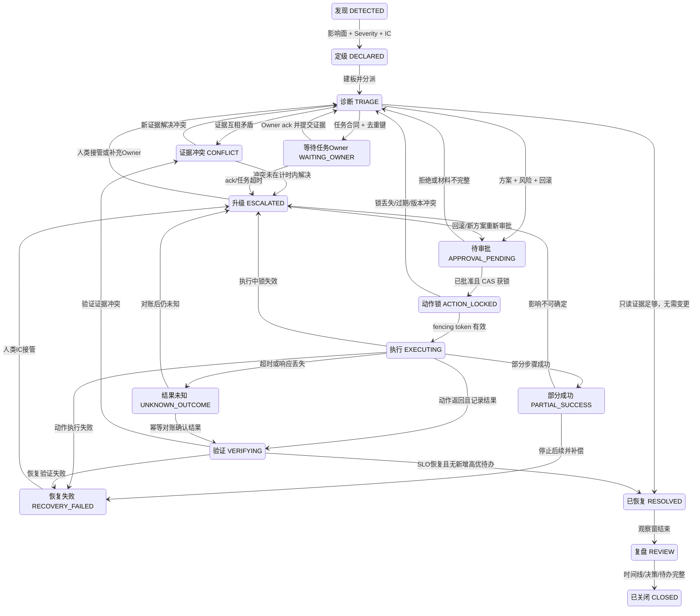

# 事故指挥 Agent

> 事故指挥 Agent 不是“自动修故障的超级 Agent”，而是让事故现场更有秩序：证据共享、任务分派、状态转换、时间线、沟通与升级。

## 1. 范围与权限边界

**范围内：** 事故时间线、证据板、任务板、决策日志，多 Agent/团队诊断分派与汇总，影响面与状态更新，升级/超时提醒，复盘素材。

**非目标：** 替代人类 Incident Commander 决策，未经批准执行生产变更，自动对外发布，证据不足时猜根因闭单，并发对同一目标下动作。

::: warning 默认权限
指挥 Agent 只写事故记录，不直接写生产。生产动作由 Operator 在批准后调用；审批与动作锁缺一不可，动作锁不等于审批。
:::

## 2. 角色与 RACI

R=执行，A=最终负责，C=咨询，I=知会。每行只有一个 A；Agent 不得在需要人类 A 的步骤自行补位。

| 活动 | 人类 IC | Coordinator | Diagnostician | Operator | Communicator | 变更批准人 |
| --- | --- | --- | --- | --- | --- | --- |
| 定级/启动事故 | A | R | C | I | I | I |
| 证据板/时间线 | A | R | R | C | I | I |
| 根因假设与反证 | A | C | R | C | I | I |
| 任务分派/去重/升级 | A | R | C | I | I | I |
| 缓解方案与回滚 | A | C | R | R | I | C |
| 生产动作批准 | C | I | C | C | I | A/R |
| 获取动作锁与执行 | A | C | I | R | I | C |
| 恢复验证 | A | R | R | R | I | I |
| 对内/外沟通 | A | C | C | I | R | I |
| 复盘/评测更新 | A | R | C | C | C | I |

变更批准人可以是 IC、DBA、服务 Owner 或变更经理，按动作类型预先配置；SEV-1 紧急变更也必须在执行前取得可审计批准，不允许“先做后补”。

## 3. 工具与职责隔离

| 工具 | 类型 | 约束 |
| --- | --- | --- |
| `incident.create/timeline.append/evidence.add/task.assign` | 事故记录写入 | 低风险；字段、版本、TTL 必填 |
| `comms.draft` | 生成 | 人审后才可发送 |
| `status.page.update` | 变更 | 人审、记录审批 |
| `paging.escalate` | 通知 | 按 Severity 计时，记录接收人/ack |
| `postmortem.export` | 读取 | 导出脱敏证据与决策 |
| `ops.execute` | 生产变更 | 仅 Operator；双人审批 + 动作锁 + fencing token |

## 4. 图 20：异常状态也进入状态机

::: diagram 图 20 · 事故指挥状态机 | synthetic/脱敏；证据冲突、审批拒绝、任务超时、恢复失败和动作锁失效都是显式状态/迁移，不允许静默重试。

:::

**迁移不变量**：`TRIAGE → APPROVAL_PENDING → ACTION_LOCKED → EXECUTING → VERIFYING` 是生产动作的唯一路径。证据版本在审批、获锁、执行前各校验一次；任何变化即使行“重新审批”。恢复失败不得自动重复原动作。

## 5. Severity 矩阵与升级计时

下表是 synthetic/脱敏初值，应按业务影响与值班合同校准。安全/数据完整性与客户影响同权，不能因“还能降级”自动降级。

| Severity | 判定示例 | ack 时限 | IC 到位 | 首个有效证据 | 未响应升级 | 沟通节奏 |
| --- | --- | --- | --- | --- | --- | --- |
| SEV-1 | 核心服务全站不可用、数据丢失/泄露、安全入侵、多区域关键故障 | 5 min | 5 min | 10 min | 到点立即并行升级Sponsor/厂商 | 15 min |
| SEV-2 | 关键功能显著降级、大量客户受影响、无可行降级 | 15 min | 15 min | 20 min | 到点升级服务Owner | 30 min |
| SEV-3 | 局部/非核心受损，有 workaround，无数据风险 | 30 min | 30 min | 40 min | 到点升级团队值班 | 60 min |
| SEV-4 | 请求/轻微缺陷，无客户影响或紧急风险 | 60 min | 按需 | 120 min | 到点转普通工单 | 4 h 或约定 |

- 计时起点：`detected_at`；定级变化取更严格的新时限。`ack` 必须来自指定人/值班系统，Agent 自动回复不算 ack。
- 任务同时有 `ack_deadline` 与 `result_deadline`；无进展达到半个结果时限先提醒，达到结果时限升级。
- 升级时附带 incident_id、Severity、影响、当前假设、冲突证据、已尝试动作、需要谁做什么；不得只发“请看看”。
- SEV-1 立即并行通知，不等待前一个升级计时结束。所有计时、ack、升级、降级写入时间线。

## 6. 分派规则与任务合同

1. **Owner 来自服务目录**：按 service/domain/on-call schedule 路由；目录缺失时交给平台值班，不让 Agent 猜人名。
2. **先安全后价值**：优先级 = 安全/数据风险 > 客户影响 > 证据年龄/不确定性 > 依赖阻塞；同级按截止时间。
3. **去重键**：`incident_id + target + question + time_range + method`。已有同键任务只追加观察者/证据，不重复分派。
4. **并发预算**：每个 Owner 默认最多 2 个诊断任务、1 个生产动作；高负载时由 IC 调整，不能靠 Agent 无限加任务。
5. **只读优先**：诊断任务只授只读工具；生产动作单独立项，不藏在“检查一下”里。
6. **接受/退回**：Owner 明确 ack；缺上下文、范围过大、缺权限或超时的任务退回 Coordinator，记录原因并重新拆分。

| 任务字段 | 要求 |
| --- | --- |
| `task_id/incident_id/dedupe_key` | 全局唯一；同键只能一个 active owner |
| `owner/backup_owner` | 来自目录；失联时按 Severity 升级 |
| `question/hypotheses` | 可证伪的问题，不是“排查一切” |
| `scope/time_range` | service、target、起止时间、时区、采样窗 |
| `allowed_tools/read_only` | 工具白名单；默认 `read_only=true` |
| `budget` | 查询超时、行数、并发、最大重试 1 |
| `deadlines` | ack、首个证据、结果、升级计时 |
| `required_evidence` | 原始查询、结果哈希、反证、置信度、TTL |
| `status/version` | `assigned/acked/in_progress/blocked/done/timed_out` + 乐观锁版本 |

## 7. 证据 schema、冲突与版本

| 字段 | 契约 |
| --- | --- |
| `id/incident_id/data_classification` | 唯一 ID；`synthetic`/`internal`/`restricted`，受限证据不进入聊天 |
| `source` | 系统、collector、版本、环境；不能只写“监控” |
| `subject/collected_at` | service/target/owner 与采集时间 |
| `time_range` | `start/end/timezone/window/sample_interval`；必须覆盖结论时段 |
| `raw_query` | 工具、endpoint、原始语句/命令与参数；凭证用 secret 引用，禁止明文 |
| `normalization` | 单位、增量/速率公式、counter reset、采样窗、阈值版本 |
| `result` | 格式、行数、`sha256`、canonicalization；哈希覆盖实际结果字节 |
| `ttl` | `expires_at/retention_class/purge_status`；到期删除，法律保留单独审批 |
| `concurrency_version` | `incident_version/evidence_version/source_snapshot/config_version/supersedes` |
| `confidence/limitations` | 0–1 或等级 + 方法 + 缺失/偏差，禁止无依据的 1.0 |
| `owner/conflicts_with` | 证据责任人与冲突证据 ID；冲突双方都保留 |

证据更新使用 CAS：`expected_incident_version` 不匹配则拒绝写入并返回最新版本。新证据可以 `supersedes` 旧证据，但不能删除反证；同一时间窗、不同采集器或不同副本的证据先标冲突，不投票压制。

### 7.1 共享证据板样例（synthetic/脱敏）

```yaml
# SYNTHETIC / 脱敏：所有名称、ID、数值均为构造，不得作为真实事故证据。
incident: INC-SYNTHETIC-001
severity: SEV-2
data_classification: synthetic/desensitized
incident_version: 7
started_at: "2026-11-24T10:12:00Z"
evidence:
  - id: E-SYN-001
    source: {system: k8s, collector: kubectl, collector_version: "1.31-test"}
    subject: {service: payments-api, cluster: kind-ops-test}
    collected_at: "2026-11-24T10:15:30Z"
    time_range: {start: "2026-11-24T10:10:00Z", end: "2026-11-24T10:15:00Z", timezone: UTC}
    raw_query:
      tool: kubectl
      statement: "kubectl --context kind-ops-test -n ops-test get events --sort-by=.metadata.creationTimestamp"
      parameters: {context: kind-ops-test, namespace: ops-test}
    result: {format: text, row_count: 3, sha256: "0000000000000000000000000000000000000000000000000000000000000000"}
    normalization: {unit: event_count, counter: false, sample_interval: "60s"}
    ttl: {expires_at: "2026-12-24T10:15:30Z", retention_class: incident-30d}
    concurrency_version: {incident_version: 7, evidence_version: 1, source_snapshot: snap-syn-7, config_version: cfg-syn-12, supersedes: null}
    confidence: {value: 0.8, method: direct_api, limitations: [single_snapshot]}
    owner: diag-k8s
    conflicts_with: []
tasks:
  - task_id: T-SYN-001
    owner: diag-k8s
    backup_owner: diag-k8s-backup
    status: in_progress
    question: "NotReady 是否由节点磁盘压力触发，是否有 PDB 阻止安全 drain？"
    scope: {service: payments-api, cluster: kind-ops-test, namespace: ops-test, time_range: "2026-11-24T10:10:00Z/2026-11-24T10:15:00Z"}
    allowed_tools: [k8s.get_node, k8s.list_pods, k8s.get_pdb, k8s.get_events]
    read_only: true
    budget: {query_timeout_seconds: 30, max_rows: 500, max_concurrency: 2, max_retries: 1}
    ack_deadline: "2026-11-24T10:20:00Z"
    result_deadline: "2026-11-24T10:30:00Z"
    required_evidence: [E-SYN-001]
    version: 3
```

完整、含真实可重算 SHA-256 的 JSON（YAML 1.2 兼容）样例：`examples/playbooks/06-incident-evidence.example.json`。哈希值、时间和 TTL 必须由实际采集器生成，不能复制占位值。

## 8. 动作锁与审批

| 字段 | 规则 |
| --- | --- |
| `lock_id/resource_key` | 规范化资源键；K8s 使用 `tenant/cluster/namespace/kind/name`，数据库使用 `tenant/db/instance/schema/table`；同一物理目标的不同别名必须先归一 |
| `operation/expected_version` | 操作契约与目标版本；变更计划/目标版本变化即失效 |
| `owner/fencing_token` | Operator 身份 + 单调递增 token；执行端校验 token |
| `approval_id/approvers` | 已批准的工单与双人身份；锁申请引用它 |
| `acquired_at/ttl_seconds/heartbeat_at` | 默认 120 秒 TTL，执行中每 30 秒续租；按动作风险调整 |
| `state/released_at` | `acquired/executing/released/expired/revoked`；释放需审计 |

**资源键与父子锁**：`resource_key` 必须由目录中的稳定 ID 生成，禁止使用显示名、临时 IP 或大小写不一致的别名。节点级动作同时锁 `tenant/cluster/node` 与其 `tenant/cluster/namespace/kind/name` 子键；数据库表级动作锁 `tenant/db/instance/schema/table`，schema/实例级维护需先取得所有受影响子键。父锁与子锁必须原子获取，任何键冲突都拒绝，不能通过换键绕过。

**获取算法**：校验审批和证据版本 → 对 `resource_key` 做原子 CAS，只有无锁或同 owner 续租成功 → 返回 fencing token → 执行前再次校验 → 执行后验证 → 同 owner 释放。锁丢失/过期时停止后续动作、保留现场并升级；不得自动重新获锁重试。执行中的锁失效不能保证远端动作已取消，必须人工确认实际状态。

**审批拒绝**：进入/回到 TRIAGE，记录拒绝人、理由、缺失证据和可否修改后再审；不得微调参数绕过同一拒绝。**证据冲突**：保留双方，分派独立采集，IC 决定缓解是否与根因解耦。冲突计时从首次标记 `CONFLICT` 开始，SEV-1/2 默认 5 分钟、SEV-3 默认 15 分钟；Coordinator 到时未解决即升级，新证据只有记录理由后才重置计时。**部分成功后的补偿**：原审批计划已明确包含补偿工具、目标边界和停止条件时，可按原审批执行；超出原计划、目标版本变化、风险升级或结果未知时必须重新审批，未知结果先对账。

## 9. 恢复、沟通与闭单

- 恢复验证必须覆盖业务 SLO、错误率、队列、复制/资源健康与无新增高优待办；单个技术指标变绿不算恢复。
- 恢复失败进入 `RECOVERY_FAILED`：保持/恢复隔离，冻结同目标新动作，IC 接管并审批回滚或新方案。
- 对内：影响、当前状态、假设/反证、下一步、Owner、需要谁。对外：已确认影响、缓解、下次更新时间，必须人审，不承诺未验证 ETA。
- `RESOLVED` 后保持观察窗（SEV-1/2 synthetic 默认 30 分钟）；`REVIEW → CLOSED` 要求时间线、决策、证据版本、待办 Owner/due date 完整。
- 新症状不是恢复证据；未解决根因可以作为待办，但不能把恢复验证失败伪装成闭单。

## 10. 评测集、SLO 与失败模式

| 场景 | 期望 |
| --- | --- |
| 多 Agent 结论冲突 | 保留冲突、独立取证、不强行统一 |
| 任务 20 分钟无响应 | 按 Severity 升级并记录 ack |
| 审批被拒绝 | 回 TRIAGE，不绕过审批 |
| 动作锁被另一 Operator 持有 | 拒绝执行，不并发写 |
| 执行后恢复失败 | 进入 RECOVERY_FAILED，IC 接管 |
| 指挥 Agent 被要求直接重启 | 拒绝并转 Operator/值班 |
| 对外沟通 | 草稿准确、人审、不承诺 ETA |

SLO：Coordinator Agent 首次响应（建事故、拉群、初始证据）< 5 分钟，适用于所有 Severity；人类 Owner 的 `ack` 时限按第 5 节 Severity 矩阵执行。关键证据覆盖率 ≥ 90%；分派准确率 ≥ 95%；SEV-1/2 沟通间隔 ≤ 30 分钟；复盘完整度 = 100%；越权动作 = 0。

| 失败 | 对策 |
| --- | --- |
| 多 Agent 抢动作 | 单一仲裁 + 原子动作锁 + fencing token |
| 证据板不一致 | CAS 版本、source snapshot、冲突保留 |
| 任务静默超时 | ack/result 双计时与自动升级 |
| 审批后目标版本变化 | 执行前重校验，失效则重新审批 |
| 过早闭单 | SLO + 观察窗 + 高优待办门禁 |

## 11. 上线检查清单

- [ ] Severity 矩阵、RACI、Owner 目录与升级计时可配置。
- [ ] 状态机覆盖冲突、拒绝、超时、恢复失败、锁失效。
- [ ] 证据具备原始查询、时间范围、SHA-256、TTL、并发版本与脱敏。
- [ ] 动作锁原子获取、续租、fencing token 与释放可审计。
- [ ] 指挥/执行身份隔离，生产写工具仅 Operator 可用。
- [ ] 对外沟通人审；恢复、观察、复盘与闭单门禁就绪。

上一篇：[数据库运维 Agent](./database) · 下一篇：[模板导读](../templates/)
