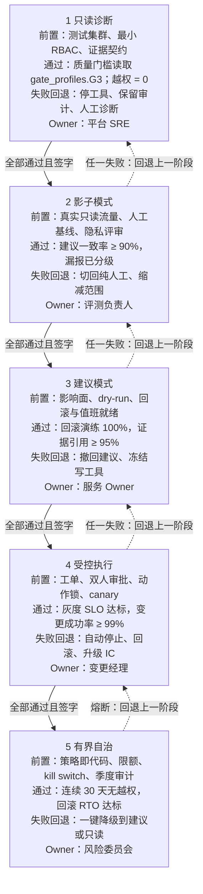

# 场景手册导读

> 方法可以复用，场景必须深潜。每本场景手册都按同一套结构写，方便你横向对照。

## 怎么选第一本

| 你的现状 | 建议从哪本开始 | 原因 |
| --- | --- | --- |
| 负责 K8s 平台/应用运维 | [K8s 集群运维](./k8s) | 证据源最丰富，任务边界最清晰，适合做第一个 Copilot |
| 负责 GPU 训练/推理集群 | [GPU 推理运维](./gpu-inference) | 价值高、指标明确，但需要处理硬件与推理框架 |
| 负责高性能网络/智算集群 | [RDMA 高网运维](./rdma) | 风险最高，建议先做只读诊断与变更预检 |
| 负责数据库/中间件 | [数据库运维](./database) | 读写边界清晰，适合做 SQL/容量/复制的只读助手 |
| 负责事故响应/多团队协同 | [事故指挥](./incident-commander) | 重点不是工具，而是证据共享、分工与沟通 |

## 统一结构

每本手册都包含：范围与非目标、证据源、工具清单、典型任务流、权限与护栏、评测集、SLO 与失败模式、上线检查清单。场景步骤只保留在图和配套检查表中，避免图文两套流程互相漂移。

## 从只读到有界自治的五道门

下图的阶段、门槛与阈值均为 **synthetic/脱敏示例**；落地时由服务 Owner 写入策略，不能用示例值替代审批。

::: diagram 图 31 · 场景 Agent 五阶段准入门禁 | 每阶段同时具备前置、通过标准、失败回退和 Owner；未过门只能留在当前阶段。

:::

**共享门禁**：环境白名单 → 工具最小权限 → 证据可追溯 → 影响面预览 → 人工审批 → 动作锁 → 执行后验证 → 失败回退。第 2、3 步不得跳过；“通过”是门槛组合，不是平均分。

## 可执行样例（PLAY-01～05）

所有样例均标注 **synthetic/脱敏**，默认拒绝生产目标；先审查，再在专用测试环境替换变量。样例不是真实变更授权。

| 样例 | 文件 | 验收方式 |
| --- | --- | --- |
| PLAY-01 K8s | `examples/playbooks/01-k8s-readonly.sh` | 非 `kind-ops-test` 上下文时退出；检查 PDB 在任何 drain 之前 |
| PLAY-02 RDMA | `examples/playbooks/02-rdma-flap-audit.sh` | 输出两次采样的增量、速率和窗口；不自动执行 perftest/NCCL |
| PLAY-03 GPU | `examples/playbooks/03-gpu-preflight.sh`、`examples/playbooks/03-kv-cache-budget.py` | 计算器复算 512 MiB/序列、8 序列 4 GiB；脚本不 reset/drain |
| PLAY-04 数据库 | `examples/playbooks/04-mysql-readonly.sql`、`examples/playbooks/05-postgresql-readonly.sql` | 超时、行数、只读事务、脱敏输出；DDL 仅见手册中的演练门禁 |
| PLAY-05 事故指挥 | `examples/playbooks/06-incident-evidence.example.json` | 校验原始查询、时间范围、SHA-256、TTL、并发版本与动作锁 |

## 五本手册共享的设计语言

- **证据包**：每次诊断输出结构化证据，而不是一段总结。
- **动作阶梯**：先只读，再建议，再受控执行。
- **Runbook 2.0**：步骤、证据、验证、回退、升级写在同一份资产里。
- **评测集**：从历史事故开始，持续增长。
- **人工责任**：Agent 可以建议/执行，但人要对结果负责。

下一篇：[K8s 集群运维 Agent](./k8s)
