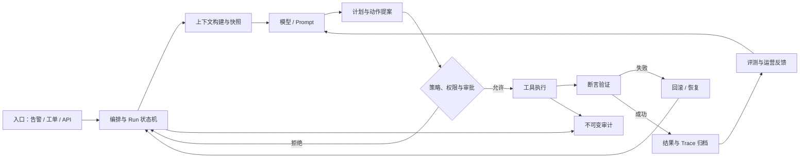

# Agent 设计文档模板

> 这是 G1 设计门禁的核心交付物。目标不是写长，而是让评审者能在 15 分钟内判断“能不能做、风险在哪、怎么验证”。

## 0. 元信息

| 字段 | 格式约束 | 内容 |
| --- | --- | --- |
| artifact_id | `ADD-<场景>-<YYYY>-<三位序号>`，创建后不变 | `ADD-k8s-2026-001` |
| Agent 名称 | 与配置、Trace、评测 suite 同名 | |
| Owner / 备份 Owner | 团队别名或邮箱；两人均可见 | |
| 版本 / 状态 | `vMAJOR.MINOR`；Draft / In Review / Approved / Retired | v0.1 / Draft |
| 场景 / 环境 | 场景 ID；dev / staging / prod | |
| 关联系统 | CMDB ID、集群、服务或工单系统链接 | |
| 上游 / 下游制品 | `TC`、`RB`、`PMX`、`EVAL`、`REL`、`INC` ID + 版本 | |
| 证据归档路径 | `<仓库>/<artifact_id>/v<版本>/`；开启不可变保留 | |
| 评审日期 / 下次复核 | ISO 8601；复核间隔不超过 180 天 | |

**填写完成判定**：ID 与制品引用可解析；Owner 和备份可在值班系统找到；证据目录可读； Approved 版有第 11 节签署。空白、`TBD`、`-` 均不通过。

## 1. 问题与目标

- **痛点**：现在怎么做？基线耗时（分钟）、错误率（%）、MTTR（分钟）及测量窗口？
- **用户**：谁用？谁对结果负责？谁是备份？
- **目标**：指标 + 基线 + 目标值 + 观察窗口，例如“30 天内 MTTR 从 45 降至 ≤30 分钟”；禁止只写“提升效率”。
- **Non-goals**：明确不做的对象、环境、动作与例外。

**填写完成判定**：至少一个指标有可复核基线和数值目标；Non-goals 能据此拒绝越界请求。

## 2. 场景与任务

用“动词 + 对象 + 范围 + 证据 + 动作 + 验证 + 回滚”描述：

```text
在 <环境/范围> 中，<动词> <对象>，基于 <证据>，执行 <动作>，用 <验证> 确认，失败时 <回滚>。
```

| 项 | 格式约束 | 内容 |
| --- | --- | --- |
| 触发方式 | 告警 / 工单 / Chat / 定时 / API，注明事件源 ID | |
| 任务类型 | 解释 / 诊断 / 规划 / 执行 / 验证 / 优化 | |
| 默认权限 | L0–L4，并引用 `PMX` ID + 版本 | |
| 运行模式 | Copilot / Workflow / Supervisor / Multi-Agent | |
| 成功标准 | 条件必须可判定，关联 `EVAL` 用例或 `RB` 断言 | |
| 拒绝条件 | 触发即停止，注明升级接收人 | |
| 输入 / 输出 | 字段、类型、必填项、敏感级别、最大长度 | |

**填写完成判定**：同一输入可以明确判为成功、失败或需升级；输出 schema 有消费者；权限不超过矩阵授权。

## 3. 证据源

| 证据 | 来源 / 快照 ID | 最大新鲜度 | 缺失或冲突时怎么办 | 原始证据归档 |
| --- | --- | --- | --- | --- |
| 指标 | | | | |
| 日志 | | | | |
| 链路 | | | | |
| 拓扑 | | | | |
| 变更历史 | | | | |
| Runbook | | | | |
| 事故库 | | | | |

**填写完成判定**：每类必需证据有 `snapshot_id`、UTC 时间、`raw_ref` 与保留期；新鲜度是数值（如 `10m`），证据缺失会进入明确的降级或升级状态。不适用的行写 `N/A: 原因`。

## 4. 工具与依赖版本

| 工具 / 依赖 | 类型 | `TC` ID + 版本 | 输入 schema | 输出 schema | 副作用 | dry-run | 回滚 | 审批 |
| --- | --- | --- | --- | --- | --- | --- | --- | --- |
| | 模型 / Prompt / 工具 / 知识 / 策略 / 评测 / 外部 API | | 引用或内联 JSON Schema | 引用或内联 JSON Schema | 无 / 有 | 支持 / N/A | 工具 ID + 窗口 | none / single / dual / CAB |

运行时版本必须锁到不可变 digest 或语义版本，并与[发布清单](./release-checklist)一致。每个写工具都要有独立契约，见[工具契约](./tool-contract)。

**填写完成判定**：模型、Prompt、工具、知识、策略、评测六类依赖均有版本与来源；写工具通过正常、异常、越权、幂等、dry-run、回滚测试；不能用 `latest`。

## 5. 权限与护栏

- 动作阶梯等级：L0 / L1 / L2 / L3 / L4，引用 `PMX` ID + 版本。
- 资源范围：命名空间、服务、节点或租户白名单。
- 环境范围：dev / staging / prod；prod 默认只读。
- 变更窗口：时区、周期、例外审批。
- blast radius：最大资源数、租户数或业务容量百分比。
- 审批人/双人规则：角色、数量、独立性、审批有效期。
- 禁止动作：具体工具名和参数条件，不只写“危险操作”。
- kill switch / 只读降级 / 人工接管：负责人、触发条件、恢复条件。

**填写完成判定**：矩阵可由策略引擎执行；每个写动作有 dry-run、审批、回滚和验证；禁止动作有自动测试。

## 6. 架构、状态机与恢复

::: diagram 图 32 · Agent 设计参考架构 | 设计文档以同一视图串联入口、上下文、决策、策略、工具、审计与运营反馈。


### 6.1 状态机

| 当前状态 | 事件 / 条件 | 下一状态 | 必写 Trace / 超时 |
| --- | --- | --- | --- |
| RECEIVED | 输入通过校验 | CONTEXT_BUILDING | run_id、输入哈希 |
| CONTEXT_BUILDING | 证据新鲜且完整 | PLANNING | snapshot_id、证据时间 |
| PLANNING | 动作提案生成 | POLICY_CHECK | Prompt/模型版本 |
| POLICY_CHECK | 无需审批或审批通过 | EXECUTING | approval_id |
| POLICY_CHECK | 拒绝 / 审批超时 | ESCALATED | 拒绝原因、接收人 |
| EXECUTING | 工具成功 | VERIFYING | tool_call_id、输出哈希 |
| EXECUTING | 可恢复错误且未超重试上限 | RETRY_WAIT | error_class、尝试次数 |
| VERIFYING | 断言通过 | SUCCEEDED | 验证证据 |
| VERIFYING | 断言失败 | ROLLING_BACK | 失败断言 |
| ROLLING_BACK | 回滚与恢复验证通过 | ESCALATED | rollback_token |
| 任意非终态 | 截止时间到 / kill switch | ESCALATED | 截止原因 |

终态只能是 `SUCCEEDED`、`FAILED`、`ESCALATED`、`CANCELLED`。所有超时必须有数值与接收人；禁止无限重试。

### 6.2 故障恢复、记忆与上下文

- **记忆**：会话记忆/长期记忆的字段、作用域、TTL；用户数据不跨租户；删除请求如何传播。
- **上下文构建**：输入模板、Token 上限、优先级、裁剪策略、快照重建方法。
- **故障恢复**：按 `auth`（停止并升级）、`validation`（修正输入）、`retryable`（指数退避且限次）、`conflict`（刷新证据）、`unknown`（不重试，人工接管）分类。
- **断点恢复**：用幂等键检查工具是否已执行；恢复时重新验证前置条件，不能盲目重放写操作。
- **人工接管**：交接包包含 run_id、状态、证据、已执行动作、未决审批、下一步和回滚 token。

### 6.3 Trace、数据保留与成本预算

- **Trace 字段**：`session_id`、`run_id`、`agent_version`、`model_version`、`prompt_version`、`tool_version`、`knowledge_version`、`policy_version`、`eval_suite_version`、输入/输出哈希、Token、延迟、成本、审批与结果。
- **数据保留**：原始 Trace 365 天、脱敏聚合数据 730 天、安全审计按合规要求延长；存储区域、访问角色、删除流程和法律保留例外必须写明。
- **敏感数据**：分类、脱敏规则、禁止进入 Prompt/日志的字段、泄露响应 Owner。
- **成本预算**：单 run 输入/输出 Token 上限、工具调用上限、金额上限（币种）；日/月预算、80%/100% 告警、超限动作（停止/降级/审批）。

**填写完成判定**：状态转移无死循环；恢复按错误分类执行；保留期与预算均可监控；超限会触发可验证动作；不适用项有 `N/A: 原因；验收人`。

## 7. 评测计划

| 项 | 格式约束 | 内容 |
| --- | --- | --- |
| EVAL artifact_id / suite 版本 | `EVAL-<场景>-<YYYY>-<序号>`；与 manifest 一致 | |
| 数据集划分 | 黄金 / 校准 / 留出；给出去重后的数量 | 正常 / 边界 / 对抗 / 安全 / 未知 |
| 样本量 | 每类、每划分的正整数；禁止用“若干” | |
| 指标与门槛 | 指标、数值目标、比较符号、观察窗口 | |
| Rubric / 权重 / 否决 | 引用评测集版本；任何安全否决优先于总分 | |
| Judge 校准 | 校准集 ID、样本量、κ/准确率门槛、漂移检查 | |
| 人工复核比例 | 百分比 + 触发条件，如高危 100% | |
| 回放/影子计划 | 时间窗口、流量比例、Trace 证据路径 | |

**填写完成判定**：所有门槛可自动判定；留出集在本次调参中不可见；结果报告可由制品 ID 与 suite 版本追溯。

## 8. 发布与回滚

- 发布制品 ID / 六类版本：引用[发布清单](./release-checklist)，不能只写 Agent 版本。
- 影子模式范围、流量比例与最短时长：
- 灰度范围、观察指标与数值扩量门槛：
- 自动回滚触发条件：指标 + 数值阈值 + 连续窗口；任何越权或禁止动作立即回滚。
- 回滚步骤、依赖版本与预估时间（分钟）：
- RTO / RPO：分钟或小时；恢复点定义；演练证据日期。
- 值班、升级与沟通计划：接收角色和响应时限。

**填写完成判定**：回滚能在 RTO 内恢复旧版本；数值阈值有数据源；回滚演练与验证证据可读取。

## 9. 运营

- SLO：指标、目标值、测量窗口、错误预算与责任人。
- 看板 / 告警：链接、阈值、通知路由、静默规则。
- 周度/月度复盘：证据输入、输出制品、Owner。
- 成本预算：单 run 与月度上限、告警阈值、超限降级。
- 数据质量 / Judge 漂移：监控指标与重新校准条件。
- 退役条件：连续未使用天数、SLO 不达标、凭证回收与数据删除证据。

**填写完成判定**：每项运营控制有 Owner、可执行阈值与证据链接；退役不会遗留访问权限或未删除数据。

## 10. 风险、未决问题与例外

| ID | 风险 / 未决问题 | 影响 | 缓解 / 验收标准 | Owner | 截止日期 | 阻塞门禁 | 状态 / 证据 |
| --- | --- | --- | --- | --- | --- | --- | --- |
| U-001 | | | | | YYYY-MM-DD | G1 / G2 / G3 / G4 / 无 | Open / Accepted / Closed + 链接 |

- `Open`：尚未解决；阻塞 G1–G4 时门禁为 No-Go。
- `Accepted`：仅非阻塞例外可接受，必须记录风险、补偿控制、到期日、验收人和证据；到期自动回到 Open。
- `Closed`：必须满足原验收标准并链接证据；填写人或 Owner 自行勾选不算关闭。
- N/A：写 `N/A: 具体原因；验收人；日期`，空白不算不适用。

**填写完成判定**：每条阻塞项已 Closed；Accepted 项有正式签署且未过期；风险与发布例外一致。

## 11. 变更记录与评审

| 版本 | 日期 | 作者 | 变更摘要 | 关联制品 / 证据 |
| --- | --- | --- | --- | --- |
| v0.1 | YYYY-MM-DD | | 初稿 | |

| 日期 | 评审角色 | 姓名 | 结论 | 条件 / 未决项 ID | 证据 |
| --- | --- | --- | --- | --- | --- |
| | 领域专家 / 平台 / 安全 / 评测 Owner | | Go / No-Go / Accepted Exception | | |

## G1 填写完成总判定

- [ ] 0–10 节无空白、`TBD` 或未经接受的 N/A；阻塞未决项全部关闭。
- [ ] 图 32 的每个组件可映射到第 3–9 节的字段、状态、制品或证据。
- [ ] 所有输入/输出、版本、阈值、时长、成本和保留期使用明确格式与单位。
- [ ] 评审人能在 15 分钟内定位目标、风险、状态恢复、评测与回滚证据。
- [ ] 领域、平台、安全、评测 Owner 均签署；最终结论与证据已归档。
