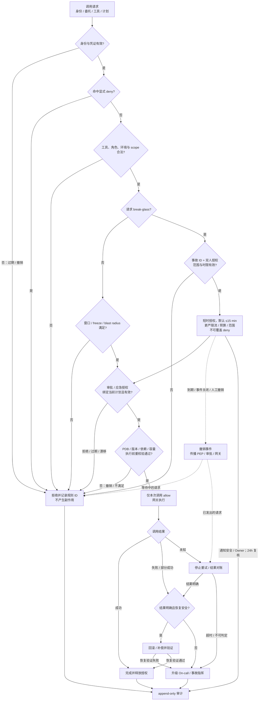

# 权限矩阵模板

> 权限矩阵是“Agent 能做什么”的权威答案。它应该独立于 Prompt，能被策略引擎执行，也能被审计。矩阵是人类可读视图；运行时必须执行对应的机器可读策略。

::: diagram 图 47 · 权限决策与 break-glass | 权限决策流程示意：显式 deny 先于一切授权且不可被 break-glass 覆盖；撤销、恢复失败和未知结果都有显式拒绝或升级出口。

:::

## 正式 Schema 与示例

- 规范：[`schemas/permission-policy.schema.json`](../../schemas/permission-policy.schema.json)，JSON Schema Draft 2020-12。
- 示例：[`examples/cases/notready/permission-policy.notready.json`](../../examples/cases/notready/permission-policy.notready.json)（synthetic / 脱敏）。
- 每次策略变更递增 `version`，保留审批记录与生效/撤销时间。

## 矩阵模板

| 顺序 | 工具/动作 | 环境 | 资源范围 | 角色 | 审批 | Blast radius | Dry-run | 恢复语义 |
| --- | --- | --- | --- | --- | --- | --- | --- | --- |
| 0 | 任意 | 任意 | 任意 | 任意 | 显式 deny | — | — | 拒绝优先，不被 allow 或 break-glass 覆盖 |
| 1 | `k8s.get_pod` / `k8s.get_events` / `logs.query` | dev/staging/prod | namespace/service | viewer | 无 | 0 | N/A | 无副作用 |
| 2 | `k8s.restart_deployment` | staging/prod | 单 namespace | operator | 单人 + 窗口 | 1 deployment | 必须 | rollout undo + 验证 |
| 3 | `k8s.scale` | prod | 单 workload | operator | 单人 + 窗口 | 1 workload | 必须 | 恢复副本 + 容量/PDB 验证 |
| 4 | `k8s.drain_node` | prod | 单节点 | senior | 双人 + 窗口 | 1 node | 必须 | **不可完全回滚**；PDB 前置；补偿含 uncordon |
| 5 | `node.cleanup_logs` | prod | 单节点白名单路径 | senior | 双人 + 窗口 | 1 node | 必须 | **清理不可逆**；先留脱敏证据，失败即停 |
| 6 | `k8s.uncordon` | prod | 单节点 | senior | 单人 + 窗口 | 1 node | N/A | 仅恢复可调度；不撤销 Pod 迁移 |
| 7 | `k8s.restart_kubelet` | prod | 单节点 | senior | 双人 + CAB + 窗口 | 1 node | 必须 | 按独立恢复计划验证；未证明可逆则禁自动回滚 |
| 8 | `cloud.replace_node` | prod | 单节点 | senior | 双人 + CAB + 窗口 | 1 node | 必须 | 新节点验收 + 服务重建；原节点迁移不可自动撤销 |
| 9 | `k8s.delete_namespace` | 任意 | 任意 | — | 禁止 | — | — | 默认拒绝 |

::: tip 贯穿案例
在 [K8s 节点 NotReady 案例](../appendix/case-notready)里，Copilot 只有只读权限；Operator 经过策略执行点并在双人审批后执行 drain。PDB 检查先于 drain，审批绑定不可变计划哈希与目标版本。部分成功时停止后续步骤，重新规划后申请新审批。`uncordon` 只是恢复步骤，不是完整回滚。
:::

## 决策顺序：deny 优先

```text
1. identity_valid_and_delegation_active?
2. explicit_deny_matches?                 -> deny（最高优先级）
3. credential_valid_and_not_revoked?
4. tool_in_allowlist_and_contract_version_approved?
5. role / environment / resource_scope_match?
6. change_window / freeze / blast_radius_satisfied?
7. approval_bound_to_current_plan_and_valid?
8. preconditions_passed?                  -> PDB / 资源版本 / 依赖 / 容量
9. revalidate_before_each_write_call?     -> 撤销 / 版本 / 凭证 / 限流
10. allow this invocation only
```

任何步骤失败都返回带原因的 `deny`；不允许“先执行再补权限”。allow 规则只在没有命中显式 deny 时生效。冲突的策略按优先级处理，但**显式 deny 始终优先**，并记录命中的规则 ID。

## 审批绑定规则

- 审批对象是不可变计划快照，至少绑定 `plan_version`、`plan_hash`、`target_resource_versions`、`expires_at`、审批人和审批级别。
- 规范化计划计算 SHA-256，覆盖工具、参数、目标、顺序、影响面、停止条件与恢复方式。
- 每次写调用前重新校验资源版本、PDB、窗口、角色、委托、撤销与凭证。
- 计划任何变化、目标版本漂移、审批撤销或超过有效期，旧审批失效；重规划后重新审批。
- 只读诊断可走无人工审批快路径，但仍必须通过身份与策略执行点。

## Break-glass

Break-glass 是**短时、可审计、可撤销的应急授权**，不是超级账号，也不是绕过安全限制的开关。

| 要求 | 规则 |
| --- | --- |
| 启用条件 | 事故指挥官声明，事故 ID 与理由必填 |
| 授权 | 双人 + 事件记录；默认最长 15 分钟 |
| 范围 | 仅指定工具、资源、环境与动作；不允许任意 shell |
| 限制 | 速率、并发、总时长、预算和 blast radius 更严格 |
| deny | 不能覆盖显式 deny；若需调整禁区，走独立策略变更与 CAB |
| 审批绑定 | 同样绑定计划哈希、版本、目标版本和到期时间 |
| 自动回收 | 到期即撤销；事件关闭立即撤销；支持人工提前撤销 |
| 后置 | 通知安全/Owner，24 小时内复核；形成改进项 |

## 撤销与凭证回收

- 委托、角色、审批或凭证撤销写入统一撤销事件流，传播到 PEP、审批服务与执行网关。
- 撤销传播 SLO 必须明确（例如 5 秒）；等待中的任务收到事件后立即拒绝，已发出的请求进入结果对账。
- 执行网关在每次写调用前检查撤销版本；不得只依赖 JWT 到期。
- Agent 退役、Owner 变更或长期不活动时自动回收角色、委托和短时凭证。
- 权限与撤销事件 append-only，记录发起人、原因、范围、时间和传播结果。

## 示例：三类角色

| 角色 | 能力 |
| --- | --- |
| Viewer Agent | 只读查询、诊断、生成报告；不可传递委托 |
| Operator Agent | staging 低风险变更；prod 单人审批 + 窗口 |
| Senior Operator Agent | prod 节点级变更；双人审批 + PDB + 绑定计划 + 安全恢复 |

## 评审与回收

- 每次新增工具/场景，更新矩阵、Schema 示例和契约测试并评审。
- 每季度复核一次权限，回收不再需要的 scope 与 break-glass 入口。
- Agent 退役时立即回收凭证、委托和服务账号。
- 权限与策略变更要版本化、可审计、可回滚；回滚策略不等于回滚业务副作用。

## 检查清单

- [ ] 每个工具都有环境、资源范围、角色、审批、blast radius 与恢复语义。
- [ ] 显式 deny 优先于 allow 与 break-glass，并记录命中规则。
- [ ] 高危动作默认禁止或双人审批。
- [ ] 写工具有 dry-run、幂等键、部分成功语义与恢复条件。
- [ ] 审批绑定计划版本、SHA-256、目标版本和有效期，执行前重新校验。
- [ ] `uncordon` 不被描述为完整回滚，Pod 迁移不被描述为可自动撤销。
- [ ] 清理/删除/复位等不可逆动作有明确证据保留、补偿边界和停止条件。
- [ ] break-glass 短时、限范围、不可覆盖 deny、自动回收并复核。
- [ ] 撤销传播到所有执行点，并有可测试的 SLO。
- [ ] 策略引擎可执行矩阵，不依赖 Prompt；定期复核与退役回收。
