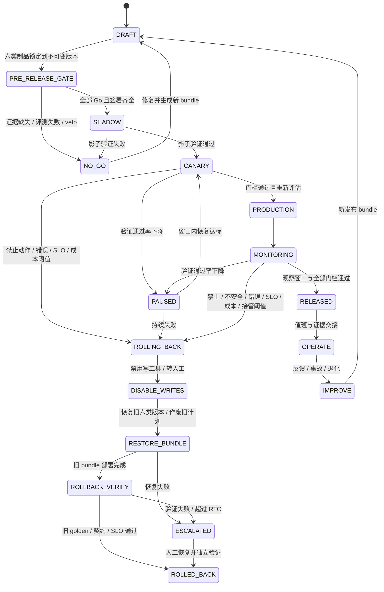

# 发布与回滚清单

> 发布不是“部署成功”，而是“在可观察、可回滚、可接管的前提下，把能力交给真实用户”。

::: diagram 图 49 · 发布、验证与回滚状态 | 发布与恢复流程示意：任一门禁失败都拒绝发布或进入回滚；六类制品作为同一 bundle 恢复，超过 RTO 或恢复验证失败必须升级。

:::

## 0. 元信息与门禁

| 字段 | 格式约束 | 内容 |
| --- | --- | --- |
| artifact_id | `REL-<场景>-<YYYY>-<三位序号>`；每次发布新 ID | `REL-k8s-2026-001` |
| 版本 / 状态 | `vMAJOR.MINOR`；Draft / In Review / Approved / Rolled Back | v1.0.0 / Draft |
| Owner / 备份 | 团队别名，能解析到值班系统 | |
| 更新时间 | ISO 8601 UTC | |
| 关联制品 | `ADD`、`RB`、`PMX`、`EVAL` ID + 版本 | |
| 证据归档 | `<仓库>/<artifact_id>/v<版本>/`；不可变，默认 365 天 | |
| 结论 / 例外 | Go / No-Go / Accepted Exception；例外有到期日和验收人 | |

机器可读权威源：仓库根目录 `templates/release.yaml`。它是合成示例，域名、digest、人名均为占位；生产使用前必须替换并验证链接。

**G4 填写完成判定**：六类制品全部锁定到不可变版本；每项检查有证据与验证责任人；所有回滚阈值是数值；RTO 经演练证明；签署齐全；阻塞未决项为零。空白、`TBD`、无原因 N/A 不通过。

## 1. 六类制品版本基线

| 类型 | 版本字段 | 不可变引用 | 必须核对 |
| --- | --- | --- | --- |
| 模型 | provider/model/revision | 权重 digest 或部署 ID | 上下文、成本、安全评测 |
| Prompt | Agent/工作流版本 | Git commit SHA | 系统提示、工具说明、输出 schema |
| 工具 | bundle 与每个工具版本 | 镜像 digest / 包哈希 | 契约测试、权限、超时、回滚 |
| 知识 | 知识库/索引版本 | 快照 ID + 内容哈希 | 来源、新鲜度、访问控制 |
| 策略 | 权限/审批/护栏版本 | policy bundle digest | 矩阵、窗口、blast radius、kill switch |
| 评测 | suite / manifest / Judge 版本 | suite digest | 划分、快照、校准、权重与否决 |

六类版本必须作为**同一发布 bundle**回滚，不能只回滚模型。生产 Trace 与事故复盘必须记录同一 bundle 的六类版本。

## 2. 发布前检查

- [ ] `ADD`、`RB`、`TC`、`PMX`、`EVAL` 的 ID 与版本可解析，设计无阻塞未决项。
- [ ] 六类制品版本与不可变引用已锁定；来源、审批和哈希验证通过。
- [ ] 评测集覆盖正常、边界、对抗、安全、未知；golden/calibration/holdout 无泄漏。
- [ ] 核心指标达数值门槛；加权总分 ≥ 85；任何 veto 为 0；Judge 校准已通过。
- [ ] 影子/回放通过，人工复核无重大遗漏；结果与原始 Trace 已归档。
- [ ] 权限矩阵、审批、dry-run、回滚已配置；越权与禁止动作测试为 0 失败。
- [ ] 工具契约测试通过：正常/异常/越权/幂等/回滚；输入 schema 校验开启。
- [ ] 运行 Trace 含 run_id 与六类版本；看板、告警、成本账单就绪。
- [ ] 发布说明包含变更点、评测结果、已知风险、影响范围和回滚 bundle。
- [ ] 值班、升级、沟通计划明确；kill switch / 只读降级 / 人工接管已演练。
- [ ] 每项检查都有 `evidence` URL 或 URI、`verified_by` 和验证时间。

## 3. 灰度与扩量

| 阶段 | 范围 | 流量 | 最短观察窗口 | 验证责任人 |
| --- | --- | --- | --- | --- |
| shadow | staging-only | 0% 真实写入 | 60 分钟 | agent-evaluation |
| internal | payments-staging | 10% | 60 分钟 | payments-sre |
| production | payments-prod-one-cluster | 5% | 120 分钟 | payments-oncall |

- [ ] 范围限定为单租户/单集群/单场景/低峰时段；影子期不产生真实副作用。
- [ ] 观察成功率、验证通过率、延迟、错误率、人工接管率、成本、SLO 与 veto。
- [ ] 每个阶段有负责人、开始/结束时间、原始指标快照与决策记录。
- [ ] 扩量前所有门槛通过且 veto 为 0；任一阈值命中按下节动作执行。
- [ ] 每次扩量由 release-owner 重新评估，不因“上一阶段正常”自动放行。

## 4. 数值回滚阈值

`window_minutes: 0` 表示单事件立即触发。错误率条件是 `max(0.02, baseline × 1.5)`；其余为固定阈值。所有指标必须来自发布 bundle 的版本化数据源。

| ID | 指标 | 条件 | 连续窗口 / 最少样本 | 自动动作 | Owner |
| --- | --- | --- | --- | --- | --- |
| `forbidden_action` | forbidden_action_count | > 0 | 即时 / 1 | 回滚并禁用写工具 | platform-oncall |
| `unsafe_action` | unsafe_action_count | > 0 | 即时 / 1 | 回滚并禁用写工具 | platform-oncall |
| `error_rate` | error_rate | > max(0.02, baseline × 1.5) | 5m / 20 | 回滚 | payments-oncall |
| `p95_latency` | p95_latency_ms | > 800 | 10m / 20 | 回滚 | payments-oncall |
| `verification_pass_rate` | verification_pass_rate | < 0.95 | 15m / 20 | 暂停扩量，仍不恢复则回滚 | payments-sre |
| `human_takeover_rate` | human_takeover_rate | > 0.25 | 30m / 20 | 回滚到只读 | payments-sre |
| `cost_per_run` | average_cost_usd_per_run | > 0.65 USD | 30m / 20 | 回滚并强制执行预算 | agent-owner |
| `slo_burn` | slo_error_budget_burn_rate | > 2 | 15m / 1 | 回滚 | payments-oncall |

禁止使用“错误率高”“成本异常”等不可执行描述。阈值调整必须升发布版本、重新评审并保留旧阈值证据。

## 5. 回滚与恢复

- [ ] RTO ≤ 15 分钟，RPO ≤ 5 分钟；最近演练实测 RTO 为 12 分钟，证据可读取。
- [ ] 回滚是六类旧版本的不可变 bundle；旧版本仍可部署、评测和审计。
- [ ] 先禁用写工具并转人工，再恢复旧 bundle，使恢复过程本身不会扩大影响。
- [ ] 作废包含未验证动作计划的会话，防止恢复后继续执行旧计划。
- [ ] 恢复后运行旧版黄金 suite、工具契约测试和关键路径验证。
- [ ] 验证 SLO、rollout、审计连续性、成本与只读行为；每项有明确验证责任人。
- [ ] 回滚失败或超过 RTO 立即升级；不得把“已发起回滚”记录为“已恢复”。
- [ ] 记录触发指标、决策人、开始/恢复时间、实际 RTO、影响、证据与后续行动项。

## 6. 发布后与签署

- [ ] 观察窗口结束，SLO 与全部数值门槛达标。
- [ ] 无越权/禁止动作，veto 为 0；人工接管率 ≤ 20%。
- [ ] 平均成本 ≤ 0.50 USD/run，月度预算未超限。
- [ ] 用户反馈、失败案例和未决风险均链接到 `INC` 或 `EVAL`。
- [ ] 复盘、评测集、Runbook、设计文档的更新计划有 Owner 和截止日。

| 角色 | 验证责任 | 姓名 / 团队 | 结论 | 日期 | 签署证据 |
| --- | --- | --- | --- | --- | --- |
| Agent Owner | bundle、成本、门禁 | payments-agent | Go | | |
| 领域专家 | 场景正确性与验收 | payments-sre | Go | | |
| 安全/合规 | 权限、数据、审批 | platform-security | Go | | |
| 值班 SRE | 告警、RTO、接管 | payments-oncall | Go | | |

最终规则：所有角色 Go 才可发布；No-Go 必须修复或形成未过期的 Accepted Exception。例外需包含风险、补偿控制、到期日、验收人和证据，且不能豁免安全 veto。
