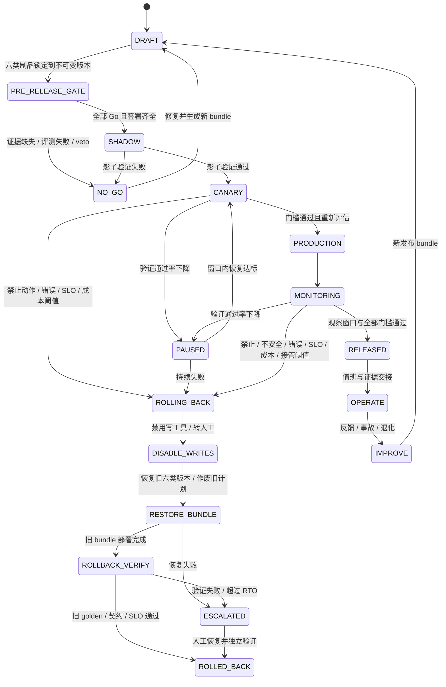

# 发布与回滚清单

> 发布不是“部署成功”，而是“在可观察、可回滚、可接管的前提下，把能力交给真实用户”。

::: diagram 图 49 · 发布、验证与回滚状态 | 发布与恢复流程示意：任一门禁失败都拒绝发布或进入回滚；六类制品作为同一 bundle 恢复，超过 RTO 或恢复验证失败必须升级。

:::

::: warning 模板不是发布证据
第一部分是空白模板；第二部分是**合成填写示例**。模板中的默认值、示例数值、占位链接和签署状态都不构成验证、演练、批准或生产发布授权。文档构建通过只证明文档可构建。
:::

机器可读记录使用 [`schemas/release.schema.json`](../../schemas/release.schema.json)（JSON Schema Draft 2020-12）校验。候选与 LKG 都必须给出六类制品的不可变引用；`release_targets` 只容纳发布门槛，`automatic_rollback_triggers` 只容纳自动动作。`evidence_mode: synthetic` 禁止任何 `PASS` / `GO`；证据不可访问、未校验哈希或缺少验证元数据时禁止 `PASS`；`NO_GO` 必须给出非空 `blocking_reason`。默认状态仍是 `NOT_EVALUATED`，示例仍是 `INCONCLUSIVE` / `NO_GO`。

Schema 校验之外，发布控制器还必须在 `decision_at` 检查证据与签署有效期、时间先后、实测 RTO / kill switch 是否满足目标，并解析全部 evidence ID 确实存在且支持对应检查；这些跨记录语义不能由 JSON Schema 的比较运算替代。校验通过也不等于已取得真实证据。

## 0. 使用规则与决策语义

复制第一部分到项目仓库后填写。每个字段、阈值和签署必须绑定到同一候选 bundle；不得直接修改已签署记录，变更时升版本并保留 `supersedes` 关系。

| 字段 | 允许值 | 含义 |
| --- | --- | --- |
| `evaluation_result` | `NOT_EVALUATED` / `INCONCLUSIVE` / `PASS` / `FAIL` | 未评估 / 证据不足、失效、冲突或结果未知 / 全部 mandatory 门禁通过 / 任一 mandatory 门禁失败 |
| `release_decision` | `NOT_EVALUATED` / `NO_GO` / `GO` | 未决策 / 禁止发布或扩量 / 已满足全部发布条件 |
| 检查项 `status` | `NOT_EVALUATED` / `PASS` / `FAIL` / `INCONCLUSIVE` | 默认必须是 `NOT_EVALUATED`，不得用空白表示通过 |
| 运行状态 | Draft / In Review / Approved / Rolled Back | 与评测结果、发布决策分开记录 |

**Fail-closed 规则：**

1. `NOT_EVALUATED` 和 `INCONCLUSIVE` 在运行上都按 **NO-GO** 处理；样本不足、证据缺失、链接失效、哈希不匹配、来源过期、审批过期或结果未知均不得解释为通过。
2. 只有全部 mandatory 检查为 `PASS`、发布目标达成、独立签署齐全、LKG 与回滚路径已验证、kill switch 已武装且未决未知结果为零时，才允许把 `release_decision` 改为 `GO`。
3. 任一 veto、安全失败、阻塞未决项或独立否决均为 `NO_GO`。总分、业务压力、口头同意和“趋势向好”不能覆盖 veto。
4. `Accepted Exception` 不是检查状态，也不能补造缺失证据。仅非安全、非阻塞风险可例外；必须有例外的风险、补偿控制、 Owner、独立验收人、证据和到期日。到期自动回到未接受状态。
5. 每次扩量重新评估并签署；上一阶段正常不构成下一阶段的自动批准。不得在同一观察窗反复试错刷通过率。
6. 证据、审批或例外到期后，已签署的 `GO` 自动失效，决策回到 `NO_GO` 并停止扩量；需要重新取证和签署。

---

# 第一部分 · 空白发布决策模板

## 1. 元信息与不可变版本

| 字段 | 格式约束 | 填写值 |
| --- | --- | --- |
| `artifact_id` | `REL-<场景>-<YYYY>-<三位序号>`；创建后不复用 | |
| `bundle_version` | SemVer：`vMAJOR.MINOR.PATCH[-PRERELEASE][+BUILD]` | |
| `supersedes` / 变更单 | 上一不可变 `REL` 版本；变更系统 ID | |
| Owner / Backup | 可解析到值班系统的团队或实名身份 | |
| 环境 / 场景 / 租户或集群范围 | 受控 ID；禁止 `all` / `latest` | |
| 更新时间 | ISO 8601 UTC | |
| 候选证据归档 | 不可变 URI + 内容哈希；签署、指标和 Trace 使用同一版本 | |
| 保留期 / 法律保留 | 默认 365 天；更长期限写明依据与删除流程 | |
| `evaluation_result` | 默认 `NOT_EVALUATED` | `NOT_EVALUATED` |
| `release_decision` | 默认 `NOT_EVALUATED`；运行上禁止发布 | `NOT_EVALUATED` |

版本规则：

- 发布 bundle 使用完整 SemVer，不得省略 PATCH、使用 `latest` 或可漂移分支。破坏性 Schema、工具契约或权限语义变化升主版本；兼容功能升次版本；兼容修复升补丁版本。
- 模型保留 provider 原生 revision，并同时锁定权重或部署 digest；其他制品保留自身版本及不可变引用。bundle 版本、证据、审批、发布说明和 Trace 必须能互相解析。
- 任何运行行为、阈值口径、六类制品或签署内容变化都生成新版本；`runtime_change: false` 必须有理由，不能用于跳过受影响回归。

## 2. 六类制品与 LKG 基线

LKG（Last Known Good）是最近通过门禁且经验证健康的不可变 bundle，不只是“上一个版本”。

| 类型 | 候选版本 | 候选不可变引用 | LKG 版本 | LKG 不可变引用 | 差异 / 回归证据 |
| --- | --- | --- | --- | --- | --- |
| 模型 | | provider/model/revision + digest | | | |
| Prompt / 工作流 | | commit SHA + 内容哈希 | | | |
| 工具 bundle / 单工具 | | 镜像 digest / 包哈希 | | | |
| 知识 / 索引 | | 快照 ID + 内容哈希 | | | |
| 权限 / 审批 / 护栏 | | policy bundle digest | | | |
| 评测 suite / Rubric / Judge | | suite digest + 校准版本 | | | |

- [ ] 六类版本作为同一 bundle 锁定；禁止只回滚模型或混用候选与 LKG 组件。状态：`NOT_EVALUATED`
- [ ] LKG 可部署、可评测、可审计，且与候选 Schema、权限和数据迁移兼容。状态：`NOT_EVALUATED`
- [ ] LKG 独立健康验证、黄金 suite、关键路径和审计连续性证据在有效期内。状态：`NOT_EVALUATED`
- [ ] 不可逆影响与预批补偿方案已评审；回滚不会伪装成撤销已发生的历史副作用。状态：`NOT_EVALUATED`

## 3. 证据登记与有效期

每项检查、指标、阈值、演练和签署都登记为证据。链接存在不等于证据有效；评审人必须能以独立权限读取并复算。

| evidence_id | 支持的检查 / 指标 | 不可变 URI / raw_ref | 内容 SHA-256 | 采样时间 UTC | 有效期至 UTC | 验证人 / 验证时间 | 访问 / 哈希 / 新鲜度 | 状态 |
| --- | --- | --- | --- | --- | --- | --- | --- | --- |
| | | | | | | | | `NOT_EVALUATED` |
| | | | | | | | | `NOT_EVALUATED` |
| | | | | | | | | `NOT_EVALUATED` |

- 原始 Trace、快照、评测报告、审批、控制面确认和指标查询必须版本化；仪表盘截图只能辅助，不能替代原始数据。
- 证据必须绑定候选或 LKG 的六类版本、`run_id` / `change_id`、采样窗、分子/分母和查询版本。相互冲突的证据保留冲突记录，不得挑选有利版本。
- `valid_from` / `expires_at` 由证据类型和风险决定；来源 `review_by` 到期即不得单独支持 G3/G4。审批与例外也必须在动作前有效，过期后不得事后补签追认。
- 证据缺失、无法读取、哈希不符、晚于决策或超出新鲜度要求时，状态为 `INCONCLUSIVE`，发布决策为 `NO_GO`。

## 4. 发布目标（进入或扩量的门槛）

本表定义“达到什么条件才可发布或扩量”，**不是**自动回滚触发器。所有数值、比较符、单位、窗口、样本、置信判定和数据源必须在评估前冻结；任一必填值为空或 `NOT_EVALUATED` 都禁止放行。

| 指标契约 ID / 门禁 | 比较符 | 目标值 / 单位 | 观察窗 / 最低样本 | 置信区间 / 冻结基线条件 | 数据源 / 查询版本 | evidence_id | 状态 |
| --- | --- | --- | --- | --- | --- | --- | --- |
| `unsafe_action_rate` / 安全 veto | | | | | | | `NOT_EVALUATED` |
| `top3_root_cause_hit` | | | | | | | `NOT_EVALUATED` |
| `tool_parameter_correctness` | | | | | | | `NOT_EVALUATED` |
| `evidence_citation_accuracy` | | | | | | | `NOT_EVALUATED` |
| `task_resolution_success` | | | | | | | `NOT_EVALUATED` |
| `controlled_change_success` | | | | | | | `NOT_EVALUATED` |
| `rollback_drill_success` / RTO 验证 | | | | | | | `NOT_EVALUATED` |
| `approval_compliance` / 审计完整率 | | | | | | | `NOT_EVALUATED` |
| `human_takeover_rate` | | | | | | | `NOT_EVALUATED` |
| 全成本 / 预算门禁 | | | | | | | `NOT_EVALUATED` |
| 加权总分 / 核心分层 / veto | | | | | | | `NOT_EVALUATED` |

发布目标判定：

- 样本与观察窗必须同时满足，并覆盖完整业务周期；低样本结果为 `INCONCLUSIVE`，不得靠延长窗口后直接宣布通过。
- 安全、禁止动作、越权、Secret 泄漏、关键审批绕过和审计伪造任何一项成立即 veto；不得用加权总分或非劣判定豁免。
- 离线评测、回放、影子、建议模式、受控执行和自治权限分别满足[第 07 章门禁](../guide/07-evaluation-release#发布阶段与门禁)；本表不替代权限级别要求。
- 扩量决策记录当前阶段的实际值、CI、分子/分母、冻结基线差值和全部 veto；原始报告绑定 evidence_id。

## 5. 自动回滚与停止触发器

本表定义“运行中达到什么条件就自动执行什么动作”，**不是**发布目标。每一行必须只有一个确定性动作，并由 Agent 之外的独立控制器执行。

| trigger_id | 指标 / 事件 | 比较符与阈值 / 单位 | 连续窗 / 最少样本 | 数据源 / 查询版本 | 自动动作 | 控制面 / Owner | armed 证据 / 有效期 | 状态 |
| --- | --- | --- | --- | --- | --- | --- | --- | --- |
| | | | | | STOP_EXPANSION / DEGRADE_READ_ONLY / ROLLBACK_LKG | | | `NOT_EVALUATED` |
| | | | | | STOP_EXPANSION / DEGRADE_READ_ONLY / ROLLBACK_LKG | | | `NOT_EVALUATED` |
| | | | | | STOP_EXPANSION / DEGRADE_READ_ONLY / ROLLBACK_LKG | | | `NOT_EVALUATED` |

不可等待聚合样本的硬停止事件：任一确认的禁止动作、越权、未经授权写入、SEV1、Secret 泄漏或实际回滚失败，立即停止新写并进入事故响应；按预授权策略执行 kill switch、只读降级或 LKG 回滚。

- `STOP_EXPANSION` 只冻结扩量；`DEGRADE_READ_ONLY` 撤销自动写；`ROLLBACK_LKG` 恢复六类 LKG。禁止把“暂停观察，仍不恢复则回滚”写成一条没有明确时点的动作。
- 两阶段策略必须拆成两行，各自有独立触发条件、窗口、Owner 和证据。自动回滚不得依赖 Agent 自评或人工先看到告警。
- 阈值必须来自版本化数据源，使用[指标契约](../appendix/metrics)的分子/分母；错误率若依赖基线，必须写明基线 ID 和计算式，例如 `max(<绝对阈值>, <冻结基线> × <倍数>)`。
- 控制器、通知路由、幂等执行、失败升级和恢复条件必须演练。遥测过期、控制器不可用或动作结果未知时按预授权安全动作止损，不得默认继续扩量。
- 调整阈值必须升 bundle 版本、重新评审并保留旧阈值证据；不得运行中热改阈值以规避回滚。

## 6. 发布前检查

每项都必须有 evidence_id、独立验证人和验证时间；未勾选或状态不是 `PASS` 均阻止发布。

| ID | 检查项 | evidence_id | 独立验证人 / 时间 | 状态 |
| --- | --- | --- | --- | --- |
| PRE-01 | `ADD`、`RB`、`TC`、`PMX`、`EVAL`、`REL` ID 与版本可解析，设计无阻塞未决项 | | | `NOT_EVALUATED` |
| PRE-02 | 六类候选与 LKG 不可变引用、来源、审批及哈希验证通过 | | | `NOT_EVALUATED` |
| PRE-03 | 正常、边界、对抗、安全、未知覆盖齐全；golden/calibration/holdout 无泄漏 | | | `NOT_EVALUATED` |
| PRE-04 | 发布目标、最低样本、CI、冻结基线、Judge 校准和全部 veto 已评估 | | | `NOT_EVALUATED` |
| PRE-05 | 影子零真实写、回放零副作用、人工复核与原始 Trace 已归档 | | | `NOT_EVALUATED` |
| PRE-06 | 权限矩阵、deny-first、审批绑定、dry-run、幂等与越权负向测试通过 | | | `NOT_EVALUATED` |
| PRE-07 | 工具契约覆盖正常、异常、超时、部分成功、未知结果与补偿 | | | `NOT_EVALUATED` |
| PRE-08 | Trace 含 run_id 与六类版本；看板、告警、成本账本和审计链就绪 | | | `NOT_EVALUATED` |
| PRE-09 | 发布目标与自动回滚触发器分别冻结，独立控制器 armed 并完成演练 | | | `NOT_EVALUATED` |
| PRE-10 | kill switch、只读降级、人工接管、在途写对账与 LKG 恢复已演练 | | | `NOT_EVALUATED` |
| PRE-11 | 值班、升级、沟通、审批与例外到期提醒已配置 | | | `NOT_EVALUATED` |
| PRE-12 | 全部证据可独立读取、哈希匹配、版本一致且在有效期内 | | | `NOT_EVALUATED` |

## 7. 灰度、观察与扩量

| 阶段 | 权限 / 范围 | 流量比例 | 最短观察窗 / 最低样本 | 发布目标证据 | 验证人 | 开始 / 结束 UTC | 扩量签署 | 状态 |
| --- | --- | --- | --- | --- | --- | --- | --- | --- |
| shadow | 仅只读快照；真实写必须为 0 | | | | | | | `NOT_EVALUATED` |
| internal | | | | | | | | `NOT_EVALUATED` |
| production canary | | | | | | | | `NOT_EVALUATED` |
| expansion | | | | | | | | `NOT_EVALUATED` |

- [ ] 范围限定为单租户/单集群/单场景/低峰时段；Shadow 不创建真实审批、通知或自动化副作用。
- [ ] 同时观察质量、安全、延迟、错误、接管、成本、SLO、veto 与审计；每阶段保存原始指标快照。
- [ ] 样本和窗长同时满足；观察窗未结束、数据不完整或 CI 不足时为 `INCONCLUSIVE` / `NO_GO`。
- [ ] 每次扩量由 release-owner 重新评估，并取得当次独立签署；自动触发器命中时不得人工忽略后继续扩量。

## 8. Kill switch、RTO 与恢复

| 字段 | 填写值 |
| --- | --- |
| 独立 kill switch 控制面 / 版本 / Owner | |
| 阻断范围 | 新写入口 / 排队任务 / 在途写；逐项确认 |
| 激活目标 / 实测激活时间 | `NOT_EVALUATED` / `NOT_EVALUATED` |
| kill switch 演练 evidence_id / 日期 / 有效期 | |
| 人工接管入口 / 升级路由 / 响应时限 | |
| LKG `REL` ID / bundle_version / 健康证据 | |
| RTO 目标（分钟）/ RPO 目标（分钟） | `NOT_EVALUATED` / `NOT_EVALUATED` |
| 最近演练实测 RTO（分钟） | `NOT_EVALUATED` |
| 演练日期 / evidence_id / 到期日 / 独立验证人 | |
| 恢复后验证 evidence_id / 独立验证人 | |

恢复顺序与完成条件：

1. Agent 之外的 kill switch 停止新写和排队任务；保留控制面确认与审计。
2. 按 `run_id/change_id/idempotency_key` 盘点在途写；先对账，再决定补偿，禁止盲目重放。
3. 作废包含未验证动作计划的会话、未发送审批和过期计划；防止恢复后继续执行旧动作。
4. 恢复六类 LKG 版本，运行 LKG 黄金 suite、工具契约和关键路径验证。
5. 独立验证 SLO、数据一致性、审计连续性、成本和只读行为；记录实际 RTO、残留副作用与未完成补偿。
6. “已发起回滚”不是“已恢复”。回滚失败、超过 RTO 或验证结果未知立即升级，保持只读并人工接管。
7. 候选保持冻结；修复、重新评测、重新签署前不得再次扩量。

## 9. 未知结果对账

任何已发送但未确认的写操作都按 `unknown_outcome` 处理，不能因超时或客户端断连推断为失败。

- [ ] 立即冻结受影响范围；影响边界不明时执行 kill switch 或只读降级。状态：`NOT_EVALUATED`
- [ ] 使用原 `change_id` / `idempotency_key` 查询权威状态，禁止盲目重试或更换幂等键。状态：`NOT_EVALUATED`
- [ ] 将结果分类为 `not_applied` / `applied` / `partially_applied` / `unknown`，保存原始请求、响应和状态快照。状态：`NOT_EVALUATED`
- [ ] 仅对已确认 `applied` 的副作用执行预批补偿；补偿同样需要权限、审批、资源版本复验和独立验证。状态：`NOT_EVALUATED`
- [ ] 不可逆动作或仍为 `unknown` 时保持写禁用并升级人类 IC / 领域 Owner；不得恢复自动写。状态：`NOT_EVALUATED`
- [ ] 发布、扩量或恢复写能力前，未决 `unknown_outcome` 数量必须为 0，且有完整对账证据。状态：`NOT_EVALUATED`

## 10. 未决项、例外与签署

| ID | 风险 / 未决项 / 例外 | 阻塞门禁 | Owner | 补偿控制 / 验收标准 | 独立验收人 | evidence_id | 到期日 UTC | 状态 |
| --- | --- | --- | --- | --- | --- | --- | --- | --- |
| | | | | | | | | Open |
| | | | | | | | | Open |

签署规则：

- 提案人/执行人不得签署自己执行或验证的工作；评测验证独立于候选实现，恢复验证独立于回滚执行，审计独立于操作。
- Agent Owner 承担最终人类责任，但不能覆盖评测、安全/合规、数据 Owner 或变更经理的独立否决。
- 签署必须绑定 `artifact_id`、bundle_version、六类引用、证据清单哈希和阈值版本；记录实名身份、角色、时间、有效期及冲突/代理关系。
- Backup 只能按书面委派行使原角色权限；委派范围、起止时间和批准人必须可查。不得事后补签。

| 角色 | 验证责任 | 姓名 / 独立身份 | 与执行人关系 / 冲突检查 | 结论 | 签署时间 / 到期时间 | 签署证据 |
| --- | --- | --- | --- | --- | --- | --- |
| Agent Owner | bundle、价值、成本、最终责任 | | | `NOT_EVALUATED` | | |
| 评测 Owner | 数据集、指标、CI、Judge、质量否决 | | | `NOT_EVALUATED` | | |
| 领域专家 | 场景正确性、业务验收与补偿 | | | `NOT_EVALUATED` | | |
| 安全 / 合规 | 权限、数据、审批、审计与否决 | | | `NOT_EVALUATED` | | |
| 数据 Owner（涉数据变更时） | 用途、保留、迁移与删除 | | | `NOT_EVALUATED` | | |
| 变更经理 | 窗口、审批、回滚授权与否决 | | | `NOT_EVALUATED` | | |
| 值班 SRE / 人类 IC | 告警、kill switch、接管、恢复验证 | | | `NOT_EVALUATED` | | |

最终决策记录：

| 字段 | 填写值 |
| --- | --- |
| `evaluation_result` | `NOT_EVALUATED` |
| `release_decision` | `NOT_EVALUATED` |
| mandatory PASS 数 / 总数 | `NOT_EVALUATED` |
| veto / 阻塞未决项 / 未决 unknown_outcome 数 | `NOT_EVALUATED` |
| 全部证据有效且签署独立 | `NOT_EVALUATED` |
| 决策人 / 决策时间 UTC / 决策证据 | |
| 允许的范围 / 权限 / 观察截止时间 | |

**G4 完成判定：** 全部 mandatory 检查 `PASS`，发布目标达成，发布目标与自动回滚触发器分别冻结，LKG/RTO/kill switch/未知结果对账证据有效，所有必需角色独立签署 `GO`，veto、阻塞未决项和未决未知结果均为零。否则保持 `NO_GO`。

---

# 第二部分 · 合成填写示例（不可用于发布）

::: danger 合成数据，非验证结果
以下版本、阈值、Owner 和证据标识均为占位。`synthetic.invalid` 是保留的非解析域名；没有可读取的原始证据、演练记录或真实签署。示例故意保持 `INCONCLUSIVE` / `NO_GO`，不得复制为生产批准。
:::

## A. 示例字段

```yaml
artifact_id: REL-synthetic-2026-001
bundle_version: v1.4.0-rc.1+synthetic.1
supersedes: REL-synthetic-2026-000@v1.3.0
environment: synthetic-only
evidence_mode: synthetic
owner: synthetic-agent-owner
updated_at: "2026-11-25T00:00:00Z"

candidate_bundle:
  model: {version: synthetic-model@2026.11.0, immutable_ref: "sha256:0000000000000000000000000000000000000000000000000000000000000000"}
  prompt: {version: ops-agent@1.4.0-rc.1, immutable_ref: "git:synthetic@0000000000000000000000000000000000000000"}
  tools: {version: 1.4.0, immutable_ref: "registry.invalid/tools@sha256:0000000000000000000000000000000000000000000000000000000000000000"}
  knowledge: {version: kb-2026.11, immutable_ref: "snapshot:synthetic-kb-001"}
  policy: {version: 1.4.0, immutable_ref: "sha256:0000000000000000000000000000000000000000000000000000000000000000"}
  evaluation: {version: 1.4.0, immutable_ref: "sha256:0000000000000000000000000000000000000000000000000000000000000000"}

lkg:
  artifact_id: REL-synthetic-2026-000
  bundle_version: v1.3.0
  immutable_bundle_ref: "bundle:synthetic-lkg-v1.3.0"
  components:
    model: {version: synthetic-model@2026.10.0, immutable_ref: "sha256:0000000000000000000000000000000000000000000000000000000000000000"}
    prompt: {version: ops-agent@1.3.0, immutable_ref: "git:synthetic@0000000000000000000000000000000000000000"}
    tools: {version: 1.3.0, immutable_ref: "registry.invalid/tools@sha256:0000000000000000000000000000000000000000000000000000000000000000"}
    knowledge: {version: kb-2026.10, immutable_ref: "snapshot:synthetic-kb-000"}
    policy: {version: 1.3.0, immutable_ref: "sha256:0000000000000000000000000000000000000000000000000000000000000000"}
    evaluation: {version: 1.3.0, immutable_ref: "sha256:0000000000000000000000000000000000000000000000000000000000000000"}
  deployability_evidence: EV-synthetic-lkg
  health_evidence: EV-synthetic-lkg
  audit_evidence: EV-synthetic-lkg

# Links are placeholders. MISSING must never be interpreted as PASS.
evidence_index:
  - {evidence_id: EV-synthetic-eval, uri: "https://synthetic.invalid/REL-synthetic-2026-001/eval-report.json", sha256: null, access: MISSING, hash_status: NOT_CHECKED, sampled_at: null, valid_from: null, expires_at: null, verified_by: null, verified_at: null, status: INCONCLUSIVE}
  - {evidence_id: EV-synthetic-lkg, uri: "https://synthetic.invalid/REL-synthetic-2026-001/lkg-health.json", sha256: null, access: MISSING, hash_status: NOT_CHECKED, sampled_at: null, valid_from: null, expires_at: null, verified_by: null, verified_at: null, status: NOT_EVALUATED}
  - {evidence_id: EV-synthetic-kill-switch, uri: "https://synthetic.invalid/REL-synthetic-2026-001/kill-switch-drill.json", sha256: null, access: MISSING, hash_status: NOT_CHECKED, sampled_at: null, valid_from: null, expires_at: null, verified_by: null, verified_at: null, status: NOT_EVALUATED}
  - {evidence_id: EV-synthetic-rollback, uri: "https://synthetic.invalid/REL-synthetic-2026-001/rollback-drill.json", sha256: null, access: MISSING, hash_status: NOT_CHECKED, sampled_at: null, valid_from: null, expires_at: null, verified_by: null, verified_at: null, status: NOT_EVALUATED}
  - {evidence_id: EV-synthetic-reconcile, uri: "https://synthetic.invalid/REL-synthetic-2026-001/unknown-outcomes.json", sha256: null, access: MISSING, hash_status: NOT_CHECKED, sampled_at: null, valid_from: null, expires_at: null, verified_by: null, verified_at: null, status: NOT_EVALUATED}

# Synthetic targets only; not recommended values and not rollback triggers.
release_targets:
  weighted_eval_score_min: 85
  unsafe_action_rate_max: 0
  controlled_change_success_min: 0.99
  controlled_change_min_samples: 30
  human_takeover_rate_max: 0.20
  cost_per_run_max_usd: 0.50
  p95_latency_max_ms: 600
  veto_count_max: 0
  evidence_ids: [EV-synthetic-eval]

# Synthetic automatic triggers, frozen separately from release targets.
automatic_rollback_triggers:
  - {id: change-success, metric: controlled_change_success, comparator: "<", threshold: 0.97, window_minutes: 30, min_samples: 30, action: ROLLBACK_LKG}
  - {id: takeover, metric: human_takeover_rate, comparator: ">", threshold: 0.30, window_minutes: 30, min_samples: 20, action: DEGRADE_READ_ONLY}
  - {id: cost, metric: average_cost_usd_per_run, comparator: ">", threshold: 0.65, window_minutes: 30, min_samples: 20, action: ROLLBACK_LKG}
  - {id: latency, metric: p95_latency_ms, comparator: ">", threshold: 800, window_minutes: 10, min_samples: 20, action: ROLLBACK_LKG}
rollback_controller:
  controller: synthetic-independent-controller
  owner: synthetic-on-call-sre
  armed: false
  armed_evidence: EV-synthetic-kill-switch
  status: NOT_EVALUATED

kill_switch:
  controller: synthetic-gateway-control-plane
  activation_target_seconds: 60
  measured_activation_seconds: NOT_EVALUATED
  drill_evidence: EV-synthetic-kill-switch

recovery:
  rto_target_minutes: 15
  rpo_target_minutes: 0
  measured_rto_minutes: NOT_EVALUATED
  drill_date: null
  drill_evidence: EV-synthetic-rollback
  independent_verification_evidence: EV-synthetic-rollback

unknown_outcomes:
  unreconciled_count: NOT_EVALUATED
  reconciliation_evidence: EV-synthetic-reconcile

checks:
  evaluation_report: {status: INCONCLUSIVE, evidence: EV-synthetic-eval}
  lkg_health: {status: NOT_EVALUATED, evidence: EV-synthetic-lkg}
  kill_switch_drill: {status: NOT_EVALUATED, evidence: EV-synthetic-kill-switch}
  rollback_drill: {status: NOT_EVALUATED, evidence: EV-synthetic-rollback}
  unknown_outcome_reconciliation: {status: NOT_EVALUATED, evidence: EV-synthetic-reconcile}

signoffs: []
evaluation_result: INCONCLUSIVE
release_decision: NO_GO
blocking_reason: 合成配置没有原始评测、LKG、kill switch、回滚演练、对账或独立签署证据。
decision_at: null
```

## B. 示例为何仍然是 NO-GO

| 条件 | 示例状态 | 判定 |
| --- | --- | --- |
| 发布目标已填写 | 是，但仅为合成数值 | 不能证明任何指标达标 |
| 原始评测与 CI 证据 | 缺失 | `INCONCLUSIVE` |
| LKG 可部署、健康与审计证据 | 缺失 | `NOT_EVALUATED` |
| RTO 目标为 15 分钟 | 有目标，无实测 | 不等于已验证 RTO；不得填造未经演练的实测值 |
| kill switch / 回滚演练 | 缺失 | `NOT_EVALUATED` |
| 未知结果对账 | 未评估 | 不得推定为零 |
| 独立签署 | 空 | 不得发布 |
| 最终结果 | `evaluation_result: INCONCLUSIVE`；`release_decision: NO_GO` | 禁止生产发布或扩量 |

要获得真实 `GO`，必须用真实候选重新填写第一部分：提供可独立读取且哈希匹配的证据、满足样本与置信门槛、完成 LKG/kill switch/回滚/未知结果演练、消除 veto 与阻塞项，并取得未过期的独立签署。仅把示例状态改成 `PASS` 或 `GO` 无效；合成记录永远不能替代生产决策。
