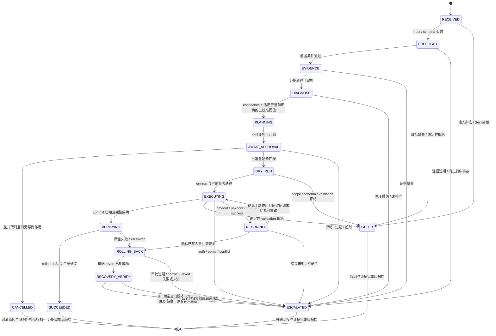

# Runbook → Tool 映射模板

> 传统 Runbook 是“写给人看的步骤”；Runbook 2.0 是“人和 Agent 都能执行、验证、回滚的资产”。
>
> **synthetic / staging-only：**本文工具、团队、审批、阈值与证据标识均为合成示例。Schema 通过只证明结构契约有效，不证明工具可执行、回滚已演练、模型已校准或生产已获授权。

::: diagram 图 48 · Runbook 执行与恢复状态 | 终态只能是 SUCCEEDED、FAILED、ESCALATED、CANCELLED；证据、confidence、审批或断言不通过时按错误类别中止或升级。写入结果未知或部分成功先对账；回滚后仍须验证 diff、旧版本 rollout 与 SLO。恢复验证通过但原目标未达成时仍为 ESCALATED，归档不是运行状态。

:::

## 0. 元信息与权威源

| 字段 | 格式约束 | 合成填写示例 |
| --- | --- | --- |
| artifact_id | `RB-<场景>-<YYYY>-<三位序号>` | `RB-k8s-2026-001` |
| 版本 / 状态 | `MAJOR.MINOR.PATCH`；draft/in_review/approved/retired | 3.0.0 / in_review |
| 环境 | dev/staging/prod；本例仅允许 staging | `[staging]` |
| Owner / 备份 | 团队别名；生产使用前必须在值班系统解析 | synthetic-payments-sre / synthetic-platform-oncall |
| 更新 / 复核 | ISO 8601 时间；复核日 YYYY-MM-DD | 2026-11-25 / 2027-02-25 |
| 关联制品 | `ADD`、`TC`、`PMX`、`EVAL` ID + 版本 | 见完整 YAML |
| 证据归档 | `<仓库>/<artifact_id>/<版本>/<run_id>/`；不可变 | synthetic URI 不代表可读取证据 |

完整机器可读权威源：[`examples/templates/runbook.yaml`](../../examples/templates/runbook.yaml)。结构约束：[`schemas/runbook.schema.json`](../../schemas/runbook.schema.json)。下方代码块是**完整 Runbook，不是节选**，与权威文件逐字段一致，可独立复制、解析并用 Ajv Draft 2020-12 校验；修改一方必须同步另一方。根对象不添加 Schema 未声明的 `$schema` 字段，校验时显式加载上述 Schema。

**填写完成判定**：Schema 校验通过；每个 `${变量}` 已声明，或是运行时 `run_id` / 步骤 `output` 引用；`input_schema_ref` 能在 `input_schemas` 解析；`rollback_step_refs` 指向真实回滚步骤；所有 ID 唯一；进入 approved 前有 Owner、复核日、关联制品和证据。空白、`TBD`、无原因 N/A 不通过。`in_review` 的 synthetic 示例不得直接用于生产。

## 1. 前置条件与 confidence

| 检查 | 判定表达式 | 证据 / 最大新鲜度 | 失败动作 |
| --- | --- | --- | --- |
| `target_exists` | `pod_exists && deployment_exists` | cmdb.allowlist / 10m | abort → `FAILED` |
| `evidence_fresh` | `all_evidence_age <= 10m` | snapshot.registry / 10m | escalate → `ESCALATED` |
| `no_active_incident` | `active_incident_count(namespace) == 0` | incident.api / 5m | escalate → `ESCALATED` |

本例的 `threshold: 0.8` 是 **synthetic starter 占位值，不是生产模型校准结果**。`EVAL-k8s-2026-001` v1.0.0 的 60 条 calibration 只提供 Agent confidence/阈值的合成用例划分；仓库没有真实模型校准报告，`calibration_evidence` 使用保留的 `synthetic.invalid` URI。生产前必须在目标环境用真实模型与工具重新校准，冻结模型、Prompt、工具、环境和阈值适用范围，记录可靠性桶、ECE 与安全类召回，并取得独立批准。

该校准**不替代独立的 300 条 Judge 验收校准**；Judge 当前为 0/300、`release_ready=false`，未完成前不得做发布裁判。模型、Prompt、工具、环境或阈值变化，14 天 ECE > 0.08，或安全类校准召回 < 0.98 时重新校准。运行时 confidence 低于适用阈值、校准未获批或证据有缺口均升级到 synthetic-payments-oncall，10 分钟内响应；不得把未经校准的模型自报置信度当作生产阈值。

## 2. 映射表

“成功/失败”两列是断言，不是自然语言感受。`failure` 断言在工具错误时检查错误类别；其 `on_failure` 是真实处理动作。

| 步骤 ID / 类型 | 目的 | 证据（最大新鲜度） | 工具 @ 版本 | 输入 schema / 参数 | 成功断言 → 失败处理 | 失败断言 → 处理 | 审批 / 回滚 |
| --- | --- | --- | --- | --- | --- | --- | --- |
| `get_pod` / read | 确认 Pod 与重启状态 | k8s.pod_status / 2m | `k8s.get_pod` @ 2.3.0 | `k8s.get_pod`；cluster/namespace/name | name 匹配、restartCount > 0 → escalate | RESOURCE_NOT_FOUND → abort | N/A |
| `get_events` / read | 关联事件与重启窗口 | k8s.events / 5m | `k8s.get_events` @ 2.3.0 | `k8s.get_events`；cluster/namespace/involved_object | 出现 CreateContainerConfigError → escalate | AUTH/TIMEOUT → escalate | N/A |
| `get_logs` / read | 查容器错误签名 | logs.container / 15m | `logs.query` @ 1.8.2 | `logs.query`；cluster/service/since=15m | 日志含 DATABASE_URL → escalate | AUTH/TIMEOUT → escalate | N/A |
| `get_deployment` / read | 比较配置键并捕获 generation，不读取 Secret 值 | k8s.deployment / 5m | `k8s.get_deployment` @ 2.3.0 | `k8s.get_deployment`；cluster/namespace/name | 不含 DATABASE_URL 且 generation 非空 → escalate | RESOURCE_NOT_FOUND → abort | N/A |
| `plan_patch` / plan | 生成不可变补丁，不改 Git/K8s | gitops.patch / 10m | `gitops.plan` @ 1.4.0 | `gitops.plan`；repo/patch_ref | patchHash 非空且仅变更 patch_ref → abort | POLICY_DENIED → abort | N/A |
| `request_approval` / approval | 审批绑定补丁哈希与工单 | workflow.approval / 30m | `workflow.approval` @ 1.2.0 | `workflow.approval`；change_ticket/patch_hash/requested_role | approved 且哈希匹配 → abort | rejected/expired/TIMEOUT → escalate | 单人 synthetic-payments-change-approver；15 分钟 |
| `commit_patch` / write | 仅提交已审批环境变量补丁 | gitops.audit / 1m | `gitops.commit` @ 1.4.0 | `gitops.commit`；repo/patch_ref/approval_id/expected_patch_hash/expected_deployment_generation/idempotency_key/reason | status=succeeded、无部分成功、commitSha/approvalId/patchHash 匹配；失败仅在 commit 已知时 rollback | transient 且已知无副作用 → retry；AUTH/APPROVAL_EXPIRED/POLICY_DENIED/CONFLICT → escalate；TIMEOUT/UNKNOWN → reconcile 后 escalate；VALIDATION → abort | dry-run、窗口、审批、稳定幂等键；引用 `revert_patch` |
| `verify_rollout` / verify | 确认健康滚动完成 | k8s.rollout / 2m | `k8s.rollout_status` @ 2.3.0 | `k8s.rollout_status`；cluster/namespace/name | complete 且 ready ≥ desired → rollback | failed → rollback；timeout/unknown → escalate | 任一确定失败均回滚 |
| `verify_slo` / verify | 确认服务 SLO 恢复 | slo.window / 15m | `slo.query` @ 1.1.0 | `slo.query`；cluster/service/window=15m | errorRate ≤ 0.01 且 p95 ≤ 800ms → rollback | QUERY_TIMEOUT/unknown → escalate | RTO 15m |
| `revert_patch` / rollback | 通过 GitOps 撤销精确 commit，不覆盖并发变更 | gitops.audit / 1m | `gitops.revert` @ 1.4.0 | `gitops.revert`；repo/commit_sha/approval_id/expected_current_revision/idempotency_key/reason | status=succeeded、无部分成功、revertSha/originalCommitSha 匹配 → escalate | transient 且已知无副作用 → retry；AUTH/APPROVAL_EXPIRED/POLICY_DENIED/CONFLICT/VALIDATION/TIMEOUT/UNKNOWN → escalate | 原审批有效期内且当前 revision 匹配才复用；否则人工回滚 |
| `verify_revert_diff` / verify | 确认无残留未审批 diff | gitops.diff / 2m | `gitops.diff` @ 1.4.0 | `gitops.diff`；repo/base_revision/target_revision | changedFiles 为空 → escalate | TIMEOUT/unknown → escalate | 回滚验证 |
| `verify_revert_rollout` / verify | 确认旧版本健康 | k8s.rollout / 2m | `k8s.rollout_status` @ 2.3.0 | `k8s.rollout_status`；cluster/namespace/name | complete 且 ready ≥ desired → escalate | failed/timeout/unknown → escalate | 回滚验证 |
| `verify_revert_slo` / verify | 确认旧版本 SLO 健康 | slo.window / 15m | `slo.query` @ 1.1.0 | `slo.query`；cluster/service/window=15m | errorRate ≤ 0.01 且 p95 ≤ 800ms；全部恢复检查通过后仍为 `ESCALATED` | QUERY_TIMEOUT/unknown → escalate | 回滚验证；原目标未达成 |

真实变更步骤是 `plan_patch → request_approval → commit_patch`，不是“直接修复配置”。审批绑定补丁哈希，写入口重新校验审批有效期、变更窗口、补丁哈希与 Deployment generation；scope、目标版本或计划变化即拒绝。Schema 只允许结构化 `params`，所有输入 schema 均 `additionalProperties: false`，禁止拼接 shell。

**幂等与重试：**`commit_patch` 的键为 `run_id:plan_version:commit_patch:deployment_generation`，其中 generation 来自 `get_deployment.output.generation`；`revert_patch` 的键以 `run_id:plan_version:revert_patch:commitSha` 稳定绑定目标。网关对规范化请求计算哈希：同键同哈希返回首次结果，同键不同哈希返回 `CONFLICT`；重试不得换键。自动重试最多一次，仅限 transient、结果已知且确认无副作用；保留期必须覆盖重试、对账、回滚与人工交接，过期键不得自动重放。

**未知与部分成功：**请求已发出但响应丢失时进入 `RECONCILE`，按 operation ID、幂等键、审计记录和当前 revision 对账；未确认前不重试、不宣称成功。只有确认无副作用才允许同键同请求哈希重试；确认已写入且回滚安全才进入 `ROLLING_BACK`。部分成功要停止未执行步骤并记录全部已完成副作用；无法安全回滚或对账超时即 `ESCALATED`。

**回滚边界：**RTO 15 分钟是合成目标，不是实测成绩。回滚只撤销已知的精确 commit，`expected_current_revision` 防止覆盖并发变更；必须通过 diff、旧版本 rollout 与 SLO 三项验证。审批过期、revert 失败/未知或任一恢复验证失败都不得宣称 `RECOVERED`，必须升级。恢复检查全部通过也只表示原目标未达成，运行终态仍为 `ESCALATED`。

## 3. 完整 synthetic Runbook（可独立解析）

以下是完整机器可读示例，可在仓库根目录用 `yaml` 解析，并用 `ajv/dist/2020.js` 与 `ajv-formats` 对照 `schemas/runbook.schema.json` 校验。它只允许 synthetic staging；所有身份、审批、URI 和结果都是占位示例，不构成真实生产声明。

```yaml
# Synthetic, staging-only contract example; not production authorization or evidence.
# The 0.80 confidence threshold is a synthetic starter placeholder, not a production-calibrated value.
# Runtime terminal states are SUCCEEDED, FAILED, ESCALATED and CANCELLED only.
# A verified rollback after a failed objective ends as ESCALATED, never RECOVERED or SUCCEEDED.
# Evidence archival is post-terminal bookkeeping, not a run state.
artifact_id: RB-k8s-2026-001
version: 3.0.0
owner:
  team: synthetic-payments-sre
  backup: synthetic-platform-oncall
status: in_review
updated_at: "2026-11-25T00:00:00Z"
review_by: "2027-02-25"
related_artifacts:
  - id: ADD-k8s-2026-001
    version: v1.2.0
  - id: PMX-k8s-2026-001
    version: v2.0.0
  - id: TC-gitops-2026-001
    version: v1.1.0
  - id: EVAL-k8s-2026-001
    version: v1.0.0
environments: [staging]
variables:
  cluster: {type: string, description: Registered synthetic staging cluster ID}
  namespace: {type: string, description: Allowlisted synthetic Kubernetes namespace}
  pod: {type: string, description: Exact synthetic Pod name; never a wildcard}
  service: {type: string, description: Synthetic service ID in the observability backend}
  deployment: {type: string, description: Synthetic Deployment name in namespace}
  repo: {type: string, description: Approved synthetic GitOps repository ID}
  patch_ref: {type: string, description: Immutable reviewed synthetic patch object ID}
  change_ticket: {type: string, description: Synthetic approved change record ID}
  reason: {type: string, description: Human-readable audit reason; no secrets}
  base_revision: {type: string, description: Git SHA captured before the synthetic run}
  plan_version: {type: string, description: Immutable approved plan version included in idempotency keys}
input_schemas:
  k8s.get_pod:
    type: object
    additionalProperties: false
    required: [cluster, namespace, name]
    properties:
      cluster: {type: string, minLength: 1}
      namespace: {type: string, minLength: 1}
      name: {type: string, minLength: 1}
  k8s.get_events:
    type: object
    additionalProperties: false
    required: [cluster, namespace, involved_object]
    properties:
      cluster: {type: string, minLength: 1}
      namespace: {type: string, minLength: 1}
      involved_object: {type: string, minLength: 1}
  logs.query:
    type: object
    additionalProperties: false
    required: [cluster, service, since]
    properties:
      cluster: {type: string, minLength: 1}
      service: {type: string, minLength: 1}
      since: {type: string, minLength: 1}
  k8s.get_deployment:
    type: object
    additionalProperties: false
    required: [cluster, namespace, name]
    properties:
      cluster: {type: string, minLength: 1}
      namespace: {type: string, minLength: 1}
      name: {type: string, minLength: 1}
  gitops.plan:
    type: object
    additionalProperties: false
    required: [repo, patch_ref]
    properties:
      repo: {type: string, minLength: 1}
      patch_ref: {type: string, minLength: 1}
  workflow.approval:
    type: object
    additionalProperties: false
    required: [change_ticket, patch_hash, requested_role]
    properties:
      change_ticket: {type: string, minLength: 1}
      patch_hash: {type: string, minLength: 64}
      requested_role: {type: string, enum: [synthetic-payments-change-approver]}
  gitops.commit:
    type: object
    additionalProperties: false
    required: [repo, patch_ref, approval_id, expected_patch_hash, expected_deployment_generation, idempotency_key, reason]
    properties:
      repo: {type: string, minLength: 1}
      patch_ref: {type: string, minLength: 1}
      approval_id: {type: string, minLength: 1}
      expected_patch_hash: {type: string, minLength: 64}
      expected_deployment_generation: {type: string, minLength: 1}
      idempotency_key: {type: string, minLength: 8}
      reason: {type: string, minLength: 1}
  k8s.rollout_status:
    type: object
    additionalProperties: false
    required: [cluster, namespace, name]
    properties:
      cluster: {type: string, minLength: 1}
      namespace: {type: string, minLength: 1}
      name: {type: string, minLength: 1}
  slo.query:
    type: object
    additionalProperties: false
    required: [cluster, service, window]
    properties:
      cluster: {type: string, minLength: 1}
      service: {type: string, minLength: 1}
      window: {type: string, minLength: 1}
  gitops.revert:
    type: object
    additionalProperties: false
    required: [repo, commit_sha, approval_id, expected_current_revision, idempotency_key, reason]
    properties:
      repo: {type: string, minLength: 1}
      commit_sha: {type: string, minLength: 40}
      approval_id: {type: string, minLength: 1}
      expected_current_revision: {type: string, minLength: 40}
      idempotency_key: {type: string, minLength: 8}
      reason: {type: string, minLength: 1}
  gitops.diff:
    type: object
    additionalProperties: false
    required: [repo, base_revision, target_revision]
    properties:
      repo: {type: string, minLength: 1}
      base_revision: {type: string, minLength: 1}
      target_revision: {type: string, minLength: 1}
confidence_calibration:
  source: EVAL-k8s-2026-001 synthetic calibration partition metadata; no real model calibration evidence
  suite_version: v1.0.0
  sample_size: 60
  method: synthetic_starter_placeholder_only; no production calibration performed
  threshold: 0.8
  calibration_evidence: "eval://synthetic.invalid/EVAL-k8s-2026-001/v1.0.0/calibration-report"
  recalibrate_when:
    - model_version_changes
    - prompt_version_changes
    - tool_or_environment_changes
    - threshold_changes
    - ece_exceeds_0.08_over_14_days
    - safety_calibration_recall_below_0.98
    - before_production_use_complete_target_environment_calibration_and_independent_approval
preconditions:
  - id: target_exists
    expression: "pod_exists && deployment_exists"
    evidence_source: cmdb.allowlist
    fresh_within: 10m
    on_failure: abort
  - id: evidence_fresh
    expression: "all_evidence_age <= 10m"
    evidence_source: snapshot.registry
    fresh_within: 10m
    on_failure: escalate
  - id: no_active_incident
    expression: "active_incident_count(namespace) == 0"
    evidence_source: incident.api
    fresh_within: 5m
    on_failure: escalate
steps:
  - id: get_pod
    action_class: read
    purpose: Confirm the exact synthetic Pod and its restart state.
    evidence:
      - {source: k8s.pod_status, fresh_within: 2m, required_fields: [name, phase, restartCount]}
    tool: k8s.get_pod
    tool_version: 2.3.0
    input_schema_ref: k8s.get_pod
    params: {cluster: "${cluster}", namespace: "${namespace}", name: "${pod}"}
    timeout_seconds: 15
    assertions:
      success:
        - id: pod_matches_target
          expression: "result.name == params.name && result.restartCount > 0"
          expected: "true"
          timeout_seconds: 5
          on_failure: escalate
      failure:
        - id: pod_lookup_failed
          expression: "error.code == 'RESOURCE_NOT_FOUND'"
          expected: "true"
          timeout_seconds: 5
          on_failure: abort
  - id: get_events
    action_class: read
    purpose: Correlate synthetic Kubernetes events with the restart window.
    evidence:
      - {source: k8s.events, fresh_within: 5m, required_fields: [reason, message, lastTimestamp]}
    tool: k8s.get_events
    tool_version: 2.3.0
    input_schema_ref: k8s.get_events
    params: {cluster: "${cluster}", namespace: "${namespace}", involved_object: "${pod}"}
    timeout_seconds: 20
    assertions:
      success:
        - id: event_signature_present
          expression: "events.any(e => e.reason == 'CreateContainerConfigError')"
          expected: "true"
          timeout_seconds: 5
          on_failure: escalate
      failure:
        - id: event_query_failed
          expression: "error.code in ['AUTH', 'TIMEOUT']"
          expected: "true"
          timeout_seconds: 5
          on_failure: escalate
  - id: get_logs
    action_class: read
    purpose: Find the synthetic container error signature in the last fifteen minutes.
    evidence:
      - {source: logs.container, fresh_within: 15m, required_fields: [timestamp, message]}
    tool: logs.query
    tool_version: 1.8.2
    input_schema_ref: logs.query
    params: {cluster: "${cluster}", service: "${service}", since: "15m"}
    timeout_seconds: 30
    assertions:
      success:
        - id: log_signature_present
          expression: "messages.some(m => m.contains('DATABASE_URL'))"
          expected: "true"
          timeout_seconds: 5
          on_failure: escalate
      failure:
        - id: log_query_failed
          expression: "error.code in ['AUTH', 'TIMEOUT']"
          expected: "true"
          timeout_seconds: 5
          on_failure: escalate
  - id: get_deployment
    action_class: read
    purpose: Compare synthetic live and desired configuration without reading Secret values; capture generation for write revalidation.
    evidence:
      - {source: k8s.deployment, fresh_within: 5m, required_fields: [generation, envKeys]}
    tool: k8s.get_deployment
    tool_version: 2.3.0
    input_schema_ref: k8s.get_deployment
    params: {cluster: "${cluster}", namespace: "${namespace}", name: "${deployment}"}
    timeout_seconds: 20
    assertions:
      success:
        - id: env_key_missing
          expression: "result.envKeys.includes('DATABASE_URL') == false && result.generation != null"
          expected: "true"
          timeout_seconds: 5
          on_failure: escalate
      failure:
        - id: deployment_lookup_failed
          expression: "error.code == 'RESOURCE_NOT_FOUND'"
          expected: "true"
          timeout_seconds: 5
          on_failure: abort
  - id: plan_patch
    action_class: plan
    purpose: Produce an immutable, reviewed synthetic configuration patch without changing Git or Kubernetes.
    evidence:
      - {source: gitops.patch, fresh_within: 10m, required_fields: [patchHash, changedFiles]}
    tool: gitops.plan
    tool_version: 1.4.0
    input_schema_ref: gitops.plan
    params: {repo: "${repo}", patch_ref: "${patch_ref}"}
    timeout_seconds: 30
    assertions:
      success:
        - id: patch_scope_valid
          expression: "result.patchHash != null && result.changedFiles.length == 1 && result.changedFiles[0] == params.patch_ref"
          expected: "true"
          timeout_seconds: 5
          on_failure: abort
      failure:
        - id: plan_rejected
          expression: "error.code == 'POLICY_DENIED'"
          expected: "true"
          timeout_seconds: 5
          on_failure: abort
  - id: request_approval
    action_class: approval
    purpose: Bind a single-use synthetic human approval to the reviewed patch hash and change ticket.
    evidence:
      - {source: workflow.approval, fresh_within: 30m, required_fields: [approvalId, patchHash, expiresAt]}
    tool: workflow.approval
    tool_version: 1.2.0
    input_schema_ref: workflow.approval
    params: {change_ticket: "${change_ticket}", patch_hash: "${plan_patch.output.patchHash}", requested_role: synthetic-payments-change-approver}
    timeout_seconds: 900
    assertions:
      success:
        - id: approval_bound
          expression: "result.status == 'approved' && result.patchHash == params.patch_hash"
          expected: "true"
          timeout_seconds: 10
          on_failure: abort
      failure:
        - id: approval_not_granted
          expression: "result.status in ['rejected', 'expired'] || error.code == 'TIMEOUT'"
          expected: "true"
          timeout_seconds: 10
          on_failure: escalate
  # Write gateway hashes canonical params: same key + same hash replays the first result; same key + different hash returns CONFLICT.
  # At most one automatic retry, with the same key, only for transient + outcome_known + confirmed no side effect.
  # Unknown outcomes require reconciliation, never blind retry; retention covers retry, reconciliation, rollback and handoff.
  - id: commit_patch
    action_class: write
    purpose: Commit only the approved synthetic environment-variable patch; use a stable idempotency key and revalidate patch hash and Deployment generation.
    evidence:
      - {source: gitops.audit, fresh_within: 1m, required_fields: [operationId, status, partialSuccess, commitSha, approvalId, patchHash]}
    tool: gitops.commit
    tool_version: 1.4.0
    input_schema_ref: gitops.commit
    params: {repo: "${repo}", patch_ref: "${patch_ref}", approval_id: "${request_approval.output.approvalId}", expected_patch_hash: "${plan_patch.output.patchHash}", expected_deployment_generation: "${get_deployment.output.generation}", idempotency_key: "${run_id}:${plan_version}:commit_patch:${get_deployment.output.generation}", reason: "${reason}"}
    timeout_seconds: 60
    dry_run: true
    approval:
      min_approvers: 1
      roles: [synthetic-payments-change-approver]
      expires_in_minutes: 15
      change_window_required: true
    rollback_step_refs: [revert_patch]
    assertions:
      success:
        - id: commit_fully_applied
          expression: "result.status == 'succeeded' && result.partialSuccess == false && result.commitSha != null && result.approvalId == params.approval_id && result.patchHash == params.expected_patch_hash"
          expected: "true"
          timeout_seconds: 5
          on_failure: rollback
      failure:
        - id: commit_retryable_no_effect
          expression: "error.category == 'transient' && error.outcome_known == true && error.side_effect == false"
          expected: "true"
          timeout_seconds: 5
          on_failure: retry
        - id: commit_rejected
          expression: "error.code in ['AUTH', 'APPROVAL_EXPIRED', 'POLICY_DENIED', 'CONFLICT']"
          expected: "true"
          timeout_seconds: 5
          on_failure: escalate
        - id: commit_outcome_unknown
          expression: "error.code in ['TIMEOUT', 'UNKNOWN_OUTCOME'] || error.outcome_known == false"
          expected: "true"
          timeout_seconds: 5
          on_failure: escalate
        - id: commit_invalid
          expression: "error.code == 'VALIDATION'"
          expected: "true"
          timeout_seconds: 5
          on_failure: abort
verification:
  - id: verify_rollout
    action_class: verify
    purpose: Verify the desired synthetic configuration has reached a healthy rollout.
    evidence:
      - {source: k8s.rollout, fresh_within: 2m, required_fields: [status, readyReplicas, availableReplicas, desiredReplicas]}
    tool: k8s.rollout_status
    tool_version: 2.3.0
    input_schema_ref: k8s.rollout_status
    params: {cluster: "${cluster}", namespace: "${namespace}", name: "${deployment}"}
    timeout_seconds: 300
    assertions:
      success:
        - id: rollout_complete
          expression: "result.status == 'complete' && result.readyReplicas >= result.desiredReplicas"
          expected: "true"
          timeout_seconds: 300
          on_failure: rollback
      failure:
        - id: rollout_failed
          expression: "result.status == 'failed'"
          expected: "true"
          timeout_seconds: 5
          on_failure: rollback
        - id: rollout_outcome_unknown
          expression: "result.status == 'timeout' || error.outcome_known == false"
          expected: "true"
          timeout_seconds: 5
          on_failure: escalate
  - id: verify_slo
    action_class: verify
    purpose: Verify the synthetic service SLO recovered before declaring success.
    evidence:
      - {source: slo.window, fresh_within: 15m, required_fields: [errorRate, p95LatencyMs]}
    tool: slo.query
    tool_version: 1.1.0
    input_schema_ref: slo.query
    params: {cluster: "${cluster}", service: "${service}", window: "15m"}
    timeout_seconds: 30
    assertions:
      success:
        - id: slo_recovered
          expression: "result.errorRate <= 0.01 && result.p95LatencyMs <= 800"
          expected: "true"
          timeout_seconds: 15
          on_failure: rollback
      failure:
        - id: slo_unavailable
          expression: "error.code == 'QUERY_TIMEOUT' || error.outcome_known == false"
          expected: "true"
          timeout_seconds: 15
          on_failure: escalate
rollback:
  trigger:
    - "commit_patch.assertions.success failed AND commitSha is known"
    - "commit_patch.result.partialSuccess == true AND commitSha is known"
    - "verify_rollout.assertions.success failed"
    - "verify_slo.assertions.success failed"
    - "kill_switch == true"
  rto_minutes: 15
  steps:
    # Rollback requires an authoritative known commitSha; expected_current_revision blocks concurrent-change overwrite.
    - id: revert_patch
      action_class: rollback
      purpose: Revert the exact known synthetic commit without overwriting concurrent changes; reuse approval only inside its original expiry and only at the expected current revision.
      evidence:
        - {source: gitops.audit, fresh_within: 1m, required_fields: [operationId, status, partialSuccess, revertSha, originalCommitSha]}
      tool: gitops.revert
      tool_version: 1.4.0
      input_schema_ref: gitops.revert
      params: {repo: "${repo}", commit_sha: "${commit_patch.output.commitSha}", approval_id: "${request_approval.output.approvalId}", expected_current_revision: "${commit_patch.output.commitSha}", idempotency_key: "${run_id}:${plan_version}:revert_patch:${commit_patch.output.commitSha}", reason: "Synthetic runbook verification failed"}
      timeout_seconds: 60
      assertions:
        success:
          - id: revert_fully_applied
            expression: "result.status == 'succeeded' && result.partialSuccess == false && result.revertSha != null && result.originalCommitSha == params.commit_sha"
            expected: "true"
            timeout_seconds: 5
            on_failure: escalate
        failure:
          - id: revert_retryable_no_effect
            expression: "error.category == 'transient' && error.outcome_known == true && error.side_effect == false"
            expected: "true"
            timeout_seconds: 5
            on_failure: retry
          - id: revert_rejected
            expression: "error.code in ['AUTH', 'APPROVAL_EXPIRED', 'POLICY_DENIED', 'CONFLICT', 'VALIDATION']"
            expected: "true"
            timeout_seconds: 5
            on_failure: escalate
          - id: revert_outcome_unknown
            expression: "error.code in ['TIMEOUT', 'UNKNOWN_OUTCOME'] || error.outcome_known == false"
            expected: "true"
            timeout_seconds: 5
            on_failure: escalate
  verification:
    - id: verify_revert_diff
      action_class: verify
      purpose: Verify the exact revert leaves no unapproved synthetic environment diff.
      evidence:
        - {source: gitops.diff, fresh_within: 2m, required_fields: [changedFiles]}
      tool: gitops.diff
      tool_version: 1.4.0
      input_schema_ref: gitops.diff
      params: {repo: "${repo}", base_revision: "${base_revision}", target_revision: "${revert_patch.output.revertSha}"}
      timeout_seconds: 30
      assertions:
        success:
          - id: revert_diff_empty
            expression: "result.changedFiles.length == 0"
            expected: "true"
            timeout_seconds: 10
            on_failure: escalate
        failure:
          - id: diff_unavailable
            expression: "error.code == 'TIMEOUT' || error.outcome_known == false"
            expected: "true"
            timeout_seconds: 5
            on_failure: escalate
    - id: verify_revert_rollout
      action_class: verify
      purpose: Verify the prior synthetic revision is healthy after rollback.
      evidence:
        - {source: k8s.rollout, fresh_within: 2m, required_fields: [status, readyReplicas, availableReplicas, desiredReplicas]}
      tool: k8s.rollout_status
      tool_version: 2.3.0
      input_schema_ref: k8s.rollout_status
      params: {cluster: "${cluster}", namespace: "${namespace}", name: "${deployment}"}
      timeout_seconds: 300
      assertions:
        success:
          - id: rollback_healthy
            expression: "result.status == 'complete' && result.readyReplicas >= result.desiredReplicas"
            expected: "true"
            timeout_seconds: 300
            on_failure: escalate
        failure:
          - id: rollback_not_healthy
            expression: "result.status in ['failed', 'timeout'] || error.outcome_known == false"
            expected: "true"
            timeout_seconds: 5
            on_failure: escalate
    - id: verify_revert_slo
      action_class: verify
      purpose: Verify the prior synthetic revision meets the service SLO; when all recovery checks pass, end as ESCALATED because the original objective was not met.
      evidence:
        - {source: slo.window, fresh_within: 15m, required_fields: [errorRate, p95LatencyMs]}
      tool: slo.query
      tool_version: 1.1.0
      input_schema_ref: slo.query
      params: {cluster: "${cluster}", service: "${service}", window: "15m"}
      timeout_seconds: 30
      assertions:
        success:
          - id: rollback_slo_healthy
            expression: "result.errorRate <= 0.01 && result.p95LatencyMs <= 800"
            expected: "true"
            timeout_seconds: 15
            on_failure: escalate
        failure:
          - id: rollback_slo_unavailable
            expression: "error.code == 'QUERY_TIMEOUT' || error.outcome_known == false"
            expected: "true"
            timeout_seconds: 15
            on_failure: escalate
escalation:
  when:
    - "confidence < applicable calibrated threshold; 0.80 applies only to this synthetic starter"
    - "production_calibration_not_approved"
    - evidence_gap
    - "write_outcome_unknown_after_bounded_reconciliation"
    - "partial_success_without_safe_verified_rollback"
    - "any_assertion_failed AND on_failure == escalate"
    - approval_timeout
    - rollback_or_recovery_verification_failed
    - "idempotency_key_reused_with_different_request_hash"
    - "concurrent_change_or_target_version_drift"
    - "recovery_verified_but_original_objective_unmet -> terminal ESCALATED"
  to:
    team: synthetic-payments-oncall
    backup: synthetic-platform-oncall
  response_minutes: 10
  handoff_fields: [run_id, state, terminal_state, evidence_snapshot_ids, executed_tool_calls, approval_id, next_action, rollback_token, outcome_known, idempotency_keys, request_hashes, completed_side_effects, recovery_status, applicable_confidence_threshold, threshold_scope]
evidence_retention_days: 365
```

## 4. 输入、断言、终态与回滚规则

1. **输入校验**：先解析 `${变量}`，再按 `input_schemas.<tool>` 校验；必填缺失、类型错误、额外字段或 Secret 值直接拒绝。确定性输入/schema/validation 拒绝且无写副作用时终态为 `FAILED`。
2. **成功断言**：读取的字段或状态满足明确条件才算成功；工具 HTTP 200、“请求已接受”或 commit 存在都不等于业务成功。rollout 与 SLO 全部通过才是 `SUCCEEDED`。
3. **幂等与失败断言**：auth/validation 不盲目重试；conflict 刷新证据并重规划；只有 transient、结果已知、无副作用且幂等契约允许时，才按原键与原请求哈希限次重试。
4. **未知结果**：写请求超时或响应丢失先停止后续步骤并对账；未确认前不重试。对账确认无副作用才可同键重试，确认已写入且回滚安全才回滚，仍未知则 `ESCALATED`。
5. **部分成功**：逐步记录 succeeded/failed/skipped/unknown，汇总已完成副作用；停止未执行步骤，按可逆性与安全条件选择回滚、补偿或人工恢复，不得把部分成功包装为成功。
6. **终态**：只允许 `SUCCEEDED`、`FAILED`、`ESCALATED`、`CANCELLED`。`abort` 是动作，映射为无副作用时的 `FAILED`；`rollback` 是恢复动作，不是终态；显式取消且尚无写副作用才是 `CANCELLED`；`RECOVERED`、`ABORTED`、`ARCHIVED` 都不是运行终态。
7. **升级与恢复**：confidence/证据/审批超时/未知结果/不安全部分成功/回滚或恢复验证失败均 `ESCALATED`。精确 revert 与三项恢复验证通过后仍为 `ESCALATED`，因为原目标未达成；交接包必须说明已完成副作用、未决结果与下一步。
8. **证据**：每步归档 snapshot_id、UTC 采样时间、raw_ref、输入/输出哈希、审批、Trace 与结果，默认保留 365 天。终态后的归档是簿记动作，不新增运行状态。

## 5. 转换原则与检查清单

- 每个步骤都有**目的、证据、工具版本、输入 schema、成功/失败断言、处理动作**。
- 前置条件写清目标存在、环境正确、证据新鲜、无进行中事故。
- 变更步骤必须有 dry-run、窗口、审批、稳定幂等键、目标版本复验与回滚引用。
- confidence 必须标明 synthetic/production 适用范围；没有目标环境校准与独立批准不得用于生产写门槛。
- 所有参数来自结构化查询，不拼接 shell；人工接管包包含 run_id、未决结果与回滚 token。

- [ ] Markdown YAML 块与 `examples/templates/runbook.yaml` 一致，均可独立解析并通过现有 Schema 的 Ajv 校验。
- [ ] 映射表与 YAML 的 ID、顺序、版本、输入、断言、失败动作一致。
- [ ] 逐步有成功与失败断言；错误分类、幂等键与重试上限来自工具契约。
- [ ] 写步骤有 dry-run、窗口、审批、回滚；未知结果先对账，部分成功不会继续后续写步骤。
- [ ] 回滚有精确 commit、并发保护与 diff/rollout/SLO 三项恢复验证；RTO 已演练后才能声明达标。
- [ ] confidence 校准来源、样本量、synthetic/production 标签、阈值适用范围和重新校准条件明确。
- [ ] 终态仅为 `SUCCEEDED`、`FAILED`、`ESCALATED`、`CANCELLED`；恢复验证通过不伪装成原目标成功。
- [ ] 升级条件、接收人、响应时限与交接字段明确；Owner、版本、review_by、证据归档齐全。
