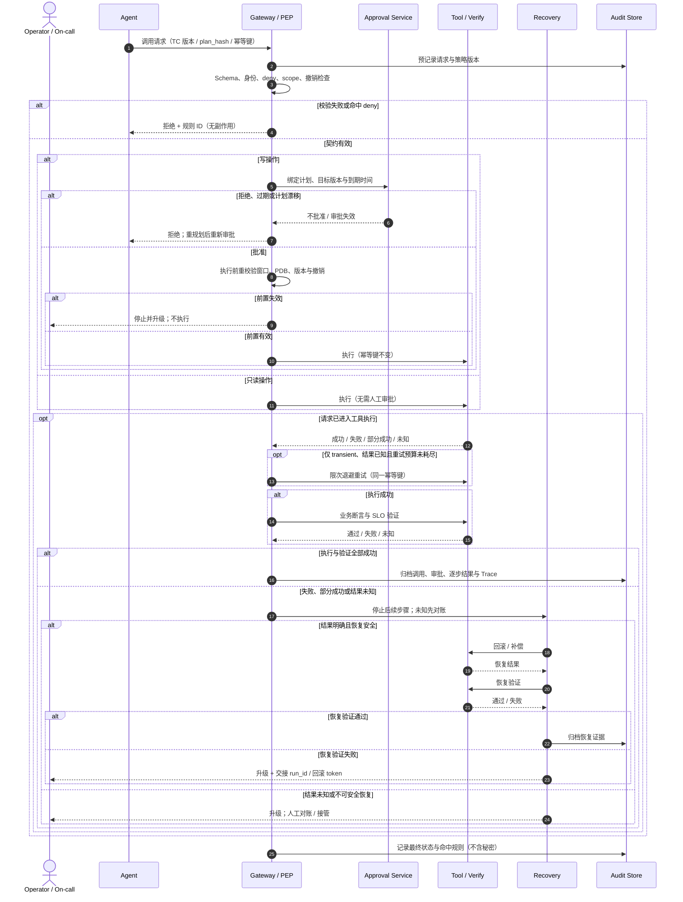

# 工具契约模板

> 工具契约是 Agent 与生产系统之间的合同。没有契约，Agent 只能“猜”工具能做什么。写工具的契约必须能在运行时强制执行，而不是只供人阅读。

::: diagram 图 45 · 工具契约与调用时序 | 合同与调用流程示意：拒绝、审批失效、未知结果、验证失败均不得静默继续；恢复失败必须升级，所有调用与命中规则进入不可变审计。

:::

## 正式 Schema 与版本

- 规范：[`schemas/tool-contract.schema.json`](../../schemas/tool-contract.schema.json)，JSON Schema Draft 2020-12。
- 示例：[`examples/cases/notready/tool-contract.drain.json`](../../examples/cases/notready/tool-contract.drain.json)（synthetic / 脱敏）。
- 每个契约都有 `name`、语义化 `version` 与 `owner`。版本变更必须评测；破坏性变更升主版本并迁移调用方。
- `reversible: false` 不等于“不做”，而是必须提供补偿或人工恢复、安全条件与停止条件。`uncordon` 不能标记为 drain 的完整回滚。

## 完整模板

```yaml
name: <namespace.tool_name>
version: 1.0.0
owner:
  team: <owning-team>
  contact: <oncall-contact>          # synthetic/脱敏示例使用 example.invalid
  runbook: <runbook-url>
description: <一句话说明工具做什么、什么时候用、什么时候不要用>

# 能力与副作用
side_effects: false                  # 是否改变系统状态
idempotent: true                     # 相同 key + 相同参数是否返回相同结果
dry_run: true
reversible: true                     # 是否存在可验证的完整逆向操作
scope:
  resource_types: [deployment]
  environments: [staging, prod]
  max_blast_radius: 1
  required_labels: []

# 权限与审批
permissions:
  role: ops-agent-operator
  approval: single                   # none / single / dual / cab / policy
  change_window: required            # required / optional / never
  break_glass: false                 # 只能扩大可用性，不能绕过显式 deny

# 输入/输出：input_schema 是标准 JSON Schema
input_schema:
  type: object
  additionalProperties: false
  required: [cluster, namespace, name, reason, idempotency_key, expected_resource_version]
  properties:
    cluster: { type: string, minLength: 1 }
    namespace: { type: string, minLength: 1 }
    name: { type: string, minLength: 1 }
    reason: { type: string, minLength: 1 }
    idempotency_key: { type: string, minLength: 8 }
    expected_resource_version: { type: string, minLength: 1 }
output_schema:
  type: object
  additionalProperties: false
  required: [status, partial_success, steps, error]
  properties:
    status: { type: string, enum: [succeeded, failed, unknown] }
    partial_success: { type: boolean }
    steps:
      type: array
      items:
        type: object
        required: [step_id, status]
        properties:
          step_id: { type: string }
          status: { type: string, enum: [succeeded, failed, skipped, unknown] }
          resource_version: { type: string }
          error_code: { type: string }
    error:
      type: [object, "null"]
      properties:
        code: { type: string }
        category: { type: string }
        retryable: { type: boolean }
        outcome_known: { type: boolean }

# 执行约束
execution:
  timeout_seconds: 300
  rate_limit: "10/min"
  concurrency_limit: 1
  retry:
    max_attempts: 2
    backoff: exponential              # none / constant / exponential
    retry_on: [transient, throttled]  # 不得包含 auth/validation/conflict/unknown_outcome
    respect_retry_after: true
    jitter: true
  idempotency:
    required: true
    key_source: run_id+plan_version+step_id+target_resource_version
    scope: run_plan_step_target
    retention_minutes: 1440
  error_taxonomy:
    unknown_default: stop_and_reconcile
    classes:
      - { code: validation, category: validation, retryable: false, outcome_known: true, meaning: 输入非法, agent_action: reject }
      - { code: conflict, category: conflict, retryable: false, outcome_known: true, meaning: 资源版本变化, agent_action: reconcile_and_replan }
      - { code: transient, category: transient, retryable: true, outcome_known: true, meaning: 可恢复错误, agent_action: backoff_then_retry }

# 审批绑定：只对不可变计划版本授权
approval_binding:
  required: true
  fields: [plan_version, plan_hash, target_resource_versions, expires_at]
  plan_hash_algorithm: sha256
  plan_version_required: true
  target_resource_version_required: true
  expires_at_required: true
  revalidate_before_execute: true
  invalidate_on_plan_change: true

preconditions:
  - target_exists
  - dependency_healthy
  - pdb_check_passed

# 完整回滚与补偿分开：不可逆动作不得伪造 rollback
rollback: null
recovery:
  mode: manual                      # none / rollback / compensate / manual
  steps: [<namespace.verify_tool>]
  safe_conditions: [target_version_unchanged, approval_valid]
  stop_conditions: [dependency_unhealthy, slo_regression]
  notes: <说明可逆边界、不可撤销的副作用与升级条件>

# 安全
security:
  credentials: short_lived
  secret_handling: never_log
  input_validation: strict
  injection_protection: true

# 审计
audit:
  fields: [caller, on_behalf_of, agent_run_id, approval_id, plan_version, plan_hash, target_resource_version, idempotency_key, outcome]
  retention_days: 365
  immutable: true

# 观测
observability:
  trace: true
  metrics: [latency, error_rate, calls, partial_success]
  log_fields: [input_hash, output_hash, approval_id]
```

## 一个例子：K8s 重启 Deployment

```yaml
name: k8s.restart_deployment
version: 1.2.0
owner:
  team: platform-runtime
  contact: platform-oncall@example.invalid  # synthetic / 脱敏
description: 在指定 namespace 内触发 Deployment 滚动重启；不删除资源。
side_effects: true
idempotent: true
dry_run: true
reversible: true
scope:
  resource_types: [deployment]
  environments: [staging, prod]
  max_blast_radius: 1
permissions:
  role: ops-agent-operator
  approval: single
  change_window: required
  break_glass: false
input_schema:
  type: object
  additionalProperties: false
  required: [cluster, namespace, name, reason, idempotency_key, expected_generation]
  properties:
    cluster: { type: string }
    namespace: { type: string }
    name: { type: string }
    reason: { type: string }
    idempotency_key: { type: string }
    expected_generation: { type: integer, minimum: 1 }
output_schema:
  type: object
  required: [status, partial_success, steps, error]
  properties:
    status: { type: string, enum: [succeeded, failed, unknown] }
    partial_success: { type: boolean }
    steps: { type: array, items: { type: object } }
    previous_revision: { type: string }
    new_revision: { type: string }
    rollout_status: { type: string, enum: [progressing, completed, degraded, unknown] }
    error: { type: [object, "null"] }
execution:
  timeout_seconds: 300
  rate_limit: "10/min"
  retry:
    max_attempts: 2
    backoff: exponential
    retry_on: [transient, throttled]
  idempotency:
    required: true
    key_source: run_id+plan_version+step_id+target_resource_version
    scope: run_plan_step_target
    retention_minutes: 1440
  error_taxonomy:
    unknown_default: stop_and_reconcile
    classes:
      - { code: transient, category: transient, retryable: true, outcome_known: true, meaning: 可恢复错误, agent_action: backoff_then_retry }
      - { code: conflict, category: conflict, retryable: false, outcome_known: true, meaning: generation 变化, agent_action: reconcile_and_replan }
approval_binding:
  required: true
  fields: [plan_version, plan_hash, target_resource_versions, expires_at]
  plan_hash_algorithm: sha256
  plan_version_required: true
  target_resource_version_required: true
  expires_at_required: true
  revalidate_before_execute: true
  invalidate_on_plan_change: true
rollback:
  tool: k8s.rollout_undo
  window_minutes: 15
  verification: k8s.get_rollout_status
recovery:
  mode: rollback
  steps: [k8s.rollout_undo, k8s.get_rollout_status]
  safe_conditions: [target_generation_unchanged, approval_valid]
  stop_conditions: [rollback_failed, slo_regression]
audit:
  fields: [caller, agent_run_id, approval_id, plan_hash, idempotency_key, outcome]
  retention_days: 365
  immutable: true
```

## 贯穿案例：K8s 节点 drain

以[附录案例](../appendix/case-notready)中的 NotReady 节点为例。drain **不是完全可逆动作**；`uncordon` 只解除节点不可调度约束，不能撤销 Pod 迁移或恢复已清理日志。

```yaml
name: k8s.drain_node
version: 1.1.0
owner:
  team: platform-runtime
  contact: platform-oncall@example.invalid  # synthetic / 脱敏
description: PDB 通过后 cordon 并 drain 单节点；不强制忽略 PDB，不删除 Pod。
side_effects: true
idempotent: true
dry_run: true
reversible: false
scope:
  resource_types: [node]
  environments: [prod]
  max_blast_radius: 1
  required_labels: [managed-by=platform]
permissions:
  role: ops-agent-senior-operator
  approval: dual
  change_window: required
  break_glass: false
input_schema:
  type: object
  additionalProperties: false
  required: [cluster, node, reason, idempotency_key, expected_resource_version]
  properties:
    cluster: { type: string }
    node: { type: string }
    reason: { type: string }
    idempotency_key: { type: string }
    expected_resource_version: { type: string }
    ignore_daemonsets: { type: boolean, default: true }
output_schema:
  type: object
  required: [status, partial_success, steps, error]
  properties:
    status: { type: string, enum: [succeeded, failed, unknown] }
    partial_success: { type: boolean }
    steps: { type: array, items: { type: object } }
    evicted_pods: { type: integer, minimum: 0 }
    pdb_violations: { type: integer, minimum: 0 }
    cordoned: { type: boolean }
    error: { type: [object, "null"] }
execution:
  timeout_seconds: 900
  rate_limit: "2/hour"
  concurrency_limit: 1
  retry:
    max_attempts: 1
    backoff: none
    retry_on: []
  idempotency:
    required: true
    key_source: run_id+plan_version+step_id+target_resource_version
    scope: run_plan_step_target
    retention_minutes: 1440
  error_taxonomy:
    unknown_default: stop_and_reconcile
    classes:
      - { code: pdb_blocked, category: pdb_blocked, retryable: false, outcome_known: true, meaning: 可用副本不足, agent_action: stop }
      - { code: unknown_outcome, category: unknown_outcome, retryable: false, outcome_known: false, meaning: 请求结果未知, agent_action: reconcile_then_escalate }
approval_binding:
  required: true
  fields: [plan_version, plan_hash, target_resource_versions, expires_at]
  plan_hash_algorithm: sha256
  plan_version_required: true
  target_resource_version_required: true
  expires_at_required: true
  revalidate_before_execute: true
  invalidate_on_plan_change: true
preconditions:
  - node_exists
  - node_not_ready
  - pdb_check_passed
  - no_active_incident_in_scope
rollback: null
recovery:
  mode: compensate
  steps: [k8s.uncordon_node, k8s.verify_node_ready, k8s.verify_pdb, slo.query]
  safe_conditions: [node_ready, capacity_available, pdb_satisfied, approval_valid]
  stop_conditions: [pdb_violation, capacity_below_threshold, approval_revoked, slo_regression]
  notes: uncordon 不是完整回滚；Pod 迁移由控制器重建，禁止删除新 Pod 还原。
audit:
  fields: [caller, agent_run_id, approval_id, plan_version, plan_hash, target_resource_version, idempotency_key, outcome]
  retention_days: 365
  immutable: true
```

没有 PDB 前置检查、审批绑定或安全恢复条件时，不应注册这个工具。机器可读版本见 [drain JSON 示例](../../examples/cases/notready/tool-contract.drain.json)。

## 契约测试

每个写工具至少测试：

- 正常参数成功；缺少必填参数失败且无副作用。
- 越权 scope、显式 deny、PDB 不满足被拒绝。
- dry-run 不产生副作用。
- 审批绑定计划版本、SHA-256、目标版本与有效期。
- 计划变化、目标版本漂移、撤销或过期使审批失效。
- 相同幂等键与参数重复调用不重复产生副作用；同键不同参数返回冲突。
- 每类错误按 `retryable` 与 `outcome_known` 执行；未知结果先对账。
- 部分成功返回逐步状态并停止后续步骤。
- 回滚/补偿在安全条件下可执行，停止条件下不执行。
- 审计字段完整、不可变且不含秘密。

## 常见错误

- 只写输入/输出，不写 Owner、版本、副作用与恢复边界。
- 把“请求已接受”当成功，或把部分成功汇总成成功。
- 对 auth/validation/conflict/unknown_outcome 盲目重试。
- 重试更换幂等键，导致重复变更。
- 审批只绑定一句自然语言，计划变化后继续复用旧审批。
- 把 uncordon 称为 drain 的完整回滚，或声称 Pod 迁移可自动撤销。
- 不写错误分类、停止条件或不可逆副作用。

## 检查清单

- [ ] `name`、语义化 `version`、`owner` 与正式 Schema 引用齐全。
- [ ] 副作用、幂等、dry-run、可逆性明确。
- [ ] scope、blast radius、环境限制明确。
- [ ] 权限、审批、变更窗口、deny 优先级明确。
- [ ] 输入/输出 schema 严格，输出包含部分成功与逐步状态。
- [ ] 超时、速率、并发、重试、错误分类、幂等键明确。
- [ ] 审批绑定计划版本、哈希、目标版本、有效期，并执行前重校验。
- [ ] 凭证与敏感数据处理明确。
- [ ] 完整回滚与补偿分开，包含安全条件、停止条件与不可逆说明。
- [ ] 审计字段完整、不可变且脱敏。
- [ ] 契约测试覆盖正常/异常/越权/审批失效/幂等/部分成功/恢复。
