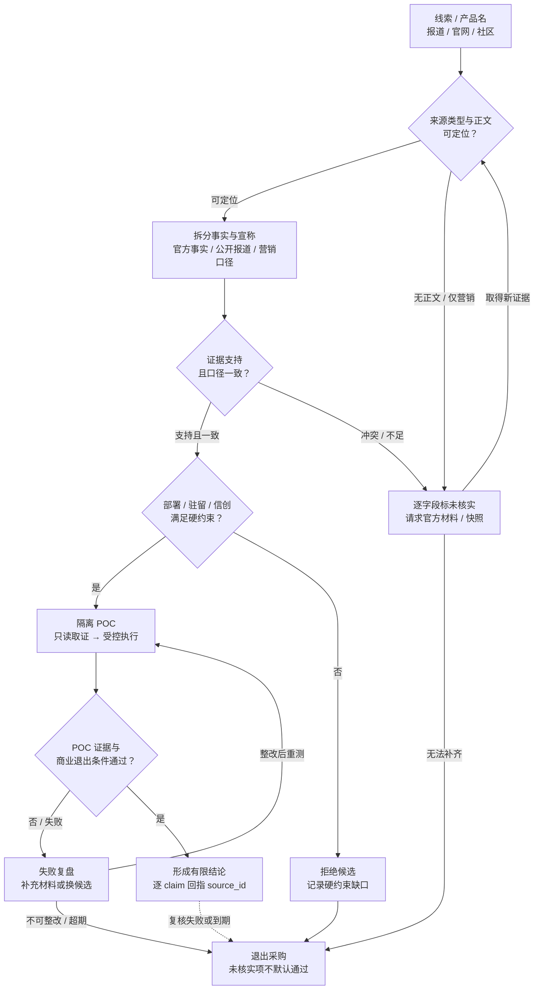

# 中国云厂商

> 中国市场的运维 Agent 有三股力量：云厂商的“云上智能运维”、传统 AIOps/ITOM 厂商的“Agent 化升级”、以及 Agent 平台厂商的“运维场景下沉”。选型时同时看云生态绑定、信创/私有化与数据不出域。
>
> 最后核实：**2026-11-25**；复核截止：**2027-02-22**。官方文档、官方产品页、公开报道分别登记，不混用。

::: diagram 图 38 · 中国云事实核验流 | synthetic/方法示意；官方事实、公开报道与营销宣称分账，证据冲突或正文缺失保持未核实，硬约束拒绝、POC 失败与退出均显式处理；本图不构成厂商能力证明。

:::

## 阿里云

| 产品 | 形态 | 运维域 | 关键能力（claim） | source_id |
| --- | --- | --- | --- | --- |
| **官方 Agent 服务目录**（ALI-01） | 独立/内嵌 Agent 导航 | 数据库、计算、安全、网络、运维等 | 官方目录入口存在；历史数量不作为当前事实，本轮未重新计数 | SRC-ALI-CATALOG-001 |
| **AgentRun**（ALI-02、ALI-04） | Agent 运行时/基础设施 | 通用 | 官方文档描述 Serverless Runtime、模型治理、Sandbox、MCP/Function Call、凭证、OpenTelemetry Trace 与 Token 成本归因；Computer/Mobile Use 明示为规划方向 | SRC-ALI-AGENTRUN-001 |
| **Agent Sandbox**（ALI-03） | 执行隔离 | 通用 | 官方帮助中心定义为安全隔离执行环境，提供代码执行、进程运行、文件操作、网络访问和状态管理；其他兼容性未核实 | SRC-ALI-SANDBOX-001 |
| **AgentBay**（ALI-05） | 执行隔离 | 通用 | 官方产品页描述 Browser、Computer、Code、Mobile 四类环境及 SDK/MCP/ASP 访问；页面宣称部署于 Singapore | SRC-ALI-AGENTBAY-001 |
| **AgentScope**（ALI-06） | 开源框架 | 多 Agent | 项目 README 描述 Agent Service、TeamPipeline 委派与 ModelRouterMiddleware；Realtime voice/SOP 标为 Experimental，不写成 GA | COM-AGENTSCOPE-001 |
| **百炼 / Model Studio**（ALI-14） | Agent 平台 | 通用 | 官方价格页证实模型服务按量计费与部分地域条目；完整 Agent 平台能力、驻留与退出未核实 | SRC-ALI-MODELSTUDIO-PRICING-001 |
| **Qoder Cloud Agents**（ALI-15） | 托管运行时 | 长任务/异步 | 官方计费文档支持个人 Credits 预付费、企业资源包及模型/沙箱按用量扣减；导出、删除与驻留未核实 | SRC-QODER-CLOUDAGENTS-BILLING-001 |
| **STAROps**（ALI-16） | 运维平台 | 全域智能运维 | 公开报道称其为全域智能运维平台；具体能力与生产可用性未核实 | PUB-ALI-SUMMIT-001 |
| **Alibaba Cloud Linux 4 Agentic Edition / Agentic OS**（ALI-17） | Agent-first OS | 主机/系统运维 | 官方文档称镜像免费、计算/存储/模型资源另计，核心组件已开源；支持 x86 并建议至少 2GB 内存 | SRC-ALI-AGENTICOS-001 |

阿里的已核验范围覆盖“**目录导航 + AgentRun 运行时 + 两类沙箱 + AgentScope 框架**”。公开报道条目单独标注，详见[阿里 Agent 产品全景](../appendix/alibaba-agent-landscape)。

## 华为云 / 华为

| 产品 | 形态 | 运维域 | 关键能力（claim） | source_id |
| --- | --- | --- | --- | --- |
| **智果 AgentArts**（CN-HW-03） | 企业级 Agent 平台 | 行业 Agent | 官方文档描述 Managed Agents、运行时托管、观测评估、低代码编排与隔离沙箱；整体 GA 与商业条款未核实 | SRC-HW-AGENTARTS-001 |
| **MindOps**（CN-HW-01） | 智能运维平台 | ICT 运维 | 公开报道涉及 Agentic AI 运维方向；具体能力、状态与生产效果未核实 | PUB-HUAWEI-MINDOPS-001 |
| **iMasterCloud**（CN-HW-04） | 云管/运维平台 | 多云/ICT | 能力与状态未核实 | 未核实 |
| **AEI**（CN-HW-02） | 架构/体系 | 企业 ICT 运维 | 公开报道提及企业 ICT 智能体架构与云边协同；具体能力与状态未核实 | PUB-HUAWEI-AEI-001 |
| **iMaster NCE**（CN-HW-05） | 网络管控 | 网络运维 | 能力与状态未核实 | 未核实 |
| **计算集群运维智能体**（CN-HW-06） | 独立/平台能力 | 智算集群 | 能力与状态未核实 | 未核实 |

华为产品仅保留两条公开报道线索：MindOps（CN-HW-01；PUB-HUAWEI-MINDOPS-001）与 AEI（CN-HW-02；PUB-HUAWEI-AEI-001）。本轮不把白皮书报道升级为生产能力证明。

## 腾讯云

| 产品 | 形态 | 运维域 | 关键能力（claim） | source_id |
| --- | --- | --- | --- | --- |
| **CloudQ**（CN-TX-01） | 独立 AIOps Agent | 多云运维/治理 | 公开报道称其面向多云资源与运维治理；具体能力与状态未核实 | PUB-TENCENT-CLOUDQ-001 |
| **MigraQ**（CN-TX-02） | 独立 Agent | 上云迁移 | 公开报道提及迁移场景；具体能力与状态未核实 | PUB-TENCENT-CLOUDQ-001 |
| **AndonQ**（CN-TX-03） | 独立 Agent | 售后技术支持 | 公开报道提及技术支持场景；具体能力与状态未核实 | PUB-TENCENT-CLOUDQ-001 |
| **WorkBuddy**（CN-TX-04） | 内嵌/工作 Agent | 个人与团队工作流 | 公开报道提及工作智能体；具体能力与状态未核实 | PUB-TENCENT-CLOUDQ-001 |
| **腾讯云智能体开发平台（ADP）**（CN-TX-05） | Agent 平台 | 通用 | 官方产品页支持多渠道接入、云部署与私有化 License；私有化部署在客户自有腾讯云 TKE | SRC-TX-ADP-001 |
| **腾讯云可观测平台（TCOP）**（CN-TX-06） | 平台 AI 能力 | 可观测/Agent 运行 | 官方产品页描述指标/链路/日志/事件一体化监控，AI 工作台处于免费公测；不证明自主调查或修复效果 | SRC-TX-TCOP-001 |

腾讯条目属于公开报道口径（PUB-TENCENT-CLOUDQ-001）；不得据此推断 GA、区域或许可。

## 百度智能云

| 产品 | 形态 | 运维域 | 关键能力（claim） | source_id |
| --- | --- | --- | --- | --- |
| **产业智能体操作系统**（CN-BD-01） | Agent 平台/体系 | 产业 | 公开报道称其连接通用/专业/定制智能体与知识数据流程；具体能力与状态未核实 | PUB-BAIDU-INDUSTRY-001 |
| **Agent Cloud / Agent Infra**（CN-BD-02） | Agent 运行时/基础设施 | 通用 | 公开报道提及 Agent 基础设施；沙箱、身份、记录、路由等具体能力未核实 | PUB-BAIDU-INDUSTRY-001 |
| **百度搭子开发平台**（CN-BD-03） | Agent 开发/运行平台 | 通用 | 官方页面描述一站式 Agent 开发运行、Skills/MCP/Workflow、托管 Harness、审计与 OpenTelemetry；支持公有云和私有化 | SRC-BD-DUMATE-001 |
| **百度伐谋**（CN-BD-04） | 专业 Agent | 工艺/优化 | 官方页面描述自我演化智能体与轻量/专业/混合云/私有化形态；不证明运维场景效果 | SRC-BD-FAMOU-001 |
| **百度胜算**（CN-BD-05） | 专业 Agent | 经营/数据 | 能力与状态未核实 | 未核实 |
| **百度秒哒 MIAODA**（CN-BD-06） | 专业 Agent | 应用构建 | 官方文档说明新应用多数可下载源码；旧应用不支持导出，复杂应用需二次开发；不等于完整数据/评测/Trace 可迁移 | SRC-BD-MIAODA-EXPORT-001 |
| **百度智能云 Hogee**（CN-BD-07） | 专业 Agent/平台 | 智能云 | 能力与状态未核实 | 未核实 |
| **文心快码**（CN-BD-08） | 内嵌编码 Agent | 研发 | 能力与状态未核实 | 未核实 |
| **百度一镜**（CN-BD-09） | 专业 Agent | 内容/媒体 | 能力与状态未核实 | 未核实 |

百度仅保留两条公开报道线索：产业智能体操作系统（CN-BD-01）与 Agent Cloud / Agent Infra（CN-BD-02），均回指 PUB-BAIDU-INDUSTRY-001。

## 火山引擎、京东云、移动云、浪潮云

| 厂商 | 产品 | 形态 | 运维域 | 关键能力（claim） | source_id |
| --- | --- | --- | --- | --- | --- |
| 火山引擎 | 智能运维助手（CN-OT-01） | 独立/平台 Agent | 可观测运维 | 官方文档明确公测，支持自然语言智能运维任务、自动化任务与响应计划 | SRC-VOLC-OPSASSISTANT-001 |
| 火山引擎 | HiAgent（CN-OT-02） | Agent 平台 | 通用 | 官方页面仅取得搜索摘要，正文为 JS 壳；能力与状态未核实 | 未核实 |
| 火山引擎 | 火山方舟（CN-OT-03） | 模型/Agent 平台 | 通用 | 官方计费文档支持实时/批量推理按 token 后付费、不调用不计费；完整 Agent 平台能力未核实 | SRC-VOLC-ARK-PRICING-001 |
| 京东云 | 京东云 AIOps 日志异常检测（CN-OT-04） | AIOps | 云运维 | 官方开发者社区历史文章描述 NLP 日志异常检测；当前产品 SKU 与 GA 未核实 | SRC-JD-AIOPS-001 |
| 移动云 | 大云智能运维（CN-OT-05） | AIOps/Agent | 云运维 | 官方页面抓取失败；能力与状态未核实 | 未核实 |
| 浪潮云 | 云海 InCloud Manager（CN-OT-06） | AIOps/云管 | 云运维 | 官方产品页描述私有云资源管理、监控/日志/智能运维与自动化体系；不证明独立 Agent 状态 | SRC-INSPUR-INCLOUD-MANAGER-001 |

## 国产 AIOps / ITOM 厂商

| 厂商 | 产品 | 形态 | 关键能力（claim） | source_id |
| --- | --- | --- | --- | --- |
| 嘉为蓝鲸 | AIOps 一体化数智运维平台（CN-DOM-01） | AIOps + Agent | 第三方横评仅作导航；具体能力与状态未核实 | PUB-CHINA-TOP10-001 |
| 云智慧 | 智能 ITSM / 轻帆云（CN-DOM-02） | AIOps + ITSM | 官方产品页描述生成式 AI 赋能工单、服务台、知识库与 AI 助理，支持 SaaS/私有化租赁；AgenticAI 独立状态未核实 | SRC-CLOUDWISE-ITSM-001 |
| 擎创科技 | 夏洛克 AIOps（CN-DOM-03） | AIOps | 官方页面描述一体化数智运维、统一数据/监控/告警/分析/决策与信创适配自述 | SRC-EOITEK-AIOPS-001 |
| 炎龙智能 | SREAgent / Agentic AIOps（CN-DOM-04） | AIOps + Agent | 官方产品页描述企业版 V4.17.1、私有部署与数据不出域；认证与效果需独立验证 | SRC-YANLONG-SREAGENT-001 |
| 新炬网络 | IT 运维 AI 智能体 / ZnDBCloud（CN-DOM-05） | AIOps + Agent | 官方新闻描述 AI 智能体接入数据库云管、智能问答/运维助手/问题决策；独立产品名与 GA 未核实 | SRC-XJ-IT-AGENT-001 |
| ManageEngine | Zia / OpManager Nexus（CN-DOM-06） | AIOps + Agent | 厂商官方博客描述 Zia、本地模型、私有化与 AI 不另收费；属于厂商营销材料，不是独立横评 | SRC-ME-AIOPS-GUIDE-001 |

## 商业字段证据卡

| claim_id / 产品 | 状态 | 区域 | 许可/计费单位 | 最低消费 / 超额 | 数据驻留 | 导出 / 退出 |
| --- | --- | --- | --- | --- | --- | --- |
| ALI-01 官方目录 | 未核实 | 未核实 | 未核实 | 未核实 | 未核实 | 未核实 |
| ALI-02、ALI-04 AgentRun | 未核实 | 未核实；页面出现 `cn-hangzhou` 链接，不等于区域清单 | 未核实 | 文档描述缩容到 0、浅休眠计费；具体价格/超额未核实 | 文档宣称 VPC/IDC、PrivateLink、核心数据私有化；具体配置与承诺未核实 | 未核实 |
| ALI-03 Agent Sandbox | 未核实 | 未核实 | 未核实 | 未核实 | 未核实 | 未核实 |
| ALI-05 AgentBay | 未核实 | 产品页宣称部署于 Singapore；完整区域未核实 | 页面显示 Basic package 与积分试用；正式计费单位未核实 | 新用户 100 points coupon；最低消费/超额未核实 | 未核实 | 未核实 |
| ALI-06 AgentScope |  Experimental 功能不视为 GA；项目整体商业状态未核实 | 不适用/未核实 | 项目 README 称 Apache-2.0；服务条款另核 | 不适用/未核实 | 不适用/未核实 | 代码许可与可迁移性须按仓库版本另核 |
| CN-HW-03 AgentArts | 官方文档/控制台入口；整体 GA 未核实 | 未核实 | 未核实 | 未核实 | 未核实 | 未核实 |
| CN-BD-03 百度搭子 | 官方页面提供体验入口；整体 GA 未核实 | 未核实 | 未核实 | 未核实 | 私有化页面宣称数据不出域；具体配置未核实 | 未核实 |
| CN-BD-04 百度伐谋 | 官方页面提供多版本入口；整体 GA 未核实 | 未核实 | 未核实 | 未核实 | 私有化页面宣称数据、任务与结果内部流转 | 未核实 |
| CN-BD-06 秒哒 | 公有云文档；整体 GA 未核实 | 未核实 | 未核实 | 未核实 | 未核实 | 多数新应用可导出源码；旧应用不支持，复杂应用需二次开发 |
| ALI-14 Model Studio | 模型服务价格页；整体平台状态未核实 | 价格页列北京/新加坡/弗吉尼亚等；完整清单未核实 | 按量；北京有免费额度，其他地域无免费额度 | 具体额度与超额未核实 | 未核实 | 未核实 |
| ALI-15 Qoder Cloud Agents | 商业计费文档；整体 GA 未核实 | 未核实 | 个人 Credits 预付；企业资源包；模型/沙箱按用量 | 具体套餐与最低消费未核实 | 未核实 | 未核实 |
| ALI-17 Agentic OS | 官方镜像文档；商业 SLA 未核实 | 未核实 | 镜像免费；计算/存储/模型等资源另计 | 未核实 | 未核实 | 核心组件开源；完整退出流程未核实 |
| CN-TX-05 ADP | 官方产品页；整体 GA 未核实 | 未核实 | 云部署/私有化 License；私有化在客户 TKE | 未核实 | 未核实 | 未核实 |
| CN-TX-06 TCOP | AI 工作台免费公测；整体未核实 | 未核实 | 未核实 | 未核实 | 未核实 | 未核实 |
| CN-OT-01 智能运维助手 | 公测 | 未核实 | 未核实 | 未核实 | 未核实 | 未核实 |
| CN-OT-03 火山方舟 | 官方计费文档；整体平台状态未核实 | 未核实 | 实时/批量推理按 token 后付费 | 不调用不计费；配额规则未核实 | 未核实 | 文件输入支持用户 TOS；整体退出未核实 |
| CN-OT-04 京东云 AIOps | 历史技术文章；当前 SKU/GA 未核实 | 未核实 | 未核实 | 未核实 | 未核实 | 未核实 |
| CN-OT-06 云海 InCloud Manager | 官方产品页；整体 GA 未核实 | 未核实 | 未核实 | 未核实 | 未核实 | 未核实 |
| CN-DOM-02 云智慧 ITSM | 官方产品页；整体 GA 未核实 | 未核实 | SaaS 订阅/私有化租赁；具体价格未核实 | 未核实 | 未核实 | 未核实 |
| CN-DOM-03 夏洛克 AIOps | 官方页面；整体 GA 未核实 | 未核实 | 未核实 | 未核实 | 信创适配为厂商自述 | 未核实 |
| CN-DOM-04 炎龙 SREAgent | 官方企业版 V4.17.1；整体 GA 未核实 | 未核实 | 未核实 | 未核实 | 官方宣称私有部署数据不出域 | 未核实 |
| CN-DOM-05 新炬 IT 运维智能体 | 官方新闻；独立产品名/GA 未核实 | 未核实 | 未核实 | 未核实 | 未核实 | 未核实 |
| CN-DOM-06 ManageEngine | 厂商博客；整体 GA 未核实 | 未核实 | 官方称 AI 功能不另收费；基础许可未核实 | 30 天试用；最低消费未核实 | 官方称支持本地/国内云；具体配置未核实 | 未核实 |
| ALI-16、CN-HW-01–02、CN-HW-04–06、CN-TX-01–04、CN-BD-01–02、CN-BD-05、CN-BD-07–09、CN-OT-02、CN-OT-05、CN-DOM-01 | 未核实 | 未核实 | 未核实 | 未核实 | 未核实 | 未核实 |

## 选型提示

- **云上为主**：优先云厂商自带的 AIOps/Agent；跨云/混合云另做数据面与权限验证。
- **信创/私有化**：确认模型、数据、部署与审计是否满足要求，不把“支持私有化”的宣传当成配置证明。
- **Agent 平台 vs AIOps 产品**：平台提供“造 Agent”的能力，AIOps 产品提供现成场景；两者不能按同一维度直接排名。
- **证据**：公开报道只作线索；采购前要求官方文档、逐功能状态、区域/定价页、POC 与真实客户案例。

## 来源与核实

最后核实：**2026-11-25**；复核截止：**2027-02-22**。本页官方文档与公开报道分列；无法取得正文的字段均为“未核实”。完整清单见[来源注册表](../appendix/source-registry)与[参考资料](../appendix/references)。

下一篇：[可观测与 AIOps](./observability-aiops)
