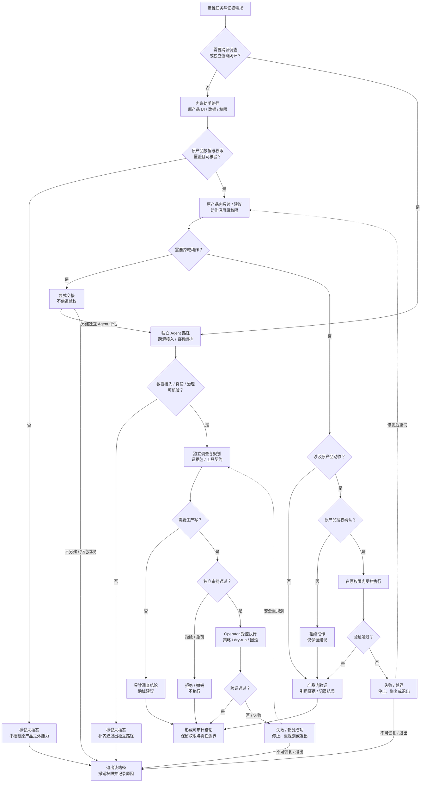

# 内嵌 Agent 助手

> 大多数企业第一次用到的“运维 Agent”，不是独立产品，而是既有产品里的助手：Azure Copilot、Grafana Assistant、Datadog Bits。其他条目只有导航，不能据此认定已具备运维能力。
>
> 最后核实：**2026-11-25**；复核截止：**2027-02-22**。同一 claim 在多个页面复用时保持相同 `claim_id` 与 `source_id`。

::: diagram 图 41 · 内嵌助手与独立 Agent 边界 | synthetic/方法示意；两条路径并列而非演进，内嵌助手不借用原产品之外的权限，跨域需求显式转交；未核实、拒绝、失败与退出均不静默降级，本图不构成厂商能力证明。

:::

## 内嵌 vs 独立

| 维度 | 内嵌助手 | 独立 Agent |
| --- | --- | --- |
| 入口 | 既有产品 UI/工作流 | 独立控制台/API/IM |
| 数据面 | 原生产品数据 | 跨源接入 |
| 行动权限 | 受原产品权限模型约束 | 需要自建身份/审批 |
| 上线速度 | 快 | 中 |
| 锁定风险 | 高 | 取决于协议与可移植性 |
| 适合 | 日常运维、快速验证 | 跨域诊断、值班、复杂闭环 |

内嵌不等于能力弱。内嵌助手的优势在既有数据面与权限上下文；独立 Agent 的优势在跨源调查与行动编排。

## 矩阵

### Microsoft

| 产品 | 内嵌助手/Agent（claim） | 运维相关性 | source_id |
| --- | --- | --- | --- |
| Microsoft 365 Copilot（EMB-MS-01） | Word/Excel/PowerPoint/Outlook/Teams；Chat/Basic/Premium/usage-based 分层 | 运维知识、事故沟通、复盘草稿（场景建议，非能力证明） | SRC-MS-M365-COPILOT-001；SRC-MS-COPILOT-LICENSING-001；SRC-MS-COPILOT-REQUIREMENTS-001 |
| Dynamics 365 Copilot（EMB-MS-02） | 记录摘要、会议准备、邮件协助、SharePoint 问答；仅访问用户有权限的记录/文件 | 业务/服务运营（场景建议） | SRC-MS-DYNAMICS-SALES-COPILOT-001；SRC-MS-DYNAMICS-REGION-LANGUAGE-001 |
| Azure Copilot（GC-MS-02） | Design、Operate、Optimize、Troubleshoot、Migrate、Deploy；migration agent 为 public preview，动作需用户确认 | 云运维 | SRC-MS-COPILOT-001；SRC-MS-COPILOT-DOC-001 |
| Security Copilot（GC-MS-03） | 能力未核实 | SecOps | 未核实 |
| GitHub Copilot（GC-MS-05） | issue/PR、并行任务、IDE/CLI/GitHub、审查、模型选择、连接器与 MCP | 研发与 DevOps，不是运维 Agent | SRC-GH-COPILOT-001 |

### Google

| 产品 | 内嵌助手/Agent（claim） | 运维相关性 | source_id |
| --- | --- | --- | --- |
| Google Workspace Gemini（EMB-GO-01） | Gmail/Docs/Sheets/Meet/Chat/Vids 内 AI；Business/Enterprise 内置 | 运维知识、沟通（场景建议） | SRC-GOOGLE-WORKSPACE-GEMINI-001 |
| Gemini Enterprise（GC-GO-03） | 企业搜索、Assistant、connectors、Agent Registry/Workflow Builder；区域与模型限制见商业字段卡 | 运维知识库、SOP（场景建议） | SRC-GOOGLE-GEMINI-ENTERPRISE-LOCATIONS-001；SRC-GOOGLE-GEMINI-ENTERPRISE-LICENSES-001；SRC-GOOGLE-GEMINI-ENTERPRISE-QUOTAS-001；SRC-GOOGLE-GEMINI-ENTERPRISE-BILLING-001 |
| Gemini Cloud Assist（GC-GO-01） | 能力未核实 | 云故障排查、优化（场景建议） | 未核实 |
| Gemini Code Assist（GC-GO-05） | 能力未核实 | 研发（场景建议） | 未核实 |
| Google Security Operations（GC-GO-04） | 能力未核实 | SecOps（场景建议） | 未核实 |

### AWS

| 产品 | 内嵌助手/Agent（claim） | 运维相关性 | source_id |
| --- | --- | --- | --- |
| Amazon Q Developer（GC-AWS-02） | IDE/CLI 保留 Amazon Q Developer 名称；控制台体验更名 AWS assistant；Free/Pro 两档，IDE 插件 2027-04-30 停止支持 | 云工程、排障 | SRC-AWS-QDEV-001；SRC-AWS-QDEV-PRICING-001；SRC-AWS-QDEV-DATA-001；SRC-AWS-QDEV-REGIONS-001 |
| AWS Quick（GC-AWS-05；旧称 Quick Suite / Q Business） | 文档/表格/演示稿生成、研究、自然语言构建应用、工具连接 | 运维知识、工单、分析 | SRC-AWS-QUICK-001 |
| CloudWatch Omni / investigations（GC-AWS-03） | AI 可观测体验、事故调查与根因分析 | 告警调查/可观测 | SRC-AWS-CLOUDWATCH-OMNI-001 |
| AWS DevOps Agent（GC-AWS-01） | 告警调查、根因与缓解步骤、可观测/代码/CI/CD 集成；Release Management 为 Preview | 事件响应/根因/可靠性；属于独立 Agent | SRC-AWS-DEVOPS-001 |

### 阿里云

| 产品 | 内嵌助手/Agent（claim） | 运维相关性 | source_id |
| --- | --- | --- | --- |
| 官方 Agent 服务目录（ALI-01） | 官方目录入口存在；本轮未重新计数，历史数量不作为当前事实 | 数据库、ECS、OSS、安全、网络、运维等导航 | SRC-ALI-CATALOG-001 |
| AgentRun（ALI-02） | Serverless Runtime、模型治理、Sandbox、MCP/Function Call、凭证与观测 | 承载自建运维 Agent；Computer/Mobile Use 为规划方向 | SRC-ALI-AGENTRUN-001 |
| Qoder Cloud Agents（ALI-15） | 能力与状态未核实 | 长任务/异步运维（场景建议） | 未核实 |
| 千问办公 / AgentOne（EMB-ALI-01） | QwenWork 支持文件/技能/连接器/定时任务与交付物下载；Lingyang AgentOne 支持企业 Agent 开发与系统连接 | 办公/业务运营（场景建议） | SRC-ALI-QWENWORK-INTRO-001；SRC-ALI-LINGYANG-AGENTONE-001 |

### 企业软件

| 产品 | 内嵌助手/Agent（claim） | 运维相关性 | source_id |
| --- | --- | --- | --- |
| ServiceNow Now Assist / AI Agents（GC-SN-01） | Foundation/Advanced/Prime；自定义 Agent 需 Prime；新 Studio 指定补丁以上 GA，但 agentic solutions 删除仍受限 | 工单、事件、变更、AIOps（场景建议） | SRC-SN-AI-AGENTS-001；SRC-SN-AI-AGENTS-GUIDE-001；SRC-SN-AGENT-STUDIO-2026-09-001 |
| Salesforce Agentforce（GC-SF-01） | 业务 Agent、CRM/Data 360 grounding、人工升级、Agent Builder 与多 Agent 编排 | 服务运营；未证明 IT 运维能力 | SRC-SF-AGENTFORCE-001 |
| SAP Joule（GC-SAP-01） | Joule Work/Assistants/Agents/Studio；跨 SAP/非 SAP 工作流与 agent gateway；客户数据留在 SAP 租户 | 业务运营（场景建议） | SRC-SAP-AI-JOULE-001；SRC-SAP-JOULE-DATACENTER-001 |
| Oracle Fusion AI Agents（GC-OR-03） | 25C 发布说明提供 AI Agents 页面与会话入口；统一 GA 未核实 | 业务运营 | SRC-OR-FUSION-AI-001 |
| Workday Illuminate（EMB-ENT-01） | HR/Finance/Industry purpose-built agents；2025 发布说明称新 agents 2026 可用，当前 GA 未核实 | 企业运营（场景建议） | SRC-WORKDAY-ILLUMINATE-001 |
| Atlassian Rovo（EMB-ENT-02） | 跨 SaaS 搜索/聊天/agents、Teamwork Graph 与管理员 AI 访问控制；支持 data residency | 研发/ITSM 协作（场景建议） | SRC-ATLASSIAN-ROVO-001；SRC-ATLASSIAN-ROVO-PRIVACY-001 |

### 可观测厂商

| 产品 | 内嵌助手/Agent（claim） | 运维相关性 | source_id |
| --- | --- | --- | --- |
| Datadog Bits AI（OBS-01） | 当前页面展示 Chat、Investigation、Code、Security Analyst、Agent Builder | 可观测/事件 | SRC-DD-AI-001 |
| Dynatrace Cloud SRE Agents 社区应用（OBS-02） | 社区应用支持并行 Agent 分派；非 Dynatrace 官方支持 | 可观测/可靠性 | SRC-DD-CLOUDSRE-001 |
| New Relic AI（OBS-03） | 自然语言查询、日志/堆栈、变更与仪表盘解释、代码级排障 | 可观测 | SRC-NR-AI-001 |
| Splunk AI Assistant/ITSI（OBS-04） | 自然语言转 SPL、代理调查、episode 摘要与根因指导 | 可观测/安全 | SRC-SPLUNK-AIASSISTANT-001；SRC-SPLUNK-ITSI-001 |
| PagerDuty Paige SRE Agent（OBS-05） | 分诊/诊断/修复/协调；修复需用户批准 | 事件管理 | SRC-PD-AIAGENTS-001 |
| Grafana Assistant（OBS-07） | 引导式对话、troubleshooting、dashboard、querying、alerting、incident response | 可观测 | SRC-GRAFANA-ASSIST-001 |
| Elastic AI Assistant（OBS-08） | ES\|QL、API、示例数据、可视化、排障、威胁研究与告警分诊 | 可观测/安全 | SRC-ELASTIC-AI-001 |

## 商业字段证据卡

| claim_id / 产品 | 状态 | 区域 | 许可/计费单位 | 最低消费 / 超额 | 数据驻留 | 导出 / 退出 |
| --- | --- | --- | --- | --- | --- | --- |
| GC-MS-02 Azure Copilot | migration agent 为 public preview；整体未核实 | 未核实；不适用于 national clouds | 当前 chat/agentic capabilities 无额外费用；Observability Agent 按 usage 计费 | 未来 Agent 价格、最低消费与超额未核实 | 未核实 | 未核实 |
| GC-MS-05 GitHub Copilot | 未核实 | 未核实 | 按计划与 credits/user；具体额度未核实 | 页面称超额 credits 为 $0.01/枚，可设预算 | 未核实 | 未核实 |
| GC-AWS-02 Amazon Q Developer | IDE/CLI 在用；控制台更名 AWS assistant；IDE 插件 2027-04-30 停服 | Builder ID Pro 支持 us-east-1；控制台/profile 支持 us-east-1 与 eu-central-1 | Free 零成本；Pro $19/用户/月 | 按月续订；代码转换超额 $0.003/LOC；未声明额外最低购买量 | 指定 Pro 功能按 profile 区域；其他功能/Free 多在美国；跨区推理按地理范围 | 可取消订阅；完整内容批量导出与删除时限未核实 |
| GC-AWS-05 AWS Quick | 未核实 | 未核实 | 按 user/month；组织版另有账户基础设施费 | Agent hours 因版本而异；超额未核实 | 未核实 | 未核实 |
| GC-AWS-01 AWS DevOps Agent | 整体未核实；Release Management 为 Preview | 未核实 | 未核实 | 未核实 | 未核实 | 未核实 |
| ALI-02 AgentRun | 未核实 | 未核实 | 未核实 | 浅休眠计费有描述；具体价格/超额未核实 | 私有化/网络隔离为文档宣称；具体配置未核实 | 未核实 |
| OBS-01 Datadog Bits AI | 未核实 | 未核实 | 定价入口含 AI Credits；具体单位未核实 | 未核实 | 未核实 | 未核实 |
| OBS-03 New Relic AI | 未核实 | 未核实 | 未核实 | 未核实 | 未核实；FedRAMP/HIPAA 客户当前不适用 | 未核实 |
| OBS-07 Grafana Assistant | 未核实 | 未核实 | 订阅与 AI Supplemental Terms；具体单位未核实 | 未核实 | 具体驻留未核实 | 未核实 |
| OBS-08 Elastic AI Assistant | Cloud Serverless 与 Stack 明示 GA | 未核实 | Managed LLM 需订阅/feature tier 并额外收费 | 额外成本存在；最低消费/超额未核实 | 第三方 provider 会处理数据；位置未核实 | 未核实 |
| GC-SF-01 Agentforce | 未核实 | 未核实 | Flex Credits、Resolutions、per-user licensing | 未核实 | 未核实 | 未核实 |
| EMB-MS-01 Microsoft 365 Copilot | 官方文档；许多区域可用，部分市场需批准 | 具体国家清单未核实；需 Entra 工作/学校账户 | E7 内置；Business≤300 用户年付加购；其他商业/政府/教育先决许可见官方清单 | 未核实 | EUDB；非 EU 流量可至其他国家/地区 | 管理员可分配/撤销许可；完整数据导出/删除未核实 |
| EMB-MS-02 Dynamics 365 Sales Copilot | 官方现行文档；GA 时间未核实 | Sales Premium 区域清单与 Exchange 数据位置限制见官方文档；Copilot 指向产品可用性报告 | 指向 Dynamics 365 授权指南 | 未核实 | 未核实 | 未核实 |
| EMB-GO-01 Workspace Gemini | 2025 官方公告；当前 GA 范围未核实 | 未核实 | 2025 起并入 Business/Enterprise；当前价格未核实 | 未核实 | 官方称不未经许可用企业数据训练域外模型 | 未核实 |
| GC-SAP-01 SAP Joule | 官方产品页；完整 GA 未核实 | 客户数据中心选项；完整区域清单未核实 | 现有 SAP 云订阅可激活 Joule base；完整价格未核实 | 未核实 | 客户数据留在 SAP 租户；Joule 不存储客户数据；数据中心选项称 payload 不离开物理环境 | Deep Research 可导出通用格式；完整 Joule 导出/退出未核实 |
| EMB-ENT-01 Workday Illuminate | 2025 发布说明称新 agents 2026 可用；当前 GA 未核实 | 未核实 | Flex Credits 包含于订阅、每年重置 | 未核实 | 未核实 | 未核实 |
| EMB-ENT-02 Atlassian Rovo | 官方产品/文档在列 | 支持 data residency；具体区域未核实 | 未核实 | 未核实 | 权限同步；LLM 提供商不留存输入输出 | 断开连接器后 30 天删除索引内容；全量导出未核实 |
| EMB-ALI-01 QwenWork / AgentOne | QwenWork 国际版完整流程；AgentOne 2025-09 发布 | QwenWork 国际版；AgentOne 区域未核实 | QwenWork 套餐/积分/订阅；价格未核实 | 未核实 | 未核实 | QwenWork 交付物可下载；完整退出未核实 |
| GC-SN-01 ServiceNow Otto AI Agents | 新 Studio 指定补丁以上 GA；整体未核实 | 未核实 | Foundation/Advanced/Prime；Assists 按动作与工具档位消耗 | 年度重置；最低量/超额价格未核实 | ServiceNow 管理 Azure；区域/驻留未核实 | 评估 CSV、Set Inactive；solution 删除受限；完整导出/退出未核实 |
| ALI-01/15、GC-OR-03 | 未核实 | 未核实 | 未核实 | 未核实 | 未核实 | 未核实 |

## 评估要点

1. **数据面**：助手能看到哪些数据？是否只限本产品？
2. **行动权限**：只能建议，还是能在审批下执行？权限是否可收紧？
3. **可扩展性**：能否接自定义工具/MCP、知识库、Runbook？
4. **治理**：身份、审计、数据驻留、模型选择、成本控制。
5. **锁定**：Prompt、知识、Trace、评测集能否导出？

::: tip 一个实用策略
日常运维先用内嵌助手（数据/权限现成），跨域诊断与复杂闭环用独立 Agent（跨源调查/行动编排），两者通过 MCP/OpenAPI/工单系统连接。
:::

## 来源与核实

最后核实：**2026-11-25**；复核截止：**2027-02-22**。场景建议不是厂商能力证据；产品能力必须回指 `source_id`。完整清单见[来源注册表](../appendix/source-registry)与[参考资料](../appendix/references)。

下一篇：[垂直行业运维 Agent](./vertical-ops)
