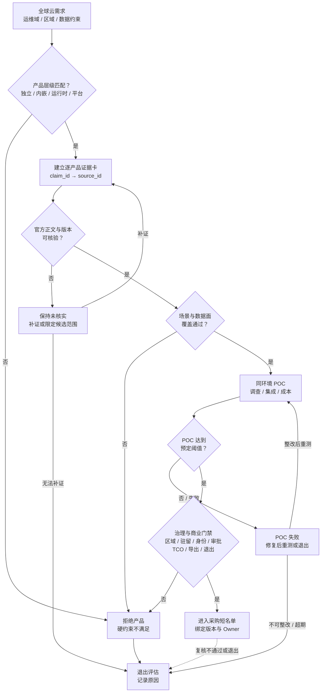

# 全球云厂商

> 全球云厂商的产品结构正在收敛为三层：一个“值班/运维 Agent” + 一组内嵌助手 + 一个 Agent 运行时/平台。选型时先分清层，再比较能力。
>
> 最后核实：**2026-11-25**；复核截止：**2027-02-22**。`claim_id → source_id` 的完整定义见[来源注册表](../appendix/source-registry)。

::: diagram 图 37 · 全球云产品评估流 | synthetic/方法示意；按产品层级、逐产品证据、场景 POC 与治理/商业门禁评估，未核实不默认通过，拒绝、POC 失败和退出均有显式分支；本图不构成厂商能力证明。

:::

## AWS

| 产品 | 形态 | 运维域 | 关键能力（claim） | source_id |
| --- | --- | --- | --- | --- |
| **AWS DevOps Agent**（GC-AWS-01） | 独立运维 Agent | 发布、事件响应、可靠性 | 官方公告确认整体于 2026-03-31 GA；可调查告警、给出根因与缓解步骤，接入 CloudWatch、Dynatrace、Datadog、Grafana、New Relic、Splunk 及代码/CI/CD；Code Change Risk Analysis 仍为 Preview | SRC-AWS-DEVOPS-001；SRC-AWS-DEVOPS-GA-001；SRC-AWS-DEVOPS-PRICING-001；SRC-AWS-DEVOPS-SECURITY-001；SRC-AWS-DEVOPS-REGIONS-001 |
| **Amazon Q Developer**（GC-AWS-02） | 内嵌助手 | 开发 + 云工程 | 官方确认 IDE/CLI 保留 Amazon Q Developer 名称，控制台体验更名 AWS assistant；提供 Free 与 Pro，IDE 插件将于 2027-04-30 停止支持；Pro 按用户月付，指定功能按 profile 区域存储 | SRC-AWS-QDEV-001；SRC-AWS-QDEV-PRICING-001；SRC-AWS-QDEV-DATA-001；SRC-AWS-QDEV-REGIONS-001 |
| **Amazon CloudWatch Omni / investigations**（GC-AWS-03） | 平台 AI 能力 | 可观测 | 官方文档支持 AI 可观测体验、事故调查与根因分析；定价、跨区域推理风险与保留规则见官方文档 | SRC-AWS-CLOUDWATCH-OMNI-001；SRC-AWS-OMNI-PRICING-001；SRC-AWS-OMNI-SECURITY-001；SRC-AWS-OMNI-RETENTION-001；SRC-AWS-OMNI-REGIONS-001 |
| **Amazon Bedrock AgentCore**（GC-AWS-04） | Agent 运行时 | 通用 | 官方公告确认 2025-10-13 整体 GA；Runtime、Memory、Gateway、Identity、Code Interpreter、Browser、Observability、Evaluations 等模块可独立/组合使用；按消费定价且无预付承诺或最低费用 | SRC-AWS-AGENTCORE-001；SRC-AWS-AGENTCORE-GA-001；SRC-AWS-AGENTCORE-REGIONS-001；SRC-AWS-AGENTCORE-PRICING-001 |
| **AWS Quick**（GC-AWS-05；旧书称 Quick Suite / Q Business） | 内嵌/平台 | 企业知识与工作 | 官方页面称可从对话生成文档/表格/演示稿，做研究，构建应用，并连接 Slack、Salesforce、Notion、Jira、Box 等 | SRC-AWS-QUICK-001 |

AWS 的已核验共同点是“**Agent + 既有可观测/工单生态**”：DevOps Agent 的官方集成清单包含多家可观测与工单工具（GC-AWS-01；SRC-AWS-DEVOPS-001）。这不代表所有集成均已 GA，也不证明跨源调查效果。

## Microsoft

| 产品 | 形态 | 运维域 | 关键能力（claim） | source_id |
| --- | --- | --- | --- | --- |
| **Azure SRE Agent**（GC-MS-01） | 独立/托管 SRE Agent | 可靠性、根因、缓解 | 官方文档描述遥测关联、根因调查、事件知识复用、技能/MCP、治理工具调用与缓解执行；Review 模式审批写操作，ReadOnly 不执行动作；控制面/数据面 API 仍为 preview | SRC-MS-SRE-001；SRC-MS-SRE-SECURITY-001；SRC-MS-SRE-MITIGATIONS-001；SRC-MS-SRE-API-001；SRC-MS-SRE-SETUP-001 |
| **Azure Copilot**（GC-MS-02） | 内嵌助手 | Azure 云运维 | 官方页面列出 Design、Operate、Optimize、Troubleshoot、Migrate、Deploy；migration agent 明示 public preview，不能推广到整个产品；动作需用户确认 | SRC-MS-COPILOT-001；SRC-MS-COPILOT-DOC-001 |
| **Microsoft Security Copilot**（GC-MS-03） | 安全运营 Agent 平台 | SecOps | 官方定价页描述独立或嵌入 Microsoft Security 产品的生成式 AI 助手，采用 SCU 计费；E5/E7 权益分阶段启用 | SRC-MS-SECCOPILOT-PRICING-001 |
| **Microsoft Foundry**（GC-MS-04） | Agent 平台 | 通用 | 官方页面描述 Agent 生命周期、模型选择/微调/路由、Agent Service、权限感知 grounding、连接器/MCP、Entra/Purview/Defender 治理、OpenTelemetry tracing 与 evaluators | SRC-MS-FOUNDRY-001 |
| **GitHub Copilot**（GC-MS-05） | 内嵌编码 Agent | 研发 | 官方页面描述从 issue/PR 开始工作、并行任务、跨 IDE/CLI/GitHub、代码审查、模型选择、自定义指令、连接器、MCP servers/skills/plugins | SRC-GH-COPILOT-001 |

Microsoft 的已核验路线是“**Azure Copilot + SRE Agent + Foundry + GitHub Copilot**”。Security Copilot 不在本轮能力结论内（GC-MS-03）。

## Google Cloud

| 产品 | 形态 | 运维域 | 关键能力（claim） | source_id |
| --- | --- | --- | --- | --- |
| **Gemini Cloud Assist**（GC-GO-01） | 内嵌助手 | 云运维/可观测 | 官方文档支持设计/部署/排障/优化、多 Agent 工具调用与专用 Agent Identity；明确 Preview/Pre-GA | SRC-GOOGLE-CLOUD-ASSIST-001 |
| **Gemini agent**（GC-GO-02） | 通用工作 Agent | 跨 Workspace/企业系统 | 官方公告称已发布 universal agent for work，可连接业务系统并交付成果；GA、区域与商业条款未核实 | SRC-GO-GEMINI-AGENT-001 |
| **Gemini Enterprise / Workspace**（GC-GO-03） | 内嵌助手 | 办公/企业知识 | 官方文档支持企业搜索、Assistant、connectors、Agent Registry/Workflow Builder 与项目/位置绑定许可；部分模型路由 global 时无区域 DRZ；超额用量与项目月度支出上限有官方控制 | SRC-GOOGLE-GEMINI-ENTERPRISE-LOCATIONS-001；SRC-GOOGLE-GEMINI-ENTERPRISE-LICENSES-001；SRC-GOOGLE-GEMINI-ENTERPRISE-QUOTAS-001；SRC-GOOGLE-GEMINI-ENTERPRISE-BILLING-001 |
| **Google Security Operations (Gemini)**（GC-GO-04） | 安全运营 | SecOps | 官方文档支持 Standard/Enterprise/Enterprise Plus、SIEM/SOAR/UEBA/Gemini 与自管 BigQuery 导出；BYOBQ 不适用于 Enterprise Plus；区域部署不跨区流量，多区域按 feeds 采用同步或异步复制；删除租户不自动取消计费 | SRC-GOOGLE-SECOPS-PACKAGES-001；SRC-GOOGLE-SECOPS-EXPORT-001；SRC-GOOGLE-SECOPS-DEPROVISION-001；SRC-GOOGLE-SECOPS-QUOTAS-001；SRC-GOOGLE-SECOPS-DR-001 |
| **Gemini Code Assist**（GC-GO-05） | 内嵌编码助手 | 研发 | 官方文档称 2026-10-09 起停售新订阅；存量年付可续订至 2027-01-31、月付至 2027-12-31，并转向 Antigravity | SRC-GOOGLE-CODEASSIST-SUNSET-001 |
| **Agent Development Kit（ADK）**（GC-GO-06；Agentspace 已并入 Gemini Enterprise，状态未核实） | Agent 框架 | 通用 | Google 官方仓库发布 ADK 2.0 GA，支持多 Agent 工作流与动态协作；不等于托管 Runtime 的区域或 SLA | SRC-GO-ADK-V2-001 |

Google 条目仅保留产品导航；本轮不把发布报道或历史记忆升级为官方能力结论。

## IBM

| 产品 | 形态 | 运维域 | 关键能力（claim） | source_id |
| --- | --- | --- | --- | --- |
| **IBM Concert**（GC-IBM-01） | AIOps/可观测平台 | 应用与基础设施运维 | 官方页面描述 Observe、Operate、Optimize、Protect、Resilience、Workflows，并整合可观测、优化、事件与暴露管理 | SRC-IBM-CONCERT-001 |
| **IBM Instana**（GC-IBM-02） | AIOps/可观测 | APM、基础设施 | 官方页面描述自动发现与插桩、实时全栈可观测、事件调查加速、性能/效率改进及 OpenTelemetry | SRC-IBM-INSTANA-001 |
| **IBM watsonx Orchestrate**（GC-IBM-03） | Agent 编排平台 | 通用/企业流程 | 官方页面描述构建/管理 Agent、Agent/workflow 编排、质量评估、治理与风险、成本控制、catalog 与 evaluation/observability | SRC-IBM-ORCH-001 |
| **IBM Turbonomic**（GC-IBM-04） | FinOps/自动化 | 成本与性能 | 官方页面描述全栈依赖与资源流、right-sizing、容量建模、策略驱动扩缩容及 compute/storage/network/GPU 优化 | SRC-IBM-TURBO-001 |
| **IBM QRadar**（GC-IBM-05） | 安全运营 | SecOps | 官方页面列出 QRadar SIEM、SOAR、EDR，并描述 AI 分析、行为分析、威胁情报、响应自动化与跨域关联 | SRC-IBM-QRADAR-001 |

IBM 的已核验组合覆盖“**可观测 + FinOps + 自动化 + 安全**”（GC-IBM-01–05；SRC-IBM-CONCERT-001、SRC-IBM-INSTANA-001、SRC-IBM-ORCH-001、SRC-IBM-TURBO-001、SRC-IBM-QRADAR-001）；是否适合既有 IBM 工具链仍需自行验证。

## Oracle / SAP / ServiceNow / Salesforce

| 厂商 | 产品 | 形态 | 运维相关性（claim） | source_id |
| --- | --- | --- | --- | --- |
| Oracle | OCI Generative AI — Enterprise AI Agents（GC-OR-01） | Agent 平台 | 官方发布说明确认 2026-03-31 GA；文档描述 Responses API、托管应用与混合架构，支持工具调用、记忆、NL2SQL 和隔离沙箱；不是运维专用 Agent | SRC-OR-ENTERPRISE-AGENTS-001；SRC-OR-AGENTS-GA-001；SRC-OR-AGENTS-REGIONS-001；SRC-OR-AGENTS-RETENTION-001 |
| Oracle | OCI Operations Insights（GC-OR-02） | AIOps | 官方文档支持数据库/主机资源与容量洞察、SQL/Exadata 分析；MySQL HeatWave 弃用与存量迁移需按文档执行 | SRC-OR-OPSINSIGHTS-001 |
| Oracle | Fusion AI Agents（GC-OR-03） | 内嵌业务 Agent | 25C 发布说明提供 AI Agents 页面与会话入口；26D 官方指南 G59779-07 描述 AI Agent Studio agentic workflows；官方价格表（2026-11-05）列 AI Agents/AI Units/Agentic Applications 在售 SKU；应用/工作流支持 JSON/ZIP 跨环境迁移 | SRC-OR-FUSION-AI-001；SRC-OR-AIAAS-GUIDE-001；SRC-OR-FUSION-PRICELIST-001；SRC-OR-AIAAS-MIGRATE-001 |
| SAP | Joule（GC-SAP-01） | 内嵌助手 | 官方页面支持 Joule Work/Assistants/Agents/Studio、跨 SAP 与非 SAP 工作流及 agent gateway；客户数据留在 SAP 租户，Joule 本身不存储客户数据；客户数据中心选项可在本地运行 Joule | SRC-SAP-AI-JOULE-001；SRC-SAP-JOULE-DATACENTER-001 |
| SAP | Joule Agents and Joule Assistants（GC-SAP-02） | Agent 平台/业务 Agent | 官方页面描述跨 SAP/非 SAP 多步业务 Agent、人工监督、唯一身份、Agent 网关与沙箱；不证明 IT 运维能力 | SRC-SAP-JOULE-AGENTS-001 |
| ServiceNow | ServiceNow Otto / AI Agents（GC-SN-01） | 内嵌助手 + Agent 平台 | 官方指南确认 Foundation/Advanced/Prime，自定义 Agent 需 Prime；Assists 按动作与工具数档位消耗并年度重置；新 Studio 对指定补丁版本以上 GA，但 2026-09-10 正文仍称不能删除 agentic solutions | SRC-SN-AI-AGENTS-001；SRC-SN-AI-AGENTS-GUIDE-001；SRC-SN-AGENT-STUDIO-2026-09-001 |
| ServiceNow | Super Intelligence Control Tower（GC-SN-02） | Agent 治理 | 官方发布说明支持 AI 资产发现、治理、安全、观测、度量、运行时监控与 kill switch；公开报价未核实 | SRC-SN-CONTROLTOWER-001 |
| Salesforce | Agentforce（GC-SF-01） | 内嵌业务 Agent | 官方页面描述员工/客服 Agent、CRM/Data 360 grounding、人工升级、Agent Builder、actions 与多 Agent 编排；未证明 IT 运维能力 | SRC-SF-AGENTFORCE-001 |

## 商业字段证据卡

| claim_id / 产品 | 状态 | 区域 | 许可/计费单位 | 最低消费 / 超额 | 数据驻留 | 导出 / 退出 |
| --- | --- | --- | --- | --- | --- | --- |
| GC-AWS-01 AWS DevOps Agent | 整体 GA：2026-03-31；Code Change Risk Analysis 为 Preview | 16 个支持区域；生产运维/按需任务/自定义 Agent 覆盖全部支持区域，GovCloud 功能有例外 | $0.0083/agent-second；按实际工作时间计费 | 无预付承诺或空闲等待费；新客户 2 个月试用，每月 10 Agent Spaces、20h 调查、15h 评估、20h 按需任务；关联 AWS 服务另收费 | 数据存储在 Agent Space 区域；提示/输出可能跨区或全球处理；删除后立即失去访问并在 30 天内永久删除；不用于训练 | 拓扑支持 PNG/JSON/Mermaid，调查/缓解摘要可经 API 读取；完整批量导出未核实；删除不可恢复，IAM 角色/策略需手工清理 |
| GC-AWS-02 Amazon Q Developer | IDE/CLI 在用；控制台体验更名 AWS assistant；IDE 插件 2027-04-30 停止支持 | Builder ID Pro 支持 us-east-1；控制台/profile 支持 us-east-1 与 eu-central-1，Frankfurt 有功能限制 | Free 零成本；Pro $19/用户/月 | Pro 按月续订直至取消；代码转换 4,000 LOC/月账户池，超额 $0.003/LOC；未声明额外最低购买量 | 指定 Pro 功能按 profile 区域存储；其他功能/Free 多在美国区域；跨区推理按地理范围处理 | 可取消 Pro 订阅；完整内容批量导出、删除时限与迁移协助未核实 |
| GC-AWS-04 AgentCore | 整体 GA：2025-10-13；子能力状态需分别核对 | 控制面/数据面九区；Gateway 额外列十二区，功能可用性因服务而异 | 按消费计量；Runtime/Browser/Code Interpreter/Gateway/Identity/Memory/Web Search 各有单位 | 无预付承诺或最低费用；网络传输与关联 AWS 服务另收费 | 未核实；Bedrock 推理保留规则不等于 AgentCore 全平台驻留承诺 | 可通过 API/OTel 读取运行数据；完整租户导出、删除时限与迁移协助未核实 |
| GC-AWS-05 AWS Quick | 未核实 | 未核实 | 页面列 Free/Plus/Max 与组织版，按 user/month；组织版另有账户基础设施费 | Agent hours 因版本而异；具体额度、超额未核实 | 未核实 | 未核实 |
| GC-MS-01 Azure SRE Agent | 控制面/数据面 API 为 preview；整体 GA 范围未核实 | 22 个已列区域；每 Agent 单区域，创建后不可更改，多区域需分别创建（SRC-MS-SRE-REGIONS-001） | AAU：always-on 4 AAU/Agent/小时 + active flow token 用量（SRC-MS-SRE-PRICING-001） | active flow 月度分配可设 500–1,000,000 AAU；达上限暂停 chat/actions，但 always-on 继续计费 | 对话/上传文件存所选 Agent 区域；Azure OpenAI 在 EU/EFTA 边界内推理，Anthropic 可全球处理且不适用 EUDB（SRC-MS-SRE-DATA-PRIVACY-001） | API 可读线程/消息；Agent 365 可对 person-started chat turns 默认导出；删除 Agent 停止计费并清除代理管理数据；完整批量导出未核实（SRC-MS-SRE-API-001；SRC-MS-SRE-SETUP-001） |
| GC-MS-02 Azure Copilot | migration agent 为 public preview；整体未核实 | 未核实；不适用于 national clouds | 当前 chat/agentic capabilities 无额外费用；Observability Agent 按 usage 计费 | 未来 Agent 价格、最低消费与超额未核实 | 未核实 | 未核实 |
| GC-MS-04 Microsoft Foundry | 未核实 | 未核实 | 按使用的各项服务各自计费 | 未核实 | 未核实 | 未核实 |
| GC-MS-05 GitHub Copilot | 未核实 | 未核实 | Free/Pro/Pro+/Max/Business/Enterprise；页面按 credits/user | 页面称超额 credits 为 $0.01/枚，可设预算；各计划额度/最低消费未核实 | 未核实 | 未核实 |
| GC-IBM-01–05 IBM 产品 | 未核实 | 未核实 | Instana 页面列 PayPerUse/SaaS/Self-Hosted；Orchestrate 列版本；其余许可单位未核实 | 未核实；Instana/Orchestrate 的结构化最低价单位不明，未采用 | 未核实；厂商数据主权表述不等于具体驻留证明 | 未核实 |
| GC-SF-01 Agentforce | 未核实 | 未核实 | 页面列 Flex Credits、Resolutions、per-user licensing | 未核实 | 未核实 | 未核实 |
| GC-OR-01 OCI Enterprise AI Agents | 整体 GA：2026-03-31 | Chicago、Ashburn、Phoenix、Frankfurt、London、Osaka、Hyderabad、São Paulo、Riyadh；模型可用性因区域而异 | 未核实 | 未核实 | xAI/Google 模型可能外部或跨区处理，不保证 AP 驻留；响应/会话最长保留 720 小时 | 删除项目会删除关联 artifacts；启用后的记忆只能随项目删除；完整导出与退出条款未核实 |
| GC-SAP-02 Joule Agents | 各 Agent GA 不同；整体未核实 | 未核实 | 未核实 | 未核实 | 未核实 | 未核实 |
| GC-SN-01 ServiceNow Otto AI Agents | 新 Studio 对 Zurich Patch 13 / Australia Patch 6 / Brazil EA1 及以上 GA；整体商业范围未核实 | 未核实 | Foundation/Advanced/Prime；自定义 Agent 需 Prime；Assists 按动作消耗，0–4/5–8/9–20 工具分别 25/50/150 | Assists 按合同周年年度重置；最低购买量、超额单价与池耗尽行为未核实 | 默认编排模型运行于 ServiceNow 管理 Azure 服务器；区域清单与驻留承诺未核实 | 评估结果可导 CSV；可 Set Inactive 停用 trigger；agentic solutions 仍不能删除；完整配置/日志/记忆导出、数据删除与合同退出未核实 |
| GC-GO-02 Gemini agent | 官方已宣布；GA 未核实 | 未核实 | 未核实 | 未核实 | 未核实 | 未核实 |
| GC-GO-06 ADK | ADK 2.0 GA；托管 Runtime 未核实 | 部署无关；Runtime 区域未核实 | 未核实 | 未核实 | 框架层不适用/未核实 | 可自部署；平台退出未核实 |
| GC-MS-03 Security Copilot | 商业云在售；E5/E7 分阶段启用；政府云不支持 | 未核实 | SCU；最低 1 provisioned SCU；示例 $4/SCU-h、$6/overage SCU | 可设 overage 上限；具体合同未核实 | 未核实 | 未核实 |
| GC-AWS-03 CloudWatch Omni | 官方文档可用；整体 GA 范围未核实 | 官方公告列多个区域；完整清单需复核 | CloudWatch 标准摄取/存储费率；调查可能产生 API 费用 | 超额查询与具体账户价格未核实 | 调查数据存主 Region；跨 Region 推理可能移出主 Region | 报告可复制；默认 24 小时删除，可配置 7–90 天 |
| GC-OR-02 OCI Ops Insights | 官方文档可用；MySQL HeatWave 弃用 | 未核实 | 文档列 OCPU/小时等计费；Autonomous AI DB Basic 免费 | 未核实 | 未核实 | 停用资源后 30 天清除；常规保留 25 个月 |
| GC-OR-03 Fusion AI Agents | 官方价格表在售 SKU（2026-11-05）；26D 指南 G59779-07（2026-11-10）；各 Agent 随季度 release 上线 | EPM 口径 GenAI 限 OC1/OC2/OC3/OC4/OC19/OC29/OC42 realm；Fusion Agent Studio 按 realm/region 受限；全产品区域清单未核实 | $150/Hosted Named User/月（B112537）或 $5/Hosted Employee/月（B112538）；AI Units $1,000/10 万池化单位（B112536）；Agentic Applications $500,000/年（B112535） | Named User 最低 50、Employee 最低 500；AI Units 耗尽须续购或停用，期末未用即作废、不退费 | 未核实 | 应用 JSON/工作流 ZIP 导出导入，导入后须发布并重配 Document/Email/REST 工具；全量业务数据导出与合同退出未核实 |
| GC-SN-02 Control Tower | 官方 8–9 月发布说明；AI Gateway 2026-09-10 GA | 未核实 | Store 标记 paid；公开报价未核实 | 未核实 | 未核实 | 未核实 |
| GC-GO-01 Gemini Cloud Assist | Preview/Pre-GA | 未核实 | 所有 Cloud 用户与 Code Assist Enterprise 权益分层 | 未核实 | 未核实 | 未核实 |
| GC-GO-03 Gemini Enterprise | 基础功能；国内区域 GA+allowlist | global/us/eu；br/ca/in/JP/SG/UK | 月付/年付；项目与位置绑定许可；纯按量版无许可费 | 超额需有效非试用订阅；按预付余额或月度发票计费；项目月度支出上限可停止付费用量，但生效延迟可能超额 | at-rest DRZ/MLP 受模型与位置限制；不支持模型路由 global | 用户许可 CSV≤100 万条；关闭自动续订；内容批量导出未核实 |
| GC-GO-04 Google SecOps | Standard/Enterprise/Enterprise Plus；整体 GA 未核实 | 区域部署数据与流量不跨区；多区域 geo-redundant，有 feeds 时异步复制存在 RPO；完整区域清单未核实 | 按年度采购注入容量；Standard 含 12 个月热保留；销售询价 | 1x–3x 日均突发是技术窗口，不是免超额额度；最低金额与超额单价未核实 | 区域部署单区存储；多区域无 feeds 同步、有 feeds 异步；Gemini/SOAR 全部处理边界未核实 | 八类 UDM/检测/指标导自管 BigQuery；Enterprise Plus 不支持 BYOBQ；历史数据不迁移；12 天软删后永久删除含备份，删除不取消计费；完整配置/SOAR 导出未核实 |
| GC-GO-05 Gemini Code Assist | 2026-10-09 停售新订阅 | 未核实 | 仅存量；续订截止见正文 | 未核实 | 未核实 | 转向 Gemini Enterprise 所含 Antigravity；数据导出未核实 |
| GC-SAP-01 SAP Joule | 官方产品页；完整 GA 未核实 | 提供客户数据中心选项；完整区域清单未核实 | 现有 SAP 云订阅可激活 Joule base；完整商业价格未核实 | 未核实 | 客户数据留在 SAP 租户且 Joule 不存储客户数据；客户数据中心选项称 payload 不离开物理环境，必要 AI Foundation 服务仍连接 SAP BTP | Deep Research 可导出通用格式；完整 Joule 内容/配置导出与退出未核实 |

Azure SRE Agent 的执行边界已由官方文档具体化：每个 Agent 使用独立微 VM 沙箱，身份 sidecar 提供单次、按工具调用作用域的 token；Review 模式需批准写操作，ReadOnly 不采取动作，delete/remove 与 `az keyvault` 命令被阻止，资源管理锁受尊重，审计记录身份、动作、时间、触发者与结果（SRC-MS-SRE-SECURITY-001；SRC-MS-SRE-MITIGATIONS-001）。这些是厂商控制声明，不能替代本组织的策略执行点、计划哈希复核和真实演练。

## 选型提示

- **已有云生态**优先看该云厂商的 SRE/DevOps Agent 与内嵌助手；跨云/混合云看可观测与事件管理厂商。
- **要“能行动”**时，重点看身份、审批、dry-run、回滚、审计。官方页面出现“autonomous”不等于已获授权自动执行。
- **要避免锁定**时，优先支持 MCP/OpenAPI、可导出 Trace/评测集、可替换模型与运行时的方案。
- **状态与价格**按逐产品证据判断；不能用某个子功能的 Preview 推导整个产品状态。

## 来源与核实

最后核实：**2026-11-25**；复核截止：**2027-02-22**。所有可核验能力均回指 `sources/registry.yaml`；公开报道不作为本页官方能力结论。完整清单见[来源注册表](../appendix/source-registry)与[参考资料](../appendix/references)。

下一篇：[中国云厂商](./china-cloud)
