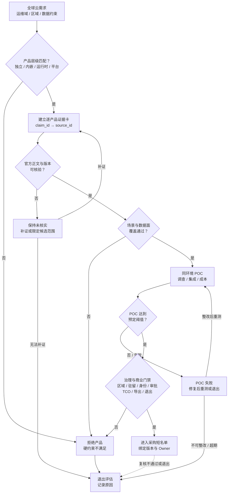

# 全球云厂商

> 全球云厂商的产品结构正在收敛为三层：一个“值班/运维 Agent” + 一组内嵌助手 + 一个 Agent 运行时/平台。选型时先分清层，再比较能力。
>
> 最后核实：**2026-11-25**；复核截止：**2027-02-22**。`claim_id → source_id` 的完整定义见[来源注册表](../appendix/source-registry)。

::: diagram 图 37 · 全球云产品评估流 | synthetic/方法示意；按产品层级、逐产品证据、场景 POC 与治理/商业门禁评估，未核实不默认通过，拒绝、POC 失败和退出均有显式分支；本图不构成厂商能力证明。

:::

## AWS

| 产品 | 形态 | 运维域 | 关键能力（claim） | source_id |
| --- | --- | --- | --- | --- |
| **AWS DevOps Agent**（GC-AWS-01） | 独立运维 Agent | 发布、事件响应、可靠性 | 官方页面称可调查告警、给出根因与缓解步骤，接入 CloudWatch、Dynatrace、Datadog、Grafana、New Relic、Splunk 及代码/CI/CD；Release Management 明示为 Preview | SRC-AWS-DEVOPS-001 |
| **Amazon Q Developer**（GC-AWS-02） | 内嵌助手 | 开发 + 云工程 | 官方页面仍列 IDE/CLI 等入口；IDE 插件将于 2027-04-30 停止支持，其他形态能力与整体状态未核实 | SRC-AWS-QDEV-001 |
| **Amazon CloudWatch Omni / investigations**（GC-AWS-03） | 平台 AI 能力 | 可观测 | 官方文档支持 AI 可观测体验、事故调查与根因分析；定价、跨区域推理风险与保留规则见官方文档 | SRC-AWS-CLOUDWATCH-OMNI-001；SRC-AWS-OMNI-PRICING-001；SRC-AWS-OMNI-SECURITY-001；SRC-AWS-OMNI-RETENTION-001；SRC-AWS-OMNI-REGIONS-001 |
| **Amazon Bedrock AgentCore**（GC-AWS-04） | Agent 运行时 | 通用 | Runtime、Memory、Gateway、Identity、Code Interpreter、Browser、Observability、Evaluations 等模块；Runtime 文档描述隔离会话、长时异步 Agent 与 MCP/A2A | SRC-AWS-AGENTCORE-001 |
| **AWS Quick**（GC-AWS-05；旧书称 Quick Suite / Q Business） | 内嵌/平台 | 企业知识与工作 | 官方页面称可从对话生成文档/表格/演示稿，做研究，构建应用，并连接 Slack、Salesforce、Notion、Jira、Box 等 | SRC-AWS-QUICK-001 |

AWS 的已核验共同点是“**Agent + 既有可观测/工单生态**”：DevOps Agent 的官方集成清单包含多家可观测与工单工具（GC-AWS-01；SRC-AWS-DEVOPS-001）。这不代表所有集成均已 GA，也不证明跨源调查效果。

## Microsoft

| 产品 | 形态 | 运维域 | 关键能力（claim） | source_id |
| --- | --- | --- | --- | --- |
| **Azure SRE Agent**（GC-MS-01） | 独立/托管 SRE Agent | 可靠性、根因、缓解 | 官方页面描述多层根因调查、遥测关联、假设检验、事件知识复用、缓解执行、自定义子 Agent、外部 MCP 与 GitHub Copilot 协作；强调人工监督 | SRC-MS-SRE-001 |
| **Azure Copilot**（GC-MS-02） | 内嵌助手 | Azure 云运维 | 官方页面列出 Design、Operate、Optimize、Troubleshoot、Migrate、Deploy；migration agent 明示 public preview，不能推广到整个产品；动作需用户确认 | SRC-MS-COPILOT-001；SRC-MS-COPILOT-DOC-001 |
| **Microsoft Security Copilot**（GC-MS-03） | 安全运营 Agent 平台 | SecOps | 官方定价页描述独立或嵌入 Microsoft Security 产品的生成式 AI 助手，采用 SCU 计费；E5/E7 权益分阶段启用 | SRC-MS-SECCOPILOT-PRICING-001 |
| **Microsoft Foundry**（GC-MS-04） | Agent 平台 | 通用 | 官方页面描述 Agent 生命周期、模型选择/微调/路由、Agent Service、权限感知 grounding、连接器/MCP、Entra/Purview/Defender 治理、OpenTelemetry tracing 与 evaluators | SRC-MS-FOUNDRY-001 |
| **GitHub Copilot**（GC-MS-05） | 内嵌编码 Agent | 研发 | 官方页面描述从 issue/PR 开始工作、并行任务、跨 IDE/CLI/GitHub、代码审查、模型选择、自定义指令、连接器、MCP servers/skills/plugins | SRC-GH-COPILOT-001 |

Microsoft 的已核验路线是“**Azure Copilot + SRE Agent + Foundry + GitHub Copilot**”。Security Copilot 不在本轮能力结论内（GC-MS-03）。

## Google Cloud

| 产品 | 形态 | 运维域 | 关键能力（claim） | source_id |
| --- | --- | --- | --- | --- |
| **Gemini Cloud Assist**（GC-GO-01） | 内嵌助手 | 云运维/可观测 | 官方文档支持设计/部署/排障/优化、多 Agent 工具调用与专用 Agent Identity；明确 Preview/Pre-GA | SRC-GOOGLE-CLOUD-ASSIST-001 |
| **Gemini agent**（GC-GO-02） | 通用工作 Agent | 跨 Workspace/企业系统 | 官方公告称已发布 universal agent for work，可连接业务系统并交付成果；GA、区域与商业条款未核实 | SRC-GO-GEMINI-AGENT-001 |
| **Gemini Enterprise / Workspace**（GC-GO-03） | 内嵌助手 | 办公/企业知识 | 官方文档支持企业搜索、Assistant、connectors、Agent Registry/Workflow Builder 与项目/位置绑定许可；部分模型路由 global 时无区域 DRZ | SRC-GOOGLE-GEMINI-ENTERPRISE-LOCATIONS-001；SRC-GOOGLE-GEMINI-ENTERPRISE-LICENSES-001 |
| **Google Security Operations (Gemini)**（GC-GO-04） | 安全运营 | SecOps | 官方文档支持 Standard/Enterprise/Enterprise Plus、SIEM/SOAR/UEBA/Gemini 与自管 BigQuery 导出；BYOBQ 不适用于 Enterprise Plus | SRC-GOOGLE-SECOPS-PACKAGES-001；SRC-GOOGLE-SECOPS-EXPORT-001 |
| **Gemini Code Assist**（GC-GO-05） | 内嵌编码助手 | 研发 | 官方文档称 2026-10-09 起停售新订阅；存量年付可续订至 2027-01-31、月付至 2027-12-31，并转向 Antigravity | SRC-GOOGLE-CODEASSIST-SUNSET-001 |
| **Agent Development Kit（ADK）**（GC-GO-06；Agentspace 已并入 Gemini Enterprise，状态未核实） | Agent 框架 | 通用 | Google 官方仓库发布 ADK 2.0 GA，支持多 Agent 工作流与动态协作；不等于托管 Runtime 的区域或 SLA | SRC-GO-ADK-V2-001 |

Google 条目仅保留产品导航；本轮不把发布报道或历史记忆升级为官方能力结论。

## IBM

| 产品 | 形态 | 运维域 | 关键能力（claim） | source_id |
| --- | --- | --- | --- | --- |
| **IBM Concert**（GC-IBM-01） | AIOps/可观测平台 | 应用与基础设施运维 | 官方页面描述 Observe、Operate、Optimize、Protect、Resilience、Workflows，并整合可观测、优化、事件与暴露管理 | SRC-IBM-CONCERT-001 |
| **IBM Instana**（GC-IBM-02） | AIOps/可观测 | APM、基础设施 | 官方页面描述自动发现与插桩、实时全栈可观测、事件调查加速、性能/效率改进及 OpenTelemetry | SRC-IBM-INSTANA-001 |
| **IBM watsonx Orchestrate**（GC-IBM-03） | Agent 编排平台 | 通用/企业流程 | 官方页面描述构建/管理 Agent、Agent/workflow 编排、质量评估、治理与风险、成本控制、catalog 与 evaluation/observability | SRC-IBM-ORCH-001 |
| **IBM Turbonomic**（GC-IBM-04） | FinOps/自动化 | 成本与性能 | 官方页面描述全栈依赖与资源流、right-sizing、容量建模、策略驱动扩缩容及 compute/storage/network/GPU 优化 | SRC-IBM-TURBO-001 |
| **IBM QRadar**（GC-IBM-05） | 安全运营 | SecOps | 官方页面列出 QRadar SIEM、SOAR、EDR，并描述 AI 分析、行为分析、威胁情报、响应自动化与跨域关联 | SRC-IBM-QRADAR-001 |

IBM 的已核验组合覆盖“**可观测 + FinOps + 自动化 + 安全**”（GC-IBM-01–05；SRC-IBM-CONCERT-001、SRC-IBM-INSTANA-001、SRC-IBM-ORCH-001、SRC-IBM-TURBO-001、SRC-IBM-QRADAR-001）；是否适合既有 IBM 工具链仍需自行验证。

## Oracle / SAP / ServiceNow / Salesforce

| 厂商 | 产品 | 形态 | 运维相关性（claim） | source_id |
| --- | --- | --- | --- | --- |
| Oracle | OCI Generative AI — Enterprise AI Agents（GC-OR-01） | Agent 平台 | 官方文档描述 Responses API、托管应用与混合架构，支持工具调用、记忆、NL2SQL 和隔离沙箱；不是运维专用 Agent | SRC-OR-ENTERPRISE-AGENTS-001 |
| Oracle | OCI Operations Insights（GC-OR-02） | AIOps | 官方文档支持数据库/主机资源与容量洞察、SQL/Exadata 分析；MySQL HeatWave 弃用与存量迁移需按文档执行 | SRC-OR-OPSINSIGHTS-001 |
| Oracle | Fusion AI Agents（GC-OR-03） | 内嵌业务 Agent | 官方 25C 发布说明支持 AI Agents 页面、会话与聊天入口；统一 GA 范围未核实 | SRC-OR-FUSION-AI-001 |
| SAP | Joule（GC-SAP-01） | 内嵌助手 | 官方页面支持 Joule Work/Assistants/Agents/Studio、跨 SAP 与非 SAP 工作流及 agent gateway；完整 GA 与商业细节未核实 | SRC-SAP-AI-JOULE-001 |
| SAP | Joule Agents and Joule Assistants（GC-SAP-02） | Agent 平台/业务 Agent | 官方页面描述跨 SAP/非 SAP 多步业务 Agent、人工监督、唯一身份、Agent 网关与沙箱；不证明 IT 运维能力 | SRC-SAP-JOULE-AGENTS-001 |
| ServiceNow | ServiceNow Otto / AI Agents（GC-SN-01） | 内嵌助手 + Agent 平台 | 官方社区 FAQ 描述自主 AI Agents 与 ITSM/HRSD/CRM 场景；具体 SKU 与版本要求需逐项核实 | SRC-SN-AI-AGENTS-001 |
| ServiceNow | Super Intelligence Control Tower（GC-SN-02） | Agent 治理 | 官方发布说明支持 AI 资产发现、治理、安全、观测、度量、运行时监控与 kill switch；公开报价未核实 | SRC-SN-CONTROLTOWER-001 |
| Salesforce | Agentforce（GC-SF-01） | 内嵌业务 Agent | 官方页面描述员工/客服 Agent、CRM/Data 360 grounding、人工升级、Agent Builder、actions 与多 Agent 编排；未证明 IT 运维能力 | SRC-SF-AGENTFORCE-001 |

## 商业字段证据卡

| claim_id / 产品 | 状态 | 区域 | 许可/计费单位 | 最低消费 / 超额 | 数据驻留 | 导出 / 退出 |
| --- | --- | --- | --- | --- | --- | --- |
| GC-AWS-01 AWS DevOps Agent | 整体未核实；Release Management 为 Preview | 未核实（控制台链接指向 us-east-1，不等于区域清单） | 未核实 | 未核实 | 未核实 | 未核实 |
| GC-AWS-02 Amazon Q Developer | IDE 插件将于 2027-04-30 停服；其他形态未核实 | 未核实 | 未核实 | 未核实 | 未核实 | 未核实 |
| GC-AWS-04 AgentCore | 未核实 | 未核实 | 按量消费；官方称无预付承诺或最低费用 | 具体超额规则未核实 | 未核实 | 未核实 |
| GC-AWS-05 AWS Quick | 未核实 | 未核实 | 页面列 Free/Plus/Max 与组织版，按 user/month；组织版另有账户基础设施费 | Agent hours 因版本而异；具体额度、超额未核实 | 未核实 | 未核实 |
| GC-MS-01 Azure SRE Agent | 未核实 | 未核实 | Azure Agent Unit（AAU）；baseline 4 AAU/Agent/小时 | task 额外 0.25 AAU/秒；最低消费未核实 | 未核实 | 未核实 |
| GC-MS-02 Azure Copilot | migration agent 为 public preview；整体未核实 | 未核实；不适用于 national clouds | 当前 chat/agentic capabilities 无额外费用；Observability Agent 按 usage 计费 | 未来 Agent 价格、最低消费与超额未核实 | 未核实 | 未核实 |
| GC-MS-04 Microsoft Foundry | 未核实 | 未核实 | 按使用的各项服务各自计费 | 未核实 | 未核实 | 未核实 |
| GC-MS-05 GitHub Copilot | 未核实 | 未核实 | Free/Pro/Pro+/Max/Business/Enterprise；页面按 credits/user | 页面称超额 credits 为 $0.01/枚，可设预算；各计划额度/最低消费未核实 | 未核实 | 未核实 |
| GC-IBM-01–05 IBM 产品 | 未核实 | 未核实 | Instana 页面列 PayPerUse/SaaS/Self-Hosted；Orchestrate 列版本；其余许可单位未核实 | 未核实；Instana/Orchestrate 的结构化最低价单位不明，未采用 | 未核实；厂商数据主权表述不等于具体驻留证明 | 未核实 |
| GC-SF-01 Agentforce | 未核实 | 未核实 | 页面列 Flex Credits、Resolutions、per-user licensing | 未核实 | 未核实 | 未核实 |
| GC-OR-01 OCI Enterprise AI Agents | 整体 GA 未核实 | 未核实 | 未核实 | 未核实 | 未核实 | 未核实 |
| GC-SAP-02 Joule Agents | 各 Agent GA 不同；整体未核实 | 未核实 | 未核实 | 未核实 | 未核实 | 未核实 |
| GC-SN-01 ServiceNow Otto AI Agents | FAQ 有版本要求；整体 GA 未核实 | 未核实 | FAQ 提及 Pro Plus/Enterprise Plus 或 AI SKU；具体合同未核实 | 未核实 | 未核实 | 未核实 |
| GC-GO-02 Gemini agent | 官方已宣布；GA 未核实 | 未核实 | 未核实 | 未核实 | 未核实 | 未核实 |
| GC-GO-06 ADK | ADK 2.0 GA；托管 Runtime 未核实 | 部署无关；Runtime 区域未核实 | 未核实 | 未核实 | 框架层不适用/未核实 | 可自部署；平台退出未核实 |
| GC-MS-03 Security Copilot | 商业云在售；E5/E7 分阶段启用；政府云不支持 | 未核实 | SCU；最低 1 provisioned SCU；示例 $4/SCU-h、$6/overage SCU | 可设 overage 上限；具体合同未核实 | 未核实 | 未核实 |
| GC-AWS-03 CloudWatch Omni | 官方文档可用；整体 GA 范围未核实 | 官方公告列多个区域；完整清单需复核 | CloudWatch 标准摄取/存储费率；调查可能产生 API 费用 | 超额查询与具体账户价格未核实 | 调查数据存主 Region；跨 Region 推理可能移出主 Region | 报告可复制；默认 24 小时删除，可配置 7–90 天 |
| GC-OR-02 OCI Ops Insights | 官方文档可用；MySQL HeatWave 弃用 | 未核实 | 文档列 OCPU/小时等计费；Autonomous AI DB Basic 免费 | 未核实 | 未核实 | 停用资源后 30 天清除；常规保留 25 个月 |
| GC-OR-03 Fusion AI Agents | 25C 发布说明；统一 GA 未核实 | 未核实 | 需角色/权限/duty roles；商业费用未核实 | 未核实 | 未核实 | 未核实 |
| GC-SN-02 Control Tower | 官方 8–9 月发布说明；AI Gateway 2026-09-10 GA | 未核实 | Store 标记 paid；公开报价未核实 | 未核实 | 未核实 | 未核实 |
| GC-GO-01 Gemini Cloud Assist | Preview/Pre-GA | 未核实 | 所有 Cloud 用户与 Code Assist Enterprise 权益分层 | 未核实 | 未核实 | 未核实 |
| GC-GO-03 Gemini Enterprise | 基础功能；国内区域 GA+allowlist | global/us/eu；br/ca/in/JP/SG/UK | 月付/年付；项目与位置绑定许可 | 未核实 | at-rest DRZ/MLP 受模型与位置限制；不支持模型路由 global | 用户许可 CSV≤100 万条；关闭自动续订；内容批量导出未核实 |
| GC-GO-04 Google SecOps | Standard/Enterprise/Enterprise Plus | 未核实 | 按注入量；销售询价 | 未核实 | 具体 DRZ 区域未核实 | UDM 导自管 BigQuery；Enterprise Plus 不支持 BYOBQ；历史数据不迁移 |
| GC-GO-05 Gemini Code Assist | 2026-10-09 停售新订阅 | 未核实 | 仅存量；续订截止见正文 | 未核实 | 未核实 | 转向 Gemini Enterprise 所含 Antigravity；数据导出未核实 |
| GC-SAP-01 SAP Joule | 官方产品页；完整 GA 未核实 | 未核实 | 未核实 | 未核实 | 未核实 | 完整导出/退出未核实 |

## 选型提示

- **已有云生态**优先看该云厂商的 SRE/DevOps Agent 与内嵌助手；跨云/混合云看可观测与事件管理厂商。
- **要“能行动”**时，重点看身份、审批、dry-run、回滚、审计。官方页面出现“autonomous”不等于已获授权自动执行。
- **要避免锁定**时，优先支持 MCP/OpenAPI、可导出 Trace/评测集、可替换模型与运行时的方案。
- **状态与价格**按逐产品证据判断；不能用某个子功能的 Preview 推导整个产品状态。

## 来源与核实

最后核实：**2026-11-25**；复核截止：**2027-02-22**。所有可核验能力均回指 `sources/registry.yaml`；公开报道不作为本页官方能力结论。完整清单见[来源注册表](../appendix/source-registry)与[参考资料](../appendix/references)。

下一篇：[中国云厂商](./china-cloud)
