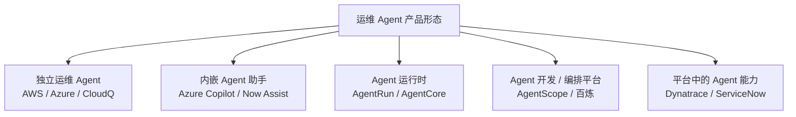

# 厂商与产品全景

> 运维 Agent 市场最大的误区，是把“独立 Agent 产品”“云产品内嵌助手”“Agent 运行时”“AIOps 平台里的 AI 功能”放在同一张表里比较。它们不是同一层东西。

## 五类产品形态

| 形态 | 是什么 | 典型例子 | 选型时看什么 |
| --- | --- | --- | --- |
| **独立运维 Agent** | 以 Agent 为主体的产品/服务，可独立值班、调查、建议或执行 | AWS DevOps Agent、Azure SRE Agent、腾讯 CloudQ、Datadog Bits AI SRE | 调查深度、行动边界、数据接入、计费 |
| **内嵌 Agent 助手** | 嵌入既有云产品/ITSM/可观测/办公产品的助手 | Azure Copilot、Gemini Cloud Assist、Now Assist、Grafana Assistant | 数据面覆盖、可扩展性、权限与治理、锁定 |
| **Agent 运行时/基础设施** | 提供执行、沙箱、会话、状态、工具与观测 | AgentRun、Agent Sandbox、AgentBay、Bedrock AgentCore、Qoder Cloud Agents | 长任务、隔离、恢复、工具治理、可移植 |
| **Agent 开发/编排平台** | 构建 Agent、多 Agent、RAG、工具、评测 | AgentScope、百炼、Microsoft Foundry、Spring AI Alibaba、Qwen-Agent | 框架开放度、可观测、评测、部署 |
| **平台中的 Agent 能力** | 传统 AIOps/ITSM/安全/网络/FinOps 平台新增的 Agent 功能 | Dynatrace、ServiceNow、Palo Alto、Cisco、Apptio | 与既有数据/流程的集成、Agent 是否真能行动 |

::: diagram 图 21 · 运维 Agent 的五类产品形态 | 五类产品形态是并列分类，不是演进顺序；选型先确定层级。

:::

## 覆盖地图

| 区域 | 覆盖的厂商/产品家族 |
| --- | --- |
| **全球云** | AWS、Microsoft Azure、Google Cloud、IBM、Oracle、SAP、ServiceNow、Salesforce |
| **中国云** | 阿里云、华为云、腾讯云、百度智能云、火山引擎、京东云、移动云、浪潮云、嘉为蓝鲸、云智慧、擎创、炎龙、新炬 |
| **可观测/AIOps** | Datadog、Dynatrace、New Relic、Splunk、PagerDuty、Grafana、Elastic、Sumo Logic、LogicMonitor、ScienceLogic、BigPanda、OpsRamp、BMC、ManageEngine、SolarWinds、Komodor、HolmesGPT、K8sGPT、incident.io、Rootly、Resolve.ai、观测云 |
| **安全** | Microsoft Security Copilot、Google Security Operations、Palo Alto Cortex、CrowdStrike Charlotte AI、SentinelOne Purple AI、Splunk Security、IBM QRadar、DropZone AI |
| **网络** | Cisco AI Canvas/Cloud Control、Juniper Marvis/Mist AI、HPE Aruba Central、Arista CloudVision、Nokia、华为 iMaster NCE、中兴、H3C |
| **FinOps** | Apptio Cloudability、CloudHealth、Harness CCM、Kubecost、Vantage、CloudZero、Finout、Flexera |
| **内嵌助手** | Microsoft 365 Copilot、Azure Copilot、Security Copilot、Google Workspace Gemini、Gemini Cloud Assist、Amazon Q、Now Assist、Agentforce、SAP Joule、Oracle Fusion AI Agents、Atlassian Rovo |
| **垂直行业** | 电信 NOC、金融运维、制造/OT、能源/电网、零售/电商、物流、医疗、政务 |

## 怎么读这张地图

1. **先确定层**：你要的是“能值班的 Agent”“平台里的助手”“运行 Agent 的底座”，还是“构建 Agent 的框架”？
2. **再看数据面**：它能看到你的指标、日志、链路、拓扑、变更和工单吗？只能看自家数据面的 Agent，盲区很大。
3. **再看行动边界**：只读、建议、审批执行、自治，分别对应完全不同的风险与工程要求。
4. **最后看证据**：官方文档、官方发布、公开报道、第三方评测；本书会标注依据类型，但产品能力与计费以官方最新文档为准。

::: warning 这不是穷举
本地图覆盖主要厂商与代表性产品，不是完整产品库。产品命名、状态（预览/商用）、能力与计费变化很快；新增或纠错请提交 Issue/PR。
:::

## 来源与时效

每个分册末尾都有“来源与核实”一节，列出该页的主要链接与最后核实日期。表格中的“依据”是证据类型（官方文档/官方发布/公开报道等），具体链接以分册末尾和[参考资料](../appendix/references)为准；使用前请再查厂商官方文档。

## 分册

- [全球云厂商](./global-cloud)
- [中国云厂商](./china-cloud)
- [可观测与 AIOps](./observability-aiops)
- [安全、网络与 FinOps](./security-network-finops)
- [内嵌 Agent 助手](./embedded-assistants)
- [垂直行业运维 Agent](./vertical-ops)
- [厂商评估方法](./methodology)
