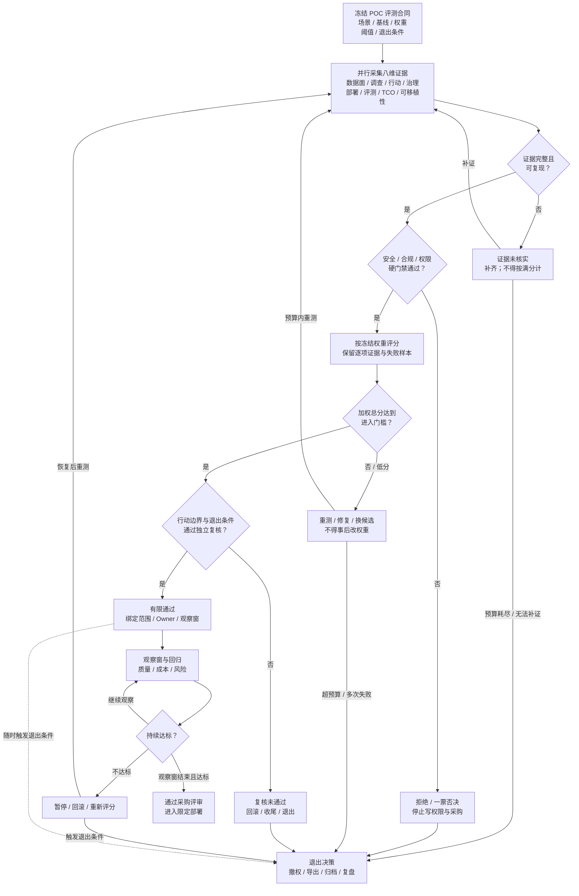

# 厂商评估方法

> 厂商演示的是“能力上限”，生产需要的是“可验证的下限”。用同一套框架评估所有厂商，避免被名词和 Demo 带走。
>
> 最后核实：**2026-11-24**；复核截止：**2027-02-22**。

::: diagram 图 43 · POC 评分与退出决策 | synthetic/方法示意；未核实证据不计入得分，安全/合规一票否决且独立于总分，低分、复核失败或观察窗退化可重测或退出；本图不构成厂商能力或 POC 结果证明。

:::

## 1. 先分层

| 层 | 问题 | 例子 |
| --- | --- | --- |
| 独立 Agent | 它能不能独立值班、调查、行动？ | AWS DevOps Agent、Azure SRE Agent、CloudQ、Bits AI SRE |
| 内嵌助手 | 它在哪个产品里？能看到什么数据？ | Azure Copilot、Gemini Cloud Assist、Now Assist |
| 运行时 | 它怎么跑、怎么隔离、怎么恢复？ | AgentRun、AgentCore、Agent Sandbox、Qoder Cloud Agents |
| 平台/框架 | 我怎么构建、编排、评测？ | AgentScope、百炼、Foundry、Spring AI Alibaba |
| AIOps 能力 | 它是传统 AIOps 加了 AI，还是 Agent 原生？ | Dynatrace、Datadog、ServiceNow、Splunk |

## 2. 八个评估维度

| 维度 | 关键问题 | 权重建议 |
| --- | --- | --- |
| **数据面** | 能接哪些指标/日志/链路/拓扑/变更/工单？盲区多大？ | 20% |
| **调查深度** | 能主动查询、形成假设、引用证据、验证结论吗？ | 15% |
| **行动边界** | 只读/建议/审批执行/自治？审批、dry-run、回滚、kill switch？ | 20% |
| **身份与治理** | Agent 身份、委托、最小权限、审计、数据驻留？ | 15% |
| **部署与集成** | SaaS/私有化/混合？与现有工具/流程集成成本？ | 10% |
| **评测与可观测** | 评测集、Trace、回归、异常检测、质量 SLO？ | 10% |
| **TCO** | 许可、按量、调查/Token、数据出口、实施、运维？ | 5% |
| **可移植性** | 工具契约、MCP/OpenAPI、Trace/评测集/知识可导出？ | 5% |

## 3. 证据分级

| 级别 | 证据 | 可信度与边界 |
| --- | --- | --- |
| A | 官方文档、API、SLA、定价页 | 高；仅证明文档明确写出的范围，仍需检查版本、区域与日期 |
| B | 官方发布、大会演示、预览公告 | 中高；发布与演示不等于 GA 或生产验证 |
| C | 公开报道、分析师报告、客户案例 | 中；必须写明“报道/厂商称”，不能自动升级为官方事实 |
| D | 社区文章、第三方评测、Demo 视频 | 低；需要 POC 验证 |

**官方营销页不等于生产能力证明。** 它最多支持“厂商如此宣称”，不能单独证明 SLA、客户规模、区域可用性、节省比例或生产效果。客户案例、benchmark 与厂商性能指标也不能替代独立验证。

本书使用稳定 `claim_id → source_id` 回指。每条 material capability claim 必须有可定位来源；来源不足以支持时写“未核实”，不保留猜测。“未核实”不等于否定，但不得把它当成肯定事实。状态、区域、许可单位、最低消费/超额、数据驻留、导出/退出六项商业字段分别核实，不能用产品主页的单一营销表述补齐。

## 4. POC 设计

建议 4–6 周：

1. **第 1 周**：确定 3–5 个真实场景 + 黄金事故集。
2. **第 2 周**：接入数据（只读），验证调查质量与证据引用。
3. **第 3 周**：影子模式，与人工处理对比。
4. **第 4 周**：受控执行（低风险动作），验证审批、dry-run、回滚。
5. **第 5–6 周**：TCO/安全/治理评审，形成选型报告。

POC 必须用**你自己的数据**，不要只用厂商的演示环境。正式执行使用 [POC 评分卡](https://github.com/ai-guru-global/the-ops-agent-book/blob/main/templates/poc-scorecard.md) 的八维权重、硬门槛与退出测试；第 10 章七维卡只用于立项前初筛，不叠加第二个采购总分。

## 5. 厂商话术检查

- “自主修复” → 有没有审批、dry-run、回滚、blast radius？
- “准确率 99%” → 数据集是什么？谁标注？失败模式是什么？
- “支持所有工具” → 有没有工具契约、权限、审计？
- “开箱即用” → 数据接入、身份、流程集成要多久？
- “按 Token 计费” → 调查/工具/沙箱/数据出口是否另计费？
- “预览版” → 什么时候 GA？SLA 是什么？

## 6. TCO 要算全

| 成本 | 内容 |
| --- | --- |
| 许可/订阅 | 席位、事件量、调查次数、Credits |
| 使用 | Token、模型、沙箱、存储、出口流量 |
| 实施 | 数据接入、工具适配、权限、流程、培训 |
| 运营 | 值班、评测、Prompt/知识/工具维护 |
| 风险 | 事故、合规、锁定、迁移 |

## 7. 覆盖与更新

- 本地图覆盖主要厂商与代表性产品，不是穷举。
- 产品名称、状态、能力、计费变化很快；每条事实回指 `source_id`，并遵守 `accessed_at / review_by`。超过复核截止或缺少快照时，先重新核验再使用。
- 来源清单、访问时间与快照计划见[来源注册表](../appendix/source-registry)；不要用含糊的“官方产品页”作为唯一证据。
- 欢迎提交 Issue/PR 补充厂商、纠正信息、提供真实 POC 经验。

## 8. 一页选型结论模板

```text
候选：
产品形态：
覆盖场景：
数据面：
行动边界：
身份/治理：
部署/集成：
评测/可观测：
TCO：
可移植性：
POC 结论：
风险与未决问题：
建议：
```

## 来源与核实

本页评估框架最后核实：**2026-11-24**；复核截止：**2027-02-22**。证据分级、回指规则与 POC 方法为本书原创，外部标准与来源参考：

- OWASP GenAI Security Project（METH-01；SRC-OWASP-GENAI-001）
- NIST AI Risk Management Framework（METH-02；SRC-NIST-AIRMF-001）
- ISO/IEC 42001（METH-03；SRC-ISO42001-001）
- EU AI Act（METH-04；SRC-EU-AIACT-001）
- OpenTelemetry GenAI Semantic Conventions（METH-05；SRC-OTEL-GENAI-001）
- Google SRE Workbook（METH-06；SRC-GOOGLE-SRE-001）

这些标准/框架入口不证明任何产品已合规或认证。完整来源见[来源注册表](../appendix/source-registry)与[参考资料](../appendix/references)。
