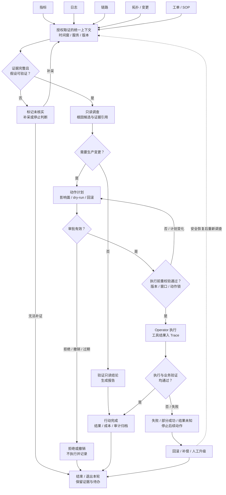

# 可观测与 AIOps

> 运维 Agent 最密集的落点，不在云厂商，而在可观测与事件管理厂商：它们已经握着指标、日志、链路、拓扑、告警和值班流程。
>
> 最后核实：**2026-11-25**；复核截止：**2027-02-22**。产品组合以本轮取得的官方页面为准，旧名称不自动沿用。

::: diagram 图 39 · 可观测信号到行动链 | synthetic/方法示意；多源信号并行汇入授权上下文，证据不足先补采，只读与写动作分路，审批拒绝、执行失败或恢复不安全均停止并留痕；本图不构成厂商能力证明。

:::

## 四种技术路线

| 路线 | 代表 | 优势 | 局限 |
| --- | --- | --- | --- |
| **存量可观测平台 + AI** | Datadog Bits、New Relic AI；Dynatrace 待核 | 数据面完整、上下文足 | 只覆盖自家数据面；附加计费须逐项核实 |
| **事件管理平台 + AI** | PagerDuty、incident.io、Rootly（待核） | 与值班/升级流程同栈 | 调查深度受限于事件数据 |
| **AI 原生运维 Agent** | Resolve.ai、Cleric、Metoro（待核） | 以 Agent 为中心设计 | 数据接入与生态较新 |
| **K8s/开源专用 Agent** | Komodor、HolmesGPT、K8sGPT（待核） | 轻量、可自建、K8s 深度 | 覆盖面窄、治理需自建 |

路线分类是本书分析框架，不代表对上述所有产品的能力背书。

## 主流产品

| 厂商 | 产品 | 形态 | 关键能力（claim） | source_id |
| --- | --- | --- | --- | --- |
| **Datadog** | Bits AI（OBS-01） | 平台 AI + Agent Builder | 当前官方页面展示 Bits Chat、Investigation、Code、Security Analyst、Agent Builder；描述调查告警、根因/修复建议、代码修复、安全分诊与自定义 Agent。旧书 Bits AI SRE/Memories/AI Guard/Scout 组合未核实 | SRC-DD-AI-001 |
| **Dynatrace** | Cloud SRE Agents 社区应用（OBS-02） | 社区 AI SRE | Dynatrace Hub 描述并行分派问题给匹配 Agent；页面明确不是 Dynatrace 官方支持，Davis CoPilot/Assist 对应关系未核实 | SRC-DD-CLOUDSRE-001 |
| **New Relic** | New Relic AI（OBS-03） | 平台 AI 能力 | 官方页面描述自然语言转查询、解释结果、分析错误日志/堆栈、变更调查、仪表盘解释与代码级排障；不证明自主修复 | SRC-NR-AI-001 |
| **Splunk (Cisco)** | Splunk AI Assistant / ITSI（OBS-04） | 平台 AI 能力 | 官方页面支持自然语言转 SPL、代理模式调查、AI episode 摘要与根因指导；标准订阅外无额外费用为厂商页面口径 | SRC-SPLUNK-AIASSISTANT-001；SRC-SPLUNK-ITSI-001 |
| **PagerDuty** | AI Agents / Paige SRE Agent（OBS-05） | 事件管理 + Agent | 官方页面支持分诊、诊断、修复与协调，并称 Paige 修复需用户批准；区域、驻留与退出未核实 | SRC-PD-AIAGENTS-001 |
| **Grafana** | Grafana Assistant（OBS-07） | 内嵌助手 | 官方文档描述引导式对话、troubleshooting、dashboard 管理、产品问答、querying、alerting 与 incident response；遵循 RBAC，部分能力需 full Grafana Cloud feature set | SRC-GRAFANA-ASSIST-001 |
| **Elastic** | Elastic AI Assistant（OBS-08） | 内嵌助手 | 官方文档描述 ES\|QL 查询、API 调用、示例数据、可视化、排障、威胁研究与告警分诊；能力因 solution 与权限而异 | SRC-ELASTIC-AI-001 |
| **Sumo Logic** | Mobot（OBS-10） | 内嵌助手 | 官方文档支持日志调查/内容创建、区域内集群处理与管理员关闭；active credit-based subscription 无额外费用 | SRC-SUMO-MOBOT-001 |
| **LogicMonitor** | Edwin AI（OBS-11） | AIOps Agent | 官方页面支持专门 Agent 自动调查/分诊、根因与自动修复；GA、区域、许可与退出未核实 | SRC-LM-EDWIN-001 |
| **ScienceLogic** | Skylar AI（OBS-09） | AIOps + Agentic AI | canonical 页面描述 Skylar Advisor 将告警/遥测/工单/文档转为建议与下一步行动，Topic Specialists 做多步调查；Skylar Analytics 做预测告警、异常检测与指标探索 | SRC-SCIENCELOGIC-SKYLAR-001 |
| **BigPanda** | L1 Agent（OBS-12） | AIOps | 官方文档支持事件分诊/路由/升级，修复动作需显式审批；部分能力 Coming soon | SRC-BP-L1AGENT-001 |
| **OpsRamp (HPE)** | OpsRamp AI Agents / OpsPilot（OBS-13） | AIOps + Agent | 官方支持混合云可观测、Operations Copilot、意图路由、多步 RCA 与工单管理；AI Agents 独立 SKU 与 OpsPilot 等同关系未核实 | SRC-HPE-OPSRAMP-001；SRC-OPSRAMP-OSPILOT-001；SRC-OPSRAMP-SECURITY-001 |
| **BMC** | BMC Helix / HelixGPT（OBS-14） | ITSM + AIOps | 官方 26.3 文档支持预构建 agents、AIOps RCA 与 license entitlements；Ask HelixGPT 仅 Controlled availability | SRC-BMC-HELIXGPT-AGENTS-001 |
| **ManageEngine** | Zia / OpManager Nexus（OBS-15） | 内嵌 Agent | 厂商官方博客描述 Zia、本地模型、私有化与 AI 不另收费；属于厂商营销材料，不是独立横评 | SRC-ME-AIOPS-GUIDE-001 |
| **SolarWinds** | Observability AI Agent（OBS-16） | 平台 AI 能力 | 官方 2026.1 发行说明支持 Technical Preview 的环境问答与文档搜索；不证明 GA 或自主修复 | SRC-SW-OBS-2026-1-001 |
| **Komodor** | Klaudia / Komodor AI（OBS-17） | K8s Agent | 官方文档支持检测、调查、RBAC 修复、验证、记忆、Git PR 与 REST/MCP；整体 GA 与商业细节未核实 | SRC-KOMODOR-KLAUDIA-001 |
| **HolmesGPT** | HolmesGPT（OBS-18） | 开源 K8s Agent | 官方仓库自称 CNCF Sandbox SRE Agent，支持调查/RCA、只读与 RBAC；README 许可证 Apache-2.0 | SRC-HOLMESGPT-001 |
| **K8sGPT** | K8sGPT（OBS-19） | 开源 K8s Agent | 官方仓库支持 K8s 扫描、诊断与英文分诊，README 称 Apache-2.0 并支持本地模型 | SRC-K8SGPT-001 |
| **incident.io** | AI SRE（OBS-20） | 独立 Agent | 官方页面支持调查/RCA 与人工 review/merge PR；AI SRE 作为 Pro/Enterprise 加购 | SRC-INCIDENTIO-AISRE-001 |
| **Rootly** | AI SRE（OBS-23） | 独立 Agent | 官方页面支持调查/RCA、建议修复与显式人工签署；AI SRE 依赖 IR 套餐 | SRC-ROOTLY-AISRE-001 |
| **Resolve.ai** | AI SRE（OBS-24） | 独立 Agent | 官方页面支持持 pager、RCA 与自主缓解；生产使用为厂商自述 | SRC-RESOLVEAI-AISRE-001 |
| **Cleric** | AI SRE（OBS-25） | 独立 Agent | 官方页面支持变更验证、告警调查与人工 review 修复 PR；定价与 US/EU 部署选项见官方定价 | SRC-CLERIC-AISRE-001；SRC-CLERIC-PRICING-001 |
| **Metoro** | AI SRE Agent（OBS-26） | 独立 Agent | 官方支持 Kubernetes 检测、调查、部署验证、RCA、修复 PR 与 review-before-merge；Cloud/BYOC/On-Prem 与公开定价可回指 | SRC-METORO-AI-SRE-001；SRC-METORO-PRICING-001；SRC-METORO-CLOUD-001；SRC-METORO-TERMS-001 |
| **观测云** | Obsy Copilot（OBS-21） | 内嵌助手 | 官方协议支持问答/分析/诊断/建板、积分计费、第三方模型调用与终止处理 | SRC-OBSY-AGREEMENT-001 |
| **嘉为蓝鲸** | 智能体自治运维平台（OBS-22） | AIOps + Agent | 官方产品页支持故障分析、自动巡检、IT 流程与标准操作数字人 | SRC-CANWAY-AGENTICOPS-001 |
| **云智慧** | Castrel AI SRE（OBS-27） | AIOps + Agent | 官方产品页支持告警/RCA/执行/巡检自愈、免费/专业/企业版与私有化/BYOM | SRC-CLOUDWISE-CASTREL-001 |
| **擎创科技** | 运维数据中台大模型集成（OBS-28） | AIOps + Agent | 官方页面支持私域数据构建运维知识库及日志/告警/事件理解 | SRC-EOITEK-DATA-001 |
| **炎龙智能** | 企业版安全私有部署（OBS-29） | AIOps + Agent | 官方安全说明支持企业内网推理、数据零出网与本地闭环 | SRC-YANLONG-PRIVATE-001 |

## 商业字段证据卡

| claim_id / 产品 | 状态 | 区域 | 许可/计费单位 | 最低消费 / 超额 | 数据驻留 | 导出 / 退出 |
| --- | --- | --- | --- | --- | --- | --- |
| OBS-01 Datadog Bits AI | 未核实 | 未核实 | 官方定价入口含 AI Credits；具体计费单位与覆盖范围未核实 | Credits 额度、最低消费与超额未核实 | 未核实 | 未核实 |
| OBS-03 New Relic AI | 未核实 | 未核实 | 未核实 | 未核实 | 未核实；官方称 FedRAMP/HIPAA 客户当前不适用 | 未核实 |
| OBS-07 Grafana Assistant | 未核实 | 未核实 | 受 Grafana 订阅与 AI Supplemental Terms 约束；具体单位未核实 | 未核实 | 文档称遵循 RBAC、通过经审核的 provider；具体驻留未核实 | 未核实 |
| OBS-08 Elastic AI Assistant | Cloud Serverless 与 Elastic Stack 明示 GA | 未核实 | 需 privileges 与 LLM connector；Managed LLMs 需订阅/feature tier 并额外收费 | 额外成本存在；最低消费/超额未核实 | Elastic 称不用 customer data 训练；用户选择的第三方 provider 会处理数据，具体位置未核实 | 未核实 |
| OBS-09 ScienceLogic Skylar AI | 未核实 | 未核实 | 页面称 on-premises 与 SaaS；许可单位未核实 | 未核实 | 具体驻留未核实 | 未核实 |
| OBS-02 Dynatrace Cloud SRE Agents | 社区应用；非官方支持 | 未核实 | 未核实 | 未核实 | 未核实 | 未核实 |
| OBS-04 Splunk AI Assistant/ITSI | 官方页面在售 | 未核实 | 官方称标准订阅外无额外费用 | 未核实 | 未核实 | 未核实 |
| OBS-05 PagerDuty AI Agents | 官方页面在售 | 未核实 | PD Reliability Platform 或 PagerDuty Advance | 未核实 | 未核实 | 未核实 |
| OBS-10 Sumo Logic Mobot | 官方文档称 2026-07-30 GA | 客户所属区域集群 | active credit-based subscription 无额外费用 | 未核实 | 官方称处理在客户区域集群 | 管理员可关闭；完整导出未核实 |
| OBS-11 LogicMonitor Edwin AI | GA 未核实 | 未核实 | 未核实 | 未核实 | 未核实 | 未核实 |
| OBS-12 BigPanda L1 Agent | 部分能力 Coming soon | 未核实 | 未核实 | 未核实 | 未核实 | 修复动作需显式审批；完整退出未核实 |
| OBS-15 ManageEngine Zia/OpManager Nexus | 厂商博客；整体 GA 未核实 | 官方称本地/国内云 | 厂商称 AI 功能不另收费；基础许可未核实 | 30 天试用 | 厂商称支持本地部署与数据不出境 | 未核实 |
| OBS-16 SolarWinds AI Agent | Technical Preview | 未核实 | 未核实 | 未核实 | 未核实 | 未核实 |
| OBS-18 HolmesGPT | 开源/CNCF Sandbox | 不适用/未核实 | README 称 Apache-2.0 | 不适用/未核实 | 只读、遵循 RBAC；具体部署未核实 | 未核实 |
| OBS-19 K8sGPT | 开源 CLI/Operator | 不适用/未核实 | README 称 Apache-2.0 | 不适用/未核实 | 支持本地模型 | 未核实 |
| OBS-20 incident.io AI SRE | 官方页面在售 | 未核实 | Pro/Enterprise 加购 | 未核实 | 未核实 | 仅 PR 人工 review/merge；完整退出未核实 |
| OBS-23 Rootly AI SRE | 官方页面在售 | 未核实 | 依赖 IR；Enterprise 包含 | 未核实 | 官方称组织隔离、零第三方训练 | 未核实 |
| OBS-24 Resolve.ai AI SRE | 官方页面在售 | 未核实 | 未核实 | 未核实 | 官方称组织隔离、不用于外部训练 | 未核实 |
| OBS-25 Cleric AI SRE | 审批试用 | 官方列 US/EU | 官方定价起步价与积分制 | 超额规则未核实 | 官方称 EU 应用/库/推理在欧，遥测在美 | 官方称书面删除约 2 工作日 |
| OBS-26 Metoro AI SRE | 官方产品页；整体 GA 未核实 | Cloud us-east/us-west/eu/ap；BYOC/On-Prem | Hobby 免费≤2 节点；Scale $20/节点/月；Enterprise 询价 | AI 模型用量按成本透传；超额规则见定价页 | 区域选项不等同合同驻留；BYOC/On-Prem 可选 | API 随时导出；随时取消，当前付费期结束生效 |
| OBS-21 Obsy Copilot | 官方协议 | 以平台实际提供为准 | 基础问答免费；高级功能扣积分 | 未核实 | 可调用第三方模型/云；未经同意不训通用模型 | 终止后按保留政策；完整导出未核实 |
| OBS-22 嘉为蓝鲸 | 官方产品页；整体 GA 未核实 | 未核实 | 未核实 | 未核实 | 私域模型与知识库；地域未核实 | 未核实 |
| OBS-27 云智慧 Castrel AI | 官方产品页；整体 GA 未核实 | 未核实 | 免费/专业/企业版；专业与 enterprise 价格另核 | 未核实 | 支持私有化/BYOM；地域未核实 | 未核实 |
| OBS-28 擎创大模型集成 | 官方页面；整体 GA 未核实 | 未核实 | 未核实 | 未核实 | 私域数据构建运维知识库 | 未核实 |
| OBS-29 炎龙企业版 | 企业版 V4.17.1；整体 GA 未核实 | 企业内网 | 未核实 | 未核实 | 官方称推理与数据仅在企业内部 | 未核实 |
| OBS-13 HPE OpsRamp | 官方产品/文档；AI Agents 独立 SKU 未核实 | 两家美国数据中心提供商托管 | OpsPilot 套餐/价格未核实 | 未核实 | 合同驻留承诺未核实 | 到期停用，删除数据归档 90 天；完整导出未核实 |
| OBS-14 BMC HelixGPT | 官方 26.3 文档；Ask HelixGPT Controlled availability | 未核实 | 按 license entitlements；价格未核实 | 未核实 | 未核实 | 未核实 |
| OBS-17 Komodor Klaudia | 官方文档称开箱运行；整体 GA 未核实 | 未核实 | 未核实 | 未核实 | AWS Bedrock；客户数据隔离且不用于训练 | 分享调查/REST API 取结果；完整导出退出未核实 |

## 选型要点

1. **数据面覆盖率**：Agent 能不能看到你的全部指标、日志、链路、拓扑、变更、工单？只看自家数据面是最大盲区。
2. **调查深度**：是“告警摘要 + 问答”，还是能主动查询、形成假设、引用证据、给出可验证结论？
3. **行动边界**：只读、建议、审批执行、自动修复；默认只读，写操作要有审批、dry-run、回滚。
4. **计费结构**：按调查次数、Credits、事件量、主机数还是 Token？必须按真实工作负载算 TCO。
5. **数据驻留**：SaaS 数据出境对金融、政务、运营商是硬约束；确认私有化/区域化选项。
6. **可移植性**：Trace/评测集/知识能否导出；是否支持 OpenTelemetry、MCP、OpenAPI。

::: warning “AI 运维”概念泛化
很多产品只是把大模型接进告警通知：能摘要、能聊天，不能调查、不能行动。用“是否能形成证据链、是否能验证结果”来区分。
:::

## 来源与核实

最后核实：**2026-11-25**；复核截止：**2027-02-22**。第三方对比文章只保留为线索，不用于证明能力。完整清单见[来源注册表](../appendix/source-registry)与[参考资料](../appendix/references)。

下一篇：[安全、网络与 FinOps](./security-network-finops)
