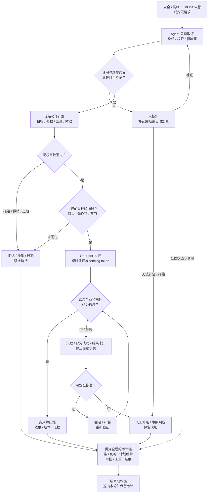

# 安全、网络与 FinOps

> 这三类 Agent 的共同点：**动作的风险高于“回答问题”**。安全 Agent 能隔离主机、封禁账号；网络 Agent 能改路由、PFC、ACL；FinOps Agent 能改资源规格、删闲置资源。默认只读、双人审批、可回滚是底线。
>
> 最后核实：**2026-11-25**；复核截止：**2027-02-22**。具体版本、自治能力与商业条款未取得证据时统一记为“未核实”。

::: diagram 图 40 · 安全动作审批与审计链 | synthetic/方法示意；证据不足不自动处置，拒绝/撤销/执行失败均进入审计，恢复不安全即升级，动作链结束须撤权留痕；本图不构成厂商能力证明。

:::

## 安全运营（SecOps）

| 厂商 | 产品 | 形态 | 关键能力（claim） | source_id |
| --- | --- | --- | --- | --- |
| **Microsoft** | Security Copilot（SEC-01） | 安全 Agent 平台 | 官方 FAQ 支持安全问答、数据与合规、租户地域和 EU 数据边界；具体合同与跨境配置需另核 | SRC-MS-SECCOPILOT-COMPLIANCE-001 |
| **Google** | Security Operations (Gemini)（SEC-02） | 平台 AI + Agent | 能力与状态未核实 | 未核实 |
| **Palo Alto Networks** | Cortex / AgentiX（SEC-03） | SecOps 平台 | 官方页面确认 Cortex 平台与 Cortex AgentiX 入口；原具体版本与 Agent 发现/行为治理能力未核实，已删除确定性表述 | SRC-PAN-CORTEX-001 |
| **CrowdStrike** | Charlotte AI / AgentWorks（SEC-04） | 安全 Agent 平台 | 官方页面描述跨 endpoint/identity/cloud/network 并行调查、共享上下文、prebuilt agents、无代码 AgentWorks、Agentic SOAR 与 MCP；默认不执行改变环境的动作，影响环境的动作需显式配置与授权审批 | SRC-CS-CHARLOTTE-001 |
| **SentinelOne** | Purple AI（SEC-05） | 安全 Agent | 能力与状态未核实；候选 URL 返回 429 | 未核实 |
| **Splunk (Cisco)** | Splunk Security AI（SEC-06） | 平台 AI | 能力与状态未核实 | 未核实 |
| **IBM** | QRadar（SEC-07） | 安全运营 | 官方页面描述 QRadar SIEM/SOAR/EDR、AI-driven analytics、威胁情报、SOAR 响应自动化、行为分析与跨云/终端/身份/网络关联 | SRC-IBM-QRADAR-001 |
| **DropZone AI** | AI SOC Analyst（SEC-08） | 独立 Agent | 官方产品页支持告警调查、Analyst 在售、Hunter Beta 与 EU 专属租户；客户效果为厂商自述 | SRC-DROPZONE-AISOC-001；SRC-DROPZONE-EU-001 |
| **Culminate / Datadog** | Bits Security Analyst（SEC-09） | 独立/平台 Agent | Datadog 官方发布说明支持 Bits Security Analyst GA 与 Cloud SIEM 自主调查；Culminate 独立产品状态未核实 | SRC-DD-BITS-SECURITY-001 |

安全 Agent 的额外要求：**行动控制**（隔离/封禁/改策略必须审批）、**身份与委托**（Agent 自己的身份、权限、凭证）、**审计**（谁批准、做了什么、影响面）、**对抗**（提示注入、工具投毒、记忆投毒）。

## 网络运维

| 厂商 | 产品 | 形态 | 关键能力（claim） | source_id |
| --- | --- | --- | --- | --- |
| **Cisco** | AI Canvas / Cloud Control / Cisco IQ（NET-01） | 网络 AI 工作空间 + Agent | 能力与状态未核实；候选 AI Canvas URL 404 | 未核实 |
| **Juniper (HPE)** | Marvis / Mist AI（NET-02） | 网络 AI 助手 + Agent | 能力与状态未核实；候选 URL 404 | 未核实 |
| **HPE Aruba** | Aruba Central + Mist AI（NET-03） | 网络 AI 平台 | 能力与状态未核实 | 未核实 |
| **Arista** | CloudVision（NET-04） | 网络管理平台 | 能力与状态未核实 | 未核实 |
| **Nokia** | AIOps/网络保障（NET-05） | 网络 AIOps | 能力与状态未核实 | 未核实 |
| **华为** | iMaster NCE（NET-06） | 网络管控 | 能力与状态未核实 | 未核实 |
| **中兴 / H3C** | 网络 AIOps/管控（NET-07） | 网络 AIOps | 能力与状态未核实 | 未核实 |

网络 Agent 的关键不是“会聊天”，而是**拓扑、遥测、变更安全**：它必须知道改一条 PFC/ACL/路由会影响谁，并且能预演、回滚、双人审批。

## FinOps / 成本优化

| 厂商 | 产品 | 形态 | 关键能力（claim） | source_id |
| --- | --- | --- | --- | --- |
| **IBM Apptio** | Cloudability（FIN-01） | FinOps 平台 | 官方页面描述云/AI/SaaS 成本视图、成本归属、预算/预测、异常告警、rightsizing、K8s 成本分配与 AI 用量拆分；不把“30%+”典型客户结果当保证 | SRC-IBM-CLOUDABILITY-001 |
| **Broadcom** | CloudHealth（FIN-02） | FinOps 平台 | 能力与状态未核实 | 未核实 |
| **Harness** | Cloud Cost Management（FIN-03） | FinOps 平台 | 官方产品页支持云/AI 成本归因、优化与治理；企业模块价格与退出未核实 | SRC-HARNESS-CCM-001 |
| **IBM Apptio** | Kubecost（FIN-04） | K8s FinOps | 官方产品页支持实时 K8s 成本、Free/Enterprise 与自托管；具体许可与导出未核实 | SRC-APPTIO-KUBECOST-001 |
| **Vantage** | 多云 FinOps（FIN-06） | FinOps 平台 | 官方定价页支持固定费率套餐与 CSV/API/Snowflake/Databricks 连接 | SRC-VANTAGE-PRICING-001 |
| **CloudZero** | 多云 FinOps（FIN-07） | FinOps 平台 | 官方定价与 API 文档支持商业订阅、小时成本和成本接口；完整退出未核实 | SRC-CLOUDZERO-PRICING-001；SRC-CLOUDZERO-API-001 |
| **Finout** | 多云 FinOps（FIN-08） | FinOps 平台 | 官方定价页支持固定年费、MegaBill 归因和 K8s 加购 | SRC-FINOUT-PRICING-001 |
| **Flexera** | Cloud Cost Optimization（FIN-09） | FinOps 平台 | 官方产品页支持成本分配、预算、治理与策略动作；商业细节未核实 | SRC-FLEXERA-CCO-001 |

FinOps Agent 的典型任务是成本异常归因、闲置资源识别、规格建议、预算预警、变更前成本预估。**删除/降配必须审批**，并区分“建议节省”和“实际节省”。

## 商业字段证据卡

| claim_id / 产品 | 状态 | 区域 | 许可/计费单位 | 最低消费 / 超额 | 数据驻留 | 导出 / 退出 |
| --- | --- | --- | --- | --- | --- | --- |
| SEC-03 Palo Alto Cortex / AgentiX | 未核实 | 未核实 | 未核实 | 未核实 | 未核实 | 未核实 |
| SEC-04 CrowdStrike Charlotte AI | 未核实 | 未核实 | 符合条件客户可在 Falcon console 使用，每月 50 AI credits 并续期 | 其他价格、最低消费与超额未核实 | 未核实 | 未核实 |
| SEC-07 IBM QRadar | 未核实 | 未核实 | 未核实 | 未核实 | 未核实 | 未核实 |
| FIN-01 IBM Cloudability | 未核实 | 未核实 | 页面列 Essentials/Standard/Premium；具体许可单位未核实 | 未核实 | 未核实 | 未核实 |
| SEC-01 Microsoft Security Copilot | 官方 FAQ；商业云在售 | 美政府云不支持；tenant Geo | SCU / E5-E7 分阶段 | 最低消费与超额未核实 | EU 租户且不共享时静态数据在 EU | 删除需支持入口；完整导出未核实 |
| SEC-08 DropZone AI | Analyst 在售；Hunter Beta | EU 可申请 | 企业/MSSP/联邦询价 | 未核实 | 官方支持 EU 专属租户 | 证据报告；保留至合同结束 |
| SEC-09 Datadog Bits Security Analyst | 官方发布说明 GA | 未核实 | Cloud SIEM；价格未核实 | 未核实 | 官方称第三方 AI 零留存/零训练 | API Preview；完整退出未核实 |
| FIN-03 Harness CCM | 官方产品页；整体 GA 未核实 | 未核实 | Enterprise 模块询价 | 未核实 | 未核实 | REST API/FOCUS；完整退出未核实 |
| FIN-04 Kubecost | IBM 产品页；整体 GA 未核实 | 自托管集群 | Free + Enterprise | 未核实 | 集群内 | JSON/CSV/PDF；完整退出未核实 |
| FIN-06 Vantage | 官方定价页 | 未核实 | Free / $30月 / $200月 / Custom | 未核实 | 未核实 | CSV/API/Snowflake/Databricks |
| FIN-07 CloudZero | 官方定价页 | 未核实 | 商业订阅；询价 | 未核实 | 未核实 | 成本 API 60 次/日；完整退出未核实 |
| FIN-08 Finout | 官方定价页 | 未核实 | 固定年费；K8s 加购 | 未核实 | 未核实 | API V2；完整退出未核实 |
| FIN-09 Flexera | 官方产品页；整体 GA 未核实 | 未核实 | 未核实 | 未核实 | 未核实 | 未核实 |
| SEC-02、SEC-05–06、NET-01–07、FIN-02 | 未核实 | 未核实 | 未核实 | 未核实 | 未核实 | 未核实 |

## 选型提示

- 安全/网络 Agent 优先看**动作控制**与**身份/委托**，而不是回答质量。
- 网络 Agent 必须接拓扑与遥测；没有拓扑的“网络 AI”只能做日志摘要。
- FinOps Agent 必须接账单、标签、资源与变更；否则只能做报表。
- 三类都要有**人审、回滚、审计**；默认只读，逐步升级到受控执行。
- 页面中的 benchmark、客户案例与厂商效果指标不能替代独立 POC。

## 来源与核实

最后核实：**2026-11-25**；复核截止：**2027-02-22**。未取得可靠官方正文的产品不保留确定性能力。完整清单见[来源注册表](../appendix/source-registry)与[参考资料](../appendix/references)。

下一篇：[内嵌 Agent 助手](./embedded-assistants)
