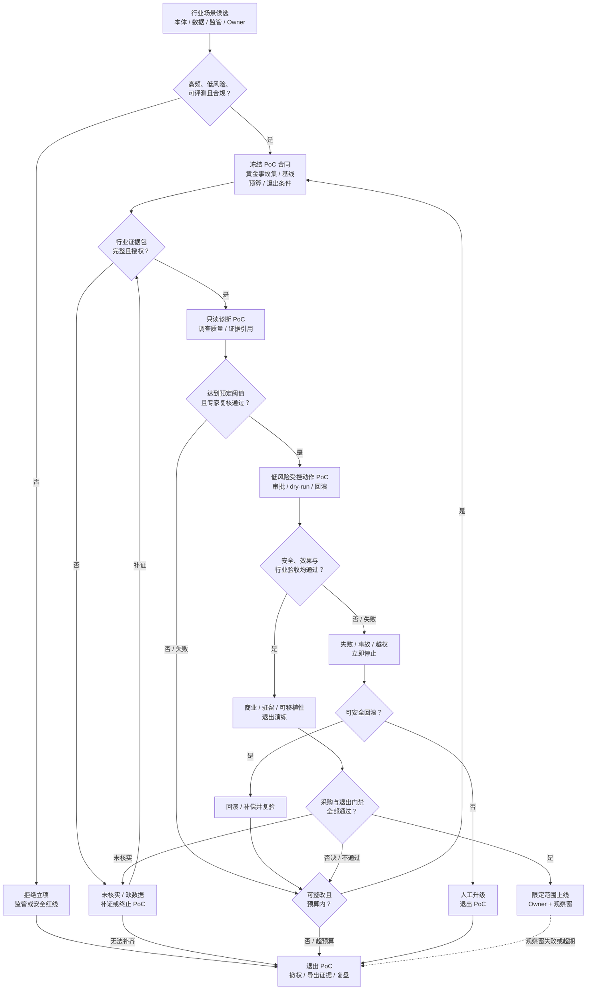

# 垂直行业运维 Agent

> 垂直行业的运维 Agent，不是“把 K8s Agent 换个名字”。它需要行业本体（ontology）、行业数据、行业流程和行业监管约束。
>
> 最后核实：**2026-11-24**；复核截止：**2027-02-22**。本页任务是场景设计建议；“代表厂商/产品”仅是导航，**不是逐产品能力证明**。

::: diagram 图 42 · 垂直行业 PoC 与退出门禁 | synthetic/方法示意；行业本体、证据包、监管红线和专家复核先于行动 PoC，未核实不补分，失败先安全收尾，再按预算与退出门禁决定重试或退出；本图不构成行业或厂商能力证明。

:::

## 场景矩阵

| 行业 | 典型运维 Agent 任务（设计建议） | 代表厂商/产品（仅导航） | 所需数据（设计建议） | 护栏 | 线索来源 |
| --- | --- | --- | --- | --- | --- |
| **电信 NOC** | 告警关联、故障定界、网络优化、闭环处置、客服/工单协同 | 华为 MindOps/AEI/iMaster NCE、Nokia、Cisco、Juniper、Amdocs、Netcracker、Blue Planet、亚信科技、浩鲸科技、中兴 | NMS/OSS、拓扑、告警、KPI、工单、变更 | 维护窗口、业务影响评估、双人审批、回滚 | PUB-HUAWEI-MINDOPS-001（公开报道） |
| **金融运维** | AIOps、事件响应、变更风险、容量、合规审计、灾备演练 | ServiceNow、Datadog、Dynatrace、平安/蚂蚁内部实践、嘉为蓝鲸、云智慧、擎创 | APM、日志、交易链路、审计、CMDB | 数据不出域、审计、双人审批、灾备切换演练 | 无逐行业官方证据 |
| **制造 / OT** | 预测性维护、质量异常、设备健康、OT 安全、能耗优化 | Siemens Industrial Copilot、Rockwell、Schneider、ABB、GE Vernova、PTC | PLC/SCADA、historian、传感器、MES、工单 | 不直接控制安全仪表系统；OT 分区隔离；人工确认 | 无逐产品官方证据 |
| **能源 / 电网** | 电网运行、故障预测、调度辅助、设备巡检、能耗 | 国家电网、Schneider、Siemens、华为 | SCADA/EMS、传感器、气象、拓扑 | 安全规程、调度授权、人工闭环 | 无逐行业官方证据 |
| **零售 / 电商** | 大促保障、站点可靠性、订单/支付运维、容量、客服 | 阿里云、京东云、AWS、Datadog、Dynatrace | APM、日志、业务指标、订单/支付链路 | 变更冻结、灰度、回滚、业务校验 | 无逐行业官方证据 |
| **物流** | 仓储/分拣设备运维、车队调度、路由、异常件 | Amazon Robotics、京东物流、菜鸟 | WMS/TMS、IoT、路由、设备状态 | 安全优先、人工兜底、SLA | 无逐行业官方证据 |
| **医疗** | 医院 IT 运维、HIS/EMR 可用性、影像/科研平台运维 | Microsoft、Google、阿里云、华为云 | 基础设施、HIS/EMR、日志、合规 | 患者安全、隐私、人工复核 | 无逐行业官方证据 |
| **政务** | 政务云运维、等保合规、应急保障、工单 | 阿里云、华为云、腾讯云、中国电子云 | 云监控、工单、审计、合规 | 数据驻留、等保、审计、分级授权 | 无逐行业官方证据 |

公开报道导航：华为 MindOps（VERT-01）见 PUB-HUAWEI-MINDOPS-001；腾讯 CloudQ/AI 可观测（VERT-02）见 PUB-TENCENT-CLOUDQ-001；百度产业智能体/Agent Infra（VERT-03）见 PUB-BAIDU-INDUSTRY-001；运维智能体行业路径（VERT-04）见 PUB-OPS-WHITEPAPER-001。它们只支持“报道存在”，不支持本表任一厂商的生产能力、客户规模或行业合规结论。

## 三个共同规律

1. **行业本体比通用知识重要**：电信的“电路/小区/切片”、制造的“产线/设备/工艺”、金融的“交易/账务/清算”，都需要专门的本体与指标。
2. **行业数据往往不在一个系统里**：NMS/OSS、SCADA、HIS、WMS、CMDB、工单、变更、知识库；Agent 的价值在跨系统取证。
3. **行业监管决定行动边界**：金融数据不出域、医疗隐私、政务等保、OT 安全仪表系统不可直接控制；Agent 必须默认只读、人工确认、可审计。

## 设计建议

- 先做一个**行业证据包**：拓扑、指标、日志、事件、变更、工单、SOP、事故库。
- 先做**只读诊断**：告警关联、根因候选、影响面、处置建议。
- 再做**受控执行**：只对低风险、可回滚的动作开放审批执行。
- 建立**行业评测集**：真实事故、边界、对抗、安全；不要用通用 Benchmark 代替。
- 把**行业专家**放进评测与复盘闭环；垂直 Agent 的护城河是行业知识，不是模型。

## 一个垂直 Agent 的最小清单

- [ ] 行业本体与指标字典
- [ ] 3–5 个高频、低风险、可评测的起点场景
- [ ] 跨系统证据包（拓扑/指标/日志/工单/变更/SOP）
- [ ] 行业权限矩阵与审批人
- [ ] 真实事故评测集与人工复核
- [ ] 监管/安全边界与审计
- [ ] 行业专家 owner

## 商业字段回查

行业场景本身没有统一许可单位；必须回到具体产品证据卡，不能把一个产品的价格、区域或驻留承诺推广到整个行业。

| 场景导航 | 商业字段状态 | 回查位置 |
| --- | --- | --- |
| 华为 MindOps / AEI | 状态、区域、许可单位、最低消费/超额、数据驻留、导出/退出均未核实 | [中国云厂商证据卡](./china-cloud#商业字段证据卡) |
| 腾讯 CloudQ / AI 可观测 | 同上，均未核实 | [中国云厂商证据卡](./china-cloud#商业字段证据卡) |
| 百度产业智能体 / Agent Infra | 同上，均未核实 | [中国云厂商证据卡](./china-cloud#商业字段证据卡) |
| Datadog / Grafana / Elastic | 逐产品回查，不跨产品套用 | [可观测与 AIOps 证据卡](./observability-aiops#商业字段证据卡) |
| AWS / Microsoft / Salesforce | 逐产品回查，不跨产品套用 | [全球云厂商证据卡](./global-cloud#商业字段证据卡) |
| 其余导航厂商 | 六项商业字段均未核实 | 对应厂商页；无证据时保持“未核实” |

## 来源与核实

最后核实：**2026-11-24**；复核截止：**2027-02-22**。行业任务与护栏为本书设计建议；公开报道与官方事实分开登记。完整清单见[来源注册表](../appendix/source-registry)与[参考资料](../appendix/references)。

下一篇：[厂商评估方法](./methodology)
